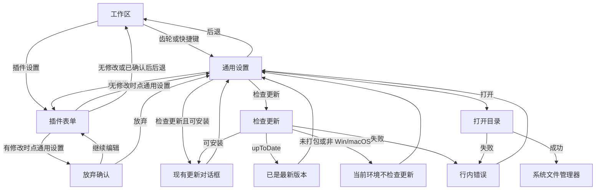
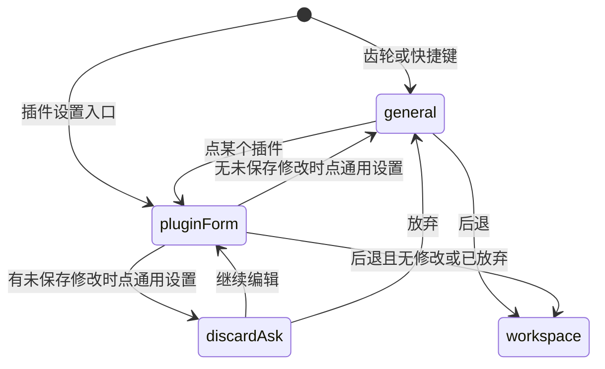
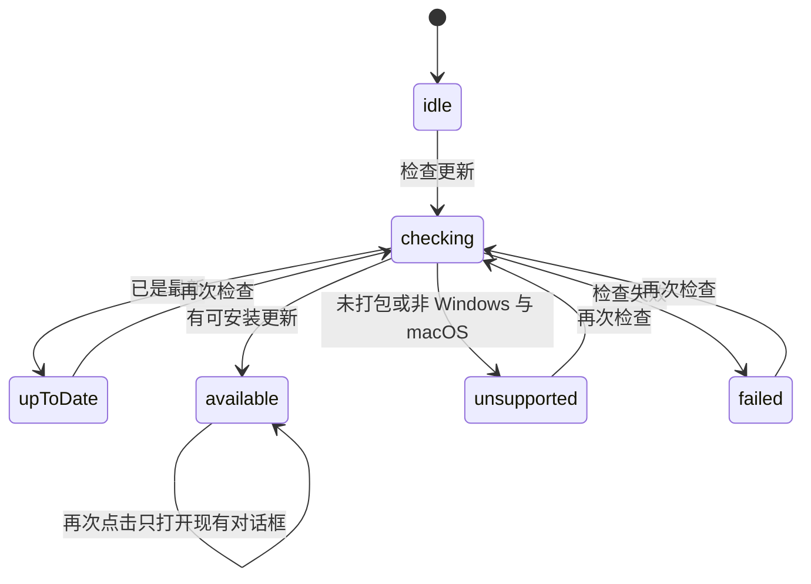

# PRD: 系统设置里的个人设置与通用设置

**登录与设置「账号」页**见 [`prd-00012-host-gateway-session.md`](prd-00012-host-gateway-session.md)。00012 废止本文「登录账号不做」及「个人设置下不增加第二项」；本文仍只管「通用设置 / 关于 / 本机数据」。

| 属性 | 值 |
|---|---|
| 状态 | backlog |
| 范围 | 现有设置页左栏增加「个人设置」分区，以及「通用设置」右栏 |
| 关联文档 | `docs/DESIGN.md`、`docs/renderer-layout.md`、`specs/prds/prd-00001-plugin-settings.md`、`specs/prds/prd-00002-workbench-chrome.md` |
| 关联实现 | `src/renderer/settings.js`、`src/renderer/index.html`、`src/renderer/updater.js`、`src/preload/host.cjs`、`src/main/index.ts`、`src/main/updater.ts` |

## 背景与问题

齿轮和 `⌘,` / `Ctrl+,` 打开的设置页，左栏只有「插件」，右栏是该插件的 `configSchema` 表单。产品名称写在侧栏字标里，版本只在更新流程里出现，本机账户名只在齿轮弹出层里。使用者要核对「这是哪一版、当前是哪台机器上的谁、配置落在哪个目录」时，没有一个固定的页。

本篇在同一张设置分栏上补这个页。`specs/prds/prd-00002-workbench-chrome.md` 写过参考图里的「通用」当时不做；那是不把整套外观、语音、权限搬进来。现在只加「个人设置」下的「通用设置」，分栏骨架和插件配置保持原样。

## 目标与非目标

### 目标

- 设置左栏在「插件」之上增加分区标题「个人设置」，其下只有一项「通用设置」。
- 从齿轮或快捷键进入、且没有指定插件时，选中「通用设置」。
- 从插件悬停卡片的「插件设置」进入时，仍打开那个插件；「通用设置」仍在左栏上方。
- 右栏用现有设置分组：组名在圆角框外，框内左标题、右控件。
- 「关于」展示产品名称、版本、本机用户。「本机数据」展示用户数据目录和已安装插件目录，并可打开。
- 「检查更新」复用现有更新检查、对话框和齿轮蓝点。

### 非目标

- 外观、语言、登录账号、开机启动、关闭确认、权限开关。
- 在「个人设置」下增加第二项。
- 把插件配置移出设置页，或修改 `configSchema`、`plugin-settings.json`、`pluginEnv()`。
- 可编辑的产品名或用户名，以及另一套下载、安装实现。
- 改 `#split-layout` 的度量、`--split-nav-width`，或设置页与插件页分开记的宽度钥匙。
- 让「打开」接受任意路径，或在查看设置时创建尚不存在的目录。

### 成功标准

- 无指定插件地进入设置时，左栏「通用设置」为选中，右栏是「关于」和「本机数据」，没有「保存」。
- 指定插件进入时，右栏仍是该插件表单；左栏上方仍有「个人设置 / 通用设置」。
- 版本行的文字等于 `app.getVersion()`。用户名等于 `os.userInfo().username`；读不到时为「本地用户」。
- 两条路径分别等于 `app.getPath('userData')` 与其下的 `installed_plugins`。打开只作用于这两个已解析路径。
- 打包的 Windows / macOS 上，检查到已是最新时版本行显示「已是最新版本」；检查到可安装更新时打开现有更新对话框。未打包或其它系统显示「当前环境不检查更新」。
- 插件列表为空时，「通用设置」仍在，右栏仍是这两组。

## 术语

| 术语 | 含义 |
|---|---|
| 个人设置 | 左栏分区标题，位于「插件」之上。本期只有一个导航项 |
| 通用设置 | 该分区下的导航项。选中后右栏标题同名 |
| 本机用户 | 操作系统账户名。齿轮弹出层已在用。读不到时显示「本地用户」 |
| 用户数据目录 | `app.getPath('userData')` |
| 已安装插件目录 | 用户数据目录下的 `installed_plugins` |
| 检查更新 | 触发现有 `retryUpdateCheck`（主进程 `updater:retry` → `runCheck`），或在已可安装时打开现有对话框 |

## 已拍板规则

| 项 | 决定 |
|---|---|
| 表面 | 仍是现在的设置页。齿轮、「设置」菜单项、`⌘,` / `Ctrl+,` 的入口不变 |
| 左栏顺序 | 先「个人设置」和「通用设置」，再「插件」和插件列表 |
| 图标 | 「通用设置」用 Lucide `sliders-horizontal`，尺寸与设置左栏现有行一致 |
| 默认选中 | `enterSettings` 没有插件 id 时选中「通用设置」。有插件 id 时选中该插件 |
| 右栏标题 | 选中「通用设置」时，主区标题为「通用设置」 |
| 版式 | 沿用 `.settings-group`：组名在框外，框内 `.settings-row`。不新增分栏 |
| 关于 | 产品名称固定为 `Dex Buddy`，与侧栏字标相同，只读。版本为 `app.getVersion()` 原文，只读。当前用户只读，说明写「本机操作系统账户」 |
| 本机数据 | 两行都显示绝对路径，过长换行，不用省略号截断。右侧按钮文案为「打开」 |
| 打开 | 渲染进程只提交 `userData` 或 `installedPlugins`。主进程自己解析路径再 `shell.openPath`。其它值拒绝。目录不存在时不创建，行内说明打不开 |
| 打开失败 | 行内显示失败原因，不新做对话框 |
| 保存 | 「通用设置」没有草稿，不显示「保存」。它自身不会变脏 |
| 放弃确认 | 插件表单有未保存修改时，点「通用设置」、点另一个插件，或离开设置页，仍用现有放弃对话框。从「通用设置」点开插件，或在「通用设置」上离开，不询问 |
| 检查更新 | 尚无待安装更新时调用 `retryUpdateCheck`。状态已是可安装时，打开现有更新对话框，不把状态打回 idle |
| 检查结果 | `upToDate` 时版本行显示「已是最新版本」。可安装时沿用现有对话框和齿轮蓝点。检查中按钮不可用，行内为「正在检查…」。失败时行内用现有错误文案 |
| 不检查的环境 | 未打包，或不是 Windows / macOS 时，`runCheck` 直接返回。按钮仍在。宿主须给出可识别结果，行内显示「当前环境不检查更新」 |
| 搜索 | 查询同时匹配「通用设置」和五行标题：产品名称、版本、当前用户、用户数据目录、已安装插件目录。不匹配则藏起这一项。插件过滤仍按显示名和字段标题。分区下没有可见项时不画该分区标题。两项都没有匹配时，左栏为现有「没有结果」。搜索只改左栏，右栏保持当前选中 |
| 无插件 | 不再把整栏换成「没有可配置的插件」。「通用设置」仍在 |
| 与旧 PRD | `prd-00001` 的插件配置继续有效。`prd-00002` 的分栏、齿轮和历史后退继续有效。本篇只补个人设置分区 |

## 用户与角色

| 角色 | 目标 |
|---|---|
| 工作台使用者 | 在设置里看到产品名、版本和本机用户，并能检查更新、打开数据目录 |
| 插件使用者 | 插件配置仍在下方「插件」分区，入口和保存方式不变 |
| Dex Buddy 维护者 | 宿主信息与插件 `configSchema` 分开，不新增一份偏好文件 |

## 功能域

左栏在现有插件导航之上插入分区。右栏在选中「通用设置」时不走 `configSchema` 渲染，改为两组只读行。

**关于**

| 行 | 左侧 | 右侧 |
|---|---|---|
| 产品名称 | 标题「产品名称」 | 文本 `Dex Buddy` |
| 版本 | 标题「版本」 | 版本文本、「检查更新」按钮、结果短句 |
| 当前用户 | 标题「当前用户」，说明「本机操作系统账户」 | 账户名，或「本地用户」 |

**本机数据**

| 行 | 左侧 | 右侧 |
|---|---|---|
| 用户数据目录 | 标题「用户数据目录」 | 绝对路径、「打开」 |
| 已安装插件目录 | 标题「已安装插件目录」 | 绝对路径、「打开」 |

按钮用设置页现有次按钮，不用「保存」那颗主按钮。色值、圆角、分组框以 `docs/DESIGN.md` 为准。实现时把左栏新分区补进 `docs/DESIGN.md` 的设置页段落。

## 用户故事地图与版本切片

### 旅程主干

| 步骤 | 节点 | 说明 |
|---|---|---|
| 1 | Entry | 工作区。点齿轮里的「设置」，或按 `⌘,` / `Ctrl+,` |
| 2 | 通用设置 | 左栏「通用设置」选中，右栏为「关于」和「本机数据」 |
| 3 | 核对身份 | 读到产品名称、版本、本机用户 |
| 4 | 检查更新 | 点「检查更新」，得到已是最新、现有更新对话框，或当前环境不检查 |
| 5 | 打开目录 | 点某一行的「打开」，系统文件管理器打开该目录 |
| 6 | 去配插件 | 点下方某个插件；若该插件表单后来有修改，再点回「通用设置」时先确认是否放弃 |
| 7 | Exit | 标题栏后退回到进入设置前的工作区。停在「通用设置」上后退时不出现放弃对话框 |

从插件悬停卡片的「插件设置」进入时，第 2 步改为该插件表单，左栏上方仍是「个人设置 / 通用设置」。后退规则与 `prd-00002` 相同。

### 故事地图

| 阶段 | 用户目标 | 用户故事 | 验收要点 |
|---|---|---|---|
| 进入 | 打开通用设置 | 作为使用者，我想从齿轮或快捷键直接看到通用设置，以便不用先点开某个插件 | 无插件 id 时「通用设置」选中；右栏标题为「通用设置」；两组都在；没有「保存」 |
| 进入 | 仍能配插件 | 作为使用者，我想从插件卡片进入它的设置，以便原来的入口还在 | 传入该插件 id 时右栏是它的表单；左栏「通用设置」在「插件」之上 |
| 浏览 | 认出产品 | 作为使用者，我想看到产品名称，以便确认打开的是 Dex Buddy | 关于组第一行是「产品名称」，右侧为 `Dex Buddy`，不是输入框 |
| 浏览 | 认出版本 | 作为使用者，我想看到正在运行的版本，以便和发布说明对照 | 版本文字等于 `app.getVersion()`，没有另编前缀或后缀 |
| 浏览 | 认出本机用户 | 作为使用者，我想看到本机账户名，以便和齿轮菜单里的名字一致 | 与 `os.userInfo().username` 相同；空或读失败时为「本地用户」；说明标明这是本机账户 |
| 浏览 | 插件仍可搜 | 作为使用者，我想搜索仍能找到插件配置，以便通用设置不挡原来的查找 | 插件仍按显示名和字段标题过滤 |
| 浏览 | 搜到通用设置 | 作为使用者，我想用行名搜到通用设置，以便不用滚动左栏 | 「通用设置」或五行标题任一命中则左栏保留该项；都不命中则藏起该项和空的「个人设置」标题 |
| 更新 | 主动检查 | 作为使用者，我想在版本行检查更新，以便不用只等齿轮上的蓝点 | 没有待安装更新时调用 `retryUpdateCheck`；检查中按钮不可用，行内为「正在检查…」 |
| 更新 | 已是最新 | 作为使用者，我想在没有新版本时得到明确一句，以便知道检查已经完成 | 状态为 `upToDate` 时，版本行显示「已是最新版本」 |
| 更新 | 有新版本 | 作为使用者，我想沿用原来的下载和安装，以便不学习第二套更新 | 可安装时打开现有更新对话框，齿轮蓝点规则不变；已可安装时再点「检查更新」不把状态打回 idle |
| 更新 | 开发或其它系统 | 作为使用者，我想知道当前环境不会检查，以便不把没反应当成故障 | 未打包或非 Windows / macOS 时，按钮仍在，行内为「当前环境不检查更新」 |
| 更新 | 检查失败 | 作为使用者，我想看到失败原因，以便可以再试 | 行内为现有错误文案；可再次点击 |
| 目录 | 打开用户数据 | 作为使用者，我想打开用户数据目录，以便查看配置落点 | 「打开」只打开 `userData` 的解析路径 |
| 目录 | 打开插件目录 | 作为使用者，我想打开已安装插件目录，以便查看装进来的插件 | 「打开」只打开 `userData/installed_plugins` 的解析路径 |
| 目录 | 打不开 | 作为使用者，我想在目录不存在或系统拒绝时看到原因，以便知道没有新建目录 | 不创建目录；失败原因在该行内；不出现目录选择框 |
| 目录 | 不能打开别处 | 作为维护者，我想限制可打开的位置，以便设置页不能变成任意路径打开器 | 渲染进程不能提交这两个枚举以外的路径；主进程拒绝其它值 |
| 切换 | 不丢插件草稿 | 作为使用者，我想在插件配置没保存时离开前提醒我，以便不会误丢修改 | 表单变脏后点「通用设置」或离开设置页，出现现有放弃对话框 |
| 切换 | 通用设置不用确认 | 作为使用者，我想从通用设置去改插件或后退时直接走，以便只读页不拦我 | 停在「通用设置」时切换和后退都不出现放弃对话框 |
| 空状态 | 没有插件也能看 | 作为使用者，我想在还没装可配置插件时仍看到通用设置，以便核对版本和目录 | 插件目录为空时左栏仍有「个人设置 / 通用设置」，右栏仍是两组 |
| 空状态 | 搜索无结果 | 作为使用者，我想在什么都匹配不到时看到原来的空文案，以便知道是筛选结果 | 通用设置与插件都无匹配时，左栏为「没有结果」 |

### Release 0

可验收结果：

- 左栏分区顺序、默认选中、从「插件设置」进入时的选中插件。
- 「关于」「本机数据」的行、只读值、按钮和没有「保存」。
- 检查更新的四种结果：已是最新、打开现有更新对话框、当前环境不检查、行内错误。
- 两个目录的打开、失败行内说明、不创建目录、拒绝其它路径。
- 脏插件表单的放弃确认，以及通用设置自身不触发确认。
- 搜索对「通用设置」和插件列表的过滤；无插件时通用设置仍在。
- 分栏宽度、插件表单保存和 `plugin-settings.json` 与现在一致。
- 实现时回写 `docs/DESIGN.md` 的设置页段落。若把「默认选中谁」和「允许打开的目录种类」抽成纯函数，用现有 `node:test` 覆盖这两处。

没有 Release 1。

## 核心流程与状态机图

「通用设置」没有草稿。选中关系只在它和插件表单之间切换。

版本行只反映现有更新状态，不保存偏好。

`available` 打开现有更新对话框，齿轮蓝点仍由现有更新逻辑负责。`unsupported` 与 `failed` 的句子留在版本行内。

## 数据与 API 衔接

不新增配置文件，不写入 `plugin-settings.json`。

| 数据 | 来源 | 是否落盘 |
|---|---|---|
| 产品名称 | 与侧栏字标相同的 `Dex Buddy` | 否 |
| 版本 | `app.getVersion()` | 否 |
| 本机用户 | 现有 `dex:local-username`（`os.userInfo().username`） | 否 |
| 用户数据目录 | `app.getPath('userData')` | 否，只展示 |
| 已安装插件目录 | `userData/installed_plugins` | 否，只展示 |
| 更新状态 | 现有 `updater:status` / `onUpdateStatus` | 否，沿用更新模块内存 |

渲染进程已经能调用 `localUsername()`、`retryUpdateCheck()`、`onUpdateStatus()`。本篇再增加两类宿主能力：

- 一次读出通用设置要展示的版本和两个目录。用户名可继续用现有接口。
- 打开目录：参数仅为 `userData` 或 `installedPlugins`。主进程解析后再打开。不要复用 `dex:open-plugin-folder`，那个接口只允许已知插件根目录。

未打包或非 Windows / macOS 时，检查结果必须能和「尚无状态」区分开，否则页面无法显示「当前环境不检查更新」。下载、安装、蓝点和对话框的行为不改。

## 假设与待确认

| 项 | 处理 |
|---|---|
| 打开失败的具体句子 | 用 `shell.openPath` 返回的原因，显示在行内 |
| 版本行结果短句的位置 | 与版本文本、按钮同一行的右侧区域；窄时随行换行 |
| 背景检查已经是 `upToDate` | 打开通用设置时直接显示「已是最新版本」，不必先点一次 |

无未决产品分叉。

## 修订记录

| 日期 | 说明 |
|---|---|
| 2026-10-11 | 初稿。设置页增加「个人设置 / 通用设置」：只读的产品名、版本、本机用户，以及检查更新和两个数据目录的打开 |
