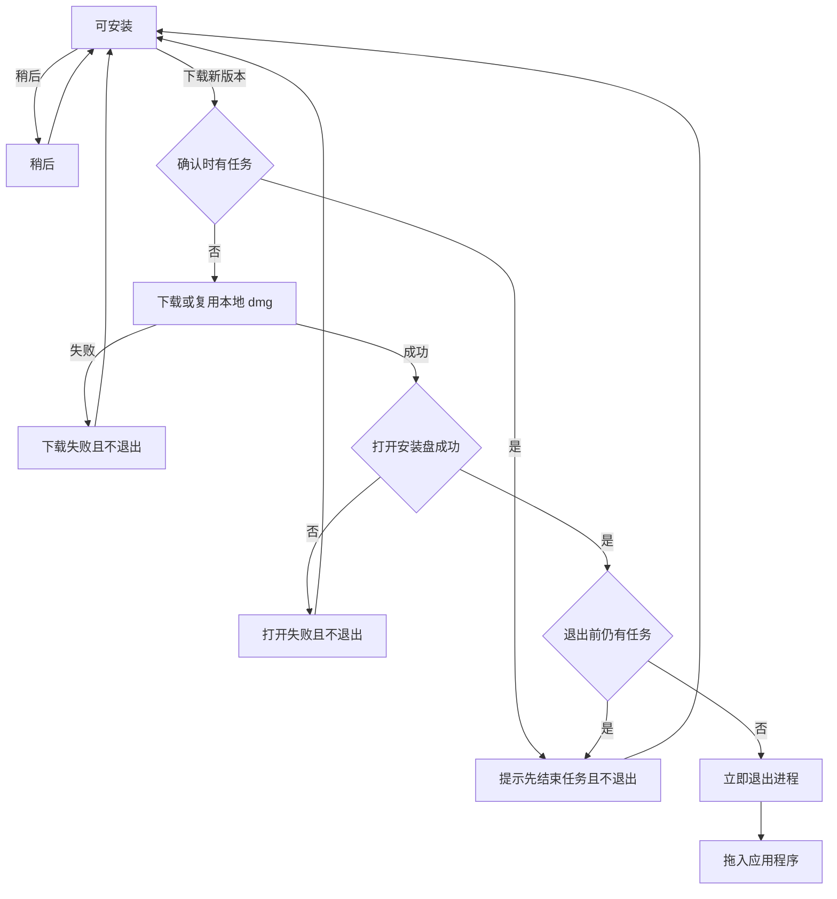
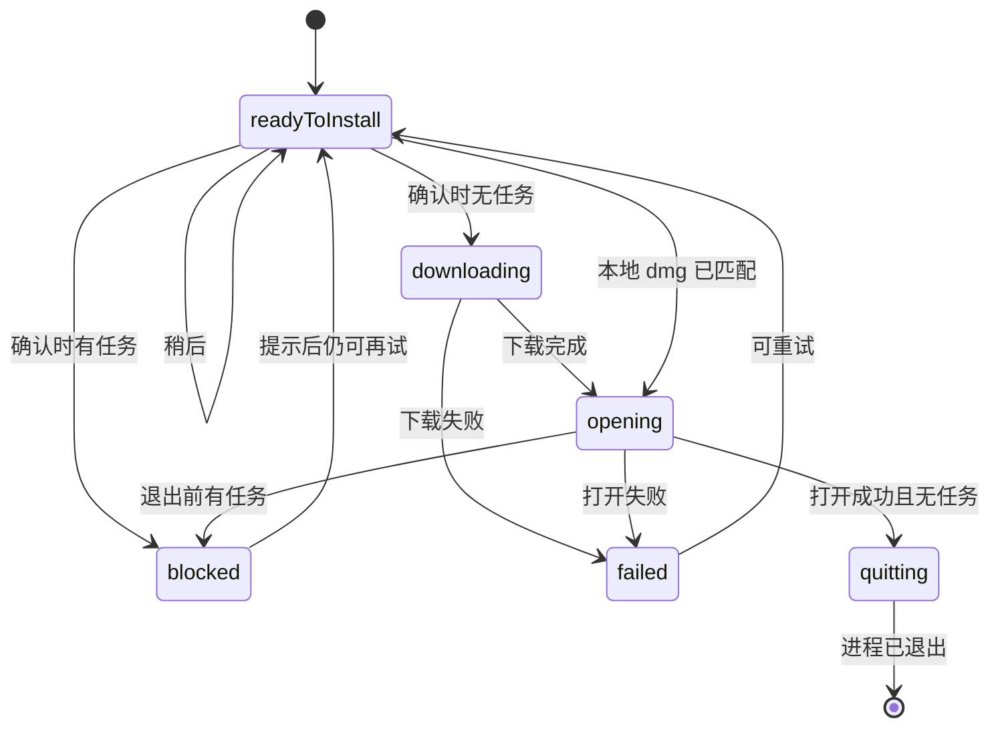

# PRD: Mac 打开 dmg 后退出应用

| 属性 | 值 |
|---|---|
| 状态 | 工程：accepted。见文末「工程验收状态」 |
| 范围 | 仅 macOS 的 dmg 手动安装：打开成功后退出进程，并在退出前尊重进行中任务 |
| 关联文档 | `docs/build-and-release.md`、`README.md` |
| 关联实现 | `src/main/updater.ts`（`installMacUpdate`、`openMacDmg`、`hasRunningTask`）、`src/main/index.ts`（`window-all-closed`）、`src/renderer/updater.js`（Mac 确认文案与 `blockedByTask`） |

## 背景与问题

macOS 未做 Apple 签名和公证，应用内更新不走 electron-updater 静默安装。检测到新版本后，主进程把 `dex-buddy-${version}.dmg` 下载到系统「下载」目录，再用 `shell.openPath` 打开。用户要把新应用拖入「应用程序」才能覆盖旧包。

打开安装盘时进程仍在运行。macOS 上关掉窗口不会退出应用：`window-all-closed` 只在非 darwin 上调用 `app.quit()`。Finder 因此提示程序开着、无法覆盖。Windows 已在安装前退出并重启，Mac 这条手动路径没有对应的退出。

## 目标与非目标

### 目标

- dmg 安装盘成功打开后，当前进程立即退出，用户可以拖入「应用程序」覆盖。
- 下载前的确认文案写明：打开后应用会退出。
- 有进行中任务时不退出，提示与 Windows 相同。点确认时查一次，打开成功后、退出前再查一次。
- 下载失败或打开失败时不退出，沿用现有错误提示。
- 「稍后」只关对话框。

### 非目标

- Apple 签名、公证，或把 Mac 改成 electron-updater 静默安装。
- 自动把 `.app` 拷进「应用程序」，或在用户拖完后自动打开新版本。
- 改变 Windows 的重启安装，或给 Linux 增加应用内更新。
- 把 `hasRunningTask()` 做成真实任务查询。该函数仍固定返回 `false`，本篇只要求退出路径调用它。
- 打开安装盘之后再显示第二句确认或倒计时。

### 成功标准

- 打包后的 macOS 上，无进行中任务时：确认下载、安装盘打开、进程退出，三者按这个顺序发生。退出后 Finder 可以覆盖「应用程序」里的旧包。
- 点确认时 `hasRunningTask()` 为真：不下载、不打开、不退出，主区域状态行为「请先结束当前任务，再安装更新」。
- 打开成功后、退出前 `hasRunningTask()` 为真：进程仍在，安装盘保持打开，同一句提示；更新状态仍为可安装。任务结束后再点，已存在且大小匹配的 dmg 不重复下载，打开后退出。
- 下载失败或 `shell.openPath` 返回非空错误时，进程仍在，现有错误文案仍出现。
- 点「稍后」后进程仍在，不出现安装盘。
- Windows 仍是「立即重启并更新」；Linux 仍不检查、不安装。

## 术语

| 术语 | 含义 |
|---|---|
| dmg 流程 | `platformFlow === 'mac-dmg'`。下载 dmg 并打开，由用户拖入「应用程序」 |
| 安装盘 | 系统打开 dmg 后 Finder 里的拖拽窗口 |
| 打开成功 | `shell.openPath` 返回空字符串。不等待 Finder 窗口绘制完成 |
| 进行中任务 | `hasRunningTask()` 为真。当前实现固定返回 `false` |
| 可安装 | 更新状态 `readyToInstall`。齿轮蓝点与更新对话框的现有条件 |

## 已拍板规则

| 项 | 决定 |
|---|---|
| 退出方式 | 打开成功且退出前无进行中任务时，立即 `app.quit()`。不调用 `BrowserWindow.close()`，也不调用 `quitAndInstall` |
| 为何必须退出进程 | darwin 上全部窗口关闭后进程仍在，`.app` 仍被占用 |
| 确认文案 | 尚未下载、也未在打开时，正文为：将下载该版本的安装包（dmg）。打开后应用会退出，请将应用拖入「应用程序」完成更新。标题仍为「下载新版本？」，确认按钮仍为「下载新版本」 |
| 打开中文案 | 短暂状态。正文说明正在打开该版本的安装包，随后应用会退出 |
| 第一次检查 | 用户点确认、尚未下载也尚未打开时调用 `hasRunningTask()`。为真则返回 `blockedByTask`，不下载、不打开、不退出 |
| 第二次检查 | `shell.openPath` 成功返回之后、`app.quit()` 之前再调用一次。为真则不退出 |
| 第二次被拦住 | 安装盘保持打开。更新状态回到 `readyToInstall`。界面走现有 `blockedByTask` 分支：关掉对话框，状态行「请先结束当前任务，再安装更新」。齿轮蓝点还在 |
| 再次安装 | 同版本 dmg 已在「下载」目录且大小匹配时，仍直接打开，不重复下载。打开成功且当时无任务则退出 |
| 失败 | 下载失败或打开失败：状态为 `error`，进程不退出，不新做对话框 |
| 稍后 | 只关对话框。不下载、不打开、不退出。状态保持可安装 |
| 任务查询 | 继续使用现有 `hasRunningTask()`。本篇不改变它的返回值 |
| Windows / Linux | 不改。Windows 仍在安装动作开始时用同一次任务查询拦住 `quitAndInstall` |

## 用户与角色

| 角色 | 目标 |
|---|---|
| macOS 使用者 | 安装盘出现后能把新版本拖进「应用程序」，不被「程序正在运行」挡住 |
| 有进行中任务的使用者 | 更新不会把尚未结束的任务直接关掉 |
| Windows 使用者 | 仍是下载完成后重启安装，本篇不改变这条路径 |
| Dex Buddy 维护者 | 退出只接在现有 dmg 打开成功之后，不另做签名或拷贝安装 |

## 功能域

改动落在现有更新对话框和 `installMacUpdate`，不新增入口。

**确认对话框（仅 Mac）**

下载前正文改为说明打开后会退出，并仍要求手动拖入「应用程序」。下载中仍只显示进度。打开中的句子说明随后会退出；打开成功且无任务时进程马上结束，这句只可能一闪。

**安装动作**

`installMacUpdate` 在两条现有路径上共用同一次退出决定：本地 dmg 已就绪而直接打开，以及下载完成后再打开。

1. 没有版本信息：现有错误，不退出。
2. `hasRunningTask()` 为真：`{ ok: false, blockedByTask: true }`，到此为止。
3. 下载或复用本地 dmg。失败则现有错误，不退出。
4. `openMacDmg`。`shell.openPath` 返回非空字符串则现有错误，不退出。
5. 再次 `hasRunningTask()`。为真则不退出，状态回到 `readyToInstall`，并带 `blockedByTask`。
6. 否则 `app.quit()`。

`openMacDmg` 自己不退出，避免「已下载直接打开」和「下载后打开」各写一遍。

界面已有 `blockedByTask` 时关闭对话框并设置状态行，Mac 复用，不新写一句提示。

实现时把 `docs/build-and-release.md` 的 macOS 小节改成：打开 dmg 后应用退出；有进行中任务时不下载或不退出。`README.md` 里「macOS 在未签名时从七牛下载 dmg 后手动安装」补上打开后退出。本篇落盘时不改这两处。

## 用户故事地图与版本切片

### 旅程主干

| 步骤 | 节点 | 说明 |
|---|---|---|
| 1 | Entry | 已安装的 macOS 生产包。齿轮上有蓝点，使用者打开更新确认 |
| 2 | 阅读 | 对话框说明将下载 dmg，打开后应用会退出，需拖入「应用程序」 |
| 3 | 确认或稍后 | 点「下载新版本」，或点「稍后」结束本轮 |
| 4 | 任务闸门 | 点确认时若有进行中任务，提示并留在应用内 |
| 5 | 取得安装包 | 无任务时下载，或直接使用已存在且大小匹配的 dmg |
| 6 | 打开安装盘 | 系统打开 dmg。打开失败则留在应用内并显示现有错误 |
| 7 | 退出闸门 | 打开成功后再查一次任务。有任务则不退出，安装盘保持打开 |
| 8 | 退出 | 无任务则进程立即结束 |
| 9 | 拖入 | 使用者把新应用拖入「应用程序」覆盖旧包 |
| 10 | Exit | 从「应用程序」打开新版本。若未覆盖就再次打开旧版本，更新仍可再走一遍 |

点「稍后」的出口在第 3 步：对话框关闭，进程仍在，蓝点还在。

### 故事地图

| 阶段 | 用户目标 | 用户故事 | 验收要点 |
|---|---|---|---|
| 确认 | 知道会退出 | 作为 macOS 使用者，我想在下载前看到应用会退出，以便安装盘出现时不会以为程序崩溃 | 可安装且未在下载时，正文含「打开后应用会退出」和拖入「应用程序」；标题与确认按钮文案不变 |
| 确认 | 先不想更新 | 作为使用者，我想点稍后留下当前应用，以便以后再更新 | 点「稍后」只关对话框；不下载、不打开、不退出；状态仍为可安装 |
| 下载 | 无任务时开始 | 作为使用者，我想在没有进行中任务时下载并打开安装盘，以便接着拖入新版本 | 确认时 `hasRunningTask()` 为假则进入下载或打开；不返回 `blockedByTask` |
| 下载 | 有任务时停住 | 作为使用者，我想在还有任务时不要开始更新，以便任务不被关掉 | 确认时 `hasRunningTask()` 为真：不下载、不打开、不退出；状态行为「请先结束当前任务，再安装更新」 |
| 下载 | 沿用本地包 | 作为使用者，我想对已经下好的同一版本直接打开，以便不用再等一次下载 | 同版本 dmg 已存在且大小匹配时不重复下载，直接打开 |
| 打开 | 打开后退出 | 作为使用者，我想在安装盘打开后应用自己退出，以便拖入时不被「程序开着」挡住 | `shell.openPath` 返回空字符串且退出前无任务时调用 `app.quit()`，不调用 `quitAndInstall`，也不只关窗口 |
| 打开 | 下载期间来了任务 | 作为使用者，我想在退出前再被拦住，以便下载过程中新开始的任务不会被退出打断 | 打开成功后、退出前 `hasRunningTask()` 为真：进程仍在；安装盘不关闭；状态回到 `readyToInstall`；状态行是同一句任务提示；蓝点还在 |
| 打开 | 任务结束后能走完 | 作为使用者，我想在结束任务后再次点更新就退出，以便不用重新下载 | 第二次被拦住之后再次确认，且当时无任务：不重复下载已匹配的 dmg，打开成功后退出 |
| 失败 | 下载失败留在应用内 | 作为使用者，我想在 dmg 没下完时继续用当前版本，以便知道失败而不是应用消失 | 下载失败时状态为 `error`，现有错误文案出现，进程仍在 |
| 失败 | 打开失败留在应用内 | 作为使用者，我想在安装盘没打开时不要退出，以便还能看到打开失败的原因 | `shell.openPath` 返回非空字符串时不退出，现有打开失败文案出现 |
| 平台 | Windows 保持原样 | 作为 Windows 使用者，我想仍是重启并安装，以便这条路径不被 Mac 的拖拽规则改掉 | Windows 确认文案、`quitAndInstall`、以及安装前那一次任务拦截与现在一致 |
| 平台 | Linux 仍不更新 | 作为 Linux 使用者，我想应用内继续不检查更新，以便不会出现 dmg 或退出 | 非 Windows 且非 macOS 时状态仍为不支持，没有下载和退出 |
| 开发 | 开发模式不触发 | 作为维护者，我想 `pnpm start` 仍不检查更新，以便本篇不改变开发启动 | 未打包时的不检查行为与 `docs/build-and-release.md` 现有约定一致 |

### Release 0

可验收结果：

- Mac 确认文案写明打开后退出，并仍要求拖入「应用程序」。
- 无任务：打开成功后立即 `app.quit()`。关窗口不算完成。
- 点确认时有任务：不下载、不打开、不退出，状态行为现有那句。
- 打开成功后仍有任务：不退出，安装盘保持，状态回到可安装，同一句提示；再次确认且无任务时复用本地 dmg 并退出。
- 下载失败、打开失败、点「稍后」都不退出。
- Windows 与 Linux 行为不变。`hasRunningTask()` 仍固定返回 `false`。
- `docs/build-and-release.md` 的 macOS 小节和 `README.md` 的更新句补上「打开后退出」。
- 把「确认时是否开始」和「打开成功后是否退出」抽成不依赖 Electron 的判断，用 `node:test` 覆盖四个结果：有任务不开始、打开失败不退出、打开成功且无任务则退出、打开成功但仍有任务则不退出。`app.quit()` 与 `shell.openPath` 用打包后的 macOS 手测。

没有 Release 1。

## 核心流程与状态机图

更新动作只在 Mac 的 dmg 流程里增加退出。失败和任务拦截都回到可安装，使用者可以再点一次。

`quitting` 没有回到应用内的边。`blocked` 与 `failed` 都留下进程。`hasRunningTask()` 在真实任务落地前一直为假，因此打包应用上的可见路径是 `readyToInstall` → 下载或直接打开 → `quitting`。

## 数据与 API 衔接

不新增配置，不改七牛上的 `latest-mac.yml` 和 dmg 文件名。

| 数据 | 来源 | 是否落盘 |
|---|---|---|
| 是否 Mac 更新 | 现有 `platformFlow: 'mac-dmg'` | 否 |
| 进行中任务 | 现有 `hasRunningTask()` | 否 |
| 安装结果 | 现有 `InstallUpdateResult`，含 `blockedByTask` | 否 |
| 本地 dmg | 现有「下载」目录与大小校验 | 是，沿用现有文件 |

渲染进程继续只调用 `installUpdate()`，不能传入下载地址。主进程在 Mac 分支内决定是否退出。

## 假设与待确认

| 项 | 处理 |
|---|---|
| `shell.openPath` 先返回、Finder 窗口稍后才出现 | 返回空字符串即退出。系统打开 dmg 后，本进程退出不会卸掉已挂载的映像 |
| 当前没有任何进行中任务 | `hasRunningTask()` 保持返回 `false`。两次检查都要写上，任务查询以后变为真时不用再改退出顺序 |
| 使用者打开安装盘后反悔、尚未拖入 | 进程已经退出。再次从旧位置打开旧版本后，更新仍为可安装，本地 dmg 可直接再打开 |

无未决产品分叉。

## 修订记录

| 日期 | 说明 |
|---|---|
| 2026-10-11 | 初稿。macOS 在 dmg 打开成功后立即退出；确认时与退出前各查一次进行中任务，有任务则不退出 |

## 1. 工程验收状态

> 由 `/team:prd-accept` 维护；勿手工编造「通过」。最后更新：2026-10-11T12:34:12Z，main 工作区（HEAD `a937f7b` 尚不含本篇实现），范围：R0,R1。

### 总览

- 工程状态：`accepted`
- 验收判定：Release 0 纳入项均通过。正文声明没有 Release 1，标为范围外。
- 最近验收：2026-10-11T12:34:12Z
- 代码提交：实现与本 PRD 仍在工作区，未提交。当前 HEAD 为 `main@a937f7b`。
- macOS 在 dmg 打开成功且无进行中任务时调用 `app.quit()`。确认时与退出前各查一次 `hasRunningTask()`。维护者确认打包后的 macOS 手测通过。
- 确认文案写明打开后退出。失败、「稍后」和有任务都不退出。Windows 仍走 `quitAndInstall`，Linux 与开发模式仍不检查。
- `pnpm test` 91 项通过。四个退出判断在 `test/mac-dmg-install.test.ts`。

### Release 交付

| Release | 状态 | 说明 |
|---|---|---|
| R0 | 通过 | 打开成功后退出、两次任务闸门、文案、文档和纯函数测试均有证据 |
| R1 | 范围外 | 正文写明没有 Release 1 |

### 功能验收清单（Agent 优先读此表）

| ID | 能力摘要 | Release | 状态 | 证据 |
|---|---|---|---|---|
| US-01 | 下载前正文含「打开后应用会退出」和拖入「应用程序」；标题与确认按钮不变 | R0 | 通过 | `src/renderer/updater.js` `fillUpdateDialog`：标题「下载新版本？」，按钮「下载新版本」 |
| US-02 | 点「稍后」只关对话框，不下载、不打开、不退出 | R0 | 通过 | `updater.js` `updateLater` 只 `updateDialog.close()` |
| US-03 | 确认时无任务才开始下载或打开 | R0 | 通过 | `installMacUpdate` 调用 `canStartMacDmgInstall(hasRunningTask())` |
| US-04 | 确认时有任务则不下载、不打开、不退出，状态行为现有那句 | R0 | 通过 | 返回 `{ ok: false, blockedByTask: true }`；`updater.js` 写「请先结束当前任务，再安装更新」 |
| US-05 | 同版本 dmg 已匹配则不重复下载，直接打开 | R0 | 通过 | `isMacDmgReady` 为真时跳过 `downloadMacDmg`，进入 `openMacDmgThenQuitIfIdle` |
| US-06 | 打开成功且无任务时 `app.quit()`，不调用 `quitAndInstall`，也不只关窗口 | R0 | 通过 | `openMacDmgThenQuitIfIdle` 仅 `app.quit()`；`quitAndInstall` 只在 `installWinUpdate`。维护者确认打包后进程退出 |
| US-07 | 打开成功后仍有任务则不退出，状态回到可安装，同一句提示，蓝点还在 | R0 | 通过 | 第二次 `shouldQuitAfterOpeningMacDmg('', hasRunningTask())` 为假时设回 `readyToInstall` 并返回 `blockedByTask`；`showUpdateDot` 只认 `readyToInstall` |
| US-08 | 被拦住后再次确认，已匹配的 dmg 不重复下载，打开成功后退出 | R0 | 通过 | 任务拦截不改本地文件；再次进入仍走 `isMacDmgReady` 后的打开与退出 |
| US-09 | 下载失败时状态为 `error`，进程不退出 | R0 | 通过 | `installMacUpdate` 下载 `catch` 设 `error` 并返回 `{ ok: false }`，不调用 `app.quit()` |
| US-10 | `shell.openPath` 返回非空时不退出，显示打开失败文案 | R0 | 通过 | `openMacDmg` 非空则 `throw`；两条路径的 `catch` 写 `errorMessage`，不退出 |
| US-11 | Windows 仍是重启安装，安装前一次任务拦截 | R0 | 通过 | `installWinUpdate` 仍先查 `hasRunningTask()`，再 `quitAndInstall(false, true)`；确认文案仍是「立即重启并更新」 |
| US-12 | Linux 不检查、不下载、不退出 | R0 | 通过 | `updatesUnsupported()` 在非 Windows 且非 macOS 时为真；`updater:install` 对其他平台返回 `{ ok: false }` |
| US-13 | 未打包时不检查更新 | R0 | 通过 | `updatesUnsupported()` 在 `!app.isPackaged` 时为真；`docs/build-and-release.md` 仍写开发模式不检查 |
| TECH-01 | 四个判断不依赖 Electron，且有 `node:test` | R0 | 通过 | `src/main/mac-dmg-install.ts`；`test/mac-dmg-install.test.ts` 四条均通过 |
| TECH-02 | `hasRunningTask()` 仍固定返回 `false` | R0 | 通过 | `src/main/updater.ts` `return false` |
| TECH-03 | README 与打包文档写明打开后退出 | R0 | 通过 | `README.md`「打开后退出，再手动安装」；`docs/build-and-release.md` macOS 小节 |
| R1-01 | 没有 Release 1 | R1 | 范围外 | 正文「没有 Release 1。」 |

### 未完成与遗留

- 无功能遗留。实现、测试、文档和本 PRD 都还在工作区，没有提交。`main@a937f7b` 不包含这些文件。
- 打包后的 `app.quit()` 与 `shell.openPath` 由维护者手测通过；自动化只覆盖纯函数判断。

### 质量检查

| 检查项 | 状态 |
|---|---|
| pnpm test | 通过，91 项 |
| 文档同步（README / docs/doc_index.md） | 通过。README 与 `docs/build-and-release.md` 已写打开后退出。`docs/doc_index.md` 原有条目仍覆盖这两篇，未新增文档 |

---

统计：通过 16 / 部分 0 / 未实现 0 / 范围外 1

