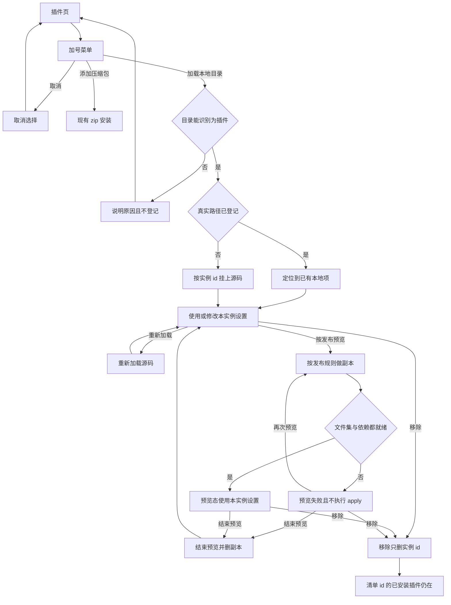
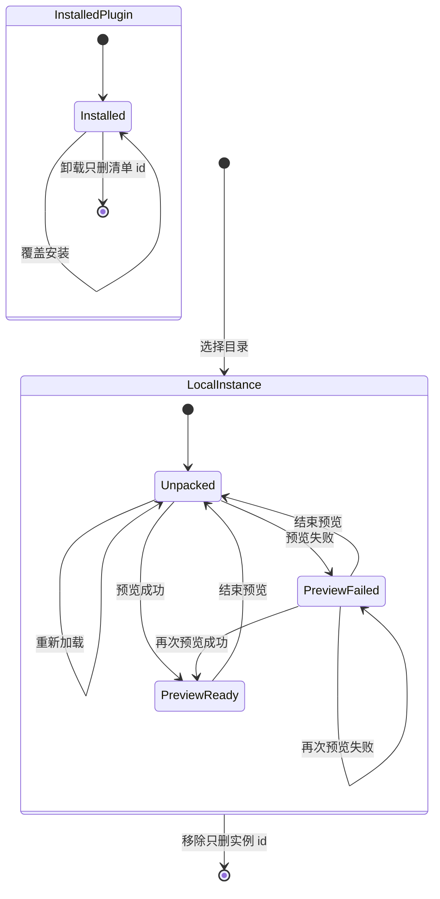

# PRD: 本地目录加载与发布预览

| 属性 | 值 |
|---|---|
| 状态 | 工程：partial。见文末「工程验收状态」 |
| 范围 | 插件页加载本地目录、实例 id 隔离、按发布预览；未打包时的 `config.dev.json` 改为同一套隔离 |
| 关联文档 | `README.md`、`docs/DESIGN.md`、`docs/plugin-development/ship.md`、`docs/plugin-development/data.md`、`docs/plugin-development/pack.md`、`docs/hub-plugin-architecture.md` |
| 关联实现 | `src/main/index.ts`（`loadAllPlugins`）、`src/main/dev-config.ts`、`src/main/registry.ts`、`src/main/plugin-settings.ts`、`src/main/plugin-runtime.ts`、`src/main/plugin-pack.ts`、`src/main/install.ts`、`src/renderer/plugins-page.js`、`src/renderer/index.html` |

## 背景与问题

插件作者要用已经装好的 Dex Buddy 开发，而不是先克隆宿主仓库。现在挂开发目录只有两条路：在仓库根把 `config.dev.example.json` 抄成 `config.dev.json`，把绝对路径写入 `extraPluginPaths`；或在宿主仓库的 `plugins/` 里做软链接。`loadAllPlugins` 只在 `!app.isPackaged` 时读这份文件。同事拿到的安装包没有它，也扫不到这些路径。

挂上之后跑的也不是发布环境。开发路径把 `ctx.dirs.data` 指到插件仓库，有 `.venv` 或 `node_modules` 就直接用，宿主不按锁文件安装依赖。发到插件中心时，zip 会丢掉 `.venv`、`node_modules`、`.env` 等，代码进 `installed_plugins/<清单 id>/`，依赖进 `plugin-runtime/<清单 id>/`，数据进 `plugin-data/<清单 id>/`。所以目录里能跑、tag 发出去不能跑。

更直接的损坏是配置共用一把钥匙。`plugin-settings.json`、注册表和卸载都用清单 `id`。`PluginSettingsStore.save` / `deletePlugin` 的键是 `manifest.id`。卸载已安装插件时 `uninstallInstalledPlugin` 调用 `deletePluginSettings(id)`。同一清单 id 的本地包和线上包只有一份配置。卸掉或覆盖这一 id 时，线上的密钥和选项一起消失。开发路径即使把数据目录指到仓库，设置页读写的仍是这份共用配置。

同名服务今天全局只能注册一次。两个副本若抢同一个服务名，后加载的服务会被拒绝。

## 目标与非目标

### 目标

- 已安装的 Dex Buddy 在插件页选择一个本地文件夹就能加载插件，路径记在用户数据目录，重启仍在。
- 本地实例使用按目录路径算出的实例 id。清单 `id` 仍是发布身份。设置、本机数据目录、运行时目录和移除范围都挂在实例 id 上。
- 移除本地实例不删除源码，也不删除同一清单 id 的已安装插件、其设置和 `plugin-data`。
- 同一清单 id 的本地实例和已安装插件可以同时留在列表里，同名服务互不覆盖。
- 对已挂上的本地目录提供「按发布预览」：文件集与插件中心相同，依赖按已安装插件的方式准备，且仍使用实例 id，不写入线上那份数据。
- 未打包版的 `extraPluginPaths` 继续能加载，并改用同一套实例 id。

### 非目标

- 保存即刷新、文件监听。
- 在应用里编辑 `dex-buddy-plugin.pack` / `ignore`，或代替推 tag。
- 手打 zip 在安装时改为读取 pack/ignore。插件中心的 zip 与手打 zip 的差别保持现状。
- 为插件引入可发布的公私钥，或允许本地加载声明自己使用线上同一个 id。
- 用固定后缀 `-developer` 做隔离。
- 插件签名、沙箱收紧。
- 废除 `plugins/` 软链接，或废除 `extraPluginPaths`。
- 改变 `forceUpdateIcon`：仍只在未打包时生效。
- 改左栏分区标题「已安装」。
- 欢迎页拖放改为接受目录。欢迎页仍只接受 zip。
- Release 2 及以后。

### 成功标准

- 打包后的 Dex Buddy 不读仓库里的 `config.dev.json`，仍能从插件页加载本地目录，重启后还在。
- 线上已安装插件的清单 id 为 `foo` 时，再加载清单 id 同为 `foo` 的本地目录：列表里两条都在；本地设置写入实例 id；保存或移除本地实例之后，`plugin-settings.json` 里 `foo` 这一段以及 `plugin-data/foo/` 的内容与操作前一致。
- 同一文件夹再次加载不产生第二个实例。换一个真实路径则是另一个实例 id，设置从空开始。
- 按发布预览不上传七牛，不要求已有 tag，不把文件写入 `installed_plugins/<清单 id>/`。pack 或依赖准备失败时插件不执行 `apply`，详情能看到失败原因。结束预览后跑的是源码目录，该实例的设置还在。
- `pnpm start` 下 `extraPluginPaths` 仍会加载，设置键是实例 id，不是清单 id。

## 术语

| 术语 | 含义 |
|---|---|
| 清单 id | `plugin.manifest.json` 的 `id`。发布、插件中心、内置示例和已安装插件继续只用它 |
| 实例 id | 宿主为本地目录生成的 id。形式是 `dev-` 加上路径 SHA256 的前 32 位十六进制，共 36 字符 |
| 本地实例 | 插件页登记的目录，或未打包时 `extraPluginPaths` 扫到的插件根。存储与移除都用实例 id |
| 加载未打包 | 直接挂源码目录。使用仓库里的 `.venv` / `node_modules`，数据目录仍是该仓库 |
| 按发布预览 | 用与插件中心相同的 pack 规则做出一份文件集再加载，依赖装进该实例自己的运行时 |
| 移除 | 取消本地实例的登记，并只删除该实例 id 下的宿主数据。不删源码，不卸载线上插件 |

## 已拍板规则

| 项 | 决定 |
|---|---|
| 谁能加载 | 打包版和 `pnpm start` 都能用插件页选择目录。不要求同事拥有 Dex Buddy 源码或 `config.dev.json` |
| 路径记在哪 | 用户数据目录的 `unpacked-plugins.json`，内容是插件根或「内含多个插件的父目录」的绝对路径。与 `config.dev.json` 分开 |
| 实例 id | `dev-` + SHA256(规范化绝对路径) 的前 32 位十六进制。字符集符合现有 id 规则（`^[a-z0-9][a-z0-9-]{0,63}$`） |
| 路径规范化 | 先取真实绝对路径，去掉末尾分隔符。Windows 上在哈希前把路径做大小写折叠，同一文件夹只算出一个 id |
| 稳定与失效 | 同一真实路径重启后 id 不变，设置还在。改名、挪目录或换盘符是新实例，R0 不迁移设置 |
| 清单 id | 作者不改。本地加载不得把清单 id 当作设置、`plugin-data`、`plugin-runtime` 或 `app-plugin://` 主机名 |
| 与线上共存 | 清单 id 相同也可以同时加载。已安装的那一份继续用清单 id |
| 与内置共存 | 清单 id 与内置示例相同仍加载为本地实例，不替换内置示例 |
| 同一路径 | 真实路径已在列表中则不新增第二条，定位到已有项 |
| 实例 id 撞车 | 算出的实例 id 与某个已加载插件的清单 id 完全相同则拒绝这次加载，不替换那一份。正常清单 id 不会是 `dev-` 加 32 位十六进制 |
| 服务 | 同名服务按实例分别注册。页面 `dex.call` 和该实例的 `getService` 只解析本实例注册的服务，以及宿主自己注册的服务，不落到另一个实例 |
| 未打包旧入口 | `extraPluginPaths` 仍只在未打包时读取，但每个插件根使用实例 id。文档不再把它写成给同事的入口 |
| 预览文件集 | 调用与插件中心相同的 pack/ignore 和宿主默认排除（`src/main/plugin-pack.ts`）。不上传，不要求 tag |
| 预览落点 | 副本和依赖都在该实例 id 下。不写入 `installed_plugins/<清单 id>/`，不读不写清单 id 的设置和 `plugin-data` |
| 预览设置 | 沿用该本地实例已有的设置 |
| 结束预览 | 回到直接挂源码。保留该实例设置。预览副本删掉。`plugin-runtime/<实例 id>/` 可以留下供下次预览，未打包加载仍用仓库里的虚拟环境 |
| 移除范围 | 删 `unpacked-plugins.json` 里的这条路径、设置里的实例 id、`plugin-runtime/<实例 id>/`、`plugin-data/<实例 id>/` 和预览副本。源码目录保留。清单 id 对应的已安装目录、设置、`plugin-data`、`plugin-runtime` 保留 |
| 来自 config.dev 的移除 | R0 不改 JSON。这类路径的菜单里不提供「移除」，避免点了下次启动又出现。要停用就从 `config.dev.json` 删掉路径后重启 |

## 用户与角色

| 角色 | 目标 |
|---|---|
| 插件作者（同事） | 在已安装的 Dex Buddy 里选中自己的插件目录就能跑，不用写宿主仓库里的配置 |
| 插件作者（上线前） | 用发布预览看到和插件中心相同的文件集与依赖安装，而不是被仓库里的 `.venv` 瞒过去 |
| 已安装该插件的作者 | 删掉或改掉本地测试实例时，线上那份密钥、选项和 `plugin-data` 还在 |
| 宿主维护者 | 未打包时仍可用 `extraPluginPaths`，但这条路径不再和线上共用设置 |

## 功能域

改动落在现有插件页和主进程插件加载，不新增窗口。视觉沿用 `docs/DESIGN.md`：来源用现有小字，不用彩色徽章；菜单沿用详情和卡片上的「…」；危险色只留给真正的「卸载」。

**插件页加号**

货架顶栏现有加号改为菜单，不再一点就打开 zip 文件框。第一项「添加压缩包」，行为与今天的 zip 选择相同。第二项「加载本地目录」，打开系统的文件夹选择框。取消选择则列表不变。欢迎页拖放不增加目录。

**加载未打包**

选中的文件夹有两种合法形态，与今天 `extraPluginPaths` 相同：根上有 `plugin.manifest.json`，或该文件夹的子目录里各自有一份清单。每个插件根单独计算实例 id。父目录只在 `unpacked-plugins.json` 里记一次。

加载后直接使用该目录里的源码和已有 `.venv` / `node_modules`。`ctx.dirs.data` 是插件仓库，`ctx.dirs.cache` 是仓库内 `cache/`。这两处都不改到线上的 `plugin-data/<清单 id>/`。声明了运行时但仓库里没有对应环境时，沿用今天开发目录的失败提示，重试不替作者创建虚拟环境。

列表主标题仍是 `displayName`。来源文案为「本地」，放在今天「内置 / 开发 / 已安装」那一格。详情「信息」里增加两行：清单 id、实例 id。设置页左栏在名称下用来源小字，本地写「本地」，已安装写「已安装」，避免两个同名插件分不清。

本地实例的「…」菜单是「重新加载」「按发布预览」「移除」。没有「卸载」。重新加载不重启应用，实例 id 不变，设置保留。移除使用普通菜单色，不用 `--danger`。

**按发布预览**

只对来源为本地的项可用。宿主按插件中心规则从该仓库产出文件集，复制到用户数据里该实例 id 的预览目录，再按已安装插件的方式准备解释器和依赖，目录是 `plugin-runtime/<实例 id>/`。失败时不执行 `apply`，详情沿用现有错误样式写出原因，例如 pack 某一行无效、结果里缺少清单或入口或依赖清单、Node 缺少 `package-lock.json`。可以再次预览，或结束预览回到源码。预览进行中菜单为「结束预览」「移除」。

**和已安装插件的关系**

覆盖安装、卸载仍只作用于来源为已安装、且 id 为清单 id 的那一份。本地实例存在时，zip 或插件中心仍可安装或升级同一个清单 id。

## 用户故事地图与版本切片

### 旅程主干

| 步骤 | 节点 | 说明 |
|---|---|---|
| 1 | Entry | 打开 Dex Buddy（安装包或 `pnpm start`），进入插件页 |
| 2 | 选择 | 加号菜单里选「加载本地目录」，或取消后留在原列表 |
| 3 | 校验 | 认出插件根。没有清单、清单不合法、或实例 id 与已加载的清单 id 撞车时停住并说明 |
| 4 | 登记 | 写入 `unpacked-plugins.json`，按实例 id 挂上源码 |
| 5 | 使用 | 打开插件或改设置。设置只写入实例 id |
| 6 | 再加载 | 改完代码后重新加载，仍是同一个实例 id |
| 7 | 预览 | 可选。按发布规则准备副本和依赖 |
| 8 | 预览出口 | 成功则在预览态使用；失败则留下原因。结束预览回到步骤 4 的源码挂载 |
| 9 | 移除 | 只撤销该实例。源码还在磁盘上 |
| 10 | Exit | 同一清单 id 的已安装插件仍在，其设置和 `plugin-data` 与移除前一致 |

点取消的出口在第 2 步。预览失败的出口在第 8 步，可以再预览或结束，不会停在没有回路的状态。已安装插件的卸载是另一条旅程，只删除清单 id，不进入本表的移除。

### 故事地图

| 阶段 | 用户目标 | 用户故事 | 验收要点 |
|---|---|---|---|
| 发现 | 不用宿主仓库 | 作为拿到安装包的插件作者，我想从插件页选一个本地目录来加载，以便不用准备 `config.dev.json` | 打包后的应用不读 `config.dev.json` 仍能完成加载；选中的路径写入用户数据目录的 `unpacked-plugins.json`；重启后仍在列表中 |
| 发现 | 两种目录都能认 | 作为作者，我想选插件根或内含多个插件的父目录，以便和现在的开发路径一样 | 根上有清单时加载这一个；子目录各自有清单时每个都加载；父路径只记一条 |
| 发现 | 选错了能停住 | 作为作者，我想在目录不合法时看到原因，以便知道为什么没出现 | 没有可用清单、清单 id 不合法、或实例 id 与已加载清单 id 相同：不写入登记，列表与设置都不变，状态或 toast 写出原因 |
| 发现 | 取消不产生副作用 | 作为作者，我想在文件夹框里取消，以便列表保持原样 | 取消后 `unpacked-plugins.json` 与插件列表都不变 |
| 隔离 | 和线上不是同一个 id | 作为已经装了正式插件的作者，我想让本地目录使用另一个 id，以便测试配置不会写进正式配置 | 本地项的存储键、`app-plugin://` 主机名、`plugin-data` 与 `plugin-runtime` 都是实例 id；实例 id 匹配 `^dev-[0-9a-f]{32}$` 且不等于清单 id；设置页保存只改实例 id 这一段 |
| 隔离 | 同一文件夹保持稳定 | 作为作者，我想反复重启还用同一份本地设置，以便不用每次重填密钥 | 同一真实路径两次计算出的实例 id 相同；重启后该实例的设置还在 |
| 隔离 | Windows 同一文件夹只有一个 id | 作为 Windows 作者，我想路径大小写不同仍算同一个目录，以便不会生出两份设置 | 仅大小写不同的同一路径得到同一个实例 id |
| 隔离 | 换目录就是新实验 | 作为作者，我想把副本挪到别的路径后从空设置开始，以便旧实验不会跟着走 | 真实路径变化后实例 id 变化；新实例的设置为空；旧实例在路径已从登记中消失之前仍可按其 id 辨认。R0 不提供迁移 |
| 隔离 | 删测试不影响正式版 | 作为作者，我想移除本地实例后正式插件完好，以便线上密钥和数据还在 | 移除后源码目录仍在；清单 id 的已安装插件仍在列表中；`plugin-settings.json` 的清单 id 段与 `plugin-data/<清单 id>/` 的内容与移除前一致 |
| 共存 | 两个都能开 | 作为作者，我想同时看到本地实例和已安装插件，以便对照，而不是本地把线上顶掉 | 清单 id 相同的两条都在列表中；来源分别为「本地」和「已安装」；打开一边不会卸载另一边 |
| 共存 | 同名服务都能用 | 作为作者，我想两边页面各自调用自己的服务，以便后加载的那一个不会因为重名而没有服务 | 两边都执行 `apply`；各自页面的 `dex.call` 打到本实例注册的方法；一边卸载或移除不拆掉另一边的服务 |
| 日常 | 改完再加载 | 作为作者，我想重新加载这个目录，以便不用退出 Dex Buddy | 重新加载不重启进程；实例 id 不变；设置保留；跑的仍是源码目录 |
| 日常 | 重复添加无第二份 | 作为作者，我想再次选择同一个目录时不要出现两条，以便列表里只有一个本地实例 | 真实路径已存在时不追加登记；列表定位到已有项 |
| 预览 | 上线前走同一套文件 | 作为作者，我想按插件中心的规则预览，以便仓库里的 `.venv` 不能掩盖缺文件 | 预览读取 `dex-buddy-plugin.pack` / `ignore` 和宿主默认排除；副本不在作者仓库里，也不在 `installed_plugins/<清单 id>/`；依赖准备进 `plugin-runtime/<实例 id>/` |
| 预览 | 失败时知道缺什么 | 作为作者，我想在预览失败时看到原因，以便补上 lock 或 pack 规则 | pack 非法、结果缺少清单或入口或依赖清单、或运行时准备失败时不执行 `apply`；详情用现有错误样式显示原因；可以再次预览或结束预览 |
| 预览 | 预览不污染线上 | 作为作者，我想预览时仍用本地设置，以便正式插件的配置和数据不被预览写入 | 预览不读不写清单 id 的设置和 `plugin-data`；沿用该实例已有设置 |
| 预览 | 结束回到源码 | 作为作者，我想结束预览后继续改仓库里的代码，以便预览只是一次检查 | 结束后 `apply` 的目录是源码；该实例设置还在；预览副本已删除；未打包加载不改用 `plugin-runtime` 里的环境 |
| 旧入口 | 维护者的配置文件仍可用 | 作为用 `pnpm start` 的维护者，我想 `extraPluginPaths` 继续生效，以便不用当天改掉本机配置 | 未打包且文件存在时这些路径仍会加载；每个插件根的设置键是实例 id；打包后仍不读这个文件 |
| 旧入口 | 文件里的路径不能被界面误删 | 作为维护者，我想界面不要假装删掉了 `config.dev.json` 里的路径，以便下次启动不会又加载回来 | 这类本地项没有「移除」。停用方式仍是编辑 JSON 后重启 |
| 文档 | 同事读得到新入口 | 作为插件作者，我想开发说明先写插件页加载，以便不会被要求去改宿主仓库 | `README.md`、`docs/plugin-development/ship.md`、`docs/plugin-development/data.md`、`docs/DESIGN.md` 把插件页「加载本地目录」写成主路径，并写明本地实例与清单 id 的设置互不影响 |

### Release 0

可验收结果：

- 插件页加号是菜单：「添加压缩包」保持现有 zip 安装；「加载本地目录」选择文件夹。欢迎页拖放仍只接受 zip。
- 合法目录写入 `unpacked-plugins.json`，重启后按实例 id 加载。取消、非法清单、实例 id 撞车都不写登记。
- 实例 id 算法含 Windows 大小写折叠，并用不依赖 Electron 的测试覆盖：同一路径稳定、不同路径不同、大小写折叠、结果匹配 `^dev-[0-9a-f]{32}$`。
- 本地与已安装可同时存在。设置、协议主机名和移除范围使用实例 id。移除本地实例后，清单 id 的设置与 `plugin-data/<清单 id>/` 与移除前一致，源码目录仍在。
- 同名服务按实例隔离，两边页面都能 `dex.call` 到自己的方法。
- 重新加载不重启应用，实例 id 与设置保持。
- 按发布预览使用 `plugin-pack` 的同一套过滤，失败不 `apply`，结束预览后回到源码并保留实例设置，且不写入清单 id 的数据。
- 未打包的 `extraPluginPaths` 改为实例 id；这些项没有「移除」。打包后不读 `config.dev.json`。
- 来源文案「本地」用现有小字。本地菜单没有「卸载」。移除不用危险色。
- 上述四篇文档改为新的主路径，并写明隔离。

### Release 1

仍属本 PRD。Release 0 不依赖这些项即可验收。

- 预览成功或失败时，列出被 pack、ignore 和宿主默认排除丢掉的相对路径，便于对照线上缺了哪个文件。
- 文件夹改名或挪位置导致新实例 id 后，作者可以选择把旧实例 id 下的设置复制到新实例。不自动搬，避免指错目录。复制不触碰清单 id 的设置。
- `config.dev.json` 扫到的路径出现在与插件页加载相同的列表里，可以重新加载和按发布预览，不能在界面里编辑 JSON，也仍然没有「移除」。

## 核心流程与状态机图

zip 安装走现有已安装插件流程，图中不再展开。移除和卸载不是同一条边：移除只结束本地实例，已安装插件留在列表里。

本地实例和已安装插件没有互相跳转的边。预览失败可以结束或再试。移除从源码挂载、预览成功和预览失败都能出去，且只删除实例 id。

## 数据与 API 衔接

不新增线上接口，不改七牛目录。插件页通过现有宿主预加载调用主进程，通道继续用 `dex:` 前缀。需要的能力是：选择并登记本地目录、重新加载、移除、开始预览、结束预览。渲染进程不传入实例 id 算法，也不传入用户数据目录。

| 数据 | 键 | 谁可以写 | 移除本地时 |
|---|---|---|---|
| `unpacked-plugins.json` | 用户数据目录里的路径列表 | 插件页加载或移除 | 去掉对应路径 |
| `plugin-settings.json` | 本地用实例 id，已安装用清单 id | 各自的设置页 | 只删实例 id 段 |
| `ctx.dirs`（未打包加载） | 数据在插件仓库，缓存在仓库 `cache/` | 插件自己的代码 | 不删仓库 |
| `plugin-data/<实例 id>/` | 预览或宿主为该实例创建的数据 | 该实例 | 删除 |
| `plugin-data/<清单 id>/` | 已安装插件 | 已安装的那一份 | 保留 |
| `plugin-runtime/<实例 id>/` | 预览依赖 | 预览流程 | 删除 |
| `plugin-runtime/<清单 id>/` | 已安装插件的依赖 | 已安装流程 | 保留 |
| 预览副本 | 用户数据目录内、路径含实例 id | 预览流程 | 删除 |
| `config.dev.json` | 仓库根，仅未打包读取 | 维护者手工编辑 | 界面不改这个文件 |

`app-plugin://` 的主机名使用当前这份插件的注册 id：已安装和内置用清单 id，本地用实例 id。设置页据此读写对应的段。

实例 id 的纯函数与「移除只碰实例 id」的判断放进 `node:test`，不依赖 Electron。打包后的文件夹选择框用手测。

## 假设与待确认

| 项 | 处理 |
|---|---|
| `plugins/` 里的软链接 | 仍按内置目录扫描，本篇不改成实例 id。软链接若与线上同清单 id，设置仍共用。要隔离时改用插件页加载或 `extraPluginPaths` |
| 手打 zip | 安装时仍不读 pack 文件。发布预览只对齐插件中心那条规则 |
| 路径变化后的旧设置 | R0 留在原来的实例 id 上，直到该路径不再被加载。R1 才提供复制到新路径 |
| 作者把清单 id 写成某个 `dev-` 哈希 | 与该次计算出的实例 id 相同则拒绝本地加载，已加载的那份插件保持不动 |

无未决产品分叉。

## 修订记录

| 日期 | 说明 |
|---|---|
| 2026-10-12 | 初稿。插件页加载本地目录；实例 id 按目录路径隔离设置与数据；按发布预览对齐插件中心的打包与运行时 |

## 1. 工程验收状态

> 由 `/team/prd-accept` 维护；勿手工编造「通过」。最后更新：2026-10-12T08:20:27Z，dev@912eb3b（实现尚未提交），范围：R0,R1。

### 总览

- 工程状态：`partial`
- 验收判定：Release 0 的本地加载、实例隔离和发布预览已有代码与测试；Release 1 三项目标都还没有实现，且正文写明仍属本篇，不能标 `accepted`
- 最近验收：2026-10-12T08:20:27Z
- 代码提交：工作区未提交。`dev` 的 HEAD `912eb3b` 不包含这些改动
- 欢迎页后来改成不再拖放 zip，只从插件页加号安装。这和本篇「欢迎页拖放仍只接受 zip」不一致，记为部分

### Release 交付

| Release | 状态 | 说明 |
|---|---|---|
| R0 | 部分 | 插件页加载、实例 id、服务隔离、发布预览、`extraPluginPaths` 和四篇文档已落地。欢迎页不再接受 zip |
| R1 | 未实现 | 丢掉的相对路径、旧实例设置复制、`config.dev.json` 路径的重新加载和预览都没有 |

### 功能验收清单（Agent 优先读此表）

| ID | 能力摘要 | Release | 状态 | 证据 |
|---|---|---|---|---|
| US-01 | 插件页选目录写入 `unpacked-plugins.json`，重启再加载；打包后不读 `config.dev.json` | R0 | 通过 | `src/main/index.ts` `loadAllPlugins` 仅在 `!app.isPackaged` 时读配置，随后 `loadRegistered`；`dex:load-unpacked-directory` 调 `addDirectory` |
| US-02 | 插件根或父目录都能认，父路径只记一条 | R0 | 通过 | `src/main/unpacked-plugins.ts` `discoverPluginRoots`、`inspectDirectory` |
| US-03 | 没有清单、清单不合法或实例 id 撞车时不登记 | R0 | 通过 | `inspectDirectory` 整次失败即返回；`test/local-mount.test.ts`「非法目录不写入登记」「清单不合法或实例 id 撞车时不写登记」 |
| US-04 | 取消文件夹选择不改列表和登记 | R0 | 通过 | `dex:load-unpacked-directory` 在 `result.canceled` 时直接返回，不调用 `addDirectory` |
| US-05 | 存储、协议主机名、数据目录和运行时用实例 id，且匹配 `^dev-[0-9a-f]{32}$` | R0 | 通过 | `src/main/instance-id.ts`；`registryIdOf`；`src/main/index.ts` `will-attach-webview` 用主机名当插件 id |
| US-06 | 同一真实路径实例 id 稳定 | R0 | 通过 | `test/instance-id.test.ts`「同一路径的实例 id 稳定」；`LocalSession.alreadyLoaded` |
| US-07 | Windows 仅大小写不同得到同一个实例 id | R0 | 通过 | `instancePathKey` 在 `win32` 折叠；`test/instance-id.test.ts` |
| US-08 | 真实路径变化是新实例；R0 不迁移设置 | R0 | 通过 | id 由路径哈希决定；本篇把迁移放在 R1 |
| US-09 | 移除不删源码，也不动清单 id 的设置和 `plugin-data` | R0 | 通过 | `LocalSession.remove` 只删实例目录和实例设置；`test/local-mount.test.ts`、`test/instance-id.test.ts` |
| US-10 | 同一清单 id 的本地实例和已安装插件可以同时在列表里 | R0 | 通过 | `test/local-mount.test.ts` 断言清单 id `foo` 有两条 |
| US-11 | 同名服务按实例隔离，页面 `dex.call` 打到本实例 | R0 | 通过 | `ServiceRegistry.callService` 按调用方实例查表；同上测试 |
| US-12 | 重新加载不重启，实例 id 不变，仍挂源码 | R0 | 通过 | `LocalSession.reload` 用原 `instanceId` 和 `layout: 'repo'` |
| US-13 | 再次选择同一路径不追加第二条 | R0 | 通过 | `LocalSession.alreadyLoaded`；`addDirectory` 返回已有 `focusedId` |
| US-14 | 预览用 pack 规则复制到实例预览目录，依赖进 `plugin-runtime/<实例 id>/` | R0 | 通过 | `copyPackedTree` 调用 `filesForPack`；`startPreview` 的 `layout: 'published'`，目标不是 `installed_plugins` |
| US-15 | 预览失败不执行 `apply`，详情用现有错误样式 | R0 | 通过 | `failPreview` / `failLocal`；`test/local-mount.test.ts` pack 行 `!`；`plugins-page.js` `.settings-error` |
| US-16 | 预览沿用实例设置，不读写清单 id | R0 | 通过 | 设置键是 `registryId`；结束预览测试保留实例设置 |
| US-17 | 结束预览回到源码并删掉预览副本 | R0 | 通过 | `LocalSession.endPreview` |
| US-18 | 未打包的 `extraPluginPaths` 用实例 id；打包后不读该文件 | R0 | 通过 | `loadAllPlugins` 以 `from: 'config'` 调用 `loadPaths`，且包在 `!app.isPackaged` 内 |
| US-19 | 来自 `config.dev.json` 的项没有「移除」 | R0 | 通过 | `localMenuItems` 在 `localFrom === 'config'` 时返回空菜单；`remove` 拒绝非 `page` |
| US-20 | 四篇文档把插件页加载写成主路径，并写明隔离 | R0 | 通过 | `README.md`、`docs/plugin-development/ship.md`、`docs/plugin-development/data.md`、`docs/DESIGN.md` |
| R0-UI | 来源写「本地」；本地菜单没有「卸载」；「移除」不用危险色 | R0 | 通过 | `SOURCE_LABEL.local`、`SETTINGS_SOURCE.local`；卸载才设 `danger: true` |
| R0-ZIP | 加号是「添加压缩包」和「加载本地目录」 | R0 | 通过 | `src/renderer/plugins-page.js` 加号菜单 |
| R0-WELCOME | 欢迎页拖放仍只接受 zip | R0 | 部分 | `src/renderer/index.html` 已去掉 `#drop-zone`，改为「打开插件市场」。压缩包只从加号进入。`docs/plugin-development/ship.md` 仍写把 zip 拖进欢迎页 |
| R1-01 | 预览列出被 pack、ignore 和宿主排除丢掉的相对路径 | R1 | 未实现 | 预览只复制 `filesForPack` 的结果，界面没有丢掉文件的列表 |
| R1-02 | 路径变化后可把旧实例设置复制到新实例，且不碰清单 id | R1 | 未实现 | 无复制入口；设置仍留在旧实例 id |
| R1-03 | `config.dev.json` 的路径可重新加载和按发布预览，仍不能移除 | R1 | 未实现 | `reload` / `startPreview` 要求 `from === 'page'`；这类项菜单为空 |

### 未完成与遗留

- Release 1 三项目标都未做：预览丢掉的相对路径、把旧实例设置复制到新路径、让 `config.dev.json` 挂上的目录重新加载和预览。
- 欢迎页不再接受 zip。这是后来的产品改动，和本篇 R0「欢迎页拖放仍只接受 zip」不一致。`docs/plugin-development/ship.md` 和 `docs/doc_index.md` 里仍有拖进欢迎页的句子。
- 实现、测试和文档都在工作区，尚未提交。打包后的文件夹选择框本篇要求手测，这次验收没有再跑安装包。

### 质量检查

| 检查项 | 状态 |
|---|---|
| pnpm test | 通过，112 项（含 `test/instance-id.test.ts`、`test/local-mount.test.ts`） |
| 文档同步（README / docs/doc_index.md） | 部分。README 已写插件页主路径和实例隔离。`docs/doc_index.md` 已登记 data/ship，但 ship 摘要仍写 zip 拖进工作台 |

---

统计：通过 22 / 部分 1 / 未实现 3 / 范围外 0
