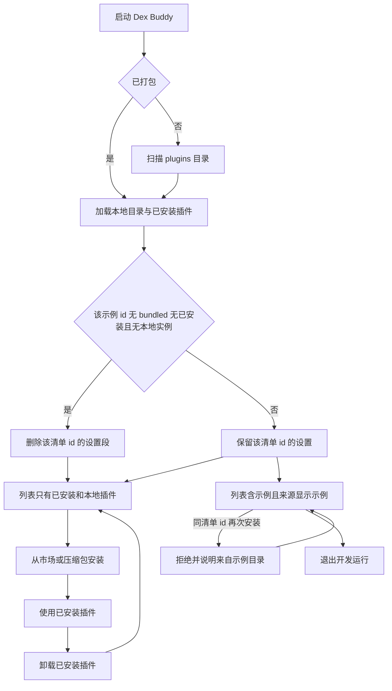
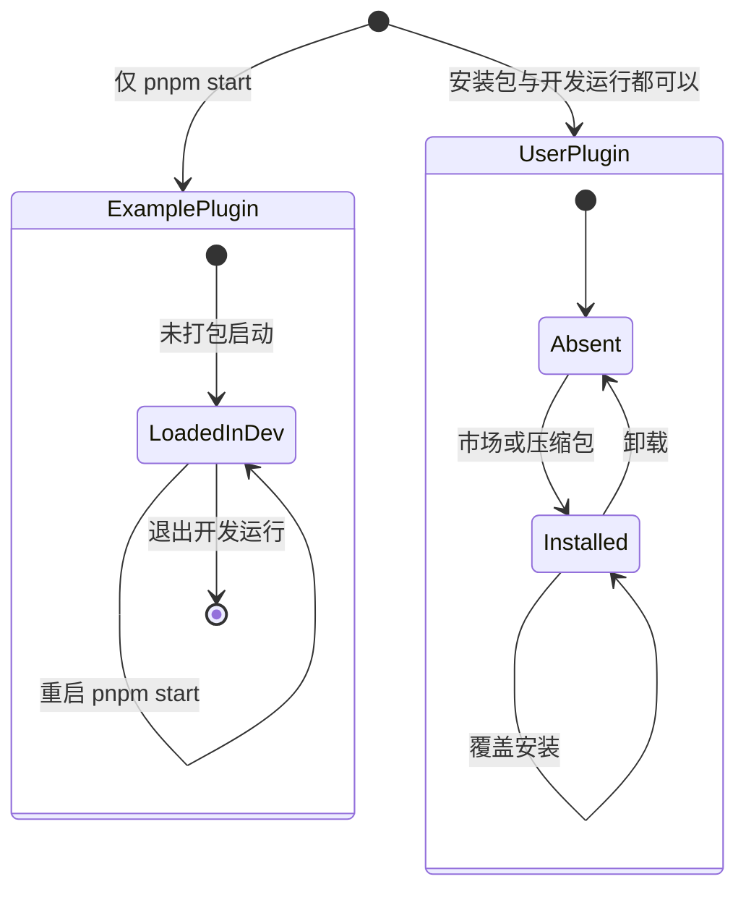

# PRD: 示例插件不进安装包

| 属性 | 值 |
|---|---|
| 状态 | 工程：accepted。见文末「工程验收状态」 |
| 范围 | 安装包文件列表、未打包时对 `plugins/` 的扫描、来源文案、升级时两份示例的设置残留 |
| 关联文档 | `README.md`、`docs/DESIGN.md`、`docs/plugin-development/ship.md`、`docs/plugin-development/settings.md`、`docs/workflows/publish-plugin.md`、`electron-builder.yml`、`specs/prds/prd-00004-plugin-market.md`、`specs/prds/prd-00007-load-unpacked-plugin.md` |
| 关联实现 | `src/main/index.ts`（`loadAllPlugins`、`bundledPluginsDir`）、`src/main/install.ts`、`src/main/plugin-settings.ts`、`src/renderer/plugins.js`、`src/renderer/plugins-page.js`、`src/renderer/settings.js` |

## 背景与问题

仓库 `plugins/` 里有两份示例：`ai-comic-master`（界面调用后返回固定路径 `/outputs/demo.mp4`）和 `quanmedia-crawl`（返回写死的粉丝数 `10000`）。它们用来演示插件契约。

`electron-builder.yml` 的 `files` 包含 `plugins/**`。`loadAllPlugins` 每次启动都扫描 `app.getAppPath()/plugins`，来源记为 `bundled`。安装包里的 Dex Buddy 因此在列表里放上这两项，界面写成「内置」或「来自内置」。内置项不能卸载，同清单 id 的压缩包和市场安装也会被拒绝。

使用者打开工作台，会把样品当成能用的插件。点进去没有成片，也没有真实爬取结果，而且拿不走。

## 目标与非目标

### 目标

- 安装包不包含 `plugins/`。打包后的进程不扫描示例目录。正式包的插件列表里没有这两项，除非使用者自己从市场或压缩包装过同名插件。
- `pnpm start`（`app.isPackaged === false`）仍扫描仓库 `plugins/`，两份示例仍会出现。
- 给人看的来源从「内置」改为「示例」。首页悬停是「来自示例」。
- 从带示例的旧安装包升级后，这两项从列表消失。已从市场或压缩包装上的插件仍在。
- 升级后，若这两个清单 id 既没有已安装实例，也没有本地实例，删掉 `plugin-settings.json` 里对应清单 id 的段，避免以后同 id 的真插件读到样品配置。
- 文档改成：示例只在未打包运行里出现。

### 非目标

- 把示例放进插件市场，或在市场里做「示例」分类。
- 一键把示例复制到本地目录。
- 新增来源枚举。内部值继续用 `bundled`。
- 改 `config.dev.json` 的 `extraPluginPaths`。规则仍以 `specs/prds/prd-00007-load-unpacked-plugin.md` 为准。
- 改插件契约、`plugin.manifest.json` 字段、七牛目录，或删除已经传上七牛的对象。
- 改写 `docs/hub-plugin-architecture.md`。那是方案原文备份。现行行为以本篇列出的文档为准。
- 扫掉 `plugin-data/` 或 `plugin-runtime/` 里所有对不上的目录。
- 允许在界面里卸载示例。要去掉示例，改仓库 `plugins/` 里的目录。

### 成功标准

- 用本篇之后的安装包打开 Dex Buddy，插件列表没有「AI 漫剧大师」和「全媒体爬虫引擎」，除非它们是使用者自己安装的。
- `pnpm start` 下列表仍有这两项。插件页、设置页来源小字是「示例」。首页悬停来源是「来自示例」。
- 这两项没有「卸载」。用同清单 id 的压缩包或市场安装会被拒绝，说明来自示例目录。
- `electron-builder.yml` 的 `files` 不含 `plugins/**`。仓库里的 `plugins/` 仍在，现有针对该目录的测试仍能读到源码。
- 仅含这两份示例配置、且没有对应已安装实例和本地实例时，启动后 `plugin-settings.json` 不再有这两个清单 id。`pnpm start` 因为仍加载示例，不删这两段。

## 术语

| 术语 | 含义 |
|---|---|
| 示例插件 | 仓库 `plugins/` 下、只在未打包运行里由宿主扫进来的插件。当前就是 `ai-comic-master` 与 `quanmedia-crawl` |
| 示例目录 | `app.getAppPath()/plugins`。未打包时指向仓库的 `plugins/` |
| 来源值 `bundled` | 注册表里的内部来源。界面不把这个英文显示给使用者 |
| 已安装插件 | 市场或压缩包写进 `installed_plugins/<清单 id>/` 的那一份，来源值 `installed` |
| 本地实例 | 插件页加载或 `extraPluginPaths` 挂上的目录，存储键是实例 id，来源值 `local` |
| 样品配置 | `plugin-settings.json` 里以这两个清单 id 为键、由旧版内置示例留下的设置 |

## 已拍板规则

| 项 | 决定 |
|---|---|
| 打包 | `electron-builder.yml` 的 `files` 去掉 `plugins/**`。不把示例打进 asar，也不打进 extraResources |
| 扫描 | 仅当 `!app.isPackaged` 时调用 `scanAndLoadPlugins(bundledPluginsDir(), 'bundled')`。打包后的进程跳过这一步 |
| 目录保留 | 仓库 `plugins/` 留下，给 `pnpm start` 和现有测试。不把示例挪到别的顶层目录 |
| 内部来源 | 继续用 `bundled`。不把枚举改名为 `example`，也不新增来源 |
| 插件页与设置页 | `bundled` 的小字由「内置」改为「示例」 |
| 首页悬停 | `bundled` 由「来自内置」改为「来自示例」。开发版、来自市场、来自压缩包不动 |
| 覆盖拒绝 | 同清单 id 已由示例加载时，压缩包和市场安装仍拒绝。提示里的「内置目录」改为「示例目录」 |
| 卸载 | 示例没有「卸载」，和市场卡片上对 `bundled` 的现有限制一致 |
| 升级列表 | 旧包里的示例来自安装包内的 `plugins/`，不在 `installed_plugins`。新包不再扫描后，列表自然不再出现它们。不另写迁移清单 |
| 设置清理 | 启动时只检查 `ai-comic-master`、`quanmedia-crawl`。某个 id 同时满足下面三条才删除该键：当前没有来源为 `bundled` 的同清单 id；`installed_plugins` 里没有这个 id；已加载的本地实例里没有这个清单 id。三条缺一就保留 |
| 开发运行 | `pnpm start` 会加载示例，因此不满足第一条，样品配置留在开发机上 |
| 本地实例的设置 | 本地实例的键是实例 id。清理只删除清单 id 那一段，不删除 `dev-` 开头的段 |
| 其它数据 | 不删除 `plugin-data/<id>/` 和 `plugin-runtime/<id>/`。示例走仓库布局，不往这两处写。曾经安装又卸载的真插件，仍走现有卸载规则 |
| 与市场的关系 | `specs/prds/prd-00004-plugin-market.md` 里「不能覆盖内置」对 `bundled` 仍然有效。打包后的进程没有示例，使用者不会走到这条拒绝。开发运行里拒绝仍然成立 |
| 与本地加载的关系 | `specs/prds/prd-00007-load-unpacked-plugin.md` 里「`plugins/` 软链接按内置扫描」只在未打包时成立。打包后的应用里没有这个目录 |
| `extraPluginPaths` | 本篇不改。未打包才读，打包后不读 |

## 用户与角色

| 角色 | 目标 |
|---|---|
| 使用者 | 打开安装包后，列表里只有自己装上的插件 |
| 插件作者 | 在 `pnpm start` 里看到示例，用来对照契约；发给同事的安装包里不出现样品 |
| 维护者 | 发版时示例不会再被打进安装包；开发机仍能跑仓库里的示例 |

## 功能域

### 打包

`files` 保留 `dist/**`、`src/renderer/**`、`src/preload/**`，去掉 `plugins/**`。安装包体积变小是结果，不是单独的验收项。

### 启动扫描

`loadAllPlugins` 的顺序保持：示例目录（仅未打包）、`extraPluginPaths`（仅未打包，现有逻辑）、已登记的本地目录、`installed_plugins`。打包后直接从本地目录和已安装目录开始。

缺少 `plugins/` 目录时，未打包运行与现在一样：扫描空目录或目录不存在都不算启动失败。打包后根本不扫，目录不存在是预期。

### 文案

三处一起改，避免同一来源出现两个中文：

| 位置 | 现在 | 改为 |
|---|---|---|
| `src/renderer/plugins-page.js` 的来源表 | 内置 | 示例 |
| `src/renderer/settings.js` 的来源表 | 内置 | 示例 |
| `src/renderer/plugins.js` 悬停 | 来自内置 | 来自示例 |
| `src/main/install.ts` 拒绝覆盖时的来源名 | 内置目录 | 示例目录 |
| `docs/DESIGN.md` | 来自内置；内置插件没有卸载 | 来自示例；示例插件没有卸载 |

不把「示例」做成彩色徽章，也不在名称前加前缀。来源仍是现有小字。

### 设置清理

清理发生在插件加载完成之后，这样才知道有没有已安装实例和本地实例。只处理上面两个清单 id。删除使用现有的按 id 删除设置，不重写整份文件的其它键。

某个 id 被自己安装的真插件占用时，该键保留，真插件继续读它。某个 id 有本地实例时，清单 id 那段也保留；本地实例自己的设置在实例 id 上，本篇不去搬、不去并。

### 文档

改这些文件里把示例说成「会随 Dex Buddy 装上的内置插件」的句子：

- `README.md`：两份示例只在 `pnpm start` 出现；安装包不带 `plugins/`。软链接仍可放进 `plugins/`，但只有未打包运行会扫到，并用清单 id。
- `docs/DESIGN.md`：来源小字和「没有卸载」的那句。
- `docs/plugin-development/ship.md`：同清单 id 被示例占用时安装会被拒绝，且只发生在未打包运行。打包后的 Dex Buddy 没有示例目录。
- `docs/plugin-development/settings.md`：示例不能从界面卸载，所以在 `pnpm start` 里改过的示例配置会留着。安装包不再加载它们；满足清理条件时，那两个清单 id 的设置会被删掉。
- `docs/workflows/publish-plugin.md`：市场不能覆盖的「内置」改称示例，并写明打包后的应用里没有这条占用。

## 用户故事地图与版本切片

### 旅程主干

使用者：

| 步骤 | 节点 | 说明 |
|---|---|---|
| 1 | Entry | 安装或升级到含本篇的 Dex Buddy，打开应用 |
| 2 | 空列表或仅自己的插件 | 列表里没有随包带上的示例。旧版留下的那两项不再出现 |
| 3 | 装真插件 | 从市场或压缩包装上一个插件 |
| 4 | 使用 | 打开该插件，设置写在它的清单 id 上 |
| 5 | Exit | 卸载只移除这份已安装插件。示例不会因为卸载被装回来 |

从旧版升级的人，第 2 步同时做设置清理：两个示例 id 若没有已安装实例和本地实例，对应设置段消失。有已安装同 id 时，该插件和它的设置都留在第 4 步。

插件作者：

| 步骤 | 节点 | 说明 |
|---|---|---|
| 1 | Entry | 在仓库里执行 `pnpm start` |
| 2 | 看到示例 | 「AI 漫剧大师」和「全媒体爬虫引擎」在列表中，来源是「示例」 |
| 3 | 对照契约 | 打开界面或调用服务，看到示例里的固定返回 |
| 4 | 改示例 | 改 `plugins/` 里的代码后按现有方式重新加载。本篇不新做重载入口 |
| 5 | Exit | 退出开发运行。示例不写入 `installed_plugins`。下次 `pnpm start` 仍从仓库扫回来 |

作者把安装包交给同事时，同事走上面的使用者旅程，看不到第 2 步的示例。

### 故事地图

| 阶段 | 用户目标 | 用户故事 | 验收要点 |
|---|---|---|---|
| 安装 | 打开就是自己的插件 | 作为使用者，我想安装包里不要带示例，以便列表里不会出现点了没有结果的插件 | 安装包的 `files` 不含 `plugins/**`；首次打开时列表没有 `ai-comic-master` 和 `quanmedia-crawl` |
| 升级 | 旧示例自己消失 | 作为从旧版升上来的使用者，我想那两个内置项离开列表，以便不用找卸载入口 | 升级后这两项不在列表中；`installed_plugins` 里其它 id 仍在，且仍能打开 |
| 升级 | 样品配置不留给以后的真插件 | 作为以后可能装上同 id 插件的使用者，我想旧示例的设置被清掉，以便新插件从声明的默认值开始 | 没有已安装实例、也没有本地实例时，`plugin-settings.json` 不再含这两个清单 id；其它 id 的设置与清理前一致 |
| 升级 | 已经装过的同名插件留下 | 作为已经自己装过同 id 插件的使用者，我想升级不要删掉我的插件和设置，以便工作还在 | 该 id 在 `installed_plugins` 中时仍加载，来源是已安装；对应设置段还在 |
| 开发 | 本机仍能看到示例 | 作为插件作者，我想 `pnpm start` 继续加载 `plugins/`，以便对照契约 | `app.isPackaged === false` 时两份示例在列表中；退出后不出现在 `installed_plugins` |
| 开发 | 一眼看出是样品 | 作为作者，我想来源写成示例，以便不会把它当成随产品发布的功能 | 插件页和设置页小字是「示例」；首页悬停是「来自示例」；没有彩色徽章，名称不加前缀 |
| 开发 | 示例不被装包盖掉 | 作为作者，我想开发运行里的示例挡住同清单 id 的安装，以便仓库里的样品和装进去的副本不会抢同一个 id | 压缩包或市场安装同 id 时失败，文案写明来自示例目录；示例仍在列表中 |
| 开发 | 界面里卸不掉示例 | 作为作者，我想示例没有卸载，以便不会以为删掉了仓库里的目录 | 详情和市场卡片都没有「卸载」。去掉示例的办法是改 `plugins/` 后重启开发运行 |
| 开发 | 打包后的同事看不到 | 作为把安装包交给同事的作者，我想对方的列表里没有我的示例，以便对方只使用市场和压缩包 | 同一仓库打出的安装包走使用者旅程的第 2 步 |
| 文档 | 说明和产品一致 | 作为读开发说明的作者，我想文档写明示例只在未打包运行出现，以便不会到安装包里找它们 | `README.md`、`docs/DESIGN.md`、`docs/plugin-development/ship.md`、`docs/plugin-development/settings.md`、`docs/workflows/publish-plugin.md` 改完后，不再把示例写成会随安装包装上的内置插件 |

### Release 0

可验收结果：

- `electron-builder.yml` 不再打包 `plugins/**`。仓库 `plugins/` 仍在。
- 打包后的进程不扫描示例目录。正式包插件列表没有这两份示例，已安装插件不受影响。
- `pnpm start` 仍扫描 `plugins/`，来源内部值仍是 `bundled`，界面为「示例」/「来自示例」。
- 同清单 id 的安装在示例已加载时被拒绝，提示为示例目录。示例没有卸载。
- 启动并完成加载后，按「已拍板规则」清理这两个清单 id 的设置段。`pnpm start` 不清理。已安装同 id 或存在本地实例时不清理该 id。
- 上表五篇文档改为同一说法。
- `node:test` 覆盖：读 `electron-builder.yml` 断言 `files` 不含 `plugins/**`；给定一组已加载插件和一份设置，两个清单 id 只在三条同时满足时被删除。打包后的空列表用安装包手测。

本篇没有 Release 1。市场里的示例分类、一键把示例复制到本地目录，写在非目标里。

## 核心流程与状态机图

打包后的进程不扫描示例，清理条件成立时删设置，人停在使用者列表。开发运行加载了示例，清理条件不成立，设置保留，人停在带示例的列表。`keepSettings` 到两条列表的边按当时有没有加载示例走，不会两条同时出现。退出开发运行不会把示例复制进 `installed_plugins`。

示例和使用者自己的插件没有互相跳转的边。打包后的进程不进入 `ExamplePlugin`。同清单 id 在开发运行里已处于 `LoadedInDev` 时，安装停在拒绝，不会变成 `Installed`。

## 数据与 API 衔接

不新增 IPC，不改七牛，不改市场目录格式。

| 数据 | 本篇之后 |
|---|---|
| 安装包内的 `plugins/` | 不再打入 |
| 仓库 `plugins/` | 保留。只有未打包进程扫描 |
| 注册来源 | 示例仍写 `bundled` |
| `installed_plugins/` | 不因本篇增删。旧示例本来就不在这里 |
| `plugin-settings.json` | 仅在清理条件成立时删除 `ai-comic-master`、`quanmedia-crawl` 两个键 |
| `plugin-data/`、`plugin-runtime/` | 不扫、不删 |
| `unpacked-plugins.json`、`config.dev.json` | 不改 |

清理判断放进不依赖 Electron 的测试：输入是这两个 id、当前已加载插件的来源和清单 id、以及 `installed_plugins` 里有没有该 id。界面文案用手测 `pnpm start`。安装包空列表用手测打出来的应用。

## 假设与待确认

| 项 | 处理 |
|---|---|
| 示例以后还会再加第三个目录 | 扫描规则按整个 `plugins/` 来，不把 id 写死在扫描里。设置清理的 id 列表就这两个。新示例若也会在旧版里写过设置，要另改清理名单 |
| 有人把真插件做成同名 id 并已安装 | 清理条件不成立，设置和插件都留下 |
| 开发机上升级自己打的包 | 安装包不扫 `plugins/`。要看示例，用 `pnpm start` |
| `docs/hub-plugin-architecture.md` 仍写内置示例会随应用出现 | 本篇不改该备份。以 README 和 `docs/plugin-development/` 为准 |

无未决产品分叉。

## 修订记录

| 日期 | 说明 |
|---|---|
| 2026-10-13 | 初稿。安装包不再包含 `plugins/`；只有未打包运行扫描示例；界面改称示例；升级时按条件清除两份示例的设置残留 |

## 1. 工程验收状态

> 由 `/team:prd-accept` 维护；勿手工编造「通过」。最后更新：2026-10-13T05:24:28Z，dev，范围：R0,R1。

### 总览

- 工程状态：`accepted`
- 验收判定：Release 0 纳入项均通过。正文声明没有 Release 1，标为范围外。
- 最近验收：2026-10-13T05:24:28Z
- 代码提交：实现与本验收章在同一提交。
- 安装包 `files` 不再包含 `plugins/**`。只有 `!app.isPackaged` 才扫描示例目录。维护者确认打包后的列表没有这两份示例，`pnpm start` 的来源文案已手测通过。
- 加载完成后按三条条件删除 `ai-comic-master`、`quanmedia-crawl` 的设置段。同清单 id 的安装拒绝文案为示例目录。示例没有卸载。
- `pnpm test` 115 项通过。打包排除与清理条件在 `test/unbundle-examples.test.ts`。

### Release 交付

| Release | 状态 | 说明 |
|---|---|---|
| R0 | 通过 | 打包排除、未打包才扫描、来源文案、设置清理、文档和 `node:test` 均有证据。安装包空列表与界面文案由维护者手测通过 |
| R1 | 范围外 | 正文写明本篇没有 Release 1。市场示例分类和一键复制示例在非目标 |

### 功能验收清单（Agent 优先读此表）

| ID | 能力摘要 | Release | 状态 | 证据 |
|---|---|---|---|---|
| US-01 | 安装包不含 `plugins/**`，正式包列表没有这两份示例 | R0 | 通过 | `electron-builder.yml` 的 `files` 只有 `dist/**`、`src/renderer/**`、`src/preload/**`。`loadAllPlugins` 把 `scanAndLoadPlugins(bundledPluginsDir(), 'bundled')` 放在 `!app.isPackaged` 内。维护者确认正式包列表没有这两项 |
| US-02 | 升级后示例离开列表，其它已安装插件仍在 | R0 | 通过 | 打包后的进程不再扫描安装包内的 `plugins/`。`installed_plugins` 仍由 `scanAndLoadPlugins(installedPluginsDir(), 'installed')` 加载。不另写迁移清单 |
| US-03 | 没有已安装实例和本地实例时，删掉这两个清单 id 的设置 | R0 | 通过 | `exampleSettingIdsToDrop` 只候选这两个 id。`dropStaleExampleSettings` 在加载后调用 `deletePluginSettings`。`test/unbundle-examples.test.ts`「三条都成立」与文件回合 |
| US-04 | 已安装的同 id 插件和它的设置留下 | R0 | 通过 | `installedIds` 含该 id 时不进入删除列表。同测例「已安装目录留下对应 id」；`deletePlugin` 只删返回的键 |
| US-05 | `pnpm start` 仍加载仓库 `plugins/` 里的两份示例 | R0 | 通过 | 未打包分支仍扫描 `bundledPluginsDir()`。`plugins/ai-comic-master` 与 `plugins/quanmedia-crawl` 仍在。`test/registry.test.ts`「示例插件可以扫描并调用」 |
| US-06 | 插件页、设置页写「示例」，首页悬停写「来自示例」 | R0 | 通过 | `plugins-page.js` 与 `settings.js` 的 `bundled` 为「示例」。`plugins.js` `hoverSourceLabel` 返回「来自示例」。维护者确认 `pnpm start` 手测 |
| US-07 | 同清单 id 的安装被拒绝，提示来自示例目录 | R0 | 通过 | `install.ts` 非 `dev` 来源写「示例目录」。市场安装走 `installPluginZip`。`test/registry.test.ts` 断言 `/已由示例目录提供，不能覆盖安装/` |
| US-08 | 示例没有「卸载」 | R0 | 通过 | `plugins-page.js` 只有 `plugin.source === 'installed'` 时才放入「卸载」。市场卡片同样只在已安装来源放「卸载」 |
| US-09 | 五篇文档改成示例只在未打包运行出现 | R0 | 通过 | `README.md`、`docs/DESIGN.md`、`docs/plugin-development/ship.md`、`docs/plugin-development/settings.md`、`docs/workflows/publish-plugin.md` 已改。`docs/hub-plugin-architecture.md` 按非目标不改 |
| R0-TEST | `node:test` 断言打包列表不含 `plugins/**`，并覆盖三条清理条件 | R0 | 通过 | `test/unbundle-examples.test.ts`：文件列表、bundled / `installedIds` / 本地实例各留一条、其它键与 `dev-` 键保留 |
| NG-01 | 市场里的示例分类 | R1 | 范围外 | 非目标。本篇没有 Release 1 |
| NG-02 | 一键把示例复制到本地目录 | R1 | 范围外 | 非目标。本篇没有 Release 1 |

### 未完成与遗留

- 无阻塞项。
- `docs/hub-plugin-architecture.md` 仍是方案原文备份，本篇不改。

### 质量检查

| 检查项 | 状态 |
|---|---|
| pnpm test | 通过，115 项 |
| 文档同步（README / docs/doc_index.md） | README 已写示例只在 `pnpm start` 出现，安装包不带 `plugins/`。`docs/doc_index.md` 不登记单篇 PRD，现有一行摘要仍成立 |

---

统计：通过 10 / 部分 0 / 未实现 0 / 范围外 2
