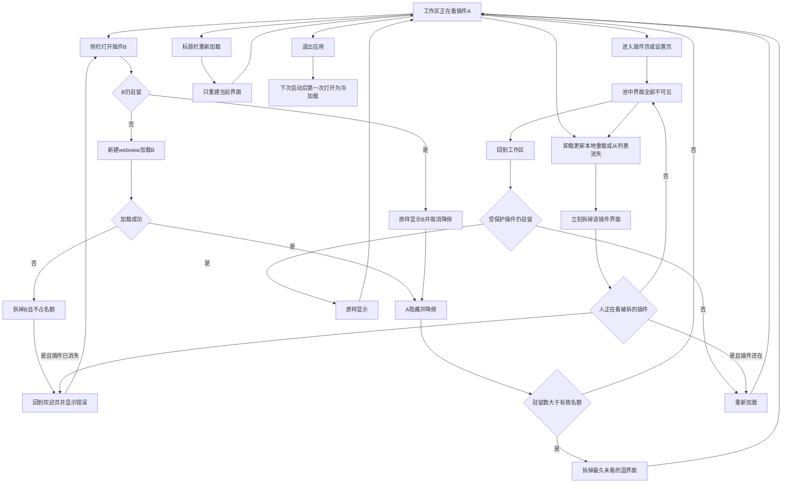
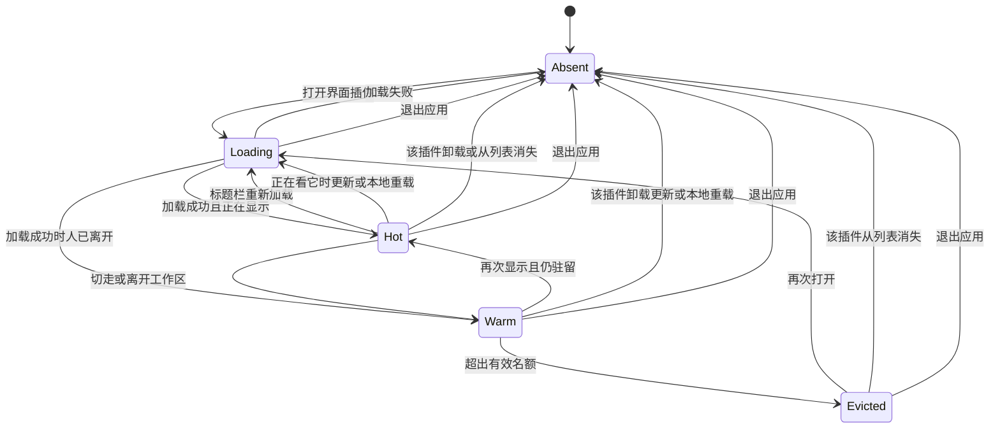

# PRD: 插件界面保活与资源回收

| 属性 | 值 |
|---|---|
| 状态 | 工程：accepted。见文末「工程验收状态」 |
| 范围 | 工作区里带界面插件的 webview 保活、降频、名额与回收；标题栏重新加载 |
| 关联文档 | `docs/DESIGN.md`、`specs/prds/prd-00002-workbench-chrome.md`、`specs/prds/prd-00003-plugins-page.md`、`specs/prds/prd-00007-load-unpacked-plugin.md` |
| 关联实现 | `src/renderer/plugins.js`、`src/renderer/chrome.js`、`src/renderer/settings.js`、`src/renderer/index.html`、`src/renderer/style.css`、`src/main/index.ts`、`src/preload/host.cjs`、`docs/DESIGN.md` |

## 背景与问题

工作区一次只显示一个插件。侧栏点另一个插件、进入插件页或进入设置时，当前界面会被拆掉。再回来时新建一个 `<webview>` 并重新打开页面，滚动位置、未提交输入和进行中的操作都丢失。

对应代码：

- `src/renderer/plugins.js` 的 `openPlugin` 在每次打开时对 `#viewport-host` 执行 `replaceChildren()`，再创建新的 `<webview>`。
- 同文件的 `suspend()` 在离开工作区时同样 `replaceChildren()`。
- `src/renderer/chrome.js` 在工作区与插件页之间调用 `suspend` / `resume`。`resume` 再次调用 `openPlugin`。
- `src/renderer/settings.js` 的 `enterSettings` 调用 `plugins.suspend()`。离开设置时若回到工作区，则 `plugins.resume`。
- `dex:prepare-plugin` 只准备 partition 和 preload，不保留已打开的页面。

使用者的路径是：在插件 A 里做到一半，点开插件 B，或去插件页 / 设置看一眼，再回到 A，发现 A 已经重新加载。

界面保活会占内存。每个带界面的插件是一份 Chromium 渲染进程。全部留着会随安装数量上涨。机器内存再多，也需要一个用不上就能拆掉的上限。

飞书桌面端的公开说明只覆盖左侧导航：固定区域里的入口关掉后还在，临时区域里的标签关掉就消失；文档、多维表格和应用可以在导航里切换，而不必跳到系统浏览器。飞书没有公布「同时保留几个渲染进程」。本篇借用的是这个可观察到的结果：入口还在，最近用过的页面切回去不用从头来，更早的页面可以再加载。回收算法对齐 Chrome 的记忆节省，以及 Electron 里常见的做法：隐藏的页面降频，超出名额的隐藏页面拆掉渲染进程，栏上的插件入口保持不动。

## 目标与非目标

### 目标

- 侧栏从一个带界面的插件切到另一个，再切回来时，若该界面仍在名额内，不新建 webview、不重新设置 `src`。滚动位置和未提交输入还在。
- 从工作区进入插件页或设置页，再回到刚才那个带界面的插件时，同样规则。插件页和设置页上看不到底下的插件界面。
- 藏在名额里的界面降频：脚本让出 CPU，宿主不主动断开它的连接。正在显示的那一个保持正常速度。
- 同时驻留的带界面插件数量 = min(硬上限, 按可用内存给出的余量)，含正在保护的那一个。硬上限是 5。隐藏的才可拆；受保护的那个不拆。
- 被拆掉之后，侧栏入口还在。再次打开时重新加载，并允许一段短暂的加载。
- 标题栏提供当前界面的「重新加载」，只重建这一个 webview，作为页面卡死时的出口。
- 卸载、更新、本地插件重新加载，或该插件从列表消失时，立刻拆掉这一个界面。

### 非目标

- 设置页自己的 webview（`settingsEntry`）不进入这套池。离开设置时仍拆掉设置页界面。
- 无界面插件不占名额，也不为它保留一块隐藏页面。
- 不把页面快照写到磁盘。退出应用后，下次打开全部重新加载。
- 不提供「钉住后永不回收」，也不在设置里让用户修改 5 / 3 / 1。
- 不由插件作者在 manifest 里声明保活或豁免回收。
- 不做多窗口。每个插件在本窗口里至多一个 webview。
- 不预加载用户还没打开过的插件。
- 不保证降频期间定时器仍按原间隔触发。名额内切回时保证的是同一份页面还在，而不是后台时钟精度。

### 成功标准

- 在可用内存不低于 4 GiB 时，连续打开不超过 5 个带界面插件并在它们之间来回切换，每个插件的滚动位置和未提交输入保持为切走前的内容。
- 从这 5 个之一进入插件页或设置页再返回，该界面仍是切走前的那一份，且插件页和设置页上看不见它。
- 第 6 个带界面插件打开后，驻留数不超过 5。被拆掉的是最久没有显示过的隐藏界面。再打开它时发生一次加载。
- 可用内存低于 2 GiB 时，驻留数不超过 1，且受保护的那个界面不被拆掉。
- 标题栏「重新加载」只让当前这个界面重新加载，其它仍在名额内的界面保持原样。
- 退出并再次启动后，第一个打开的插件是一次新的加载。

## 术语

| 术语 | 含义 |
|---|---|
| 界面插件 | 清单类型为带界面、且具有 `uiUrl` 的插件。只有它进入保活池 |
| 驻留 | 该插件的 webview 还在，无论正在显示还是藏着 |
| 热 | 正在工作区里显示，脚本按正常速度运行 |
| 温 | 藏在池里并降频。页面还在，不重新加载 |
| 冷 | 本会话里曾经驻留过，现已拆掉。侧栏入口还在，下次打开要重新加载 |
| 受保护 | 不允许被名额回收的那一个。工作区里就是当前热界面；人在插件页或设置页时，是离开工作区前最后一个界面插件 |
| 有效名额 | min(硬上限 5, 内存余量)。含受保护的那一个 |
| 硬上限 | 5。可用内存再多也不增加 |
| 内存余量 | 由当时可用内存决定的驻留上限：5、3 或 1 |
| 可用内存 | 操作系统报告的、还能分给新分配的内存。工程选用与此定义一致的读数。macOS 上不用接近零的 “free” 代替 “available” |
| 重新加载 | 只拆掉并重建当前这一个 webview。不退出 Dex Buddy |

## 已拍板规则

| 项 | 决定 |
|---|---|
| 保活范围 | 侧栏里界面插件互切；从插件页或设置页回到离开前的那个界面插件。两条都走同一套池 |
| 设置页界面 | `settingsEntry` 的 webview 不进池。离开设置仍拆掉它。回到工作区时只恢复插件池里的界面 |
| 后台 | 温界面降频。宿主不调用会冻结页面的接口，也不设置让整个应用取消后台节流的开关。热界面取消降频 |
| 切回仍在池中 | 把已有 webview 显示出来。不新建元素，不改 `src`，不因为再次 `prepare` 而丢掉页面 |
| 硬上限 | 5，含受保护的那一个 |
| 内存余量 | 可用内存 ≥ 4 GiB 为 5；≥ 2 GiB 且 < 4 GiB 为 3；< 2 GiB 为 1。1 GiB = 1024³ 字节 |
| 有效名额 | min(5, 内存余量) |
| 读不到内存 | 余量按 5，仍受硬上限约束。下一次读到之后立刻按新余量回收 |
| 重算时机 | 打开一个界面插件时，以及离开当前界面插件时（切到另一个插件、无界面插件、欢迎页、插件页或设置页）。停在同一个热界面上不轮询 |
| 回收顺序 | 只拆温界面。最久没有成为热界面的先拆。上次显示时间相同则按插件 id 字典序，保证顺序稳定。拆到驻留数 ≤ 有效名额为止 |
| 受保护 | 工作区：当前热界面。插件页或设置页：离开前最后一个界面插件。它计入名额，且本轮不拆。余量为 1 时只留它 |
| 无界面插件 | 不占名额。打开它时，上一个界面插件若仍在名额内则变为温 |
| 冷打开 | 冷状态或本会话第一次打开：新建 webview 并加载。允许短暂加载。加载失败不留下空白 webview，不占名额 |
| 加载中切走 | 尚未成功的界面若被切走，仍占一个名额并保持隐藏，完成后作为温界面。失败则拆掉且不占名额 |
| 再次点当前插件 | 已经是热界面时不重新加载 |
| 插件页与设置 | 池里的 webview 不得出现在这两页的可见区域，也不得从工作区卡片底下露出来 |
| 标题栏重新加载 | 仅当工作区正在显示某个界面插件时出现。只重建这一个。其它温界面不动。不写入壳的后退 / 前进历史 |
| 卸载、更新、从列表消失 | 立刻拆掉该 id 的 webview。若它正是热界面且插件已不在列表中，回到欢迎页。若插件还在列表中且人正在看它，紧接着做一次冷加载 |
| 本地重新加载 | 沿用 `prd-00007`：不退出应用，实例 id 不变。同时拆掉该 id 已驻留的 webview。人若正停在插件页，返回工作区时是一次冷加载 |
| 退出 | 全部拆掉。不写页面快照。下次启动从冷打开开始 |
| 名额数字 | 不进设置页，不进 manifest |

## 冲突与决议

| 现有说法 | 决议 |
|---|---|
| `openPlugin` / `suspend` 用 `replaceChildren()` 清掉 `#viewport-host` | 本篇覆盖。切换和离开工作区改为隐藏或移入不可见的池，只在回收、重新加载、卸载、更新、消失或退出时拆 webview |
| `settings.js` 注释要求切到插件页时不能把刚才的插件页面露出来 | 仍然有效。做到「不可见」，同时页面可以留在池里 |
| `docs/DESIGN.md` 的标题栏是后退、前进、收起和正中插件名 | 本篇增加「重新加载」。实现时把按钮补进 `docs/DESIGN.md`：Lucide `refresh-cw`，16px、描边 1.5、`currentColor`，放在前进右侧，不参与窗口拖拽。欢迎页、无界面插件、插件页和设置页不显示 |
| `prd-00002` 的壳历史不记录「打开另一个插件」 | 仍然有效。保活和重新加载都不新增历史项。切到另一个插件仍会清掉「前进」 |
| `prd-00007` 的本地「重新加载」不重启进程 | 仍然有效。那个动作继续重载插件源码；本篇只额外要求拆掉对应 webview |

## 用户与角色

| 角色 | 目标 |
|---|---|
| 工作台使用者 | 在两个插件之间切换，或去插件页 / 设置看一眼再回来，未做完的界面还在 |
| 内存较少的使用者 | 应用不会为了保活把机器占满；当前正在用的界面不会被拆掉 |
| 插件作者 | 不改 manifest 也能获得保活。需要干净页面时，使用者可以用重新加载 |
| 工程 | 名额和回收顺序可以不启动 Electron 就测；壳的外观仍以 `docs/DESIGN.md` 为准 |

## 功能域

### 池

每个界面插件至多一个 webview。温界面放在始终不可见的容器里，热界面放在工作区可见位置。从温变为热时移动已有节点。`dex:prepare-plugin` 可以再次调用以确认 partition，但不得因此替换节点或修改 `src`。

温界面开启后台节流。变为热时关闭节流。不使用会冻结访客页的接口，也不打开「整个应用禁止渲染进程后台化」的开关。

### 名额

纯函数，输入为：当前驻留列表（含上次成为热界面的时间）、受保护 id、可用内存字节数（或「读不到」）。输出为应拆掉的 id 列表。

计算顺序：

1. 内存余量按「已拍板规则」分档。读不到则余量为 5。
2. 有效名额 = min(5, 余量)。
3. 受保护 id 若在驻留列表里，本轮不输出它。
4. 其余驻留按上次热时间从早到晚，相同则按 id 字典序。依次列入输出，直到剩下的驻留数 ≤ 有效名额。

打开新界面之前，先把即将隐藏的热界面记为「刚刚看过」，这样它在温界面里是最新的，不会第一个被拆。

### 表面

去插件页或设置页时，工作区宿主隐藏，受保护对象改为离开前的界面插件（若当时没有界面插件，则没有受保护对象，全部温界面都可回收）。返回工作区时若该 id 仍驻留，显示原节点；若已冷，则冷加载。

### 重新加载按钮

图标按钮，`aria-label` 为「重新加载」。点击后只拆当前热界面并立刻冷加载同一个插件。失败时与打开失败相同：该插件不占名额，回到欢迎页，并用现有状态文案说明原因。其它温界面保持原样。

### 与安装和本地加载的交界

覆盖安装、市场更新、本地「重新加载」「移除」以及列表刷新后 id 消失，都先按 id 拆 webview，再走现有安装或列表逻辑。不在本篇改变安装结果、实例 id 或设置存储。

## 用户故事地图与版本切片

### 旅程主干

| 步骤 | 节点 | 说明 |
|---|---|---|
| 1 | Entry | 工作区正在显示界面插件 A，页面上有滚动位置或未提交输入 |
| 2 | 互切 | 侧栏打开界面插件 B。A 变为温并降频。B 若已温则原样显示，否则冷加载后成为热 |
| 3 | 名额 | 打开或离开时重算。超出则拆最久未看的温界面，直到不超过有效名额。热界面和当前受保护对象不拆 |
| 4 | 离开工作区 | 进入插件页或设置页。所有插件 webview 不可见。受保护对象是 A 或 B 里最后一个界面插件 |
| 5 | 返回 | 回到工作区。受保护对象若仍温，原样显示；若已冷，冷加载 |
| 6 | 卡死出口 | 可选。标题栏重新加载只重建当前热界面 |
| 7 | 强制拆掉 | 卸载、更新、本地重新加载或该插件从列表消失时，立刻拆该 id |
| 8 | Exit | 退出应用。池清空。下次启动后的第一次打开是冷加载 |

第 2 步可以立刻再点回 A，只要 A 还没被第 3 步拆掉，就回到第 1 步的同一份页面。第 5 步若已经变冷，加载结束后进入热，形成回路。第 6 步结束后仍停在同一个插件的新页面上。没有停在「拆掉了但入口也没了」的状态：只有卸载或消失才会离开侧栏列表，那是现有列表逻辑。

### 故事地图

| 阶段 | 用户目标 | 用户故事 | 验收要点 |
|---|---|---|---|
| 保活 | 切走再回来还在 | 作为使用者，我想从插件 A 切到插件 B 再回到 A，以便做到一半的内容还在 | A、B 都在名额内时，回到 A 不新建 webview、不改 `src`。切走前的滚动位置和未提交输入还在 |
| 保活 | 再点一次不要刷新 | 作为使用者，我想再点已经打开的插件时页面不动，以便不会误触丢掉输入 | 热界面对应的侧栏项再次点击不重新加载 |
| 保活 | 去插件页再回来 | 作为使用者，我想去插件页看一眼再回来，以便刚才的插件不用重新打开 | 从界面插件进入插件页再回到工作区，该界面仍是离开前那一份。插件页上看不见该 webview |
| 保活 | 去设置再回来 | 作为使用者，我想改完或看完设置再回到插件，以便工作现场还在 | 从界面插件进入设置再回到工作区，该界面仍是离开前那一份。设置页上看不见该 webview。设置页自己的 webview 在离开设置时被拆掉 |
| 保活 | 藏起来时少占 CPU | 作为使用者，我想后台插件别全速跑，以便当前插件保持顺畅 | 温界面处于后台节流；热界面不以后台节流运行。宿主不打开「禁止整个应用后台化」的开关 |
| 名额 | 机器空也不能全开 | 作为使用者，我想最多留下五个界面，以便装了很多插件时内存仍有顶 | 可用内存 ≥ 4 GiB 时连续打开 6 个界面插件，同时驻留的 webview 数为 5。第 6 个是热界面 |
| 名额 | 内存少时少留 | 作为内存较少的使用者，我想驻留数随可用内存下降，以便机器还能做别的事 | 可用内存 ≥ 2 GiB 且 < 4 GiB 时有效名额为 3；< 2 GiB 时有效名额为 1。分档用 GiB（1024³ 字节） |
| 名额 | 正在用的不要被拆 | 作为使用者，我想当前页面在内存紧时仍留着，以便不会看着看着被回收 | 热界面不在回收结果里。人在插件页或设置页时，离开前最后一个界面插件不在回收结果里。余量为 1 时驻留的就是这一个 |
| 名额 | 先拆最久没用的 | 作为使用者，我想刚看过的页面优先留下，以便来回切换的两个还在 | 需要回收时，拆上次成为热界面最早的温界面。时间相同则拆插件 id 字典序靠前的。刚切走的那个排在温界面的末尾 |
| 回收 | 拆掉后还能从侧栏打开 | 作为使用者，我想被回收的插件还在列表里，以便再点一次就能用 | 冷界面的侧栏项仍在。再次打开会新建 webview 并加载，期间可以出现短暂加载。加载完成前切走的规则见下一行 |
| 回收 | 打开失败不占坑 | 作为使用者，我想打不开的插件不要占着名额，以便其它插件还能留下 | 冷加载或加载中失败时拆掉该 webview，不占名额，用现有错误状态说明，并回到欢迎页。其它温界面若仍在名额内则保留 |
| 出口 | 卡住时我能刷新 | 作为使用者，我想只刷新当前插件，以便一个页面卡死时不用关掉整个应用 | 仅工作区显示界面插件时，标题栏有「重新加载」（Lucide `refresh-cw`，前进右侧，不参与拖拽）。它只重建当前 webview。其它温界面的滚动位置和未提交输入不变。壳的后退 / 前进历史不变 |
| 出口 | 代码更新后看到新页面 | 作为作者，我想本地重新加载或更新之后不要还显示旧页面，以便确认新代码 | 卸载、更新、本地重新加载或 id 从列表消失时，该 id 的 webview 立即不在池中。插件仍在且使用者正在看它时，紧接着冷加载。插件已不在列表中时回到欢迎页 |
| 出口 | 无界面不占名额 | 作为使用者，我想打开没有页面的插件时不要挤掉五个名额里的界面，以便说明页不算一个网页 | 无界面插件不创建保活 webview。打开它时，上一个界面插件按温界面规则留下或被名额拆掉 |
| 出口 | 退出就是结束 | 作为使用者，我想退出后再打开是干净的一次启动，以便不会依赖没写到磁盘的页面 | 退出后池为空。下次启动第一次打开任一界面插件都是冷加载 |
| 工程 | 规则能单测 | 作为工程，我想名额计算不依赖 Electron，以便分档和回收顺序可回归 | 纯函数覆盖：≥ 4 GiB 名额 5、< 4 且 ≥ 2 GiB 名额 3、< 2 GiB 名额 1、读不到内存时名额 5、受保护 id 永不出现在拆掉列表、相同时间戳按 id 字典序、输出之后驻留数 ≤ 有效名额 |
| 文档 | 标题栏按钮有依据 | 作为后续改壳的人，我想设计文档写上重新加载，以便按钮位置和色值有事实源 | 实现时 `docs/DESIGN.md` 写明该按钮的出现条件、Lucide 名称、位置和「不参与窗口拖拽」 |

### Release 0

可验收结果：

- 名额内，侧栏在界面插件之间切换再回来，不新建 webview。滚动位置和未提交输入保持。
- 名额内，从界面插件进入插件页或设置页再回到工作区，不新建 webview。这两页看不见插件 webview。离开设置时设置页 webview 被拆掉。
- 温界面后台节流，热界面正常速度。不开启禁止整个应用后台化的开关。
- 有效名额按 5 / 3 / 1 分档，硬上限 5。回收最久未看的温界面。受保护对象不回收。
- 变冷后再打开会加载。失败不占名额。
- 标题栏「重新加载」只重建当前热界面，并写入 `docs/DESIGN.md`。
- 卸载、更新、本地重新加载、列表消失会立刻拆对应 webview。
- 无界面插件不占名额。退出后不恢复页面。
- 名额纯函数有不依赖 Electron 的 `node:test`。webview 的显示与隐藏用手测或现有界面测试能覆盖的方式验收。

### Release 1

仍属本 PRD。Release 0 不依赖本项即可验收。

- 因名额回收变为冷、之后使用者再次打开并加载成功时，用现有 `#shell-toast` 显示「已重新打开」。成功为现有成功样式，数秒后消失。
- 下列情况不显示这句：本会话第一次打开、标题栏重新加载、本地重新加载、更新或覆盖安装之后的冷加载、打开失败。
- 插件页自己的「已重新加载」toast 保持不变，不与本句叠成两套文案规则以外的新组件。

## 核心流程与状态机图

打开 B 时若 A 仍在名额内，回路停在「正在看 B」，A 变为温。再点 A 且 A 仍驻留，走同一条「原样显示」。人在插件页时强制拆掉不会把界面露出来；若拆掉的不是受保护对象，返回时仍可原样显示受保护对象。欢迎页用于加载失败，以及被拆掉的插件已经不在列表中。插件还在且人正在看它时，拆掉之后走冷加载，回到工作区。人在插件页拆掉别的插件时，留在插件页，不打开欢迎页。

热界面没有进入冷的边。正在显示的插件被卸载或从列表消失时直接离开，不经过冷。更新和本地重新加载把温界面直接拆掉；若当时它是热界面，则拆掉后进入加载，不进入冷，因此 Release 1 不对该次显示「已重新打开」。

## 数据与 API 衔接

不新增插件 manifest 字段，不改 `plugin-settings.json`，不改七牛目录。保活状态只活在当前进程里。

宿主需要提供一次「可用内存字节数」读取，失败时明确告诉渲染进程读不到。渲染进程用上一节的纯函数计算应拆掉的 id。通道继续用 `dex:` 前缀。渲染进程不传入硬编码的内存数字来冒充读数；测试里的纯函数可以传入假的字节数。

每个界面插件继续使用现有按插件 id 区分的 partition。池不在插件之间共享 webview。

`docs/DESIGN.md` 在实现标题栏按钮时更新。不改插件页面配色文档。

## 假设与待确认

| 项 | 处理 |
|---|---|
| 停在同一个热界面时内存突然下降 | R0 不轮询。等下一次打开或离开界面插件时再回收 |
| 降频后页面自己的长连接断开 | 宿主不主动断开。连接是否扛得住节流由插件页面负责。变为冷之后不保证连接还在 |
| 可用内存的具体系统调用 | 由工程选择与「可用内存」定义一致的读数，并在读不到时走余量 5 |
| 重新加载按钮的悬停说明 | 与后退、前进相同，只用 `aria-label`，不另做提示气泡 |

无未决产品分叉。

## 修订记录

| 日期 | 说明 |
|---|---|
| 2026-10-13 | 初稿。界面插件在名额内切走不重新加载；硬上限 5，并按可用内存降为 3 或 1；最久未看的隐藏界面回收 |

## 1. 工程验收状态

> 由 `/team:prd-accept` 维护；勿手工编造「通过」。最后更新：2026-10-13T06:52:10Z，dev@fba539e（实现仍在工作区，尚未提交），范围：R0,R1。

### 总览

- 工程状态：`accepted`
- 验收判定：Release 0 与 Release 1 纳入项均通过。
- 最近验收：2026-10-13T06:52:10Z
- 代码提交：工作区未提交。基线 `dev@fba539e`。
- 侧栏互切不再换 webview 的父节点，温界面用 `is-parked` 藏在 `#viewport-host` 里。维护者确认小红书增长引擎与英语听力大师来回切换后，未提交输入还在。
- 名额按可用内存分 5 / 3 / 1，硬上限 5。受保护界面不回收。标题栏「重新加载」只重建当前页。卸载、更新、本地重载和列表消失会拆掉对应页。
- 名额回收后再打开成功才显示「已重新打开」。`pnpm test` 124 项通过。

### Release 交付

| Release | 状态 | 说明 |
|---|---|---|
| R0 | 通过 | 保活、降频、名额、重新加载、强制拆掉、无界面不占名额、退出不恢复，以及名额纯函数测试均有证据。切换后输入还在由维护者手测通过 |
| R1 | 通过 | 只有名额回收后的冷加载成功才用现有 toast 显示「已重新打开」 |

### 功能验收清单（Agent 优先读此表）

| ID | 能力摘要 | Release | 状态 | 证据 |
|---|---|---|---|---|
| US-01 | 名额内从 A 切到 B 再回 A，不新建 webview、不改 `src`，输入还在 | R0 | 通过 | `plugin-views.js` 的 `present` 只去掉 `is-parked`，不换父节点、不改 `src`。`style.css` 用绝对定位和 `visibility: hidden` 藏起温界面。维护者手测两个界面插件来回切换后输入还在 |
| US-02 | 再点当前热界面不重新加载 | R0 | 通过 | `plugins.js` `openPlugin` 在 `views.isShowing` 时直接返回。`isShowing` 表示没有 `is-parked` |
| US-03 | 进插件页再回工作区仍是离开前那一份，插件页看不见 | R0 | 通过 | `chrome.js` 离开工作区调用 `suspend`，返回调用 `resume`。`suspend` 只加 `is-parked`。`style.css` 在 `body[data-surface="plugins"]` 隐藏 `#workspace-pane` |
| US-04 | 进设置再回来仍是离开前那一份；设置页自己的 webview 离开时拆掉 | R0 | 通过 | `settings.js` `enterSettings` 调用 `plugins.suspend()`。`leaveSettings` 对 `#settings-entry-host` 执行 `replaceChildren()`，再 `plugins.resume`。设置页同样隐藏 `#workspace-pane` |
| US-05 | 温界面后台节流，热界面正常速度，不禁止整个应用后台化 | R0 | 通过 | `dex:set-view-throttling` 只对宿主自己的 `app-plugin://` guest 调用 `setBackgroundThrottling`。藏起之后传 `true`，显示之后传 `false`。仓库内没有 `disable-renderer-backgrounding` |
| US-06 | 可用内存 ≥ 4 GiB 时最多驻留 5 个，第 6 个是热界面 | R0 | 通过 | `view-quota.js` 硬上限 5。`test/view-quota.test.ts`「硬上限是 5，第 6 个驻留只拆最久没看的」 |
| US-07 | ≥ 2 GiB 且 < 4 GiB 名额 3，< 2 GiB 名额 1，按 1024³ 字节 | R0 | 通过 | `memoryAllowance`。同测例「可用内存按 GiB 分档」。macOS 用 `free + fileBacked`，见 `available-memory.ts` 与 `test/available-memory.test.ts` |
| US-08 | 热界面和离开前的界面插件不被回收；余量为 1 时只留它 | R0 | 通过 | `selectEvictions` 不输出 `protectedId`。`suspend` 把当前或仍驻留的界面插件传给 `enforceQuota`。测例「受保护 id 不出现在拆掉列表，余量为 1 时只留它」 |
| US-09 | 先拆最久没看的温界面；时间相同按 id 字典序；刚切走的排在后面 | R0 | 通过 | `parkHot` 先把 `lastHotAt` 记成现在。测例「相同时间戳按插件 id 字典序」和「刚看过的温界面排在后面」 |
| US-10 | 被拆掉后侧栏还在，再打开会重新加载 | R0 | 通过 | `drop` 只 `remove()` webview，不改 `shell.plugins`。侧栏仍由 `renderNav` 画。再次 `mount` 才设置 `src` |
| US-11 | 打开失败不占名额，工作区正在等它时回到欢迎页 | R0 | 通过 | `did-fail-load` 主帧失败时 `drop(..., 'fail')`。`handleViewFailed` 仅在 `shell.activeId` 仍是它且工作区开着时 `showWelcome` 并 `setStatus` |
| US-12 | 标题栏「重新加载」只重建当前页，不写入壳历史 | R0 | 通过 | `#history-reload`，`aria-label="重新加载"`，Lucide `refresh-cw`，在前进右侧、`.titlebar-leading` 内。`showingUiPlugin` 控制显示。点击只调 `reloadActive`，不调 `clearNavigation`。`docs/DESIGN.md` 写了出现条件、图标、位置和不参与拖拽 |
| US-13 | 卸载、更新、本地重载、预览切换或从列表消失时立刻拆掉该界面 | R0 | 通过 | `plugins-page.js` 在卸载、移除、市场更新、覆盖安装和 `runLocal`（重新加载、按发布预览、结束预览）之前调用 `releaseView`。`refresh` 拆掉已不在列表中的 id。人在工作区看着它时 `reopenIfWatching` 冷加载；`releaseView` 用 `force`，不记入名额回收 |
| US-14 | 无界面插件不占名额 | R0 | 通过 | `openPlugin` 在 `type !== 'ui'` 或没有 `uiUrl` 时不 `mount`，只把上一个界面插件 `parkHot` 后按无名额保护回收 |
| US-15 | 退出后不恢复页面 | R0 | 通过 | 保活状态只在 `mountPluginViews` 的内存 Map 里。没有把页面快照写到磁盘 |
| US-16 | 名额纯函数不依赖 Electron | R0 | 通过 | `test/view-quota.test.ts`：分档、读不到内存、受保护 id、相同时间戳、回收后驻留数。`test/available-memory.test.ts` 覆盖三端换算 |
| US-17 | 设计文档写明重新加载按钮 | R0 | 通过 | `docs/DESIGN.md` 标题栏段。`docs/doc_index.md` 该行摘要已提到前进右侧的重新加载 |
| US-18 | 名额回收后再打开成功才显示「已重新打开」 | R1 | 通过 | 只有 `drop(..., 'evict')` 写入回收标记。`did-finish-load` 首次成功且 `entry.reopen` 时调用 `showShellToast('已重新打开', 'ok')`。标题栏重载、本地重载、更新和失败走 `force` 或 `fail`，不显示这句。toast 仍是 `#shell-toast`，4 秒后消失 |

### 未完成与遗留

- 无阻塞项。
- 实现与本验收章都还在工作区，尚未提交。

### 质量检查

| 检查项 | 状态 |
|---|---|
| pnpm test | 通过，124 项 |
| 文档同步（README / docs/doc_index.md） | 插件契约未改，README 无需改。`docs/DESIGN.md` 已写重新加载按钮，`docs/doc_index.md` 已更新该行摘要 |

---

统计：通过 18 / 部分 0 / 未实现 0 / 范围外 0

