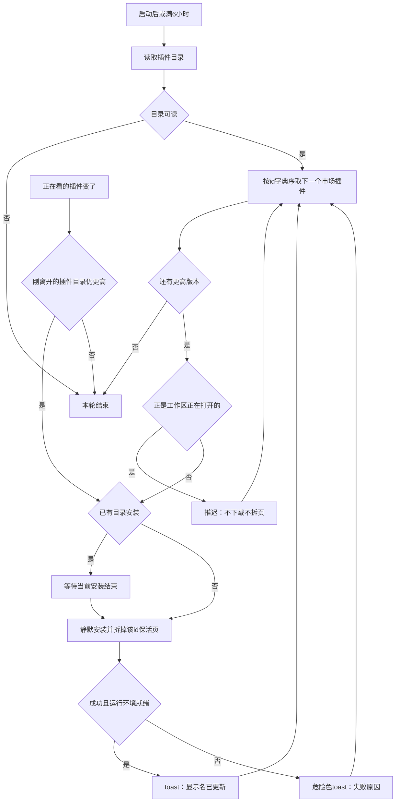
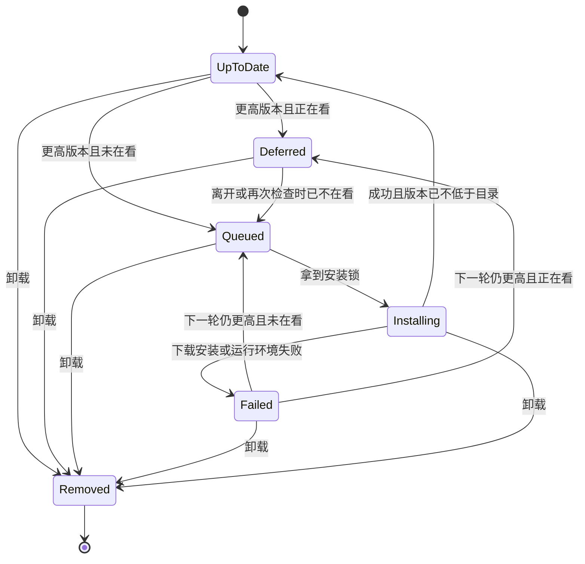

# PRD: 市场插件静默更新

| 属性 | 值 |
|---|---|
| 状态 | 工程：accepted。见文末「工程验收状态」 |
| 范围 | 市场来源插件的启动检查、每 6 小时检查、静默安装、正在看时推迟、离开后补装；手动更新入口保持 |
| 关联文档 | `docs/DESIGN.md`、`docs/workflows/publish-plugin.md`、`docs/build-and-release.md`、`specs/prds/prd-00004-plugin-market.md`、`specs/prds/prd-00009-plugin-view-keepalive.md` |
| 关联实现 | `src/main/plugin-origins.ts`、`src/main/index.ts`、`src/main/updater.ts`、`src/renderer/plugins-page.js`、`src/renderer/shell-toast.js` |

## 背景与问题

从插件市场装上的插件，只有打开插件页才能知道有没有新版本。左栏写「可更新」，真正安装要再进市场卡片的「…」菜单点「更新」。应用常开时，这个入口不会自己跑。

Dex Buddy 自己的安装包已经会在启动时、以及进程还活着时每 6 小时检查一次。插件没有同一套节奏。人很少退出，尤其是 Mac，插件就会一直停在旧版本。

## 目标与非目标

### 目标

- 从插件市场安装、且来源记录为市场的插件，在应用启动时检查一次；进程一直开着则每 6 小时再查一次。
- 目录里有更高的 semver 时直接安装，不先问确认。
- 工作区正在看的那一个先不装。离开后再装。其它可更新插件照常静默安装。
- 成功或失败都用现有顶栏 toast。手动的「可更新」和菜单「更新」仍在。
- 检查与安装不依赖插件页是否已经打开，也不跟应用自身「已经可安装」绑在一起。

### 非目标

- 改 Dex Buddy 自身的更新：检查节奏、图标轨下载圆钮、确认对话框、Windows 退出时安装、Mac 的 dmg。现状只记录在下一节，本篇不改代码。
- 把 Mac 应用改成静默替换。未签名，仍然要下载 dmg 再拖进「应用程序」。见 `specs/prds/prd-00006-mac-dmg-quit-after-open.md`。
- 自动更新压缩包来源、本地目录、示例和开发路径。
- 把 6 小时改成设置项，或记住「上次检查时刻」以便退出前补齐间隔。
- 系统通知、第二套更新对话框、按下载字节显示百分比。
- 目录版本相同或更低时强制重装。
- Release 1。本篇只有 Release 0。

### 成功标准

- 打包或 `pnpm start` 启动后，市场来源且有更高版本、当时又没在看的插件，会自己装上，并出现「显示名」已更新。
- 进程连续开过 6 小时后会再查一次。这次不要求先退出。
- 正在看的那个在离开工作区里的这个插件之前保持旧版本；离开后才装。
- 压缩包来源、本地目录、示例、开发路径在上述两次检查里都不会被盖掉。
- 应用自身更新的圆钮、对话框和「可安装后跳过后续检查」与现在一致。
- 插件页左栏仍会出现「可更新」，市场卡片菜单里仍有「更新」。点下去走现在的手动安装。

## 应用自身更新的现状核实

本节只说明 2026-10-13 代码里的行为，避免和插件静默更新缠在一起。实现本篇时不要改 `src/main/updater.ts` 的这些规则。

打包后的 Windows 和 macOS 会在启动时检查应用更新。进程还在就每 6 小时再查（`CHECK_INTERVAL_MS`）。Mac 很少退出，不影响这一定时器。未打包的 `pnpm start` 和 Linux 不检查、不安装应用自身。

查到新版本后不弹窗，也不发系统通知。图标轨齿轮上方出现现有的下载圆钮，事实源是 `docs/DESIGN.md`。Windows 在后台下完：点圆钮可立即重启安装，以后正常退出时也会装上。Mac 要点圆钮下载 dmg，打开安装盘后退出，再拖进「应用程序」。

状态已经是下载中、可安装或安装中时，后面的 6 小时检查会跳过，直到装完或进程重启。因此第一次新版本不会因为不退出而漏掉；圆钮一直留着、人没去点时，不会再追一个更新的版本。插件检查不得复用这个「跳过」。

`docs/build-and-release.md` 仍写齿轮蓝点。界面以 `docs/DESIGN.md` 的下载圆钮为准。本篇不改正那篇发版文档。

## 术语

| 术语 | 含义 |
|---|---|
| 市场插件 | 已加载、来源为已安装，且 origin 通道是 `market` 的插件。比较规则与现有 `marketUpdates` 相同 |
| 静默更新 | 不先弹出确认，直接走现有目录安装。结果只用顶栏 toast |
| 正在看 | 工作区当前打开的那一个插件。插件页、设置页、欢迎页（工作区没有打开插件）都不是正在看 |
| 推迟 | 本轮发现它有更高版本，但因为它正在看，所以不安装 |
| 离开 | 正在看从该插件变成另一个插件，或变成没有插件。包括切到别的插件、进入插件页、进入设置页、回到欢迎页 |
| 一轮 | 一次启动检查，或一次 6 小时检查。离开触发的补装不算新的一轮目录检查 |

## 已拍板规则

| 项 | 决定 |
|---|---|
| 谁会被自动更新 | 只限市场插件。远程 semver 高于本地，且本地版本能被现有 semver 比较接受 |
| 谁不会 | origin 通道是 `file` 的压缩包；本地目录；示例；开发路径；内置或开发占用同一 id、市场本来就不能覆盖的插件 |
| 何时检查 | 插件列表已经加载之后检查一次。之后每 6 小时再查。6 小时与应用自身更新同一长度，计时器分开 |
| 不持久化上次检查 | 退出再打开一定再查，不管离上次检查是否不满 6 小时 |
| 不阻塞启动 | 窗口先出来。目录慢、失败或还在安装时，工作台仍可操作 |
| 目录读失败 | 本轮不安装。不弹 toast。下一轮再试 |
| 安装失败 | 危险色 toast，文案用安装返回的错误。该插件留在旧版本。下一轮再试。不在本轮紧循环重试 |
| 运行环境失败 | 与手动更新相同：安装已写入但有 `runtimeError` 时，toast 用该错误，不用「已更新」 |
| 成功文案 | 现有 `#shell-toast`：「显示名」已更新。引号里是该插件的 `displayName`。没有显示名时用「插件」 |
| toast | 与 `docs/DESIGN.md` 和 `specs/prds/prd-00004-plugin-market.md` 相同：顶栏下居中，同时一条，新的替换旧的，约 4 秒消失，悬停不暂停。多个插件接连更新就接连替换 |
| 正在看 | 以「即将开始安装」时工作区打开的插件为准。检查过程中人打开了它，改为推迟，不拆当前页 |
| 隐藏的保活页 | 不是正在看。本轮直接更新，并按 `specs/prds/prd-00009-plugin-view-keepalive.md` 拆掉该 id 的 webview。未提交输入可以丢失 |
| 离开后补装 | 正在看的 id 一变，若刚离开的市场插件仍有更高版本，马上装。不等下一次 6 小时 |
| 补装时人又点回来 | 安装一开始就拆掉该 id 的保活页。结束后若工作区又正在看它，冷加载新页面。这次不显示「已重新打开」 |
| 无界面 | 没有 webview 可保活。只要它不是工作区当前打开的插件，就直接更新。它正是当前打开的，仍推迟 |
| 顺序 | 同一轮里按插件 id 字典序，一个接一个 |
| 同时一个 | 与手动安装共用一把锁。锁被占用时，静默队列等它结束再继续。等待期间忽略新的手动安装点击，与现在「进行中忽略新的点击」一致 |
| 手动优先打断推迟 | 人在菜单里点「更新」是明确要现在装。即使它正在看，也走现有手动更新：先拆页面，成功后若仍在看则冷加载。不显示「已重新打开」 |
| 卸载 | 卸载开始后取消该 id 的推迟和队列。不在卸载后再装回去 |
| 手动入口 | 左栏「可更新」和市场卡片菜单「更新」保持。静默更新不删这两处 |
| 开发模式 | `pnpm start` 也检查市场插件。应用自身「未打包不检查」不套用到插件 |
| Linux | 应用自身仍不更新。市场插件的静默更新仍做 |
| 下载地址 | 渲染进程不能传入。仍只从现有目录安装路径下载并核对 sha256 |

## 冲突与决议

| 现有说法 | 决议 |
|---|---|
| `docs/workflows/publish-plugin.md`：有更高版本时要人去菜单点「更新」 | 本篇增加静默路径。手动菜单保留。实现时把「启动和每 6 小时会自己更新，正在看的离开后再装」补进该工作流的同事使用段 |
| `prd-00004`：更新只出现在卡片菜单 | 菜单仍是手动入口。自动安装不要求人先打开市场 |
| `prd-00009`：更新会立刻拆 webview；若正在看则紧接着冷加载 | 静默更新在「正在看」时不开始，因此不拆当前页。一旦开始安装，拆页和「不显示已重新打开」仍照 `prd-00009` |
| `docs/build-and-release.md` 的齿轮蓝点 | 本篇不改应用更新，也不改那篇文档。界面以 `docs/DESIGN.md` 为准 |
| 应用更新在「可安装」时停止 6 小时复查 | 仅限应用自身。插件每 6 小时仍查 |

## 用户与角色

| 角色 | 目标 |
|---|---|
| 工作台使用者 | 市场插件自己跟上目录，不用翻到卡片菜单；正在看的页面不要被换掉 |
| 插件作者 | tag 发布之后，已安装的客户端在启动或常开 6 小时后装上新版本 |
| 维护者 | 压缩包和本地目录仍不被目录覆盖；应用 dmg / 安装包流程不变 |

## 功能域

主进程在插件列表可用后启动检查，并每 6 小时重复。比较沿用 `marketUpdates`。安装沿用现有目录安装（下载、校验、解压、加载、运行环境）。渲染进程上报工作区当前插件 id：只有工作区正打开某个插件时非空。主进程用这个 id 决定推迟。toast 由渲染进程显示。

纯比较（给定目录、origin、已安装列表、正在看的 id，得出本轮要装的 id 和要推迟的 id）放到不依赖 Electron 的函数里，用 `node:test` 覆盖。计时、下载和 webview 拆页不塞进这个函数。

## 用户故事地图与版本切片

### 旅程主干

| 步骤 | 节点 | 说明 |
|---|---|---|
| 1 | Entry | 打开 Dex Buddy。至少一个市场插件的目录版本更高。工作区可能正打开其中某一个 |
| 2 | 启动检查 | 窗口已经可用之后读目录。读失败则本轮结束，不 toast |
| 3 | 静默安装 | 未在看的更高版本按 id 顺序安装。隐藏保活页被拆掉。成功 toast「已更新」 |
| 4 | 推迟 | 正在看的那个只记着，不拆页、不安装 |
| 5 | 离开补装 | 一切走，若它仍更高，马上安装。装完前又点回来，则结束后冷加载，不说「已重新打开」 |
| 6 | 常开复查 | 满 6 小时再读目录。当时没在看的更高版本继续静默安装。应用自身即便已是「可安装」，这一步仍发生 |
| 7 | 手动 | 人仍可在「可更新」或菜单「更新」里现在装，包括正在看的那个 |
| 8 | 失败 | 安装或运行环境失败：危险色 toast，旧版本还在。下一轮或下一次离开再试 |
| 9 | Exit | 退出进程。推迟不写盘。下次启动回到第 1 步，重新读目录 |

第 4 步若人一直不离开，该插件保持旧版本，直到第 5 步、或第 6 步时已经不在看、或第 9 步之后的下次启动。没有「推迟了就再也装不上」的终点。

### 故事地图

| 阶段 | 用户目标 | 用户故事 | 验收要点 |
|---|---|---|---|
| 检查 | 打开就跟上 | 作为使用者，我想启动后市场插件自己更新，以便不用去菜单里找 | 启动且列表可用后，未在看的市场插件若目录 semver 更高，会安装并 toast「显示名」已更新。窗口不卡在检查上 |
| 检查 | 常开也会查 | 作为把 Mac 一直开着的使用者，我想不用退出也会再查插件，以便版本不会停太久 | 进程存活满 6 小时会再读一次目录并按同样规则安装。不依赖应用自身更新是否已经停在可安装 |
| 检查 | 刚退出再开仍查 | 作为使用者，我想每次打开都查，以便不用等满上一个 6 小时 | 距上次检查很短又重新打开时，仍做启动检查 |
| 检查 | 离线别吵 | 作为暂时没网的使用者，我想目录读失败时不要每 6 小时弹一次，以便工作台还能用 | 目录失败：不安装、无 toast、下一轮再试。已打开的插件保持原样 |
| 推迟 | 正在看的先别动 | 作为正在填写的使用者，我想当前插件不要被换掉，以便输入还在 | 检查决定安装时，工作区正在打开的那个市场插件不下载、不拆 webview、版本不变 |
| 推迟 | 检查途中打开也别动 | 作为抢先点开插件的使用者，我想刚打开的页面不要被这一轮拆掉，以便不会闪一下旧页又重载 | 读目录期间才变成正在看的插件，本轮改为推迟 |
| 推迟 | 离开再装 | 作为看完就切走的使用者，我想离开后才更新，以便下次进来是新版本 | 正在看从该插件变为其它插件、插件页、设置或欢迎页后，若目录仍更高，开始安装，不等 6 小时 |
| 推迟 | 一直不离开 | 作为长时间停在一个插件上的使用者，我想它保持当前页，以便做完再更新 | 连续多轮检查时只要它仍是正在看，就一直不装。切走、或下次启动时不再看着它，才会装 |
| 安装 | 没在看的照常换 | 作为同时装了好几个插件的使用者，我想后台那个自己更新，以便不用一个个点菜单 | 不是正在看的市场插件在本轮安装。若它有隐藏保活页，该 webview 被拆掉 |
| 安装 | 一个接一个 | 作为使用者，我想更新不要互相踩，以便不会两个包同时往同一套目录写 | 同一时刻只有一个目录安装。多个 id 按字典序排队。手动安装进行时，静默队列等待 |
| 安装 | 知道装好了 | 作为使用者，我想有一句结果，以便知道哪个插件换过 | 成功 toast 为「显示名」已更新，样式是现有成功 toast。多个成功则后者替换前者 |
| 安装 | 装坏了能看懂 | 作为使用者，我想失败时知道原因，以便可以再试手动更新 | 安装失败或 `runtimeError` 用危险色 toast 和返回文案。插件仍是旧的可运行版本，或与现有手动更新失败后的残留规则相同。下一轮再试 |
| 安装 | 中途回来看到新的 | 作为离开后又立刻点回的使用者，我想装完看到新页面，以便不会停在拆掉一半的旧页 | 补装开始时拆掉该 id。结束时若正在看它，冷加载。不出现「已重新打开」 |
| 资格 | 压缩包别被盖掉 | 作为从 zip 装插件的使用者，我想目录更新不要换掉我这个包，以便和现在的来源规则一致 | origin 通道为 `file` 的插件不在静默队列里，菜单也不因为本篇新增自动项 |
| 资格 | 本地和示例别被盖掉 | 作为在本地目录里改代码的人，我想市场 zip 不要覆盖这个目录，以便改动还在 | 本地目录、示例、开发路径不静默安装，也不能被本篇的自动路径覆盖 |
| 资格 | 不降级 | 作为已经装上新版本的使用者，我想目录更旧或相同号时什么都不发生，以便不会被装回旧包 | 远程版本不高于本地，或本地版本不能做 semver 比较时，不下载 |
| 手动 | 菜单还在 | 作为想马上更新的使用者，我想仍能从市场点更新，以便不等离开、也不等 6 小时 | 左栏「可更新」仍出现。卡片菜单在可更新时仍有「更新」。点它走现有手动安装和现有 toast |
| 手动 | 正在看也能点 | 作为正开着这个插件的使用者，我想菜单里点更新就现在换，以便不用先切走 | 手动更新不受推迟限制。先拆该 id，成功后若仍在看则冷加载，不显示「已重新打开」 |
| 边界 | 卸载优先 | 作为决定卸掉的使用者，我想排队中的更新不要把它装回来，以便卸载是终态 | 卸载一旦开始，该 id 不再静默安装 |
| 应用 | 壳的更新不动 | 作为 Mac 使用者，我想应用自己仍靠下载圆钮，以便本篇不会改成静默换掉未签名的应用 | 应用检查间隔、圆钮、对话框、Windows 退出安装、Mac dmg、可安装后跳过复查，均与本篇落地前一致。Linux 与 `pnpm start` 仍不检查应用自身 |
| 工程 | 资格能单测 | 作为工程，我想「装谁、推迟谁」不依赖 Electron，以便回归比较规则 | `node:test` 覆盖：市场且更高则入队、正在看则推迟、file / 非已安装来源不入队、版本相同或更低不入队、多个 id 按字典序、正在看的 id 为空则全部可装的都入队 |
| 文档 | 同事说明跟着改 | 作为发布插件的人，我想工作流里写上会自己更新，以便不用只告诉同事去点菜单 | `docs/workflows/publish-plugin.md` 的同事使用段写明启动与每 6 小时静默更新，以及正在看的离开后再装。手动菜单句子保留 |

### Release 0

可验收结果：

- 市场插件在启动后，以及进程每存活 6 小时，按「已拍板规则」静默更新。
- 正在看的推迟；离开后补装；隐藏保活页在被更新时拆掉。
- 目录失败无 toast；安装失败有危险色 toast，下一轮再试。
- 压缩包、本地目录、示例、开发路径不会被自动覆盖。
- 手动「可更新」和菜单「更新」仍在，且可以更新正在看的插件。
- 应用自身更新行为不变。
- 比较函数有不依赖 Electron 的测试。
- `docs/workflows/publish-plugin.md` 写上静默更新和推迟。

没有 Release 1。

## 核心流程与状态机图

离开补装走同一把安装锁。锁占用时在「已有目录安装」处等待，不另开第二次下载。

一个市场插件在本篇里的生命周期如下。卸载从任一状态离开。推迟不落盘，进程退出后下次启动重新从目录判断。

`Failed` 不会自己紧接着再进 `Installing`。要等下一轮检查，或等一次新的离开补装。`Installing` 被卸载打断时停在 `Removed`，不装回。

## 数据与 API 衔接

不新增插件可见的协议，也不让渲染进程提交下载地址。

| 数据 | 来源 | 是否新存储 |
|---|---|---|
| 目录版本 | 现有插件目录 | 否 |
| 是否市场来源 | 现有 origin 文件 | 否 |
| 本地版本与来源 | 现有插件列表 | 否 |
| 正在看的 id | 渲染进程告知主进程；非工作区或未打开插件时为空 | 否，只在进程内 |
| 推迟与队列 | 主进程内存 | 否 |
| 安装 | 现有目录安装 | 否 |
| 结果提示 | 现有 `#shell-toast` | 否 |

## 假设与开放项

- 6 小时等于应用更新已有的 `6 * 60 * 60 * 1000` 毫秒，不是日历整点，也不是设置。
- 机器睡眠时定时器可以推迟触发；醒来后补上这一轮即可，不要求睡眠期间联网。
- 手动更新失败后目录里留下的半成品，沿用现有安装实现，本篇不另定回滚格式。
- `docs/build-and-release.md` 与 `docs/DESIGN.md` 关于蓝点 / 圆钮的差异不在本篇关闭。

没有未拍板的产品分叉。

## 修订记录

| 日期 | 说明 |
|---|---|
| 2026-10-13 | 初稿。市场插件启动时和每 6 小时静默更新；正在看的离开后再装；手动菜单保留。应用自身更新只核实、不改 |

## 1. 工程验收状态

> 由 `/team/prd-accept` 维护；勿手工编造「通过」。最后更新：2026-10-13T07:55:02Z，dev@9cc521f（实现仍在工作区，尚未提交），范围：R0,R1。

### 总览

- 工程状态：`accepted`
- 验收判定：Release 0 纳入项均通过。Release 1 按本篇声明为范围外。
- 最近验收：2026-10-13T07:55:02Z
- 代码提交：工作区未提交。基线 `dev@9cc521f`。
- 市场插件在宿主页加载完成后检查，之后每 6 小时再查。正在看的推迟，离开后用上一轮目录结果补装。手动「可更新」和菜单「更新」仍在。
- 满 6 小时的进程守候，以及 Electron 里的 toast 和拆页，没有人工点过。判定依据是代码路径和 `node:test`。
- `pnpm test` 133 项通过。`src/main/updater.ts` 与 `docs/build-and-release.md` 无改动。

### Release 交付

| Release | 状态 | 说明 |
|---|---|---|
| R0 | 通过 | 启动检查、6 小时间隔、推迟与离开补装、静默安装、失败提示、来源资格、手动入口、应用更新不改、比较测试和同事说明均有证据 |
| R1 | 范围外 | 本篇写明只有 Release 0 |

### 功能验收清单（Agent 优先读此表）

| ID | 能力摘要 | Release | 状态 | 证据 |
|---|---|---|---|---|
| US-01 | 启动后未在看的更高版本市场插件会安装，并 toast「显示名」已更新；窗口不卡在检查上 | R0 | 通过 | `index.ts` 在 `ready-to-show` 后显示窗口，`did-finish-load` 才 `startSilentPluginUpdates`，`runRound` 不 await。成功文案在 `plugins-page.js` `finishInstall` |
| US-02 | 进程满 6 小时再查，不看应用自身是否已可安装 | R0 | 通过 | `PLUGIN_SILENT_UPDATE_INTERVAL_MS` 为 `6 * 60 * 60 * 1000`。`index.ts` 用单独的 `setInterval` 调 `runRound`。静默更新不读 `updater.ts` 的 `shouldSkipScheduledCheck`。未守候满 6 小时 |
| US-03 | 退出再开仍做启动检查，不记住上次检查时刻 | R0 | 通过 | 每次 `did-finish-load` 都 `runRound`。推迟和队列只在 `createPluginSilentUpdates` 的内存里，没有把检查时刻写入磁盘 |
| US-04 | 目录读失败不安装、不 toast，下一轮再试 | R0 | 通过 | `runRound` 在 `fetchCatalog` 抛错时直接 return，不 `send`。测例「目录读失败时不安装，已推迟的仍可在离开后补装」 |
| US-05 | 正在看的市场插件不下载、不拆页 | R0 | 通过 | `chrome.js` `reportWatching` 只在工作区且有 `activeId` 时上报。`planSilentPluginUpdates` 把该 id 放进 `defer`。`installOne` 在发 `start` 之前若仍在看则写回推迟集合。测例「市场且更高版本的插件入队，正在看的推迟」 |
| US-06 | 读目录期间才打开的插件，本轮改为推迟 | R0 | 通过 | `runRound` 在 `await fetchCatalog()` 之后才做计划，期间 `setWatching` 已更新 `watchingId`。`installOne` 拿到安装锁后再次比较 `watchingId`，命中则不发 `start` |
| US-07 | 离开该插件、插件页、设置或欢迎页后马上补装，不等 6 小时 | R0 | 通过 | `setWatching` 在 id 变化时把推迟集合里的上一轮 release 重新入队。测例「静默更新按字典序安装，正在看的离开后才装」 |
| US-08 | 连续多轮只要仍在看就不装；切走或下次启动不再看才会装 | R0 | 通过 | 每轮用当前 `watchingId` 重算 `defer`，仍在看则不会 `enqueueRelease`。推迟不落盘，下次启动工作区没有打开插件 |
| US-09 | 未在看的市场插件照常装；隐藏保活页被拆掉 | R0 | 通过 | 计划里 `watchingId` 为空时全部入队，测例「正在看为空时……全部入队」。`start` 事件调用 `plugins.releaseView`，即 `drop(..., 'force')` |
| US-10 | 同一时刻只有一个目录安装，按 id 字典序；手动安装时静默队列等待 | R0 | 通过 | `createInstallLock` 串行执行。静默安装走 `lock.run`，市场点击走 `tryRun`，锁占用时返回 `{ ignored: true }`，界面不 toast。队列用 `comparePluginId` 排序。zip 安装和卸载也走同一把锁 |
| US-11 | 成功 toast 为「显示名」已更新，多个成功互相替换 | R0 | 通过 | `finishInstall` 用 `showShellToast`。没有显示名时用「插件」。`shell-toast.js` 新的一条会清掉上一条计时 |
| US-12 | 安装失败或 `runtimeError` 用危险色 toast，不在本轮紧循环重试 | R0 | 通过 | `finishInstall` 在 `!ok` 或 `runtimeError` 时用失败样式和返回文案。失败后不把该 id 放回队列，要等下一轮 `runRound` |
| US-13 | 补装开始时拆页；结束时若又正在看则冷加载，不显示「已重新打开」 | R0 | 通过 | `start` 先 `releaseView`。成功走 `reopenIfWatching`，失败在 `onSilentUpdate` 里同样冷加载。`drop(..., 'force')` 会删掉名额回收标记，因此不会 toast「已重新打开」 |
| US-14 | origin 为 `file` 的压缩包不进静默队列，也不新增自动菜单 | R0 | 通过 | `marketUpdates` 要求 `channel === 'market'`。测例「压缩包来源和非已安装来源不入队」。菜单「更新」仍只在已有 `updates` 里出现 |
| US-15 | 本地目录、示例、开发路径不被自动覆盖 | R0 | 通过 | `marketUpdates` 要求 `source === 'installed'`。同一测例覆盖 `bundled`、`dev`、`local` |
| US-16 | 远程版本不高于本地，或本地版本不能比较时不下载 | R0 | 通过 | `planSilentPluginUpdates` 只收 `marketUpdates` 的结果。安装前 `stillHigher` 再比一次。测例「目录版本相同或更低时不入队」和「安装前版本已经不更高则跳过」 |
| US-17 | 左栏「可更新」和卡片菜单「更新」仍在，点下去走现有手动安装 | R0 | 通过 | `plugins-page.js` 左栏仍写「可更新」，菜单项「更新」仍调用 `installFromCatalog`。下载仍由主进程 `downloadVerifiedZip` 核对 sha256，渲染进程只传 id |
| US-18 | 正在看时点「更新」现在就换，不显示「已重新打开」 | R0 | 通过 | 手动安装在锁内调用 `noteManualInstall`，从推迟集合和队列去掉该 id。更新前 `releaseView`，成功后 `reopenIfWatching`。测例「手动安装拿掉推迟后，离开不再静默安装」 |
| US-19 | 卸载一开始就取消该 id 的推迟和队列，不在卸载后再装回 | R0 | 通过 | `dex:uninstall` 先 `cancel`，再排队卸载。正在安装的 id 进入 `dropped`，结果事件被跳过。测例「卸载会取消尚未开始的静默安装」 |
| US-20 | 应用自身的圆钮、对话框、可安装后跳过复查不变；Linux 与 `pnpm start` 仍不检查应用自身 | R0 | 通过 | `src/main/updater.ts` 与 `docs/build-and-release.md` 无改动。`updatesUnsupported` 仍是未打包或非 Windows/macOS。插件检查没有这层判断 |
| US-21 | 「装谁、推迟谁」有不依赖 Electron 的测试 | R0 | 通过 | `test/plugin-silent-update.test.ts` 覆盖入队、推迟、file 与非已安装、相同或更低、字典序、正在看为空 |
| US-22 | 发布工作流写上静默更新和离开后再装，手动菜单句子保留 | R0 | 通过 | `docs/workflows/publish-plugin.md` 同事使用段。`docs/doc_index.md` 该行摘要已补上静默更新 |
| R1-00 | 本期没有 Release 1 | R1 | 范围外 | 非目标与 Release 0 节写明没有 Release 1 |

### 未完成与遗留

- 无阻塞项。
- 没有人工守候满 6 小时，也没有在 Electron 里点选 toast、推迟和拆页。这些不作为未实现：间隔、推迟和提示路径都在仓库里。
- 实现与本验收章都还在工作区，尚未提交。

### 质量检查

| 检查项 | 状态 |
|---|---|
| pnpm test | 通过，133 项 |
| 文档同步（README / docs/doc_index.md） | 插件契约未改，README 无需改。`docs/workflows/publish-plugin.md` 与 `docs/doc_index.md` 已写静默更新。`docs/build-and-release.md` 按本篇不改 |

---

统计：通过 22 / 部分 0 / 未实现 0 / 范围外 1
