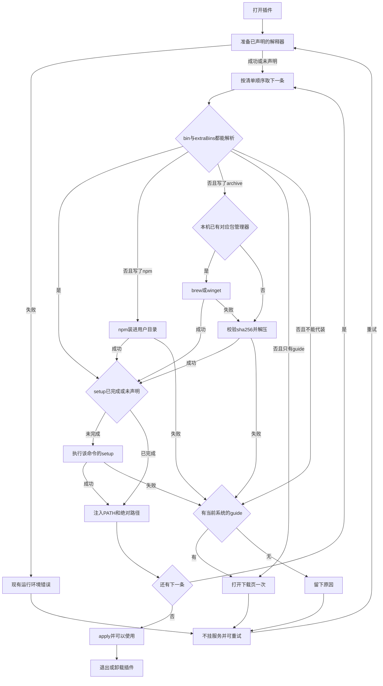
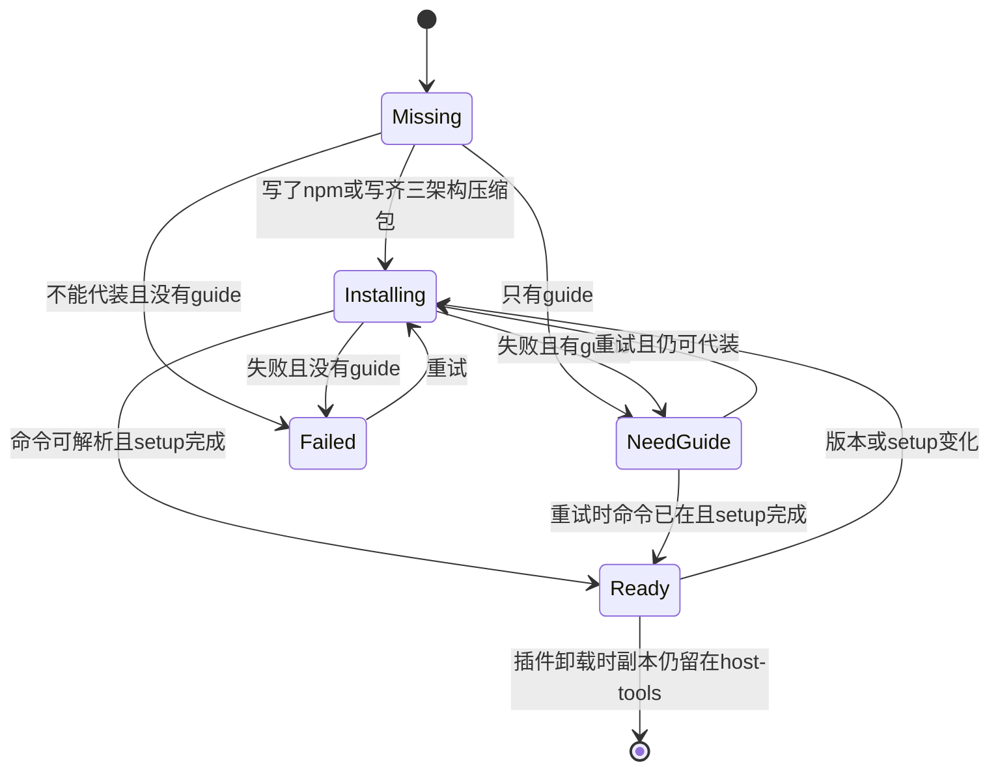

# PRD: 插件外部 CLI 一次准备

| 属性 | 值 |
|---|---|
| 状态 | 工程：backlog |
| 范围 | 插件清单 `externalTools`、打开插件前的准备、用户数据目录中的共用 CLI、子进程 PATH 与 `ctx.tools` |
| 关联文档 | `docs/DESIGN.md`、`docs/plugin-development/manifest.md`、`docs/plugin-development/runtime.md`、`docs/plugin-development/data.md`、`docs/build-and-release.md` |
| 关联实现 | `src/main/types.ts`、`src/main/manifest.ts`、`src/main/plugin-runtime.ts`、`src/main/shell-path.ts`、`src/main/registry.ts`、`src/renderer/plugins-page.js` |

## 背景与问题

有的插件要调用本机命令才能工作。FFmpeg 负责转码，agent-browser 负责打开网页。后者是一条 CLI：npm 包里有各平台二进制，包内的 `skills/` 给编程助手读；二进制就位后还要再执行 `agent-browser install`，才会下载浏览器。没有这一步，命令在，但打不开网页。

今天 Dex Buddy 只代装钉死版本的 Python、Node 和 uv，放在七牛 `dex-buddy/runtimes/`。`docs/plugin-development/runtime.md` 写明 FFmpeg 用同事自己装在 PATH 里的那一份，没装时调用直接失败。启动时会合并登录 shell 和 Windows 注册表里的 Path，但不会替人安装。

同事的机器不一定有 Homebrew 或 winget。安装方式若写死在宿主里，上游改一条命令就要重发 Dex Buddy。七牛空间也不再放这些软件的预编译包。

## 目标与非目标

### 目标

- 插件在 `plugin.manifest.json` 的 `externalTools` 里声明要调用的命令。一次打开按数组顺序准备完。
- 干净的 Mac（`darwin-arm64`、`darwin-x64`）和 Windows x64，在没有 Homebrew、也没有 winget 时，仍能按清单静默装进用户数据目录。
- 命令已经在 PATH 或宿主副本里时直接用。需要第二次安装的，用 `setup` 写出该命令自己的参数，例如 `["install"]`。
- 代装失败，或作者只提供下载页时，用系统浏览器打开当前系统的页面，服务先不挂上。同事装好后点现有的「重试」。
- 安装配方写在插件清单里。上游改 `setup` 或压缩包地址时发插件，不发 Dex Buddy。
- 子进程拿得到这些命令：PATH 前置，并有 `ctx.tools` 的绝对路径。

### 非目标

- 单独安装 skill。skill 文件若在 npm 包里，随包留下，不进清单，也不注册到工作台。
- 执行任意 shell、`curl|sh`、git 地址，或下载页里的程序。
- 静默安装 dmg、pkg 或 exe 安装向导。这类软件只写 `guide`。
- 自动安装 Homebrew 或 winget 本身。
- 写入登录 shell、Windows 系统 Path、`/usr/local` 或 `Program Files`。
- 把 FFmpeg、浏览器或其它 CLI 上传到七牛。`dex-buddy/runtimes/` 继续只有 Node、Python、uv。
- 在 Linux 或 `win32-arm64` 上代装。
- 工具市场，或在 `setup` 里传递密钥。
- Release 0 不提供已装命令的占用列表和手动移除。那是 Release 1。

### 成功标准

- 一台没装 Homebrew 的 Mac，打开声明了 `agent-browser`（带版本的 npm 与 `setup`）的插件后，不弹安装向导就能执行该命令，且成功前已跑过 `setup`。
- 一台没装 winget 的 Windows x64，同一份声明得到同样结果。
- 一份写齐三架构压缩包和 sha256 的声明，在上述两台机器上都能得到 `ffmpeg` 与 `ffprobe`。七牛 `runtimes/` 的对象不因此新增。
- 代装失败且写了分平台 `guide` 时，打开的是当前系统的那一页，插件服务不挂上。同事自行装好后点「重试」，准备通过并挂上服务。
- 只改插件清单里的 `setup` 或压缩包地址，宿主版本不变即可换安装方式。
- 清单缺架构，或写成 shell 时，准备失败并写明原因，不执行 `apply`。

## 术语

| 术语 | 含义 |
|---|---|
| 外部 CLI | 插件要在子进程里调用、但不是 Python/Node 解释器本身的命令 |
| 代装 | 宿主按清单把命令准备进用户数据目录，或调用本机已经存在的包管理器 |
| setup | 命令就位后执行一次的该命令自己的参数。agent-browser 的 `install` 属于这一步 |
| 引导 | 打开清单里的 https 下载页，由同事自己安装。宿主不下载、不执行页面内容 |
| 戳记 | 某次代装完成后写下的 `install.json`，用来判断可以跳过下载或要重跑 setup |
| 宿主副本 | `host-tools` 里已经按戳记装好的那一份 |
| 干净机器 | 没有 Homebrew（Mac）或没有 winget（Windows）的受支持架构 |

## 已拍板规则

| 项 | 决定 |
|---|---|
| 声明位置 | `plugin.manifest.json` 的可选数组 `externalTools`。与 `runtime` 并列，不写进 `runtime` 对象 |
| 谁来写配方 | 插件作者。宿主不维护 FFmpeg、agent-browser 等工具名单 |
| 两边都能代装 | 该项写了 `npm`，或写齐 `darwin-arm64`、`darwin-x64`、`win32-x64` 三个 `archive`。只写 `brew`/`winget`，或只写 `guide`，不做静默代装 |
| 获取顺序 | 见下一节。npm 项不改走系统包管理器 |
| 版本不漂 | npm 未写版本时，第一次解析到的版本写入戳记，之后不跟着注册表升级。作者要升级就改清单 |
| setup 重跑 | `setup` 数组变化，或版本 / 压缩包 sha256 变化时重新执行。参数不放密钥 |
| 共用与锁 | 同一 `bin`、同一版本或 sha256、同一架构多插件共用一份。同时准备时加锁，只装一次 |
| 半截失败 | 删掉这一次没写完的目录，保留上一份已经成功的 |
| 已有命令 | `bin` 与全部 `extraBins` 都能在 PATH 或宿主副本里解析到时，跳过下载。缺任何一个就代装 |
| Node | 写了 `npm` 的项，即使插件没有 `runtime.node`，也先准备现有钉死版本的 Node。不因此准备 Python 或 uv |
| PATH | 只改该插件子进程的环境。Mac 与 Windows 都前置宿主副本目录。不改登录 shell，不写注册表 |
| 绝对路径 | `ctx.tools[bin]` 与 `ctx.tools[extraBin]` 为绝对路径。声明了 `runtime` 时写在 `ctx.runtime.env` 上，否则写在 `pluginEnv()` 返回的环境上 |
| Mac 隔离属性 | 宿主刚写进 `host-tools` 的可执行文件去掉隔离属性。已经在 PATH 里的系统命令不动 |
| 引导打开次数 | 进入「需要手动安装」时打开一次当前系统的页面。准备过程中不重复打开。同事点「重试」后若仍然失败，可以再打开一次 |
| 多条命令 | 按数组顺序。某一条进入引导或失败时，后面的先不装。重试从第一条未就绪的继续 |
| 离线 | 戳记已就绪时直接用，不访问网络 |
| 失败展示 | 沿用插件页「正在准备运行环境」和「重试」。文案带上当前 `bin`。不 `apply`。无界面插件的错误出现在列表现有的运行环境错误上 |
| 哪些插件走这条准备 | 已安装、本地目录、发布预览，有界面或无界面，只要清单里有合法或非法的 `externalTools` |
| 解释器顺序 | 先按现有规则准备已声明的 `runtime`，再准备外部 CLI，全部成功才 `apply` |
| 卸载插件 | Release 0 不删除 `host-tools`。Release 1 才按引用移除 |
| 非法清单 | 插件仍出现在列表。不 `apply`。错误写明哪一条、缺什么 |
| Linux 与 Windows ARM | 不代装。`guide` 为字符串，或对象里有当前系统的键时，打开该页；否则失败并说明本期代装只有 Mac 与 Windows x64 |
| 发版边界 | 改某个工具的 `setup` 或压缩包地址：发插件。通用动作坏了才发 Dex Buddy：准备 Node、npm 装进独立前缀、校验并解压、调用本机已有的 brew/winget、打开系统浏览器 |

### 获取顺序

对每一条，在「已有命令」不成立时：

1. 写了 `npm`：用宿主 Node 装进该条自己的前缀，忽略包的生命周期脚本。不调用 brew 或 winget。
2. 没写 `npm`、写了 `archive`：若当前系统的 `brew`（Mac）或 `winget`（Windows）有写，且本机已经有这个包管理器，先试它。失败或本机没有该管理器时，再下载当前架构的压缩包，校验 sha256，解压。
3. 两项都没写：不代装。有 `guide` 则引导，没有则失败。
4. 命令就位后，若声明了 `setup` 且戳记对不上，执行 `<绝对路径> setup...`，不经过 shell。

压缩包只接受 https 的 `.zip` 与 `.tar.gz`。sha256 为 64 位十六进制。`npm` 只接受注册表名，可带 scope 和版本，不接受 URL。`guide` 只接受带主机名的 `http` 或 `https`。`setup` 的每一项是非空字符串，不含换行。

## 冲突与决议

| 现有说法 | 决议 |
|---|---|
| `docs/plugin-development/runtime.md`：FFmpeg 用本机已安装的那份，不随 runtime 下载 | 未声明 `externalTools` 时保持。声明之后由本篇准备。实现时改该节，写明声明方式、用户目录位置，以及没装上时会停在准备而不是调用时才失败 |
| 七牛 `dex-buddy/runtimes/` 是解释器的唯一下载源 | 外部 CLI 不新增对象。npm 走现有 npm 镜像，压缩包走清单里的 https。Node 仍从现有运行时地址取 |
| 运行环境失败的按钮是「重试」 | 外部 CLI 失败共用这一状态和按钮，不另做一套对话框 |

## 用户与角色

| 角色 | 目标 |
|---|---|
| 同事 | 打开插件就能用到命令，不必先找安装包；装不上时知道去哪一页 |
| 插件作者 | 用清单声明命令、可选的 npm 或压缩包、可选的 setup 和下载页 |
| Dex Buddy 维护者 | 宿主只实现通用准备。某个工具改安装方式时不必发宿主 |

## 功能域

### 清单字段

```json
{
  "externalTools": [
    {
      "bin": "agent-browser",
      "npm": "agent-browser@0.37.1",
      "setup": ["install"],
      "guide": {
        "darwin": "https://github.com/vercel-labs/agent-browser",
        "win32": "https://github.com/vercel-labs/agent-browser"
      }
    },
    {
      "bin": "ffmpeg",
      "extraBins": ["ffprobe"],
      "archive": {
        "darwin-arm64": { "url": "https://example.com/ffmpeg-darwin-arm64.tar.gz", "sha256": "<64 hex>" },
        "darwin-x64": { "url": "https://example.com/ffmpeg-darwin-x64.tar.gz", "sha256": "<64 hex>" },
        "win32-x64": { "url": "https://example.com/ffmpeg-win32-x64.zip", "sha256": "<64 hex>" }
      },
      "brew": "ffmpeg",
      "winget": "Gyan.FFmpeg",
      "guide": {
        "darwin": "https://ffmpeg.org/download.html",
        "win32": "https://ffmpeg.org/download.html"
      }
    }
  ]
}
```

示例里的压缩包地址不是事实源。真实地址和校验和由每个插件自己的清单填写。本文不指定 FFmpeg 的上游 URL。

`bin` 必填。Windows 上解析 `bin`、`bin.exe`、`bin.cmd`。`extraBins` 可选，同一包里的附带命令。`guide` 可以是一个 URL，或按 `darwin` / `win32` 分开的对象。

### 目录与戳记

`userData/host-tools/<bin>/<版本或压缩包 sha256>/<架构>/`

`install.json` 至少记录：版本或 sha256、架构、`setup` 的哈希、完成时间、命令绝对路径。来源是 PATH 上已有命令时，同样写戳记，避免每次打开都重跑 setup。

### 界面

不新增页面。准备中的状态文案在现有「正在准备运行环境」上带上 `bin`。按钮、颜色和圆角遵循 `docs/DESIGN.md`。引导使用系统浏览器，工作台内不内嵌下载站。

### 实现时要改的说明

`docs/plugin-development/manifest.md` 增加 `externalTools`。`docs/plugin-development/runtime.md` 改掉「FFmpeg 只认本机、缺失时调用才失败」的句子，改为未声明则行为不变、声明了则在准备阶段安装或引导。

## 用户故事地图与版本切片

### 旅程主干

| 步骤 | 节点 | 说明 |
|---|---|---|
| 1 | Entry | 打开一份声明了 `externalTools` 的插件（已安装、本地目录或发布预览） |
| 2 | 解释器 | 若还有 `runtime`，先按现有规则准备。失败则停在现有运行环境错误，不开始 CLI |
| 3 | 逐条 | 按数组顺序检查 `bin` 与 `extraBins` |
| 4 | 代装或引导 | 缺命令时按获取顺序代装；不能代装或代装失败则打开 `guide` 或留下原因 |
| 5 | setup | 需要时执行一次该命令的 `setup` |
| 6 | 注入 | PATH 前置，`ctx.tools` 给出绝对路径 |
| 7 | 挂载 | 全部就绪后才 `apply` |
| 8 | Exit | 同事使用插件。再次打开且戳记匹配时不再下载 |
| 9 | Teardown | 卸载插件只走现有卸载。Release 0 保留 `host-tools`。准备失败时不挂服务，点「重试」回到步骤 2 |

引导和失败都有出口：重试。重试时命令已经出现，则从该条继续，直到挂载。版本或 `setup` 变化时从步骤 4 重新代装或重跑 setup，不会停在旧戳记上。

### 故事地图

| 阶段 | 用户目标 | 用户故事 | 验收要点 |
|---|---|---|---|
| 声明 | 写出 CLI 和第二次安装 | 作为插件作者，我想声明 npm 包和 `setup`，以便 agent-browser 这类命令在两边都能装上 | 清单含 `bin`、`npm`、`setup` 时，Mac 与 Windows x64 都把包装进用户目录；`setup` 在 `apply` 之前以该绝对路径执行一次；不写入系统全局 npm |
| 声明 | 没有 npm 包时给压缩包 | 作为作者，我想为三个受支持架构各写一个带 sha256 的压缩包，以便干净机器不用包管理器 | 缺任一架构、非 https、非 zip/tar.gz、或 sha256 不是 64 位十六进制时不 `apply`，错误指出缺的键或字段 |
| 声明 | 附带命令一起可用 | 作为作者，我想声明 `ffprobe` 随 `ffmpeg` 而来，以便转码和探测用同一份 | `extraBins` 里的命令在 `ctx.tools` 中有绝对路径；其中任一缺失则不能跳过下载 |
| 声明 | 装不上时有页面 | 作为作者，我想按系统写下载页，以便 Mac 和 Windows 打开各自的页面 | `guide` 为对象时打开当前系统的 URL；为字符串时各系统打开同一个 URL；宿主不请求该 URL 的正文来执行 |
| 声明 | 非法写法停住 | 作为作者，我想在写成 shell 或 git 地址时立刻看到原因，以便不会静默执行 | `setup` 含换行、`npm` 为 URL、或出现未定义字段时不 `apply`，列表里看得到原因 |
| 代装 | 干净 Mac 能装上 | 作为没有 Homebrew 的同事，我想打开插件就用上命令，以便不用先装包管理器 | `darwin-arm64` 与 `darwin-x64` 上，仅有 `npm` 或仅有 `archive` 的声明能准备成功；不尝试安装 Homebrew |
| 代装 | 干净 Windows 能装上 | 作为没有 winget 的同事，我想得到同样的结果，以便不必开安装向导 | `win32-x64` 上同上；不写注册表 Path；不弹出安装向导 |
| 代装 | 已有命令就跳过 | 作为已经装过该命令的同事，我想直接用本机那份，以便不再下一份 | `bin` 与 `extraBins` 都能解析到时不下载。声明了 `setup` 且尚无匹配戳记时仍执行一次 setup |
| 代装 | 有包管理器时少下大包 | 作为已经装了 Homebrew 或 winget 的同事，我想压缩包类工具先走本机管理器，以便失败后再用压缩包 | 仅当该项没有 `npm`、写了 `archive`、且写了当前系统的配方名、且管理器存在时先调用；调用失败则继续解压压缩包。npm 项不调用 brew/winget |
| 代装 | 浏览器那一步会跑 | 作为要打开网页的同事，我想 `agent-browser install` 在准备阶段完成，以便第一次调用不是缺浏览器 | `setup` 退出码非零则不 `apply`。退出码为 0 后戳记记下 `setup` 哈希，下次打开不重复执行，直到哈希或版本变化 |
| 代装 | 版本固定 | 作为作者，我想未写版本时不要第二天自动变成另一个版本，以便同事之间行为一致 | 第一次解析到的 npm 版本写入戳记；清单未改时再次准备不访问注册表做升级 |
| 失败 | 知道去哪装 | 作为代装失败的同事，我想看到下载页和重试，以便自己装完还能继续 | 有 `guide` 时打开一次当前系统页面，状态文案含 `bin`，服务不挂上。点「重试」后命令已存在则继续准备并可以 `apply`。同一次进入引导不连续打开多次 |
| 失败 | 没有页面时只有原因 | 作为作者，我没写 `guide` 时代装失败应留下日志，以便我补地址而不是打开空白页 | 不调用系统浏览器；现有运行环境错误展示原因；「重试」会再试代装 |
| 失败 | 半截文件不会被当成成功 | 作为同事，我想校验失败或磁盘满之后重试是重新下，以便不会执行半个压缩包 | sha256 不符、磁盘满、解压失败或 setup 非零时删除这一次未完成的目录；上一份成功戳记还在则可继续用上一份 |
| 并发 | 两个插件只下一份 | 作为同时打开两个需要同一命令的同事，我想只下载一次，以便不互相写坏目录 | 同一 bin、版本或 sha256、架构并发准备时只装一次；两边都拿到同一绝对路径 |
| 注入 | 插件代码找得到命令 | 作为作者，我想用绝对路径调用，以便 PATH 里还有别的同名命令 | `ctx.tools[bin]` 指向本次准备的绝对路径；子进程环境里该目录排在原 PATH 前面；Dex Buddy 自己的 `process.env` 不被改写 |
| 范围 | 无界面和本地目录一样 | 作为作者，我想本地目录、发布预览和无界面插件也在打开前准备，以便不只有市场插件能用 | 这三种来源在 `apply` 前走同一准备。失败出现在现有运行环境错误上 |
| 范围 | 不受支持的系统有说明 | 作为 Linux 或 Windows ARM 上的同事，我想看到本期不代装，以便不会以为已经装上 | 不下载、不调用包管理器。有对应当前系统的 `guide` 则打开；没有则错误说明代装仅 Mac 与 Windows x64 |
| 范围 | 七牛不增大 | 作为维护者，我想外部 CLI 的字节不进运行时桶，以便空间只留给解释器 | 准备 FFmpeg 或 agent-browser 不向 `dex-buddy/runtimes/` 上传新对象。Node 仍用现有运行时 URL |
| 文档 | 作者读得到声明方式 | 作为作者，我想在插件开发说明里看到字段和「没声明则 FFmpeg 仍靠本机」，以便按文档写清单 | 实现时更新 `docs/plugin-development/manifest.md` 与 `runtime.md`。未声明 `externalTools` 的插件，调用缺失命令的行为与现在相同 |
| 清理 | 以后能丢掉没人用的副本 | 作为同事，我想在没有插件再引用时删掉已装命令，以便磁盘能收回 | Release 1：设置中列出名称、版本和占用；引用数为 0 时可以移除。Release 0 卸载插件不删除 `host-tools` |

### Release 0

可验收结果：

- `externalTools` 的解析与「缺架构 / shell / 非 https 则拒绝」放进 `node:test`，不依赖 Electron。
- 获取顺序、戳记匹配、半截目录删除、以及「已有 bin 与 extraBins 才跳过下载」有不访问真实网络的测试。
- 干净 Mac 的两个架构与干净 Windows x64 上，npm + `setup` 的声明能在不安装 Homebrew/winget 的前提下准备成功并执行该命令。
- 三架构 `archive` 的声明在 Mac 与 Windows x64 上得到 `bin` 与 `extraBins`，校验失败不会把未完成目录当成就绪。
- 分平台 `guide` 在代装失败时打开当前系统的 URL 一次，不 `apply`；重试在命令出现后可以挂上服务。
- 子进程 PATH 含宿主副本，`ctx.tools` 为绝对路径，登录 shell 与 Windows 系统 Path 不变。
- 插件页状态沿用「正在准备运行环境」和「重试」，文案含当前 `bin`，外观遵循 `docs/DESIGN.md`。
- `manifest.md` 与 `runtime.md` 写明本篇规则。七牛运行时桶不新增这些软件。

### Release 1

仍属本 PRD。Release 0 不依赖本节即可验收。

- 设置里列出已代装命令的名称、版本和磁盘占用。
- 没有任何已加载插件的清单再引用该 bin 与该版本时，可以移除对应目录。仍被引用时拒绝移除并说明。
- 若 `specs/prds/prd-00005-system-settings.md` 的通用设置尚未落地，列表放在现有设置页的宿主区域，不另做工具市场。

## 核心流程与状态机图



解释器失败不开始 CLI。压缩包项在包管理器失败后仍会解压。引导和纯失败都回到同一次准备的起点，且不会在失败状态下执行 `apply`。



`NeedGuide` 与 `Failed` 都能离开，不会停在没有重试的状态。`Ready` 在清单变化后回到 `Installing`。Release 0 卸载插件不删除副本，所以就绪不是把文件一起销毁。

## 数据与 API 衔接

不新增线上业务接口。不向七牛 `dex-buddy/runtimes/` 增加外部 CLI 对象。Node 仍用 `src/main/plugin-runtime.ts` 里的现有版本与 URL。npm 镜像沿用 `DEX_BUDDY_NPM_REGISTRY`，默认与现在的运行时相同。

渲染进程不传入下载地址、sha256 或安装参数。这些只来自插件清单。打开下载页由主进程读取清单里的 `guide` 再调用系统浏览器。

| 数据 | 位置 | 谁写入 | Release 0 卸载插件时 |
|---|---|---|---|
| 清单 `externalTools` | 插件包内 | 插件作者 | 随插件目录按现有卸载处理 |
| `host-tools/<bin>/<版本或sha256>/<架构>/` | 用户数据目录，多插件共用 | 准备流程 | 保留 |
| `install.json` | 上述目录内 | 准备成功时 | 保留 |
| 未完成的当次目录 | 同级临时目录，成功后才成为正式目录 | 准备流程 | 失败时删除当次目录 |
| `ctx.tools` | 仅该插件本次 `apply` 的上下文 | 准备成功后 | 随卸载摘掉服务 |
| 子进程 PATH | `ctx.runtime.env` 或 `pluginEnv()` | 准备成功后 | 不写回用户环境 |
| 运行环境错误 | 现有插件列表状态 | 准备失败时 | 插件卸载后不再显示 |

`bin` 名只允许作为目录名的安全片段：字母、数字、点、下划线、连字符。其它字符使该条非法。

测试放在 `test/`，用假的下载器、假的命令探测和临时目录。真实的 agent-browser 与 FFmpeg 下载不作为 `pnpm test` 的必跑步骤。干净机器上的端到端准备记在 Release 0 的手测项。

## 假设与待确认

| 项 | 处理 |
|---|---|
| 国内网络上下载 Chrome for Testing 失败 | 视为 setup 失败，走引导或错误。Release 0 不为浏览器下载单独做镜像 |
| FFmpeg 的真实压缩包 URL | 由插件清单提供并带 sha256。本 PRD 的 example.com 只说明字段形状 |
| 同事本机的命令比清单更新 | 能解析到 `bin` 与 `extraBins` 就用本机那份，不比较版本号 |
| `prd-00005` 通用设置尚未做 | Release 1 的列表落在当时已经存在的设置页宿主区域 |
| 两个插件对同一 `bin` 要求不同版本 | 目录按版本或 sha256 分开，各用各的，不互相覆盖 |

无未决的产品分叉。

## 修订记录

| 日期 | 说明 |
|---|---|
| 2026-10-14 | 初稿。插件用 `externalTools` 声明 CLI 与可选 setup。干净的 Mac 与 Windows x64 静默装进用户目录；失败或仅有下载页时引导。二进制不进七牛 |
