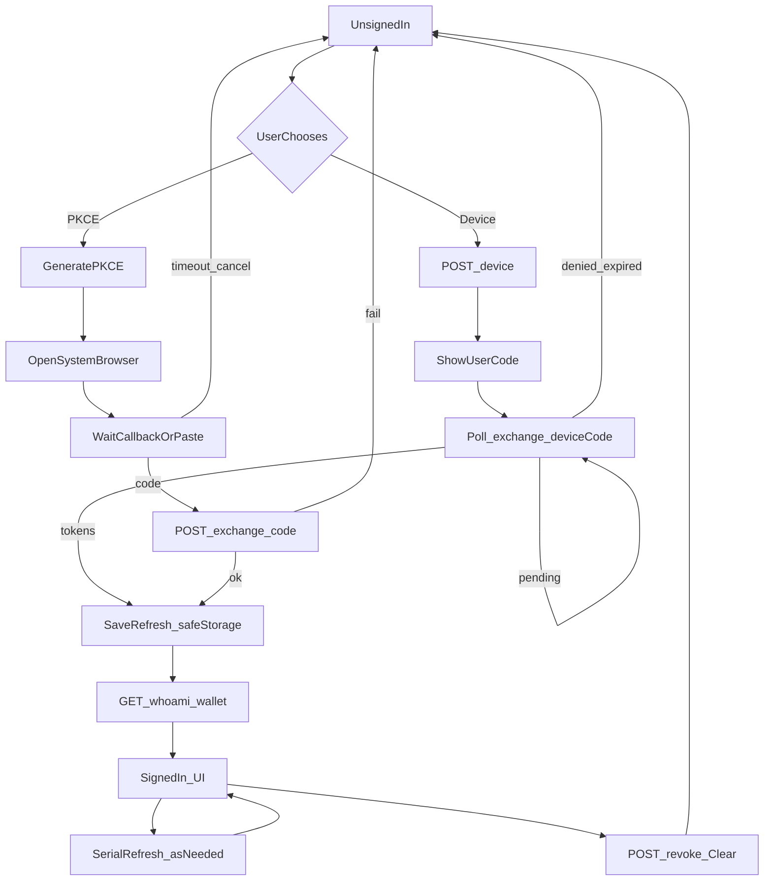
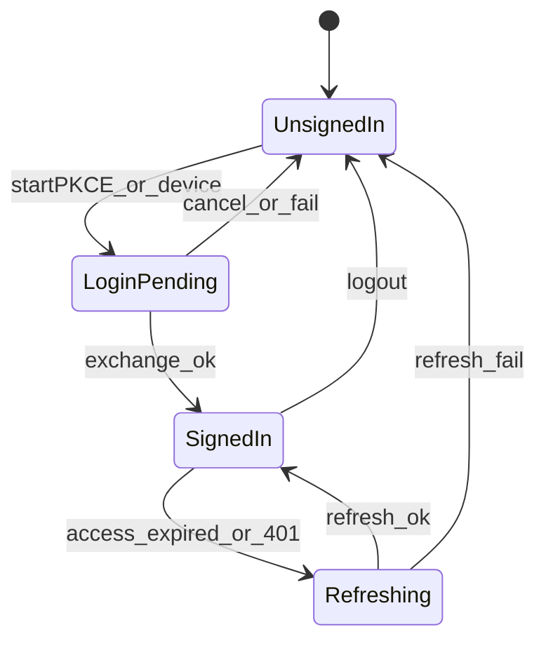

# PRD: 宿主网关会话（登录与账号）

| 属性 | 值 |
|---|---|
| 状态 | 工程：partial（见文末「工程验收状态」） |
| 范围 | Electron 宿主：自定义协议、PKCE / 设备码登录交接、本机会话、图标轨与设置账号页；不改网关、不改插件 LLM |
| 关联文档 | `docs/memo/phase1-repos-and-auth.md`、`docs/memo/phase1-billing.md`、`docs/DESIGN.md`、`docs/renderer-layout.md`、`specs/prds/prd-00005-system-settings.md`、`specs/prds/prd-00002-workbench-chrome.md`；兄弟仓网关契约 `../0001-HyHarness-gateway/public/openapi.json`（或部署后的 `/openapi.json`） |
| 关联实现（预告） | `src/main/`（协议、会话、网关 HTTP）、`src/preload/`、`src/shared/dex-ipc`、`src/renderer/chrome.js`、`src/renderer/settings.js`、`src/renderer/index.html` |
| 兄弟仓依赖 | 网关 PRD-00001（手机号 OTP + `/v1` 会话）已工程 accepted |

## 1. 背景与问题

商业链路要求：烧钱请求必须带网关会话。网关仓已提供 `/login` 手机号验证码、PKCE 授权码跳转 `dexbuddy://auth/callback`、`POST /v1/auth/exchange|refresh|revoke|device`，以及 `GET /v1/whoami`、`GET /v1/wallet`。

本仓今天没有登录：未注册自定义协议、不存 refresh、界面只显示操作系统本机用户名（见设置「通用设置」与图标轨弹出层）。用户无法完成「浏览器登一次 → 桌面领会话 → 看到脱敏手机号与余额」。

`specs/prds/prd-00005-system-settings.md` 撰写时明确不做「登录账号」，且「个人设置」下不增加第二项。现状已变：账号页必须进设置，并由本 PRD 负责；00005 继续只管「通用设置 / 关于 / 本机数据」。

## 2. 目标与非目标

### 目标

- 宿主注册并处理 `dexbuddy://auth/callback`。
- 主路径：本机生成 PKCE（S256）→ 系统浏览器打开网关 `/login` → OTP 成功后拿授权码 → `POST /v1/auth/exchange` → access 进主进程内存，refresh 进 `safeStorage`。
- 备用：RFC 8628 设备码（宿主发起 device、展示 userCode、打开 verificationUri、轮询 exchange）。
- 已登录时用 Bearer 拉取 whoami / wallet；access 将过期或 401 时串行 refresh。
- 退出：`POST /v1/auth/revoke` + 清空本机凭证与 UI 态。
- **双入口**（共用同一会话）：图标轨「用户」弹出层；设置「个人设置」下「账号」页。未登录可发起登录；已登录展示脱敏手机号、余额、「退出」。

### 非目标

- 在宿主内自建手机号 / OTP 表单（登录 UI 只在网关网站）。
- **粘贴授权码**兜底入口与相关 UI（验收确认本期不做；主进程可保留 submit IPC，不向用户暴露）。
- 买断列表、充值、支付、流水、管理后台。
- 模型转发（文案 / 生图）、插件改走宿主 LLM（后续 PRD）。
- 把 access / refresh / Supabase token 交给渲染进程或插件页面。
- 网站 `/account`（网关仓范围）。
- 单设备强制踢下线（除非网关后续另定）。
- Release 2 及更高版本占位。

### 成功标准

- 开发机指向 `http://localhost:3000` 时，完成一次 PKCE 登录后，双入口均显示 `phoneMasked` 与 `wallet.balance`（可为 0）。
- 重启应用后无需再登，whoami 仍可用（refresh 恢复）。
- 退出后本机无 refresh，双入口回到未登录；再调 whoami 不得静默成功。
- `safeStorage` 不可用时登录失败有明确提示，磁盘上无明文 refresh。
- 设备码路径可独立完成登录（不依赖自定义协议唤起）。

## 3. 术语

| 术语 | 含义 |
|---|---|
| 网关 | Dex Buddy Harness Gateway（兄弟仓）；JSON API + `/login` |
| 授权码 | PKCE 成功后短时一次性 `code`，仅用于 exchange |
| access token | 不透明短时令牌（前缀 `dbh_at_`），`Authorization: Bearer`；主进程内存 |
| refresh token | 不透明长时令牌（前缀 `dbh_rt_`）；仅 refresh / revoke；`safeStorage` |
| 会话摘要 | 渲染层可见的脱敏态：是否已登录、`phoneMasked`、`balance`、`currency`；不含任何 token |
| 账号页 | 设置左栏「个人设置」下导航项「账号」及其右栏 |
| 用户弹出层 | 图标轨 `#rail-account` 打开的弹出层 |

## 4. 已拍板规则

| 项 | 状态 | 决定 |
|---|---|---|
| 登录 UI 位置 | 已定 | 仅网关 `/login`；宿主只打开系统浏览器 |
| 自定义协议 | 已定 | `dexbuddy://auth/callback`；与网关白名单一致 |
| PKCE | 已定 | 仅 S256；登录 URL 带 `code_challenge`、`code_challenge_method=S256`、`redirect_uri` |
| 设备码 | 已定 | **Release 0 必做** |
| 粘贴授权码 | 已定 | **本期不做**（非目标）；不以粘贴 UI 作为 R0 验收项 |
| 双入口 | 已定 | 图标轨用户弹出层 **与** 设置「账号」页，共用会话 |
| 与 00005 关系 | 已定 | 废止 00005「登录账号不做」「个人设置下不增加第二项」；账号页由本 PRD 负责 |
| 凭证存放 | 已定 | access 内存；refresh 仅 `safeStorage`；禁止明文文件 |
| Token 边界 | 已定 | 预加载 / IPC 只暴露会话摘要与动作（登录、退出、刷新摘要、设备码等）；不暴露 token 字符串；粘贴 code 无 UI |
| 网关 base URL | 已由 00013 修订 | 原：开发默认 `http://localhost:3000`，打包默认 `https://app.dexbuddy.xds365.com`。现以 [`prd-00013-prod-gateway-base.md`](./prd-00013-prod-gateway-base.md) 为准：未打包与安装包默认 `https://www.dexbuddy.app` |
| 验收环境 | 已由 00013 修订 | 原：优先本地 3000。现以 00013 为准：验收打线上，localhost 仅显式覆盖，不算 00013 通过 |
| whoami 字段 | 已定 | 使用网关现有：`userId`、`phoneMasked`、`accountKind`、`wallet`、`organizations`（空数组）；本期 UI 主展示手机号与余额，不渲染组织 |
| refresh 并发 | 已定 | 主进程串行化 refresh；避免旧 refresh 复用导致整会话作废 |
| 视觉 | 已定 | 遵循 `docs/DESIGN.md` |

## 5. 用户与角色

| 角色 | 目标 |
|---|---|
| 终端用户 | 登录后确认「这是我的号、还剩多少额度」；可退出 |
| 宿主工程 | 按 OpenAPI 对接；凭证不出主进程 |
| 网关工程 | 契约已定；本 PRD 不改网关代码 |
| 插件作者 | 本期无接口变更 |

## 6. 功能域

### 6.1 主进程：会话与协议

- 应用启动时注册为 `dexbuddy` 协议处理器（开发与打包均须可用；平台差异写入实现说明）。
- 会话模块：生成 / 持有 PKCE verifier、处理回调 URL、调用 exchange / refresh / revoke / device、读写 `safeStorage`、缓存会话摘要。
- 网关 HTTP 客户端：base URL 解析；JSON；识别 `ErrorBody.code`（如 `AUTHORIZATION_PENDING`、`EXPIRED_TOKEN`、`INVALID_GRANT`）。
- `safeStorage.isEncryptionAvailable()` 为 false 时拒绝持久化 refresh，并向 UI 报错。

### 6.2 预加载与 IPC

- 通道纳入现有 `shared/dex-ipc` 纪律。
- 渲染可调用：获取会话摘要、开始 PKCE 登录、开始设备码登录、取消进行中的登录、刷新摘要（whoami/wallet）、退出。（不提供粘贴授权码 UI）
- 渲染可订阅：摘要变更、登录进度（打开浏览器 / 等待回调 / 设备码待确认 / 失败原因）。

### 6.3 图标轨用户弹出层

- 未登录：主按钮「登录」（默认 PKCE）；次要入口「使用设备码登录」。
- 登录进行中：简短状态文案；可取消（若工程可行）。
- 已登录：`phoneMasked`、余额（及 `currency` 文案）、「退出」。
- 协议唤不起时：走设备码备用（不提供粘贴授权码 UI）。

### 6.4 设置「账号」页

- 左栏「个人设置」下：在「通用设置」旁增加「账号」（顺序：账号在上或通用在上由实现选定，须在验收说明中固定一种并保持一致）。
- 右栏：与弹出层同一套未登录 / 进行中 / 已登录信息与动作；可略宽展示，不引入买断或流水表。
- 「通用设置」仍展示操作系统本机用户与关于信息；**不得**把 OS 用户名冒充网关账号。

### 6.5 与网关页面的协作（宿主侧）

| 路径 / 能力 | 宿主行为 |
|---|---|
| `{base}/login?...` PKCE | `shell.openExternal` 打开 |
| `dexbuddy://auth/callback?code=` | 主进程捕获 → exchange |
| 设备码 `verificationUri` / `verificationUriComplete` | 展示 userCode；打开 URI |
| 网关成功页「重新打开客户端」 | 依赖协议注册；失败则设备码备用（不粘贴 code） |

## 7. 用户故事地图与版本切片

### 7.1 旅程主干

#### 旅程 A：PKCE 登录（主路径）

| 步骤 | Entry / 动作 | Exit |
|---|---|---|
| A0 | Entry：未登录，点图标轨或账号页「登录」 | 主进程生成 PKCE |
| A1 | 打开系统浏览器 `{base}/login?code_challenge=…&code_challenge_method=S256&redirect_uri=dexbuddy://auth/callback` | 用户见网关登录页 |
| A2 | 用户完成手机号 OTP（网关） | 浏览器跳转或尝试打开回调 |
| A3 | 宿主收到 `code`，`POST /v1/auth/exchange` | 获得 token 对 |
| A4 | refresh → `safeStorage`；拉取 whoami/wallet | 摘要已登录 |
| A5 | Exit：双入口展示账号 | Teardown：退出 → revoke + 清空 |

#### 旅程 B：设备码备用

| 步骤 | Entry / 动作 | Exit |
|---|---|---|
| B0 | Entry：点「使用设备码登录」 | `POST /v1/auth/device` |
| B1 | UI 展示 `userCode`；打开 verification 链接 | 用户在浏览器确认 |
| B2 | 宿主按 `interval` 用 `deviceCode` 调 exchange | `AUTHORIZATION_PENDING` 则继续 |
| B3 | 成功后同 A4–A5 | 已登录 / 可退出 |

#### 旅程 C：粘贴授权码兜底（本期不做）

本期非目标；不以本旅程验收。

#### 旅程 D：续期与失效

| 步骤 | 动作 | Exit |
|---|---|---|
| D1 | 冷启动读 refresh → refresh → 摘要 | 已登录或清掉坏凭证 |
| D2 | 业务拉摘要遇 401 / 将过期 → 串行 refresh | 新 token 对 |
| D3 | refresh 失败 → 清空 → 未登录 | 提示重新登录 |

#### 旅程 E：退出

| 步骤 | 动作 | Exit |
|---|---|---|
| E1 | 用户点退出 | revoke（尽力）+ 清内存与 safeStorage |
| E2 | Exit：双入口未登录 | — |

### 7.2 用户故事地图

| 阶段 | 目标 | 故事 | 验收要点 |
|---|---|---|---|
| 发起登录 | 离开宿主完成身份 | 作为用户，我想从图标轨点登录，以便用浏览器完成手机号验证 | 打开系统浏览器且 URL 含 PKCE 三参数与白名单 redirect |
| 发起登录 | 设置内可达 | 作为用户，我想在设置「账号」页发起同样登录，以便不必找图标轨 | 账号页「登录」与弹出层走同一主进程 API；登录后两处状态一致 |
| 交接 | 协议回调 | 作为用户，我想登录成功后自动回到客户端，以便不用手抄 | 回调触发 exchange；摘要变为已登录 |
| 交接 | 设备码 | 作为用户，我想在协议不可用时用设备码完成登录，以便仍能进账号 | 展示 userCode；确认后宿主拿到会话 |
| 交接 | 粘贴 code | （本期不做） | 非目标 |
| 使用 | 看见账户 | 作为用户，我想看到脱敏手机号与余额，以便确认登录成功 | 双入口展示 whoami.phoneMasked 与 wallet.balance |
| 使用 | 续期 | 作为用户，我想重启后仍保持登录，以便不必每次验证码 | 仅依赖 refresh；无 refresh 则未登录 |
| 退出 | 清会话 | 作为用户，我想退出并清除本机登录，以便换号或交还电脑 | revoke 后无 refresh；whoami 不可用；UI 未登录 |

### 7.3 Release 切片

#### Release 0（MVP，必选）

可验收结果：

1. PKCE 主路径端到端（本地网关 `http://localhost:3000`）。
2. 设备码备用端到端。
3. 双入口会话摘要与退出。
4. 冷启动 refresh；串行 refresh；`safeStorage` 不可用时失败明示。
5. 生产默认 base `https://app.dexbuddy.xds365.com`（可用配置覆盖）；凭证不进渲染进程。
6. （不做）粘贴授权码 — 见§非目标。

#### Release 1（可选，同 PRD）

- 账号页增加「重新同步余额」「重新打开登录页」等轻量动作。
- 登录中 / 失败文案与空态打磨。
- **本期不做**：买断、流水、支付入口。

## 8. 核心流程与状态机图

### 8.1 主流程（PKCE + 备用出口）

### 8.2 会话状态

死胡同预警：`LoginPending` 必须提供取消或超时回到 `UnsignedIn`；`Refreshing` 失败必须清空坏凭证，禁止卡在半登录。

## 9. 数据与 API 衔接

本仓不建业务库表。持久化仅：`safeStorage` 中的 refresh（及实现所需的最小元数据，如过期提示用时间戳，不得存 access）。

调用网关（形状以兄弟仓 OpenAPI 为准）：

| 方法 | 路径 | 用途 |
|---|---|---|
| POST | `/v1/auth/exchange` | `{ code, codeVerifier }` 或 `{ deviceCode }` |
| POST | `/v1/auth/refresh` | `{ refreshToken }` |
| POST | `/v1/auth/revoke` | Bearer 与/或 `{ refreshToken }` |
| POST | `/v1/auth/device` | 启动设备授权 |
| GET | `/v1/whoami` | Bearer |
| GET | `/v1/wallet` | Bearer（可与 whoami.wallet 交叉校验） |

站点 OTP 路由由浏览器直打网关，宿主不代理。

## 10. 假设与开放项

### 假设

- 网关本地与线上行为与 OpenAPI 一致；短信 OTP 在联调环境可用。
- macOS / Windows 上 `setAsDefaultProtocolClient('dexbuddy')` 在开发与打包场景可验收；Linux 若受限，设备码为合格备用（R0 仍须实现设备码；不做粘贴）。

### 开放项

- 开发配置键名（如 `gatewayBaseUrl` / `DEX_GATEWAY_BASE_URL`）由工程在实现时选定并回写简短开发说明（不必新开 PRD）。
- 账号与「通用设置」在左栏中的上下顺序：实现时固定一种并在验收记录写明。
- 多窗口是否共享同一主进程会话：默认共享；若出现多实例进程再单独立项。

## 11. 修订记录

| 日期 | 说明 |
|---|---|
| 2026-10-23 | 初稿：双入口、设备码 R0、网关 URL、覆盖 00005 账号边界 |
| 2026-10-23 | 验收确认：粘贴授权码本期不做，移入非目标 |
| 2026-10-26 | 默认网关域名与验收环境改由 [`prd-00013-prod-gateway-base.md`](./prd-00013-prod-gateway-base.md) 规定；协议、safeStorage、双入口、设备码遗留仍归本文 |

## 12. 工程验收状态

> 由 `/team:prd-accept` 维护；勿手工编造「通过」。最后更新：2026-10-23T10:13:42Z，dev@d783653，范围：R0,R1。

### 总览

| 项 | 值 |
|---|---|
| 工程状态 | partial |
| 验收判定 | 部分通过 |
| 最近验收 | 2026-10-23T10:13:42Z |
| 代码提交 | d783653（branch `dev`） |

摘要：

1. PKCE 主路径、safeStorage、串行 refresh、退出、字符串余额与文档/单测已通过；用户手测本地联调通过。
2. **粘贴授权码**：验收确认本期不做，已写入§非目标；清单标范围外（不再挡 R0）。
3. **设备码**：主进程 + IPC + 单测有，渲染仍无入口 → R0 仍「部分」。
4. **双入口**：同会话已通；信息架构为「通用设置账号 + 积分页 + 轨」，相对初稿「独立账号页 / 双入口都显示 balance」→「部分」。
5. R1 重新同步、继续登录已通过。

### Release 交付

| Release | 状态 | 说明 |
|---|---|---|
| R0 | 部分 | 主路径通过；粘贴已出范围；设备码缺 UI；双入口文案有漂移 |
| R1 | 通过 | 重新同步、继续/reopen 已交付 |

### 功能验收清单（Agent 优先读此表）

| ID | 能力摘要 | Release | 状态 | 证据 |
|---|---|---|---|---|
| F01 | 注册 `dexbuddy` 协议并处理 `/auth/callback` | R0 | 通过 | `src/main/index.ts`、`electron-builder.yml`、`parseAuthCallback` / `handleAuthUrl`；`test/gateway-session.test.ts` |
| F02 | PKCE S256 → exchange → 会话摘要 | R0 | 通过 | `startPkce` / `buildLoginUrl`；手测 localhost:3000；连点幂等单测 |
| F03 | access 内存、refresh 仅 `safeStorage`；摘要无 token | R0 | 通过 | `gateway-session`；PKCE 单测序列化不含 token |
| F04 | whoami/wallet（含字符串余额）展示手机号与积分 | R0 | 通过 | `parseCreditsBalance`；`test/gateway-client.test.ts`；账号行 + 积分页 |
| F05 | 冷启动 refresh；串行 refresh；失败清空 | R0 | 通过 | `refreshSerial`；并发与失败清空单测 |
| F06 | 退出 revoke + UI 未登录 | R0 | 通过 | logout IPC；登录/退出按钮左右错开 |
| F07 | `safeStorage` 不可用时失败明示 | R0 | 通过 | `test/gateway-session.test.ts` |
| F08 | 开发/生产 base URL 与可覆盖 | R0 | 通过 | `gateway-config.ts`、`config.dev.example.json`、`README.md` |
| F09 | 凭证不进渲染 | R0 | 通过 | `dex-bridge` / `host.cts` / `dex-ipc` |
| F10 | 设备码备用端到端（展示 userCode、轮询） | R0 | 部分 | 主进程 + IPC + 单测有；渲染无入口 |
| F11 | 粘贴授权码兜底 | — | 范围外 | 验收确认本期不做；§非目标；`DESIGN.md` 亦不展示粘贴 |
| F12 | 双入口同会话与展示形态 | R0 | 部分 | 同会话通过；账号并入通用设置、余额在积分页，与初稿措辞不完全一致 |
| F13 | 左栏个人设置顺序固定 | R0 | 通过 | 通用设置 → 积分 |
| F14 | 积分页重新同步 | R1 | 通过 | `refreshGatewaySession` |
| F15 | 登录中继续/reopen | R1 | 通过 | `reopenGatewayLogin` |
| F16 | 买断/流水/支付/宿主内 OTP | — | 范围外 | §非目标 |

### 未完成与遗留

- 关到 `accepted` 仍差：设备码 UI（或 PRD 明确设备码亦仅主进程/本期不做），以及双入口成功标准措辞与现网信息架构对齐后再验。
- 粘贴授权码已出范围，不再列为遗留实现项。

### 质量检查

| 检查项 | 状态 |
|---|---|
| pnpm test | 通过（177） |
| 文档同步（README / docs/doc_index.md / DESIGN.md） | 通过 |

---
统计：通过 11 / 部分 2 / 未实现 0 / 范围外 2
