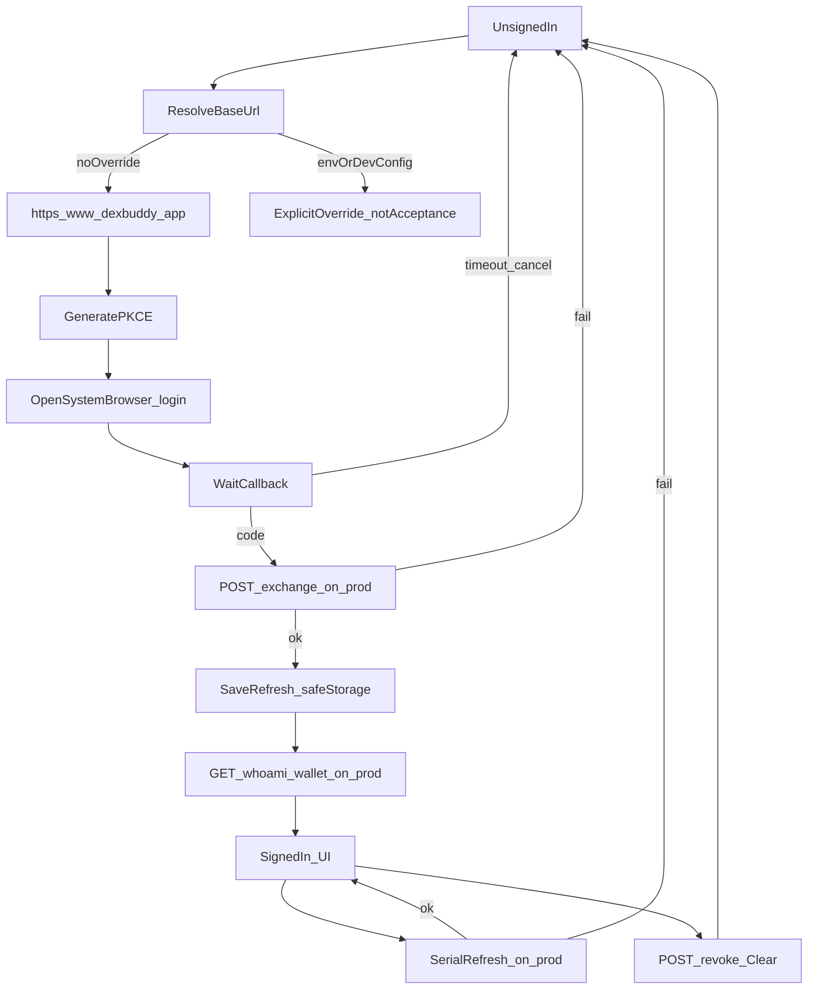
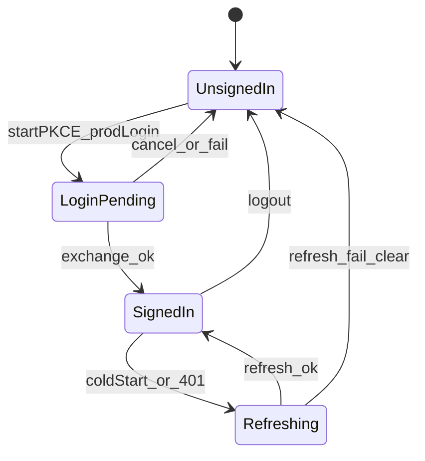

# PRD: 线上网关默认域名

| 属性 | 值 |
|---|---|
| 状态 | 工程：accepted。见文末「工程验收状态」章 |
| 范围 | Electron 宿主：默认网关 base URL、开发说明与默认域名单测；用线上复验 00012 已有会话，不新增登录能力 |
| 关联文档 | `specs/prds/prd-00012-host-gateway-session.md`、`docs/memo/phase1-repos-and-auth.md`、`docs/DESIGN.md`、`src/main/gateway-config.ts`、`config.dev.example.json`、`README.md`；兄弟仓契约 `../0001-HyHarness-gateway/public/openapi.json` |
| 关联实现（预告） | `src/main/gateway-config.ts`、`config.dev.example.json`、`README.md`、`test/gateway-config.test.ts` |
| 姊妹 PRD | 插件经宿主调用模型 `specs/prds/prd-00014-host-chat-egress.md` |
| 兄弟仓依赖 | 线上网关已部署于 `https://www.dexbuddy.app`；本 PRD 不改网关代码 |

## 1. 背景与问题

[`prd-00012-host-gateway-session.md`](./prd-00012-host-gateway-session.md) 已接通桌面会话：`dexbuddy://auth/callback`、PKCE、`safeStorage` refresh、图标轨与设置里的脱敏手机号和积分。协议、凭证边界与双入口仍归 00012。

00012 拍板的默认地址已经过时：

| 场景 | 今天 | 问题 |
|---|---|---|
| 未打包 `pnpm start` | `http://localhost:3000` | 本机网关正在改其它内容，不能当联调对象 |
| 安装包 | `https://app.dexbuddy.xds365.com` | 线上登录已迁到 [https://www.dexbuddy.app](https://www.dexbuddy.app) |

开发配置 `config.dev.json` 的 `gatewayBaseUrl` 和环境变量 `DEX_GATEWAY_BASE_URL` 会盖过默认值。仓库里的 [`config.dev.example.json`](../../config.dev.example.json) 目前把示例写成 localhost；复制后会把新默认值再次盖掉。

用户打开客户端点登录时，系统浏览器必须落到线上 `/login`，回调仍回本机客户端。本次只改「打哪一台网关」，不改登录怎么交会话。

## 2. 目标与非目标

### 目标

- 未打包与安装包的默认网关 base 都是 `https://www.dexbuddy.app`（无尾斜杠）。
- 退役默认值 `https://app.dexbuddy.xds365.com` 与默认值 `http://localhost:3000`。
- 用线上走通 00012 已有主路径：PKCE 登录、冷启动 refresh、whoami 脱敏手机号、积分页余额、退出。
- `README.md` 与 `config.dev.example.json` 与新默认一致；覆盖写法仍可指向其它地址，但不作为本次验收。
- 默认常量相关单测断言新域名。

### 非目标

- 改网关仓、新增或修改 HTTP 接口。
- 文案转发、已购列表、购买积分、生图（见 00014）。
- 设备码界面（00012 遗留，不挪进本文）。
- 粘贴授权码、宿主内 OTP、把 token 交给渲染进程。
- 把本机 `localhost:3000` 当作验收环境，或启动、依赖本机正在改的网关。
- 把已忽略的 `config.dev.json` 改入仓库。
- Release 1 及更高版本占位。

### 成功标准

- 未设置环境变量、也未写 `config.dev.json` 的 `gatewayBaseUrl` 时，未打包与安装包解析出的 base 均为 `https://www.dexbuddy.app`。
- 点登录后，系统浏览器打开的地址 origin 为 `https://www.dexbuddy.app`，路径为 `/login`，并带 00012 已定的 PKCE 三参数与 `redirect_uri=dexbuddy://auth/callback`。
- 在线上完成手机号验证码后，工作台已登录：通用设置账号行显示 `phoneMasked`，积分页显示余额（可为 0）。
- 退出 Dex Buddy 再打开，无需再登，摘要仍可用。
- 点退出后本机无 refresh，两处入口回到未登录。
- 源码与文档中，默认生产地址不再出现 `app.dexbuddy.xds365.com`。

## 3. 术语

| 术语 | 含义 |
|---|---|
| 网关 base | 宿主主进程解析出的 origin（可带路径前缀，无尾斜杠）；登录页与 `/v1/*` 都接在它后面 |
| 线上网关 | `https://www.dexbuddy.app` |
| 旧生产域名 | `https://app.dexbuddy.xds365.com`，本文起不再作为默认 |
| 覆盖 | 环境变量 `DEX_GATEWAY_BASE_URL` 或开发配置 `gatewayBaseUrl` 显式指定的 base；优先级仍高于默认值 |
| 会话摘要 | 渲染层可见的脱敏态：是否已登录、`phoneMasked`、余额；不含 token。形态仍由 00012 规定 |

## 4. 已拍板规则

| 项 | 状态 | 决定 |
|---|---|---|
| 默认 base | 已定 | 未打包与安装包相同：`https://www.dexbuddy.app` |
| 旧生产域名 | 已定 | 不再作为默认；解析逻辑不必特判重定向，改常量即可 |
| localhost | 已定 | 仅覆盖用途；**不是**默认，**不是**本次验收环境 |
| 覆盖优先级 | 已定 | 仍为环境变量 > `config.dev.json` > 默认值（见 `resolveGatewayBaseUrl`） |
| 验收必须打线上 | 已定 | 验收机不得依赖覆盖到 localhost；本机网关正在改其它内容 |
| `config.dev.json` | 已定 | 已 gitignore；若本机仍写 localhost，联调前人工删掉或改成线上。不入库 |
| `config.dev.example.json` | 已定 | 不再把 localhost 写成可复制即生效的示例值，以免盖过新默认；覆盖写法写在 README |
| 登录页与回调 | 已定 | `{base}/login`；`dexbuddy://auth/callback`。不改 00012 的 PKCE / 凭证规则 |
| 凭证边界 | 已定 | access 主进程内存；refresh 仅 `safeStorage`；渲染进程与插件页面不接触 token |
| 界面 | 已定 | 不新增入口、不改 `docs/DESIGN.md` 账号三态与积分页布局 |
| 与 00012 | 已定 | 协议、会话模块、双入口、设备码遗留仍归 00012；本文只改「默认打哪」并在线上复验主路径 |

## 5. 用户与角色

| 角色 | 目标 |
|---|---|
| 终端用户 | 点登录后进线上验证码页，回来看到自己的号和积分 |
| 宿主工程 | 改默认常量与文档；验收打线上，不启本机网关 |
| 网关工程 | 线上已可用；本 PRD 不改网关 |
| 本机改网关的同事 | 其 localhost 进程不被本次联调占用 |

## 6. 功能域

### 6.1 默认 base

[`src/main/gateway-config.ts`](../../src/main/gateway-config.ts) 中未打包默认与安装包默认都改为 `https://www.dexbuddy.app`。`normalizeGatewayBaseUrl` 与覆盖优先级不变。

### 6.2 开发说明

[`README.md`](../../README.md) 中「未设置时，开发默认 localhost、安装包默认旧域名」改为「未设置时默认 `https://www.dexbuddy.app`」；说明仍可用环境变量或 `gatewayBaseUrl` 覆盖，并写明覆盖到本机只供显式本机调试，不是默认路径。

[`config.dev.example.json`](../../config.dev.example.json) 去掉会把默认盖回 localhost 的示例值（删除该键，或改为注释说明「需要覆盖时再写」——以实现时能通过 JSON 解析为准）。

### 6.3 单测

[`test/gateway-config.test.ts`](../../test/gateway-config.test.ts) 对无覆盖时 `isPackaged` true / false 的断言改为线上域名。把 localhost 当作 URL 规范化夹具的用例可以保留。

### 6.4 线上复验（不改会话实现）

沿用 00012 已实现的：打开系统浏览器、处理回调、exchange / refresh / revoke、whoami / wallet、账号行与积分页。本文验收时上述请求的 origin 必须是 `https://www.dexbuddy.app`。

联调前检查（不入库）：本机若存在 `config.dev.json` 且 `gatewayBaseUrl` 为 localhost，删掉该键或改成线上，否则新默认不会生效。

## 7. 用户故事地图与版本切片

### 7.1 旅程主干

#### 旅程 A：未覆盖时打线上登录

| 步骤 | Entry / 动作 | Exit |
|---|---|---|
| A0 | Entry：未设置覆盖；未登录，点图标轨或通用设置「登录」 | 主进程用默认 base 生成 PKCE |
| A1 | 系统浏览器打开 `https://www.dexbuddy.app/login?code_challenge=…&code_challenge_method=S256&redirect_uri=dexbuddy://auth/callback` | 用户见线上登录页 |
| A2 | 用户完成手机号 OTP（线上网关） | 浏览器尝试打开回调 |
| A3 | 宿主收到 `code`，向线上 `POST /v1/auth/exchange` | 获得 token 对 |
| A4 | refresh 写入 `safeStorage`；向线上拉取 whoami / wallet | 摘要已登录 |
| A5 | Exit：账号行与积分页展示线上账号 | Teardown：退出 → 线上 revoke + 清空本机 |

#### 旅程 B：冷启动续期

| 步骤 | Entry / 动作 | Exit |
|---|---|---|
| B0 | Entry：本机已有 refresh；启动应用且无覆盖 | 向线上 `POST /v1/auth/refresh` |
| B1 | 成功则拉 whoami / wallet | Exit：仍显示同一脱敏手机号与余额 |
| B2 | refresh 失败 | Exit：清空凭证，UI 未登录，可再走旅程 A |

#### 旅程 C：退出

| 步骤 | Entry / 动作 | Exit |
|---|---|---|
| C1 | Entry：已登录，点「退出」 | 尽力 `POST /v1/auth/revoke`（线上）+ 清内存与 `safeStorage` |
| C2 | Exit：双入口未登录 | 再拉 whoami 不得静默成功 |

#### 旅程 D：覆盖存在时（不验收通过）

| 步骤 | Entry / 动作 | Exit |
|---|---|---|
| D1 | Entry：环境变量或 `config.dev.json` 指向 localhost 或其它 origin | 登录打覆盖地址 |
| D2 | Exit：行为仍符合 00012；**不能**用本旅程宣称 00013 通过 | 联调前应去掉覆盖后再走旅程 A |

### 7.2 用户故事地图

| 阶段 | 目标 | 故事 | 验收要点 |
|---|---|---|---|
| 默认地址 | 打开即连线上 | 作为用户，我想在未做任何配置时登录线上网关，以便不必改本机文件 | 未打包与安装包默认 base 均为 `https://www.dexbuddy.app`；源码默认值不再含旧域名或 localhost |
| 登录 | 浏览器完成身份 | 作为用户，我想点登录后进入 dexbuddy.app 的验证码页，以便用手机号登入 | 打开的 URL origin 为 `https://www.dexbuddy.app`，路径 `/login`，含 PKCE 三参数与白名单 redirect |
| 交接 | 回到客户端 | 作为用户，我想验证成功后自动回到工作台，以便看到自己的号 | 回调触发 exchange；账号行显示 `phoneMasked`；积分页显示余额 |
| 续期 | 重启仍登录 | 作为用户，我想关掉再打开后仍保持登录，以便不必每次验证码 | 仅依赖 refresh 打线上；无 refresh 则未登录 |
| 退出 | 清掉这台机器 | 作为用户，我想退出并清除本机登录，以便换号或交还电脑 | 线上 revoke 后无 refresh；UI 未登录 |
| 文档 | 覆盖可找得到 | 作为开发者，我想在 README 看到默认已是线上、以及如何显式覆盖，以便偶尔打别的环境 | README 与 example 不再诱导复制 localhost 当默认 |
| 隔离 | 不占用同事本机网关 | 作为正在改网关的同事，我不希望工作台默认连我的 3000 端口，以便互不干扰 | 验收声明未启动本机网关；覆盖到 localhost 不算通过 |

### 7.3 Release 切片

#### Release 0（MVP，必选）

可验收结果：

1. 默认 base（未打包与安装包）为 `https://www.dexbuddy.app`。
2. 无覆盖时，线上 PKCE 主路径端到端（登录、摘要、退出）。
3. 无覆盖时，冷启动 refresh 恢复同一账号。
4. README 与 `config.dev.example.json` 与新默认一致；默认域名单测更新。
5. 源码默认值不再使用 `app.dexbuddy.xds365.com` 或 `http://localhost:3000`。

本文**不**定义 Release 1。文案、买断、生图见姊妹 PRD。

## 8. 核心流程与状态机图

### 8.1 主流程（线上 PKCE）

### 8.2 会话状态

死胡同预警：`LoginPending` 必须能取消或超时回到 `UnsignedIn`（沿用 00012）。`Refreshing` 失败必须清空坏凭证。覆盖到不可用的本机网关会卡在失败，这是覆盖误用，不是默认路径；验收前去掉覆盖。

## 9. 数据与 API 衔接

本仓不建业务库表。持久化仍仅为 00012 的 `safeStorage` refresh。

调用的线上路径不变，origin 改为 `https://www.dexbuddy.app`：

| 方法 | 路径 | 用途 |
|---|---|---|
| — | `/login` | 系统浏览器打开 |
| POST | `/v1/auth/exchange` | PKCE 换 token |
| POST | `/v1/auth/refresh` | 轮换 refresh |
| POST | `/v1/auth/revoke` | 退出 |
| GET | `/v1/whoami` | 脱敏身份与钱包快照 |
| GET | `/v1/wallet` | 积分余额（可与 whoami 交叉） |

形状以兄弟仓 OpenAPI 为准。本文不新增路径。

## 10. 假设与待确认

### 假设

- 线上 `https://www.dexbuddy.app` 的 `/login`、PKCE 回调白名单与 `/v1/auth/*`、`whoami`、`wallet` 行为与 OpenAPI 一致，短信 OTP 可用。
- 网关已允许 redirect `dexbuddy://auth/callback`。
- 打包与未打包都走同一套 `resolveGatewayBaseUrl`。

### 开放项

- README 中网关段落是原地改现有长段，还是单列「网关地址」小标题：实现时选一种，保持能搜到 `www.dexbuddy.app`。
- `config.dev.example.json` 是删除 `gatewayBaseUrl` 键，还是保留键但改为线上地址：实现时选一种，**禁止**保留 localhost 作为示例生效值。

不把 00014 的技术选型写入本文。

## 11. 修订记录

| 日期 | 说明 |
|---|---|
| 2026-10-26 | 初稿：默认打 www.dexbuddy.app；线上复验 00012 主路径；不设 Release 1 |

## 12. 工程验收状态

> 由 `/team:prd-accept` 维护；勿手工编造「通过」。最后更新：2026-10-26T02:35:48Z，dev@d6f8977（00013 改动在工作区未提交），范围：R0,R1。

### 总览

| 项 | 值 |
|---|---|
| 工程状态 | accepted |
| 验收判定 | 通过 |
| 最近验收 | 2026-10-26T02:35:48Z |
| 代码提交 | HEAD `d6f8977`（00012 会话接入）；00013 默认域名在工作区：`src/main/gateway-config.ts`、`config.dev.example.json`、`README.md`、`test/gateway-config.test.ts` |

摘要：

1. 未打包与安装包默认 base 均为 `https://www.dexbuddy.app`；`src/` 默认值不再含旧域名或 localhost。
2. 无覆盖时线上 PKCE 主路径已手测通过（登录、摘要、退出）；登录页 origin 与 PKCE 三参数已核对。
3. 无覆盖时冷启动 refresh 恢复同一账号，维护者确认通过。
4. README 与 example 不再诱导复制 localhost；默认域名单测断言线上字面量。
5. 正文不定义 Release 1，标为范围外。

### Release 交付

| Release | 状态 | 说明 |
|---|---|---|
| R0 | 通过 | 默认线上域名、文档、单测、线上复验主路径均有证据 |
| R1 | 范围外 | 正文写明本文不定义 Release 1 |

### 功能验收清单（Agent 优先读此表）

| ID | 能力摘要 | Release | 状态 | 证据 |
|---|---|---|---|---|
| F01 | 未打包与安装包默认 base 均为 `https://www.dexbuddy.app` | R0 | 通过 | `src/main/gateway-config.ts` 中 `DEV_DEFAULT_GATEWAY_BASE_URL` 与 `PROD_DEFAULT_GATEWAY_BASE_URL` 同为该值；`resolveGatewayBaseUrl` 无覆盖时 `isPackaged` true/false 均落到该常量 |
| F02 | 源码默认值退役旧域名与 localhost | R0 | 通过 | `src/` 无 `app.dexbuddy.xds365.com`、无 `localhost:3000`。localhost 仅作规范化夹具与 README 覆盖示例 |
| F03 | 无覆盖时登录打开线上 `/login` 并带 PKCE 三参数 | R0 | 通过 | `buildLoginUrl` 拼 `{base}/login`、`code_challenge`、`code_challenge_method=S256`、`redirect_uri=dexbuddy://auth/callback`。未覆盖解析出的 URL origin 为 `https://www.dexbuddy.app`；线上登录页已打开并显示手机号验证码 |
| F04 | 线上 OTP 后工作台显示 `phoneMasked` 与余额 | R0 | 通过 | 沿用 00012 `gateway-session` whoami/wallet；维护者确认线上验证码后账号行与积分页通过。本机 `config.dev.json` 无 `gatewayBaseUrl` |
| F05 | 冷启动 refresh 恢复同一账号 | R0 | 通过 | 沿用 00012 `refreshSerial`；维护者确认退出 Dex Buddy 再打开无需再登 |
| F06 | 退出后本机无 refresh，双入口未登录 | R0 | 通过 | 沿用 00012 logout revoke + 清 `safeStorage`；维护者确认通过 |
| F07 | README 与 example 与新默认一致 | R0 | 通过 | `README.md` 写明未设置时默认线上，覆盖仅显式调试。`config.dev.example.json` 已删除 `gatewayBaseUrl` |
| F08 | 默认域名单测断言线上字面量 | R0 | 通过 | `test/gateway-config.test.ts` 对 `isPackaged` true/false 无覆盖分支断言 `'https://www.dexbuddy.app'` |
| F09 | 验收未占用本机网关 | R0 | 通过 | 默认不再指向 localhost；本机 `config.dev.json` 无该键。覆盖到 localhost 的旅程 D 不作为通过依据 |
| D01 | 覆盖到其它 origin 的登录 | — | 范围外 | 旅程 D 正文写明不验收通过 |

### 未完成与遗留

无。Release 1 未定义。文案转发、买断、生图见 00014，不在本文。

### 质量检查

| 检查项 | 状态 |
|---|---|
| pnpm test | 通过（177） |
| 文档同步（README / docs/doc_index.md） | 通过（README 已改；无新增文档需登记） |

---
统计：通过 9 / 部分 0 / 未实现 0 / 范围外 1

