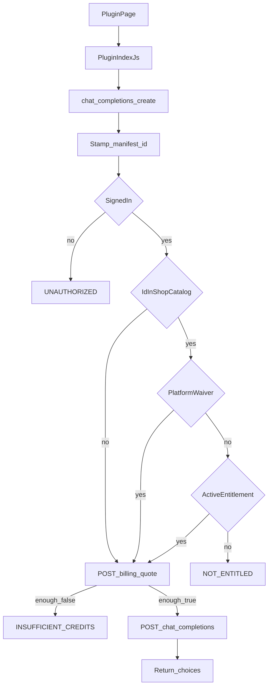
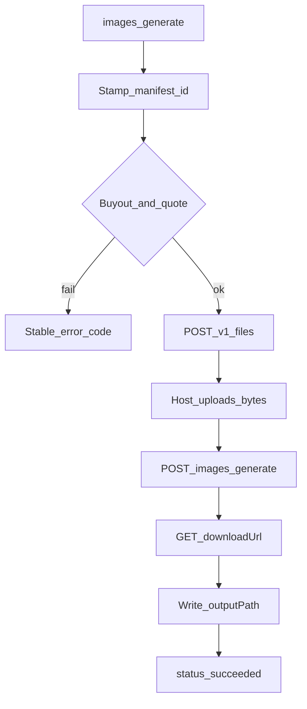
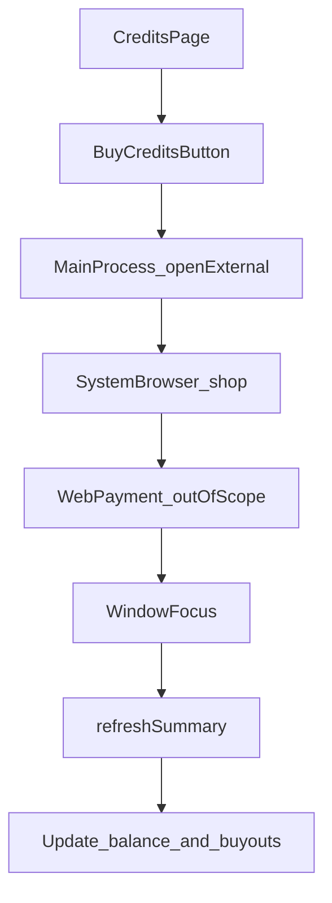

# PRD: 插件经宿主调用模型

| 属性 | 值 |
|---|---|
| 状态 | 工程：accepted。见文末「工程验收状态」章 |
| 范围 | Electron 宿主：`ctx.models` 文案与生图、共享盖章与买断闸、积分页已购列表与「购买积分」、插件文档与可拷贝助手。依赖 [`prd-00013-prod-gateway-base.md`](./prd-00013-prod-gateway-base.md) 的线上默认域名 |
| 关联文档 | `docs/memo/phase1-billing.md`、`docs/plugin-development/models.md`、`docs/DESIGN.md`；兄弟仓 OpenAPI `../0001-HyHarness-gateway/public/openapi.json` |
| 姊妹 PRD | 域名与会话 [`prd-00013-prod-gateway-base.md`](./prd-00013-prod-gateway-base.md) |
| 兄弟仓依赖 | 线上网关已部署于 `https://www.dexbuddy.app`。本 PRD 不改网关代码 |

## 1. 背景与问题

线上网关已提供模型目录、报价、文案补全、参考图上传和按张生图。工作台今天会登录并展示积分，插件还不能经宿主烧额度；积分页也看不出买了哪些插件。插件页面不该自己拿 token 去打网关。

本文是这一条出口的唯一 PRD：清单 id 由宿主盖上、`X-Plugin-Id` 对网关仍可选、有限买断拦截、OpenAI / Replicate 调用形状、生图落盘、积分页已购列表、「购买积分」打开 `/shop`。

默认打 `https://www.dexbuddy.app`。不跟本机网关联调。

## 2. 目标与非目标

### 目标

- 插件后端经 `ctx.models` 调用线上 `GET /v1/models`、`POST /v1/billing/quote`、`POST /v1/chat/completions`、生图代传与落盘。
- 宿主用当前插件的 `manifest.id` 盖 `X-Plugin-Id`。插件参数与请求体里没有 `pluginId`。
- 文案请求体与成功体保持 OpenAI Chat Completions 字段名。生图 `input` 保持 Replicate 字段名。模型 id 是网关渠道 Model ID。
- 余额不够时宿主先报价，不够就不转发。
- 清单 id 出现在商城商品里且没有生效买断时，不转发文案和生图。
- 插件页面不自己请求网关，也不拿到 token、上传凭证、`downloadUrl`。
- 登录后在积分页看出已购插件；点「购买积分」用系统浏览器打开 `{gatewayBase}/shop`；回到前台刷新余额与列表。
- 插件作者可拷贝 Node / Python 助手：独立跑用本机 `DEX_BUDDY_API_KEY` 打我们的网关（开发者付钱）；装进 Dex Buddy 后助手改走 `ctx.models`（谁用谁付钱）。Key 不进包。

### 非目标

- 改网关、本机网关联调、流式输出。
- 宿主自己消费用户 API Key。Key 只给作者独立跑助手用。
- 插件包签名、验签、加密壳。删签名再改成普通 id 这一期接受。
- 把 `X-Plugin-Id` 改成网关必填。其它平台与 API Key 只烧积分，可以不带这个头。
- 改成带点的 Bundle ID。
- 改外部插件仓（小红书等）。
- 在客户端做支付。网页登录会话与桌面会话打通。
- 发 npm 包，或要求作者克隆宿主仓。
- Release 1 及更高版本占位。

### 成功标准

- 官方或已安装插件调用 `chat.completions.create` / `images.generate` 时，发出的请求带 `X-Plugin-Id: <manifest.id>`，body 不含 `pluginId`。
- 该 id 在 `GET /api/shop/catalog` 的 `plugins[].pluginId` 里，且 `GET /v1/entitlements` 没有 `active`：宿主返回 `NOT_ENTITLED`，不打补全或生图。
- 该 id 不在商城商品里：只要已登录且余额够，可以烧积分。
- `quote.enough === false` 时不转发，错误码 `INSUFFICIENT_CREDITS`。
- 未登录时错误码 `UNAUTHORIZED`。
- 带参考图的一次生图：宿主发出 files + generate，插件只看到本地 `outputPath`。
- 已登录且有 active 权益时，积分页列出 `名称 (pluginId)`（没有名称时只显示 id）。
- 点「购买积分」后系统浏览器 origin 为当前网关 base，路径 `/shop`。

## 3. 术语

| 术语 | 含义 |
|---|---|
| 清单 id | `plugin.manifest.json` 的 `id`，也是盖到 `X-Plugin-Id` 的值 |
| 官方插件 | 授权名单仓库打出的包；新 id 建议 `app-dexbuddy-` 前缀 |
| 用户插件 | 同事自己做的、或改过清单 id 的包 |
| 商城商品 | `GET /api/shop/catalog` 的 `plugins[]`，绑定买断型 `pluginId` |
| 渠道 Model ID | `GET /v1/models` 的 `data[].id`，不是供应商模型路径 |
| 有限拦截 | 没改文件的正式安装包按清单 id 查买断；改成普通 id 后当作用户插件 |
| 已购列表 | `GET /v1/entitlements` 中 `status=active` 的项 |
| `input` | Replicate 风格对象：`prompt`、`aspect_ratio`、`input_images` |
| `input_images` | 本机文件路径数组，不是供应商 URL |

## 4. 已拍板规则

| 项 | 状态 | 决定 |
|---|---|---|
| 盖章 | 已定 | 宿主闭包当前 `manifest.id`。插件不能自己传 id |
| `X-Plugin-Id` | 已定 | 对我们自己的插件每次都带；网关合同仍为可选，只进流水 |
| 买断闸门 | 已定 | 只在宿主。网关烧钱路径不查买断 |
| 闸门条件 | 已定 | id ∈ 商城商品 **且** 无 `active` 权益 → 不转发文案 / 生图。`list` 与 `quote` 不拦 |
| 免费官方 / 用户插件 | 已定 | 不在商城商品里则只验登录和余额 |
| 改 id 白嫖 | 已定 | 删掉任何标记、改成普通 id：当作用户插件。本期接受 |
| 签名 | 已定 | 本期不做 |
| 插件 id 字符 | 已定 | 仍为 `^[a-z0-9][a-z0-9-]{0,63}$`。新官方插件用前缀 `app-dexbuddy-`，只是命名，宿主不因前缀拒载。已有 `ai-comic-master`、`quanmedia-crawl` 继续有效 |
| 调用形状 | 已定 | 文案对齐 OpenAI；报价对齐 `POST /v1/billing/quote`；生图 `input` 对齐 Replicate 字段名。宿主不发明驼峰字段 |
| 生图方法名 | 已定 | `ctx.models.images.generate`。落盘为插件传入的绝对 `outputPath` |
| 幂等键 | 已定 | 可选，放 `Idempotency-Key` 头，不写进业务 JSON |
| 凭证 | 已定 | access 主进程内存；refresh 仅 `safeStorage`；渲染进程与插件页面不接触 token、上传凭证、`downloadUrl` |
| 域名 | 已定 | 默认 `https://www.dexbuddy.app` |
| 积分页 | 已定 | 设置 → 积分。「已购插件」只读列表；按钮文案「购买积分」，仍打开 `/shop` |
| 打开方式 | 已定 | 主进程 `shell.openExternal`，渲染层不拼网关域名 |
| 刷新 | 已定 | 沿用「重新同步」；另在窗口 focus 时拉一次（短防抖） |
| 未登录 | 已定 | 已购列表不展示；「购买积分」仍可点 |
| 支付 | 已定 | 只在网页。桌面不嵌入收银台 |
| 独立开发 | 已定 | 可拷贝 Node / Python 助手。独立跑读 `DEX_BUDDY_API_KEY`；工作台走 `ctx.models`。Key 不进 zip、不进 `configSchema` |
| 谁付钱 | 已定 | 独立跑扣开发者；装进 Dex Buddy 扣打开插件的使用者 |

## 5. 用户与角色

| 角色 | 目标 |
|---|---|
| 终端用户 | 已购的小红书等插件能生成文案和图片；没买则停在买断提示；余额不够则停在充值提示；积分页能看见已购并去买积分 |
| 插件作者 | 按 OpenAI / Replicate 习惯写调用；独立跑填我们的 API Key；发出去的包没有 Key |
| 自己做插件的同事 | 不在商城里的 id 登录后可以烧积分 |
| 宿主工程 | 盖 id、报价、转发、代传文件、把网关错误码交给插件 |

## 6. 功能域

### 6.1 `ctx.models`

`apply(ctx)` 时注入。页面继续只调 `window.dex.call`。

- `list()` → `GET /v1/models`
- `billing.quote(body)` → `POST /v1/billing/quote`
- `chat.completions.create(body, { idempotencyKey })` → 先报价，再 `POST /v1/chat/completions`
- `images.generate({ model, input, outputPath }, { idempotencyKey })` → 买断闸与报价后：读本地图 → `POST /v1/files` → 表单上传 → `POST /v1/images/generate` → GET `downloadUrl` → 写 `outputPath`。返回 `{ status: 'succeeded', output, model }`

### 6.2 盖章与剥离

发出去的 JSON 去掉 `pluginId`。头：`Authorization: Bearer <access>`、`X-Plugin-Id: <manifest.id>`，可选 `Idempotency-Key`。

### 6.3 有限买断拦截

仅 `chat.completions.create` 与 `images.generate`。商城目录拉不到时，这一闸放行（仍要登录）；登录失败仍是 `UNAUTHORIZED`。

### 6.4 积分页

「当前积分」分组下是「已购插件」只读列表。右侧文字按钮「购买积分」，样式与「重新同步」相同。IPC 由主进程用已解析的 gateway base 拼 `/shop`。`browser-window-focus` 且已登录时刷新 wallet、entitlements、shop catalog。

显示名：商城目录 `name` / `displayName` / `title` → 本机已加载插件的 `manifest.displayName` → `pluginId`。与 id 不同时写成 `名称 (pluginId)`。

### 6.5 错误码

插件看到稳定 `code`：`UNAUTHORIZED`、`NOT_ENTITLED`、`INSUFFICIENT_CREDITS`，以及网关 `ErrorBody` / ChatError 原样映射。页面文案由插件自己写。

### 6.6 可拷贝助手

文档提供 `dex-buddy-sdk.js` 与 `dex_buddy_sdk.py`（见 00015）。作者拷进自己的插件。独立进程用 `DEX_BUDDY_API_KEY` 打线上网关；`apply(ctx)` 里有 `ctx.models` 则忽略 Key。Python 子进程由 Node SDK 注入本机代理并删掉子进程里的 Key。

## 7. 用户故事地图与版本切片

### 7.1 旅程主干

#### 旅程 A：已购插件写稿

| 步骤 | Entry / 动作 | Exit |
|---|---|---|
| A0 | Entry：已登录，已购该清单 id，插件后端调用 `chat.completions.create` | 宿主盖 id |
| A1 | 查商城商品与 entitlements | 已购，继续 |
| A2 | `POST /v1/billing/quote` | `enough === true` |
| A3 | `POST /v1/chat/completions` 带 `X-Plugin-Id` | 返回 `choices` |
| A4 | Exit：插件从 `choices[0].message.content` 取文本 | Teardown：无本机账单 |

#### 旅程 B：商城插件未买断

| 步骤 | Entry / 动作 | Exit |
|---|---|---|
| B0 | Entry：已登录，id 在商城，无 active 权益 | 宿主拦截 |
| B1 | Exit：抛 `NOT_ENTITLED`，未打补全 | 用户可点「购买积分」打开 `/shop` |

#### 旅程 C：余额不足

| 步骤 | Entry / 动作 | Exit |
|---|---|---|
| C0 | Entry：已购或非商城插件，报价 `enough === false` | 不打补全 |
| C1 | Exit：`INSUFFICIENT_CREDITS` | 积分页可购买积分 |

#### 旅程 D：用户自己的插件

| 步骤 | Entry / 动作 | Exit |
|---|---|---|
| D0 | Entry：清单 id 不在商城商品 | 不查买断 |
| D1 | 已登录且余额够 | Exit：补全成功，头仍带该 id |

#### 旅程 E：未登录

| 步骤 | Entry / 动作 | Exit |
|---|---|---|
| E0 | Entry：无会话 | `UNAUTHORIZED` |
| E1 | Exit：不打网关业务口 | 用户先登录 |

#### 旅程 F：带参考图生一张

| 步骤 | Entry / 动作 | Exit |
|---|---|---|
| F0 | Entry：已登录且允许调用，插件传入 prompt、本地参考图、outputPath | 宿主盖 id |
| F1 | 买断闸与报价 | 够余额 |
| F2 | 申请上传凭证并代传 | 得到 fileId |
| F3 | 生图并下载 | 写入 outputPath |
| F4 | Exit：`status=succeeded`，`output` 为该路径 | Teardown：凭证不回插件 |

#### 旅程 G：查看已购并去买积分

| 步骤 | Entry / 动作 | Exit |
|---|---|---|
| G0 | Entry：已登录，打开积分 | 见余额与已购列表 |
| G1 | 点「购买积分」 | 系统浏览器打开 `/shop` |
| G2 | 在网页完成支付（范围外实现） | 网页已入账 |
| G3 | 回到 Dex Buddy，窗口获焦 | 重新同步 |
| G4 | Exit：列表与余额已更新 | Teardown：退出后列表清空 |

#### 旅程 H：作者独立跑再发布

| 步骤 | Entry / 动作 | Exit |
|---|---|---|
| H0 | Entry：作者拷助手，本机 env 填 `DEX_BUDDY_API_KEY` | 独立进程打网关，扣作者积分 |
| H1 | 业务只调 `models.chat` / `images` | 与上线同一套调用 |
| H2 | 打成插件发出去，Key 不在包里 | 装进 Dex Buddy 后走 `ctx.models` |
| H3 | Exit：使用者登录后调用，扣使用者积分 | 作者 Key 未出本机 |

### 7.2 用户故事地图

| 阶段 | 目标 | 故事 | 验收要点 |
|---|---|---|---|
| 调用 | 插件能写稿 | 作为插件作者，我想用 OpenAI 形状的 `chat.completions.create`，以便少改现有 client | body 字段不改名；成功体含 `choices`；无顶层 billing |
| 生图 | 得到本地文件 | 作为插件作者，我想把参考图路径和 outputPath 交给宿主，以便页面继续用本地预览 | 文件存在且非空；返回值无 token / url |
| 盖章 | 流水能对上插件 | 作为宿主，我要自己盖清单 id，以便插件填不了别人的 id | 请求头为当前 manifest.id；body 无 pluginId |
| 买断 | 没买的官方包不能烧模型 | 作为产品，我希望商城里的插件未买断时停住，以便买断仍有意义 | 不转发；`NOT_ENTITLED` |
| 看见 | 知道买了什么 | 作为用户，我想在积分页看到已购插件，以便确认账号权益 | 名称优先；空态可辨 |
| 购买 | 去网页付钱 | 作为用户，我想从工作台购买积分，以便买插件或积分包 | 打开 `{base}/shop` |
| 回来 | 不必再点同步 | 作为用户，我想买完切回客户端就看到新余额，以便继续生成 | 窗口获焦后摘要更新 |
| 独立 | 不克隆宿主仓 | 作为作者，我想拷一份助手在自己的仓库里跑，以便用我们的 Key 调试 | 上线不改调用处；Key 不进包 |
| 文档 | 后来的人写得对 | 作为插件作者，我想在插件文档里看到调用例子，以便按标准接口写 | `docs/plugin-development/models.md` 有例子 |

### 7.3 Release 切片

#### Release 0（MVP，必选）

1. `ctx.models.list` / `billing.quote` / `chat.completions.create` / `images.generate` 可用。
2. 宿主盖 `X-Plugin-Id`，插件不能改。
3. 商城 id 未买断不转发。
4. 报价不够不转发。
5. 积分页已购列表与「购买积分」；窗口获焦刷新。
6. 插件文档写明调用形状、错误码、可拷贝助手与谁付钱。

本文不定义 Release 1。

## 8. 核心流程与状态机图

### 8.1 文案转发

### 8.2 生图

### 8.3 购买积分与刷新

死胡同预警：`Checking` 在商城目录失败时不得把用户插件一律当成未买断；目录失败则跳过买断闸，仍要登录。上传成功但生图失败时，不必让插件清理七牛对象。获焦刷新失败不得留下过期已购当真相。独立跑的 Key 不得在 `apply(ctx)` 已有 `ctx.models` 时继续使用。

## 9. 数据与 API 衔接

本仓不建业务库表。会话仍为 00012 的 `safeStorage` refresh。

| 方法 | 路径 | 用途 |
|---|---|---|
| GET | `/v1/models` | 渠道模型列表 |
| POST | `/v1/billing/quote` | 生成前估价 |
| POST | `/v1/chat/completions` | 非流式补全 |
| POST | `/v1/files` | 直传凭证 |
| POST | `/v1/images/generate` | 按张生图，成功体 `downloadUrl` |
| GET | `/v1/entitlements` | 买断闸与已购列表 |
| GET | `/api/shop/catalog` | 哪些 id 是商城买断商品；显示名 |
| GET | `/v1/wallet` | 余额（已有） |
| — | `/shop` | 系统浏览器 |

形状以兄弟仓 OpenAPI 为准。本文不新增网关路径。

## 10. 假设与待确认

### 假设

- 线上 OpenAPI 与 `https://www.dexbuddy.app` 行为一致。
- 商城 `plugins[].pluginId` 即买断型商品；免费插件不进该数组。
- 插件 `apply` 时拿到的 `ctx.models` 在之后的服务方法里仍指向同一宿主出口。
- 网关 generate 在单次 HTTP 内完成轮询，宿主只需一次 POST 再下载。
- 用户在网页商城登录的账号与桌面 PKCE 是同一手机号时，权益才会对上。

### 开放项

- 商城目录短暂失败时的重试间隔：实现时选几十秒缓存即可。
- 小红书仓何时改 `src/llm/client.js`：不在本仓，另开插件仓任务。
- 参考图 MIME 仅覆盖常见 png / jpeg / webp / gif；其它扩展按 octet-stream。

## 11. 修订记录

| 日期 | 说明 |
|---|---|
| 2026-10-26 | 初稿：功能清单 |
| 2026-10-26 | 技术讨论后补合同：盖章、有限买断闸、OpenAI 形状、本期不做签名 |
| 2026-10-26 | 把原 00015（已购列表 / 购买积分）与 00016（生图落盘）并进本文；积分页文案改为已购插件与购买积分；补可拷贝助手与谁付钱 |
| 2026-10-27 | 00015 修订：文案 / 生图未买断弹框仍保留；拦截顺序改为未登录 → 未买断（未上架 / 限免跳过）→ 积分不够；可拷贝助手改名为 `dex-buddy-sdk.js` / `dex_buddy_sdk.py` |

## 12. 工程验收状态

> 由 `/team:prd-accept` 维护；勿手工编造「通过」。最后更新：2026-10-26T07:17:12Z，dev@86666f3（00014 实现在工作区未提交），范围：R0,R1。

### 总览

| 项 | 值 |
|---|---|
| 工程状态 | accepted |
| 验收判定 | 通过 |
| 最近验收 | 2026-10-26T07:17:12Z |
| 代码提交 | HEAD `86666f3`；00014 在工作区：`src/main/host-egress.ts`、`src/main/gateway-session.ts`、`src/renderer/settings.js`、`docs/plugin-development/models.md`、`plugins/models-playground/`、`test/host-egress.test.ts`、`test/dex-models.test.ts` |

摘要：

1. `ctx.models` 四方法、盖章、买断闸、报价闸、生图落盘均有单测；维护者确认工作台模型试玩可用。
2. 积分页已购列表与「购买积分」打开 `/shop`；获焦刷新仍在；进入积分页已登录会再同步一次。
3. 可拷贝 Node/Python 助手：独立跑 Key，工作台走宿主；文档五步无感接入。
4. 不补新单测：核心路径已覆盖；进页同步只调现有 IPC；单窗与 Electron 窗口竞态不进 `node:test`。
5. 正文不定义 Release 1，标为范围外。

### Release 交付

| Release | 状态 | 说明 |
|---|---|---|
| R0 | 通过 | 四方法、盖章、闸门、积分页、文档与助手均有证据 |
| R1 | 范围外 | 正文写明本文不定义 Release 1 |

### 功能验收清单（Agent 优先读此表）

| ID | 能力摘要 | Release | 状态 | 证据 |
|---|---|---|---|---|
| F01 | `list` / `quote` / `chat.completions.create` / `images.generate` | R0 | 通过 | `src/main/host-egress.ts` `createHostModels`；`src/main/index.ts` `registry.setHostModels`；`test/host-egress.test.ts` |
| F02 | 宿主盖 `X-Plugin-Id`，body 去掉 `pluginId` | R0 | 通过 | `test/host-egress.test.ts`「盖清单 id，并从 body 去掉 pluginId」 |
| F03 | 商城 id 未买断不转发，`NOT_ENTITLED` | R0 | 通过 | 同文件「商城插件未买断时不转发文案」，`calls.length === 0` |
| F04 | 不在商城的 id 只验登录和余额 | R0 | 通过 | 「普通 id 不在商城时不查买断，仍可烧积分」 |
| F05 | 报价不够不转发，`INSUFFICIENT_CREDITS` | R0 | 通过 | 「报价不够时不打补全」 |
| F06 | `list` 与 `quote` 不拦未买断 | R0 | 通过 | 「list 与 quote 不拦未买断的商城插件」 |
| F07 | 未登录 `UNAUTHORIZED`，不打业务口 | R0 | 通过 | `gateway-session.ts` `authorizedJson` 无 token 抛 `UNAUTHORIZED`；`unavailableHostModels` 同码 |
| F08 | 生图 Replicate `input`，结果落到 `outputPath`，无 `downloadUrl` | R0 | 通过 | `test/host-egress.test.ts`「images.generate … 不把 downloadUrl 交给插件」 |
| F09 | 已购列表 `名称 (pluginId)`，未登录不展示 | R0 | 通过 | `test/account-session.test.ts` `buyoutLabel` / `buyoutItems`；`settings.js` 积分页 |
| F10 | 「购买积分」打开 `{base}/shop` | R0 | 通过 | `gateway-session.ts` `shopUrl` / `openShop`；`test/gateway-session.test.ts` `shopUrl()` 以 `/shop` 结尾 |
| F11 | 窗口获焦已登录刷新摘要 | R0 | 通过 | `src/main/index.ts` `browser-window-focus` → `refreshSummary`，2s 防抖 |
| F12 | 进入积分页已登录自动同步 | R0 | 通过 | `settings.js` `watchAccountSession({ refreshPoints: true })`；未登录不调。维护者确认 |
| F13 | 可拷贝助手：独立 Key / 工作台 `ctx.models`，Key 不进包 | R0 | 通过 | `test/dex-models.test.ts`；`docs/plugin-development/pack.md` 丢掉 `.env`；`models.md` 五步 |
| F14 | 插件文档含调用形状、错误码、谁付钱 | R0 | 通过 | `docs/plugin-development/models.md`、`README.md`、`ship.md`、`docs/doc_index.md` |
| F15 | 试玩插件可走 Node 与 Python | R0 | 通过 | `plugins/models-playground/`；维护者确认文案生成可用。Python 曾超时，已恢复 |
| R1 | Release 1 | R1 | 范围外 | 正文写明本文不定义 Release 1 |

### 未完成与遗留

- 小红书等外部插件仓改接 `bindModels` 不在本仓（PRD 非目标）。
- 线上渠道 Model ID 由网关目录维护；宿主示例回退名为 `dexbuddy-chat` / `dexbuddy-image`。
- 不补 Electron 窗口单测、不补积分进页刷新的渲染层单测（只调已测 IPC）。

### 质量检查

| 检查项 | 状态 |
|---|---|
| pnpm test | 通过（194） |
| 文档同步（README / docs/doc_index.md） | 通过（`models.md`、snippets、DESIGN、plugin-development README / ship 已登记） |

---
统计：通过 15 / 部分 0 / 未实现 0 / 范围外 1

