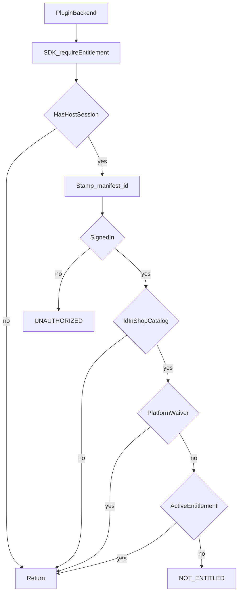
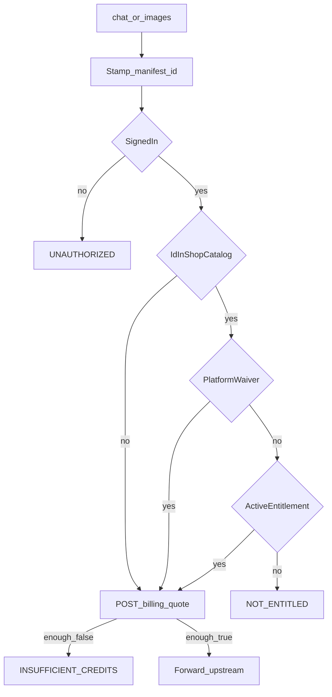
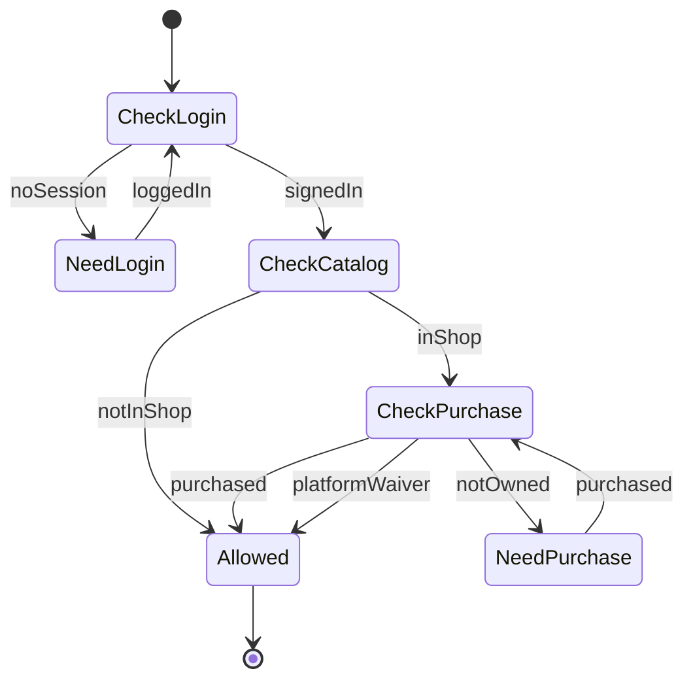

# PRD: 插件主动买断校验

| 属性 | 值 |
|---|---|
| 状态 | 工程：accepted，见文末「工程验收状态」 |
| 范围 | Electron 宿主注入无参买断函数；可拷贝 SDK 改名为 `dex-buddy-sdk.js` / `dex_buddy_sdk.py` 并带版本号；修正模型出口拦截顺序；平台限免与未上架默认放行。不改网关代码，不发 npm / PyPI |
| 关联文档 | `specs/prds/prd-00014-host-chat-egress.md`、`docs/plugin-development/models.md`、`docs/plugin-development/snippets/`、`docs/DESIGN.md`、`docs/memo/phase1-billing.md` |
| 对 00014 的修订 | 保留文案 / 生图未买断弹框；该路径改为先登录、再买断、再积分。新增作者可提前调用的买断确认。助手改名为插件 SDK |
| 兄弟仓依赖 | 仍读 `GET /v1/entitlements` 与 `GET /api/shop/catalog`。限免字段见开放项 |

## 1. 背景与问题

今天买断只发生在文案和生图真正打出去的时候。作者没法在自己的步骤里先问「这个人登了没有、买了没有」。用户点了生成，才在返回时看到「需要购买插件」。本地校验可以绕过，烧模型时宿主仍会拦一次，这是刻意的兜底。

另外，宿主现在先看商城和权益，再报价。会话没有或权益接口失败被收成空列表时，未登录的人会先看到购买框，甚至积分框，而不是登录框。

作者拷走的助手仍叫 `dex-models.js`，却已经不只调模型。接上买断校验后，文件名更对不上。独立跑若再拿 Key 去查权益，本机开发会被登录 / 买断打断。

平台可以把某个插件标成限免。不在商城目录里的清单 id 没有买断、也没有未买断，应当默认能用。

本文补作者可调用的提前确认、修正顺序、把拷走的文件收成带版本号的 SDK。不把买断挪到网关。不改支付。不发包装包。

## 2. 目标与非目标

### 目标

- 作者从 SDK 调用无参 `requireEntitlement(ctx)`，提前确认当前使用者已登录且已买断本插件（或平台限免，或不在商城目录）。
- 该函数不看积分、不返回余额、不报价。作者不传插件 id。
- 清单 id 由宿主按当前插件的 `plugin.manifest.json` `id` 填入。传了也不生效。
- 文案 `chat.completions.create` 与生图 `images.generate` 发现未买断时，仍不转发，工作台仍弹「需要购买插件」。这是兜底。
- 工作台两条路径的拦截顺序都是：未登录 → 未买断 →（仅模型出口）积分不够。
- 平台限免时，作者函数和模型出口都跳过买断，都不跳过登录。
- 清单 id 不在商城目录里：买断视为通过（默认可用）。登录仍要过；烧模型仍报价。这不是限免。
- 独立跑：`requireEntitlement` 直接通过，不打 entitlements、不要求登录、不抛买断错误。业务代码与工作台同一行，不必写 `if`。
- 可拷贝母版改名为单文件 `dex-buddy-sdk.js`（Python `dex_buddy_sdk.py`），导出 `SDK_VERSION` / `__version__`，第一次为 `1.0.0`。
- 作者提前调用已经通过之后，同一次使用再进模型出口，不得再弹购买框。
- 页面仍只走 `window.dex.call`。购买、登录、充值文案仍由工作台弹出层绘制。

### 非目标

- 作者传入插件 id，或查别人的权益。
- 函数返回余额、报价或「还剩多少积分」。
- 打开插件就自动拦；清单里再声明一次「要买断」。
- 去掉模型出口的未买断弹框。
- 把买断挪到网关；包签名、验签、加密壳。
- 发 npm / PyPI；自动更新已拷走的 SDK；工作台提示「SDK 过期」。
- 给 Python 单独做 entitlements HTTP。
- 客户端支付；改网关合同（限免字段除外，见开放项）。
- 改外部插件仓源码（小红书等接到这个函数是插件仓的事）。
- 本机旧安装目录卸不掉（见 `docs/memo/stale-installed-plugin.md`，不在本文）。
- Release 1 及更高版本占位。

### 成功标准

- 工作台未登录时调用 SDK 校验：错误码 `UNAUTHORIZED`，弹「需要登录」，不查买断。
- 工作台已登录、id 在商城、无生效权益、平台未限免：`NOT_ENTITLED`，弹「需要购买插件」。
- 工作台已登录且（已购，或限免，或 id 不在商城）：函数正常返回；作者不传 id。
- 独立跑调用同一函数：直接通过，不弹框，不抛 `UNAUTHORIZED` / `NOT_ENTITLED`。
- 未登录时调用文案或生图：先是 `UNAUTHORIZED`，不出现购买框或积分框。
- 已登录、id 在商城、未买断、未限免时调用文案或生图：仍是 `NOT_ENTITLED`，不转发，仍弹购买框。
- 已登录、买断通过（含未上架 / 限免）、报价不够：才是 `INSUFFICIENT_CREDITS`。
- 母版文件名为 `dex-buddy-sdk.js` / `dex_buddy_sdk.py`，版本 `1.0.0`；文档示例为 `require('./lib/dex-buddy-sdk')`。
- 请求体里自带 `pluginId` 仍被剥掉；盖章仍是当前清单 id。

## 3. 术语

| 术语 | 含义 |
|---|---|
| 插件 SDK | 作者拷进 `lib/` 的单文件。母版 `docs/plugin-development/snippets/dex-buddy-sdk.js` 与 `dex_buddy_sdk.py` |
| 作者函数 | SDK 导出的 `requireEntitlement(ctx)`。工作台转交给宿主注入的实现；独立跑直接通过 |
| 模型出口 | `ctx.models.chat.completions.create` 与 `ctx.models.images.generate`（经 SDK 的 `bindModels`） |
| 兜底 | 模型出口在未买断时不转发并弹购买框。00014 已有，本文保留 |
| 清单 id | `plugin.manifest.json` 的 `id`。宿主用来查权益、盖 `X-Plugin-Id` |
| 商城目录 | `GET /api/shop/catalog` 的 `plugins[].pluginId` |
| 未上架 | 清单 id 不在商城目录里：没有买断商品，也没有「未买断」。买断闸默认放行 |
| 生效权益 | `GET /v1/entitlements` 中 `status=active` 且 `pluginId` 等于当前清单 id |
| 限免 | 平台在商城目录上把**已在目录里的**插件标为当前不要求买断。登录仍要过。不是未上架 |
| `SDK_VERSION` | JS 导出的 semver 字符串，与文件头注释、Python `__version__` 同一数字。第一次 `1.0.0` |
| 工作台弹出层 | 现有 `spend-gate`：登录 / 购买插件 / 购买积分 三态 |

## 4. 已拍板规则

| 项 | 状态 | 决定 |
|---|---|---|
| 两套并存 | 已定 | 作者提前调用是可选的正向确认；模型出口未买断弹框是兜底。两套都要 |
| 作者函数看什么 | 已定 | 只看登录和买断。不看积分 |
| 函数内顺序 | 已定 | 工作台：先登录，再买断。作者不能自己排 |
| 调用方式 | 已定 | 从 SDK 调 `requireEntitlement(ctx)`，无参。不要直接写 `ctx.requireEntitlement()`（独立跑没有这个字段） |
| 插件 id | 已定 | 宿主填当前清单 id。作者不传。传别的 id 不能改查对象，也不能绕过自己的买断 |
| 页面 | 已定 | 只调自己的服务；不直接调宿主函数、不 `fetch` 网关 |
| 未上架 | 已定 | id 不在商城目录 → 买断视为通过。作者函数返回。模型出口不弹购买框。工作台仍要登录 |
| 限免 | 已定 | 仅针对目录里的平台标记。作者函数和模型出口都跳过买断，都不跳过登录。不得把缺目录项当成限免 |
| 提前通过后再烧模型 | 已定 | 同一次使用不得再弹购买框（权益或限免或未上架状态未变时） |
| 模型出口顺序 | 已定 | 未登录 → 未买断 → 积分不够 |
| 积分 | 已定 | 只在模型出口报价。作者函数不报价 |
| `list` / `quote` | 已定 | 仍不弹买断框，与 00014 相同 |
| 弹出层 | 已定 | 继续用现有三态。作者函数只会带出登录和购买插件 |
| 买断仍在宿主 | 已定 | 不把买断挪到网关 |
| SDK 形态 | 已定 | 单文件拷贝，不发 npm / PyPI。导出 `bindModels`、`requireEntitlement`、`childEnv`、`SDK_VERSION` |
| 文件名 | 已定 | `dex-buddy-sdk.js` / `dex_buddy_sdk.py`。snippets 不再保留 `dex-models.js` / `dex_models.py`。文档只教新名字 |
| 版本 | 已定 | 第一次 `1.0.0`。文件头与导出常量同一条。JS 与 Python 锁同一数字。母版改内容再 bump：补方法或修独立跑协议为 minor / patch，破坏导出为 major |
| 作者怎么判断新旧 | 已定 | 看自己 `lib/` 里的 `SDK_VERSION`，对照文档母版。不一致就整文件再拷。本期不做自动更新、不做工作台过期提示 |
| 拷贝关系 | 已定 | 外部作者从 `docs/plugin-development/snippets/` 拷到插件 `lib/`。本仓试玩 `plugins/models-playground/lib/` 与母版同一份。宿主不跑这份文件 |
| 独立跑 | 已定 | `requireEntitlement` 直接 resolve。不打 entitlements，不要求登录。`bindModels` 仍用 `DEX_BUDDY_API_KEY`（作者付钱） |
| Python | 已定 | 同名 `require_entitlement()` 始终直接返回。工作台真校验写在 `index.js`，通过后再 `spawn`。不给 Python 单独打权益接口 |

## 5. 用户与角色

| 角色 | 目标 |
|---|---|
| 终端用户 | 没登录先去登录；没买先去购买；积分不够才在烧模型时看到充值。不要在未登录时看到购买框 |
| 插件作者 | 拷一份 SDK；在步骤里调用校验；独立跑不受影响；看版本号知道是不是最新 |
| 平台运营 | 把插件标为限免后，作者仍调用校验，用户不用买也能过买断这一步 |
| 宿主工程 | 盖 id、固定顺序、两条路径共用同一套登录 / 买断判断、壳弹框；不执行作者拷走的那份文件 |

## 6. 功能域

### 6.1 插件 SDK

母版：

- `docs/plugin-development/snippets/dex-buddy-sdk.js`
- `docs/plugin-development/snippets/dex_buddy_sdk.py`

作者拷到插件 `lib/`。工作台发现 `ctx` 上有宿主方法就转交；独立跑走 Key 调模型、校验直接通过。作者不要直接碰 `ctx.models` / `ctx.requireEntitlement`。

宿主真实现仍在 `src/main/host-egress.ts` 与 `src/main/registry.ts` 的 `createContext`（注入 `models` 与 `requireEntitlement`）。

文档必须出现的 Node 用法：

```js
const { bindModels, requireEntitlement, SDK_VERSION } = require('./lib/dex-buddy-sdk');

ctx.registerService('myTool', {
  async draft(params) {
    await requireEntitlement(ctx);
    const models = bindModels(ctx);
    return models.chat.completions.create({
      model: 'dexbuddy-chat',
      messages: [{ role: 'user', content: params.prompt }],
    });
  },
});
```

- 放在自己的服务方法里、烧模型或其它要买断的步骤之前。
- 无参，不要传 `pluginId`。
- 页面只 `window.dex.call`。
- 不看积分；积分仍在后来的 `chat` / `images`。
- 失败时不要自己画登录 / 购买文案。工作台会弹框。
- 用 Python 时：Node 里先 `await requireEntitlement(ctx)` 再 `spawn`。独立脚本可写 `require_entitlement()`，无效果，脚本不崩。

工程落地时：[docs/plugin-development/models.md](../../docs/plugin-development/models.md) 删掉「第一期没有查买断函数」；README 目录树与各处 `dex-models.js` 改为新文件名；写明对照 `SDK_VERSION`。

### 6.2 模型出口兜底

`assertMaySpend` 一类逻辑保留：清单 id **在商城商品里**、无生效权益、平台未限免 → `NOT_ENTITLED`，不转发，壳弹购买框。

在此之前必须先确认已登录，否则 `UNAUTHORIZED`。id 不在商城、或限免、或已购，之后才报价；`enough === false` 才是 `INSUFFICIENT_CREDITS`。

### 6.3 限免与未上架

| 情况 | 买断闸 | 登录（工作台） |
|---|---|---|
| id 不在商城目录 | 通过 | 仍要 |
| id 在目录且平台限免 | 通过 | 仍要 |
| id 在目录、未限免、无 active 权益 | `NOT_ENTITLED` | 先登录 |
| id 在目录且已购 | 通过 | 仍要 |

限免字段名见开放项；字段未上线前，不得把缺目录项当成限免（缺目录项走「未上架」）。

### 6.4 错误与壳

| code | 工作台作者函数 | 独立跑作者函数 | 模型出口 | 工作台壳 |
|---|---|---|---|---|
| `UNAUTHORIZED` | 有 | 无（直接通过） | 有 | 「需要登录」 |
| `NOT_ENTITLED` | 有（仅已上架未买） | 无（直接通过） | 有（兜底） | 「需要购买插件」 |
| `INSUFFICIENT_CREDITS` | 无 | 无 | 有 | 「积分不够」 |

## 7. 用户故事地图与版本切片

### 7.1 旅程主干

#### 旅程 A：作者提前确认后写稿

| 步骤 | Entry / 动作 | Exit |
|---|---|---|
| A0 | Entry：工作台已登录，已购该清单 id。服务方法里 `await requireEntitlement(ctx)` | SDK 转交宿主 |
| A1 | 已登录且已购 | 函数返回 |
| A2 | 作者继续 `bindModels(ctx)` 写稿 | 不再弹购买框 |
| A3 | 报价够，转发 | Exit：得到文案。Teardown：无本机账单 |

#### 旅程 B：未登录点了作者把守的步骤

| 步骤 | Entry / 动作 | Exit |
|---|---|---|
| B0 | Entry：工作台无会话。调用 `requireEntitlement(ctx)` | 不查买断 |
| B1 | Exit：`UNAUTHORIZED`，弹「需要登录」 | Teardown：作者后续步骤不跑 |

#### 旅程 C：已登录未买断，作者提前拦住

| 步骤 | Entry / 动作 | Exit |
|---|---|---|
| C0 | Entry：已登录，id 在商城，无 active 权益，未限免 | 查买断 |
| C1 | Exit：`NOT_ENTITLED`，弹「需要购买插件」 | 未打模型 |

#### 旅程 D：作者没调用，烧模型时兜底

| 步骤 | Entry / 动作 | Exit |
|---|---|---|
| D0 | Entry：已登录，商城插件未买断。直接 `chat.completions.create` | 模型出口买断闸 |
| D1 | Exit：`NOT_ENTITLED`，不转发，仍弹购买框 | 与 00014 兜底相同 |

#### 旅程 E：未登录直接烧模型

| 步骤 | Entry / 动作 | Exit |
|---|---|---|
| E0 | Entry：无会话。调用文案或生图 | 先认登录 |
| E1 | Exit：`UNAUTHORIZED`，弹「需要登录」 | 不出现购买框或积分框 |

#### 旅程 F：已购但积分不够

| 步骤 | Entry / 动作 | Exit |
|---|---|---|
| F0 | Entry：已登录已购。作者函数已通过（或未调用） | 买断通过 |
| F1 | 报价 `enough === false` | Exit：`INSUFFICIENT_CREDITS`。作者函数路径不会出现这一码 |

#### 旅程 G：平台限免

| 步骤 | Entry / 动作 | Exit |
|---|---|---|
| G0 | Entry：已登录，平台将该 id 标为限免，账号未买 | 买断闸视为通过 |
| G1 | 作者函数返回；模型出口也不弹购买框 | 仍要登录；烧模型仍报价 |
| G2 | Exit：余额够则生成 | Teardown：限免结束后，下一次须重新买断 |

#### 旅程 H：作者传了别人的 id

| 步骤 | Entry / 动作 | Exit |
|---|---|---|
| H0 | Entry：调用时在参数或 body 里写了另一个 `pluginId` | 宿主忽略 |
| H1 | 仍按当前清单 id 查 | Exit：不能改成查别人，也不能跳过自己的买断 |

#### 旅程 I：自研插件不在商城

| 步骤 | Entry / 动作 | Exit |
|---|---|---|
| I0 | Entry：工作台已登录。清单 id 不在商城目录。调用 `requireEntitlement(ctx)` | 买断视为通过 |
| I1 | 函数返回，不弹购买框 | 可继续写稿或烧模型 |
| I2 | 未登录时仍先 `UNAUTHORIZED` | Exit：未上架 ≠ 免登录 |

#### 旅程 J：作者独立跑

| 步骤 | Entry / 动作 | Exit |
|---|---|---|
| J0 | Entry：本机 `node` 或 Python 脚本，无宿主。业务里已写 `requireEntitlement(ctx)` | SDK 判断无宿主 |
| J1 | 函数直接返回 | 不打 entitlements，不抛买断 / 登录错误 |
| J2 | `bindModels` 用 `DEX_BUDDY_API_KEY` | Exit：扣作者积分。Teardown：装进工作台后同一行变成真校验 |

### 7.2 用户故事地图

| 阶段 | 目标 | 故事 | 验收要点 |
|---|---|---|---|
| 提前 | 生成前就停住 | 作为插件作者，我想从 SDK 调用校验，以便没登录或没买时不要等到模型返回 | `require('./lib/dex-buddy-sdk')`；无参；工作台失败码稳定 |
| 未上架 | 自己的插件能用 | 作为作者，我的清单 id 不在商城时，校验应当通过，以便自研插件默认能用 | 已登录则返回；不弹购买框 |
| 独立 | 本机开发不被拦 | 作为作者，我想独立跑时加上校验也不影响调试，以便业务代码零改 | 直接通过；不要求登录 |
| 顺序 | 先认人 | 作为终端用户，我想在未登录时先看到登录 | 工作台作者函数和模型出口都不先弹购买或积分 |
| 兜底 | 没提前调用也拦得住 | 作为产品，我希望烧模型时未买断仍弹购买框 | 不转发；`NOT_ENTITLED` |
| 积分 | 作者不管钱包 | 作为插件作者，我不想在买断函数里判断积分 | 该函数无 `INSUFFICIENT_CREDITS` |
| SDK | 文件名对得上 | 作为作者，我想拷一份叫 SDK 的文件并看到版本号，以便知道是不是最新 | `dex-buddy-sdk.js`；`SDK_VERSION === '1.0.0'` |
| 限免 | 平台能放假 | 作为运营，我想把目录里的插件标为限免 | 两条路径都跳过买断，登录仍要 |
| 文档 | 写得对 | 作为作者，我想在插件文档里看到拷哪、怎么调、版本怎么看 | `models.md` 有本节示例；目录树用新文件名 |

### 7.3 Release 切片

#### Release 0（MVP，必选）

1. 宿主注入无参买断函数；SDK `requireEntitlement(ctx)` 工作台转交、独立跑通过。
2. 清单 id 由宿主填入。不在商城目录则买断放行。
3. 模型出口保留未买断弹框；顺序改为未登录 → 未买断 → 积分不够。
4. 限免时两条路径都跳过买断（字段见开放项）。
5. 母版改名为 `dex-buddy-sdk.js` / `dex_buddy_sdk.py`，版本 `1.0.0`；`models.md` 与 README 目录树用新名字并写出上面的调用示例。

本文不定义 Release 1。

## 8. 核心流程与状态机图

### 8.1 作者函数（SDK）



### 8.2 模型出口（修订后的顺序）



### 8.3 买断确认状态（工作台）



死胡同预警：权益接口失败不得把未登录收成「需要购买插件」。商城目录失败时，模型出口买断闸与 00014 相同（目录失败则跳过买断闸，仍要登录）；作者函数同样把「目录失败、看不到该 id」按未上架放行，不得当成未买断。限免字段未上线前，不得把缺目录项当成限免。独立跑不得因缺少 `ctx.requireEntitlement` 而抛错。

## 9. 数据与 API 衔接

本仓不建业务库表。会话仍为 00012 的 `safeStorage` refresh。不新增网关路径。不发包装包。

| 方法 | 路径 | 用途 |
|---|---|---|
| GET | `/v1/entitlements` | 是否已买。仅工作台作者函数与模型出口 |
| GET | `/api/shop/catalog` | 是否商城买断商品；限免字段（开放项）；不在列表则未上架放行 |
| POST | `/v1/billing/quote` | 仅模型出口；作者函数不打 |

盖章与剥 `pluginId` 仍按 00014。独立跑的 `requireEntitlement` 不打上表。

## 10. 假设与待确认

### 假设

- `apply(ctx)` 时注入的函数，在之后的服务方法里仍指向当前插件。
- 网页商城与桌面 PKCE 是同一手机号时，权益才会对上。
- 现有 `spend-gate` 三态足够，不必新做购买页。
- 作者愿意整文件重拷 SDK，不需要工作台检测过期。

### 开放项

- 限免在 `GET /api/shop/catalog` 上的字段名与取值。对照网关 OpenAPI 后再接到宿主；未定之前宿主没有限免，未上架仍按缺目录项放行。
- 宿主注入点的最终属性名（正文以 `ctx.requireEntitlement` 为例，必须无参、不接收插件 id）。作者只从 SDK 调用。

### 冲突与决议需求

- 00014 写过「买断闸只在文案 / 生图」以及助手文件名 `dex-models.js`。本文保留该兜底，增加作者提前调用，并把助手改名为 SDK。工程实现时改文档文件名与 00014 的顺序描述，不新开买断网关合同，不发包装包。

## 11. 修订记录

| 日期 | 说明 |
|---|---|
| 2026-10-27 | 初稿。作者函数只做登录与买断；模型出口保留未买断弹框并修正未登录优先；id 由宿主填写；限免两条路径跳过买断。旧安装目录不在本文，见备忘 |
| 2026-10-27 | 未上架默认放行；助手改名为 `dex-buddy-sdk.js` / `dex_buddy_sdk.py`，版本 1.0.0；独立跑校验直接通过；Python 同名但真闸在 Node；不发包装包。文档示例改为从 SDK require |

## 12. 工程验收状态

> 由 `/team:prd-accept` 维护；勿手工编造「通过」。最后更新：2026-10-27T05:56:01Z，dev@892f7b2，范围：R0,R1。

### 总览

| 项 | 值 |
|---|---|
| 工程状态 | accepted |
| 验收判定 | 通过 |
| 最近验收 | 2026-10-27T05:56:01Z |
| 代码提交 | HEAD `892f7b2` |

摘要：

1. 宿主注入无参 `requireEntitlement`；SDK 工作台转交、独立跑直接通过；清单 id 由宿主盖章，外人传入无效。
2. 作者函数与模型出口顺序均为未登录 → 未买断 →（仅模型出口）积分不够；未上架放行；spend-gate 三态仍由壳绘制。
3. 限免钩子已接、线上字段未上线前恒为空，缺目录项不当限免；注入限免时两条路径跳过买断、登录仍拦。
4. 母版改名为 `dex-buddy-sdk.js` / `dex_buddy_sdk.py`，`SDK_VERSION` / `__version__` 均为 `1.0.0`；`models.md` 与 README 用新名字。
5. 正文不定义 Release 1，标为范围外。

### Release 交付

| Release | 状态 | 说明 |
|---|---|---|
| R0 | 通过 | 作者函数、未上架、模型出口顺序、限免钩子、SDK 改名与文档均有证据 |
| R1 | 范围外 | 正文写明本文不定义 Release 1 |

### 功能验收清单（Agent 优先读此表）

| ID | 能力摘要 | Release | 状态 | 证据 |
|---|---|---|---|---|
| F01 | 宿主注入无参买断函数；SDK `requireEntitlement(ctx)` 工作台转交、独立跑通过 | R0 | 通过 | `src/main/registry.ts` `setRequireEntitlement`；`src/main/host-egress.ts` `createRequireEntitlement`；`test/dex-buddy-sdk.test.ts`「转交宿主且不传 id」「独立跑直接通过」 |
| F02 | 清单 id 由宿主填入；不在商城目录则买断放行 | R0 | 通过 | `test/registry.test.ts`「ctx.models 与 requireEntitlement 用清单 id 创建」；`test/host-egress.test.ts`「不在商城的清单 id 只验余额，不弹买断」；`assertEntitled` 在 `shop.has` 为假时 return |
| F03 | 模型出口保留未买断弹框；顺序未登录 → 未买断 → 积分不够 | R0 | 通过 | `createHostModels` 先 `assertEntitled` 再 `quoteOrThrow`；`test/host-egress.test.ts`「未登录烧模型时通知 UNAUTHORIZED」「商城插件未买断时不转发」「余额不够时不转发」；`src/renderer/spend-gate.js` |
| F04 | 限免时两条路径跳过买断；字段未上线前钩子为空，缺目录项不当限免 | R0 | 通过 | `gateway-session.ts` `waivedPluginIds` 恒 `[]`；`test/host-egress.test.ts`「注入限免跳过买断，未登录仍先拦住」 |
| F05 | 母版 `dex-buddy-sdk.js` / `dex_buddy_sdk.py` 版本 1.0.0；文档示例从 SDK require | R0 | 通过 | snippets 与 `plugins/models-playground/lib/` 同一份；`test/dex-buddy-sdk.test.ts` `SDK_VERSION === '1.0.0'`；`docs/plugin-development/models.md`、`README.md` |
| F06 | 未登录作者函数 `UNAUTHORIZED`，不查买断 | R0 | 通过 | `test/host-egress.test.ts`「未登录调用作者函数不查买断」 |
| F07 | 已登录、在商城、未买断：作者函数 `NOT_ENTITLED`，不报价 | R0 | 通过 | 「已登录未买断时作者函数 NOT_ENTITLED 且不报价」 |
| F08 | 作者函数不看积分 | R0 | 通过 | 「作者函数不看积分」 |
| F09 | 正式插件传入的 pluginId 无效，仍按当前清单 id | R0 | 通过 | 「作者函数忽略传入的插件 id」。试玩 `models-playground` 可传 mock，不进正式合同 |
| F10 | Python `require_entitlement()` 直接返回 | R0 | 通过 | `test/dex-buddy-sdk.test.ts`「Python SDK 能被编译且 require_entitlement 直接通过」 |
| F11 | 目录失败则买断放行，仍要登录 | R0 | 通过 | 「目录失败则买断放行后再报价」 |
| F12 | `list` / `quote` 不弹买断框 | R0 | 通过 | 「list 与 quote 抛 UNAUTHORIZED 不通知壳」；与 00014 相同，买断闸只在 chat / images 与作者函数 |
| R1 | Release 1 | R1 | 范围外 | 正文写明本文不定义 Release 1 |

### 未完成与遗留

- 限免目录字段名见开放项；接上之前 `waivedPluginIds` 保持空数组。
- 外部插件仓（小红书等）改接 `requireEntitlement` 不在本仓（PRD 非目标）。
- 模型试玩的「检测已买断 / 未买断」是本仓示例 mock，不改变正式作者无参合同。
- 不把买断挪到网关；不发 npm / PyPI。

### 质量检查

| 检查项 | 状态 |
|---|---|
| pnpm test | 通过（217） |
| 文档同步（README / docs/doc_index.md） | 通过（`models.md`、snippets 新文件名、DESIGN、plugin-development README / ship 已登记） |

---
统计：通过 12 / 部分 0 / 未实现 0 / 范围外 1

