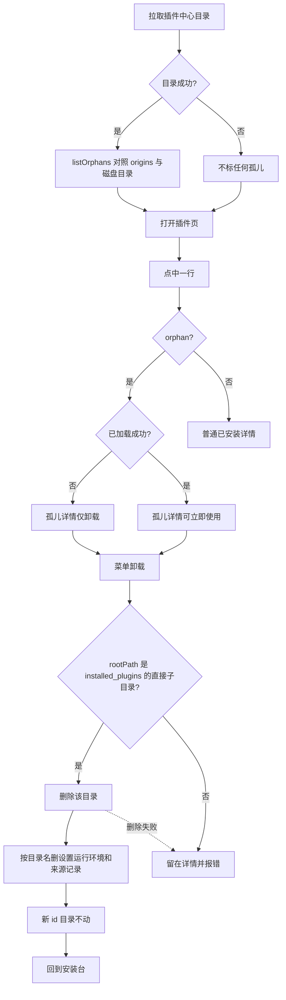
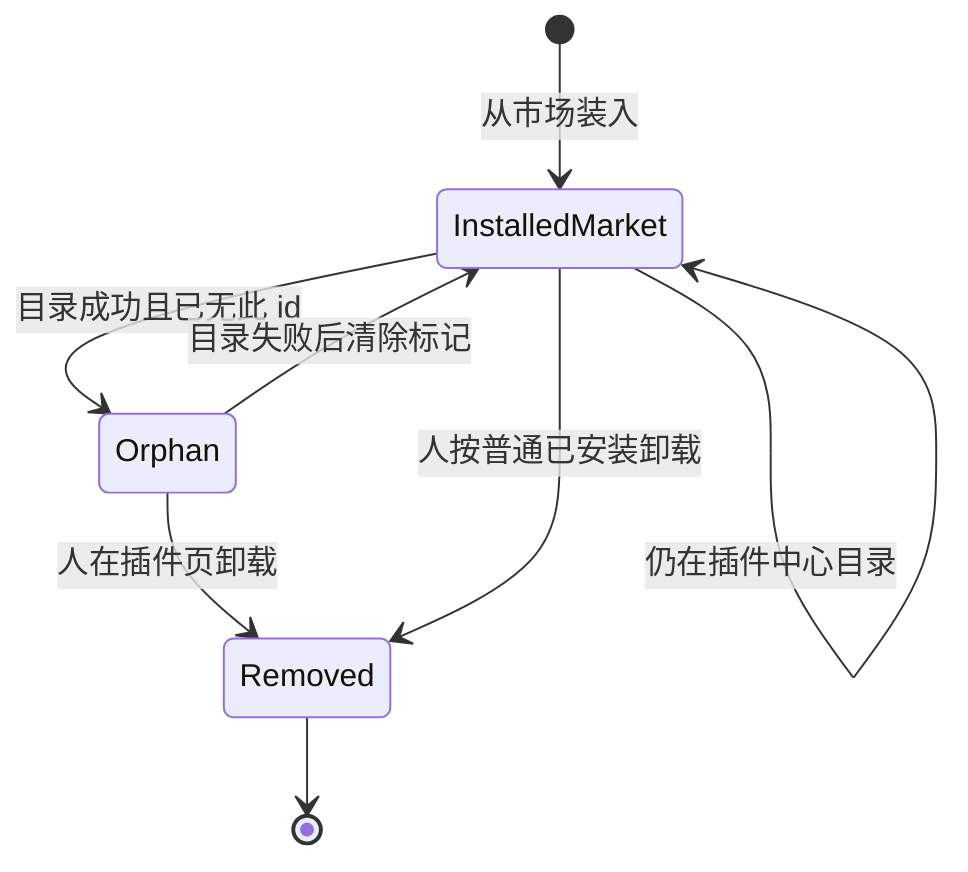

# PRD: 认定并删除商店换 id 后的孤儿安装

| 属性 | 值 |
|---|---|
| 状态 | 工程：backlog |
| 范围 | 孤儿判定；插件页可见性与删除；`userData/installed_plugins` 中带市场来源的目录 |
| 关联文档 | `docs/memo/stale-installed-plugin.md`、`docs/plugin-development/data.md`、`specs/prds/prd-00003-plugins-page.md`、`specs/prds/prd-00004-plugin-market.md` |
| 关联实现 | `src/main/plugin-origins.ts`、`src/main/plugin-catalog.ts`、`src/main/install.ts`、`src/main/registry.ts`、`src/renderer/plugins-page.js` |
| 备忘来源 | `docs/memo/stale-installed-plugin.md` |

## 背景与问题

商店里的插件换了清单 id（例如小红书改成带 `app-dexbuddy-` 前缀）之后，本机以前按旧 id 装进 `installed_plugins/<旧 id>/` 的那一份不会被新安装覆盖。`replaceInstalledPlugin` 只覆盖同一个 id。旧目录成了**孤儿**：市场曾经卖过、本机还在，当前插件中心目录里已经没有这个 id。

两件事叠在一起，人不好处理：

1. 没有明确的孤儿判定。旧 id 若仍能加载，看起来像普通已安装插件；若加载失败，列表往往没有这一行，也就没有卸载入口（`tryLoadDirectory` 只打日志）。
2. 即便点了卸载，`uninstallInstalledPlugin` 按注册表 id 再拼路径，目录名和清单 id 不一致时会删错地方。

本篇只做两件事：如何判断孤儿，以及在插件页删除它。不自动迁移、不静默删、不改云端已购。

点开头的覆盖备份（`.{id}.bak`）不是插件。zip 安装不是孤儿。仍在架的插件即使加载失败也不是孤儿。

正常卸载今天会删安装目录、`plugin-runtime/<id>/` 和设置段，**留下** `plugin-data/<id>/`。删除孤儿沿用这条。

## 目标与非目标

### 目标

- 用本机市场来源记录对照当前插件中心目录，判定哪些已安装目录是孤儿。
- 插件页能看见孤儿行：已加载的标出来；加载失败、今天进不了列表的，补一行。
- 人能删除该孤儿：删扫到的那个目录，并按**目录名**清设置、运行环境和来源记录。新 id 的安装不动。

### 非目标

- 把 `installed_plugins` 里每个加载失败的目录都列出来。
- 把 zip / 文件安装（`channel === 'file'` 或没有市场来源记录）当成孤儿。
- 插件中心目录拉取失败或尚未返回时猜测孤儿。
- 对照积分/买断用的 `GET /api/shop/catalog`。
- 在发布流程里写旧 id → 新 id 的 `replaces` 映射。
- 积分页「已购插件」里的旧 id。
- 给全部用户机器做批量清理、远程推送清理脚本。
- 自动把旧 id 的设置、`plugin-data` 迁到新 id。
- 启动时静默删除孤儿，或提供「一键清除全部孤儿」。
- 把备份目录（`.{id}.bak`）或 `__MACOSX` 列进插件页。
- 删除时去掉 `plugin-data/<目录名>/`。

### 成功标准

- 市场来源的旧 id 不在当前插件中心目录、且磁盘上还有该目录时，插件页有且仅有一行孤儿，可删除。
- 同机新 id 仍在目录里：不是孤儿；删旧行后新目录、其设置和运行环境仍在。
- zip 安装、仍在架的插件、目录未就绪：都不标孤儿。
- 启动扫描不会删除任何已安装目录。

## 术语

| 术语 | 含义 |
|---|---|
| 插件中心目录 | 市场货架同一份 `index.json`（`PLUGIN_CATALOG_URL`），字段 `plugins[].id` |
| 来源记录 | 本机安装来源，键是插件 id，`channel` 为 `market` 或 `file` |
| 已安装目录 | `userData/installed_plugins` 下的直接子目录 |
| 非备份目录 | 不以 `.` 开头、也不叫 `__MACOSX` 的已安装目录 |
| 目录名 | 该子目录的文件夹名。正常安装时等于清单 id |
| 孤儿 | 非备份目录仍在，来源是市场，且当前插件中心目录里没有这个 id |
| 本机设置 | `plugin-settings.json` 里以**目录名**为键的那一段 |
| 运行环境 | `plugin-runtime/<目录名>/` |
| 用户数据 | `plugin-data/<目录名>/`。删除留下 |

## 已拍板规则

### 判定

输入：磁盘上的非备份目录名、来源记录、一次成功的插件中心目录。输出：孤儿 id 列表。目录未就绪或拉取失败时输出空列表，不标任何孤儿。

| 条件 | 孤儿？ |
|---|---|
| 目录还在 + `channel === 'market'` + 当前目录 `plugins[].id` 不含该 id | 是 |
| `channel === 'file'` 或没有来源记录 | 否 |
| 当前目录里还有这个 id（仍在架），即使加载失败 | 否 |
| 插件中心目录尚未返回或拉取失败 | 整表不标 |
| 以 `.` 开头或名为 `__MACOSX` | 否 |
| 只出现在积分页已购、本机没有该目录 | 否（本篇不管云端） |

没有旧 id → 新 id 的映射。换 id 之后旧 id 不在目录里，自然被标成孤儿；新 id 在目录里，不是孤儿。

纯函数语义：

```text
listOrphans(dirNames, origins, catalog) -> id[]
  若 catalog 不是一次成功结果：返回 []
  否则返回 dirNames 中同时满足：
    origins[id].channel === 'market'
    catalog.plugins 没有任何一项 id 相等
```

对照的是插件中心目录，不是 `GET /api/shop/catalog`。

### 列表与删除

| 项 | 决定 |
|---|---|
| 已加载的孤儿 | 仍是列表里那一行，标成孤儿，可卸载；若已 `apply` 成功，仍可「立即使用」直到人自己删 |
| 加载失败的孤儿 | 补一行，来源 `installed`，`id` 为目录名；只有「… → 卸载」，没有立即使用、没有重试、没有更新 |
| 非孤儿的加载失败 | 不因本篇补行；仍走今天的运行环境问题 / 日志 |
| 卸载目标 | 只删这条 `rootPath`。必须是 `installed_plugins` 的直接子目录。禁止按清单 id 再拼另一条路径 |
| 设置与运行环境 | `deletePluginSettings(目录名)`、`discardRuntime(目录名)` |
| 来源记录 | `deleteOrigin` 只删目录名这一把钥匙。新 id 的市场记录不动 |
| 用户数据 | 不删 `plugin-data/<目录名>/` |
| 启动 | 只判定和列出，不删除、不改名、不合并 |
| 确认框 | 与 `prd-00003` 相同：卸载无确认框 |
| 批量 | 没有「一键清全部孤儿」 |
| 设置页 | 从未挂上的孤儿不进设置页插件列表 |
| 静默更新 | 孤儿 id 不在当前目录里，本来就不会被计划更新 |
| 工作区 | 若正打开被删的那一行，回到欢迎页。删的是兄弟孤儿时，当前插件继续开着 |
| 显示名 | 清单可读则用 `displayName`；否则用目录名。左栏来源小字仍是「已安装」，另标孤儿 |

## 冲突与决议

| 现有说法 | 决议 |
|---|---|
| `prd-00003`：左栏列出全部已加载插件 | 已加载规则不变。本篇只额外补「判定为孤儿但未进列表」的那一行 |
| 初稿曾写「每个非备份目录都列出」 | 作废。只列出孤儿，以及今天已经会列出的已加载 / 运行环境失败项 |
| `docs/plugin-development/data.md`：卸载留下 `plugin-data` | 继续有效。清理键是目录名 |
| `uninstallInstalledPlugin` 用 `id` 拼路径 | 改为删除该行的 `rootPath` |
| 备份目录 `.{id}.bak` | 继续不是插件，也不是孤儿 |

## 用户与角色

| 角色 | 目标 |
|---|---|
| 工作台使用者 | 认出商店换 id 后留下的旧安装，删掉它，继续用新 id |
| 插件作者 | 改市场 id 并重新发布后，同事能在插件页自己删旧目录 |
| Dex Buddy 维护者 | 不改发布流程、不改云端已购、不在启动时偷偷删目录 |

## 功能域

### 判定

主进程在插件中心目录**成功**返回后，用 `listOrphans` 对照来源记录和 `installed_plugins` 的非备份子目录。目录刷新或来源记录变化后重新计算。目录失败时清空孤儿标记，不要沿用上一次结果（避免把仍在架的插件卡住）。

### 列表

孤儿必须在 `getPluginList()` 里有一行：

1. 已加载成功或已作为运行环境问题出现：同一 `rootPath` 不另占一行，给该行加上孤儿标记。
2. 否则补孤儿行：`id` / 缺省 `displayName` 为目录名，`source` 为 `installed`，`rootPath` 为该目录，带错误文案说明未能加载。

`PluginSummary` 增加可选布尔字段（如 `orphan: true`），供插件页标「孤儿」。不要改 `source` 枚举。

### 删除

`dex:uninstall` 继续只接受来源为 `installed` 的 id（含孤儿行）。查到这一行之后：

1. 若注册表里已挂上（含运行环境问题），先卸掉。
2. 校验 `rootPath` 是 `installed_plugins` 的直接子目录，再删除该目录。
3. 用目录名调用 `discardRuntime`、`deletePluginSettings`、`deleteOrigin`。
4. 取消该 id 的静默更新预约。
5. 返回新列表。

目录已经不在磁盘上：仍清注册表、目录名对应的设置、运行环境和来源记录，返回成功。不要去删清单 id 对应的另一条目录。

删除失败：目录和设置留下，详情留着，右栏显示错误。

### 插件页

左栏孤儿行可搜（匹配 `displayName`，读不出清单时即目录名）。详情标明孤儿。已加载成功的孤儿仍有「立即使用」和「卸载」。加载失败的孤儿只有「卸载」。成功后回到安装台，状态「插件已卸载」。

市场货架、积分页已购、通用设置里「打开已安装插件目录」不因本篇改结构。

## 用户故事地图与版本切片

### 旅程主干

| 步骤 | 节点 | 说明 |
|---|---|---|
| 1 | Entry | 以前用市场旧 id 装过。商店已改成新 id。本机同时有旧目录和新目录。插件中心目录已成功拉取 |
| 2 | 打开插件页 | 新 id 是普通已安装。旧 id 标成孤儿 |
| 3 | 核对 | 点孤儿行。仍能加载则可以立即使用；加载失败则只有卸载和错误条 |
| 4 | 删除 | 菜单卸载。无确认框 |
| 5 | 确认新安装 | 孤儿行消失。新 id 目录、设置和运行环境仍在 |
| 6 | Exit | 回到安装台。工作区若开着新插件，仍然开着 |

逆向：目录还没拉下来时，旧 id 不标孤儿，人也删不了「孤儿」这条通道（仍可用普通卸载，若该行已加载）。拉取失败同此。删除失败则停在详情，目录还在。人可以不删，离开插件页。

### 故事地图

| 阶段 | 用户目标 | 用户故事 | 验收要点 |
|---|---|---|---|
| 判定 | 认出孤儿 | 作为换过商店 id 的使用者，我想看到旧市场安装被标成孤儿，以便和还在架的插件分开 | `channel === 'market'` 且当前目录无此 id 且目录还在时，该行 `orphan` 为真 |
| 判定 | zip 不算 | 作为只拖过 zip 的使用者，我不想自己的包被标成孤儿，以便还能继续用 | `file` 或无来源记录的目录不标 |
| 判定 | 仍在架不算 | 作为市场插件加载失败的使用者，我不想它被当成换 id 孤儿，以便走重试而不是当垃圾删 | 目录里仍有该 id 时不标孤儿 |
| 判定 | 目录失败不猜 | 作为网络不好的使用者，我想目录没拉下来时不要乱标孤儿，以免误删 | 目录未就绪或失败时没有任何 `orphan: true` |
| 发现 | 加载失败也能删 | 作为旧包已经挂了的使用者，我想插件页仍有这一行，以便能删 | 孤儿且未进列表时补一行；有卸载、无立即使用 |
| 发现 | 搜到旧 id | 作为使用者，我想按旧显示名或目录名找到它 | 搜索匹配该行 `displayName` |
| 核对 | 分清新旧 | 作为已经装上新 id 的使用者，我想两行都在且只有旧的标孤儿 | 新 id 无孤儿标记；旧 id 有 |
| 删除 | 删掉孤儿目录 | 作为使用者，我想卸载后旧文件夹从本机消失 | `rootPath` 删除；列表不再有这一行 |
| 删除 | 别删新安装 | 作为使用者，我想删孤儿时新 id 还在 | 不删 `installed_plugins/<新 id>/`；其设置和运行环境仍在 |
| 删除 | 旧设置跟着走 | 作为使用者，我想删完后旧 id 的设置键去掉 | `plugin-settings.json` 的目录名段删除 |
| 删除 | 导出留下 | 作为使用者，我想以前导出的文件还在 | `plugin-data/<目录名>/` 仍在 |
| 保护 | 不自动删 | 作为使用者，我想启动时不要偷偷丢掉任何安装 | 冷启动与刷新都不 `rm` 已安装目录 |
| 保护 | 云端已购不动 | 作为买过该插件的使用者，我想删本机孤儿后积分页仍显示已购 | 不改已购接口和积分页 |
| 失败 | 删不掉时目录还在 | 作为使用者，我想失败时看到原因并且目录仍在 | 详情不关；设置不删；右栏错误文案 |

### Release 0

可验收结果：

- `listOrphans`（或等价纯函数）有 `node:test`：市场旧 id 且不在目录 → 孤儿；file / 仍在架 / 目录失败 → 非孤儿。
- 插件页已加载孤儿带标记，可卸载；未加载孤儿补行，可卸载，无立即使用。
- 删除该行 `rootPath`，按目录名清设置、运行环境、来源记录；不删 `plugin-data`，不删新 id。
- 夹具：本机同时有市场旧 id 目录与新 id 目录，目录 JSON 只有新 id；列表旧行是孤儿；删旧后新目录仍在。
- 实现时回写 `docs/plugin-development/data.md` 一句：市场换 id 后旧目录会标成孤儿，可在插件页删除。备忘录与本 PRD 口径一致。

没有 Release 1。积分页旧 id、全量清理、发布侧 `replaces` 不在本篇。

## 核心流程与状态机图





`Orphan` 不是启动时的自动终点。目录拉取失败必须离开 `Orphan` 回到未标记，避免误伤。zip 安装从未进入 `InstalledMarket`。

加载失败的孤儿若今天不在列表里，是一条断头路：磁盘有目录、人看不见、删不了。本篇只为**已判定为孤儿**的目录补行，把这条路接到 `Removed`。其它加载失败不是孤儿，不在本篇补行。

## 数据与 API 衔接

不新增配置文件。不改 `plugin-data` 布局。

| 路径 | 删除孤儿时 |
|---|---|
| `installed_plugins/<目录名>/` | 删除 |
| `plugin-runtime/<目录名>/` | 删除 |
| `plugin-settings.json` 的 `<目录名>` 键 | 删除 |
| 来源记录里目录名这一把钥匙 | 删除 |
| `plugin-data/<目录名>/` | 留下 |
| `installed_plugins/<其它 id>/` | 不动 |
| 云端已购 / 积分页 | 不动 |

判定读来源记录和插件中心目录，不写盘。`dex:uninstall` 仍用列表行 `id`，主进程经该行解析 `rootPath`。

## 假设与待确认

| 项 | 处理 |
|---|---|
| 判定用插件中心 `index.json`，不用买断目录 | 已拍板 |
| 没有来源记录的旧市场安装 | 不算孤儿。避免把 zip 或来源丢失的目录误删 |
| 已加载孤儿仍可立即使用 | 已拍板。删除是可选，不是强制下线 |
| `plugin-data` 留下 | 与今天卸载相同 |

### 开放项

- 历史机器上没有来源记录的旧市场目录：本篇不标孤儿。若以后要收，需另开产品决定，不能靠「不在目录里」一条规则。
- 来源记录写在清单 id、目录名不同：判定按来源键与目录名的交集。实现时以磁盘目录名为准去查 `origins[目录名]`。

## 修订记录

| 日期 | 说明 |
|---|---|
| 2026-10-27 | 初稿。按备忘录立项：列出非备份已安装目录并卸载 |
| 2026-10-27 | 收成孤儿判定：市场来源且当前插件中心目录无此 id；只给孤儿补行和删除 |
