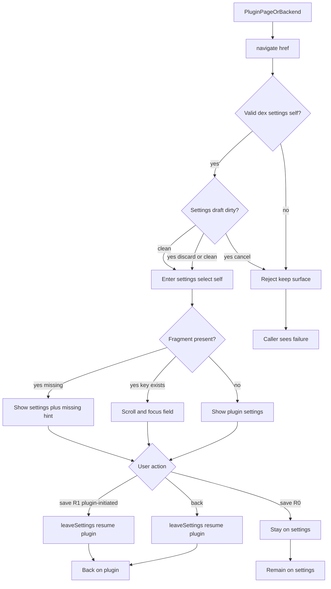
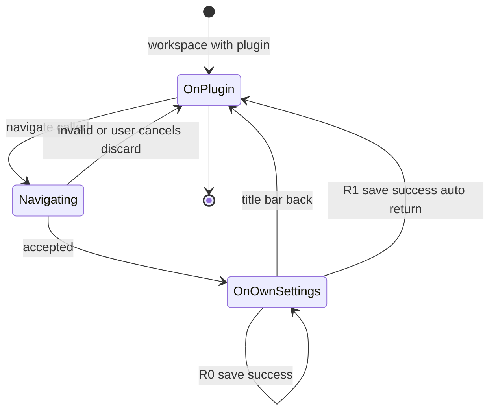

# PRD: 插件设置跳转协议

| 属性 | 值 |
|---|---|
| 状态 | 工程：accepted，见文末「工程验收状态」 |
| 范围 | 插件页面预加载桥、插件后端 `ctx`、工作台设置表面与 chrome 会话；导航地址契约 |
| 关联文档 | `specs/prds/prd-00001-plugin-settings.md`、`specs/prds/prd-00002-workbench-chrome.md`、`specs/prds/prd-00015-plugin-access-check.md`、`docs/plugin-development/settings.md`、`docs/plugin-development/navigate.md`、`docs/DESIGN.md`、`docs/renderer-layout.md` |
| 关联实现 | `src/shared/dex-navigate.ts`、`src/preload/plugin.cts`、`src/preload/host.cts`、`src/shared/dex-bridge.ts`、`src/shared/dex-ipc.ts`、`src/main/types.ts`、`src/main/registry.ts`、`src/main/index.ts`、`src/renderer/chrome.js`、`src/renderer/settings.js` |

## 1. 背景与问题

插件发现用户缺某项设置时，今天只能在页面上写「请去齿轮里打开设置」。工作台本身已经能打开设置并选中某个插件：`openSettings(pluginId)` → `enterSettings(pluginId)`，并且会记下进入前的 `returnPluginId`，标题栏后退可回到该插件页。缺的是：

1. 插件页面（webview）发不出这条命令。
2. 插件后端（`index.js` / `apply` 里）发现缺配置时也发不出。
3. 即使打开了该插件设置，也不能落到某个 `configSchema` 字段。

若每种「去某页」都新增一个预加载方法或 SDK 函数，作者就要反复重拷 `dex-buddy-sdk.js`。买断校验（`requireEntitlement`）和访问检测已经走了这条路。本期把「去哪」收成**一条稳定的导航入口 + 可变的地址内容**，类似浏览器把跳转收成 URL，而不是为每个目的地加一个 API。

买断与检测**不**迁进本协议：它们仍是现有函数与宿主弹层，契约没变就不必为跳转去改接口层。

## 2. 目标与非目标

### 目标

- 提供**一个**稳定入口：插件页面 `window.dex.navigate(href)`；插件后端 `ctx.navigate(href)`。两边吃同一套地址语法。
- 本期唯一合法地址族：打开**调用方自己的**插件设置；可选片段落到某个配置键。
- 宿主根据调用方身份解析「自己」，插件不能指定别的插件 id，也不能打开个人设置 / 通用设置 / 积分页。
- 无片段：打开该插件设置主区。有片段：滚到并聚焦对应字段（密钥框进入可编辑状态的规则沿用现有设置页）。
- 进入设置后，标题栏后退回到进入前的插件页（沿用并明确 `returnPluginId` 语义）。
- Release 1：仅当本次进入由插件 `navigate` 发起时，**保存成功**后可自动回到该插件；做不到则砍掉，不另开更高版本。
- 文档写清地址样例；**不**因此升 `SDK_VERSION`，也**不**改要拷走的接口层文件。

### 非目标

- 把 `requireEntitlement`、访问检测、登录、买断、积分不足弹层改成导航地址。
- 修改 `docs/plugin-development/snippets/dex-buddy-sdk.js` / Python 接口层；发 npm / PyPI；提示「SDK 过期」。
- 打开其他插件的设置、系统设置、插件市场、外链。
- 自动替用户写入配置；新增「必填」字段类型或校验规则。
- 独立跑（无宿主）下的导航；独立跑调用应安全失败或 no-op，不得假设有设置页。
- 跨窗口深链、冷启动带地址、系统级 `dexbuddy://` 协议（那是登录 PKCE 用的，见既有备忘）。
- 改外部插件仓业务代码（作者自行接入）。
- Release 2 及更高版本占位。

### 成功标准

- 插件页面调用合法地址：工作台切到设置表面，左栏选中本插件，无未保存冲突时直接进入。
- 带合法字段片段：对应控件进入可视区并获得焦点；密钥字段行为与用户手动点进该框一致。
- 非法地址（未知 scheme / 非本插件目标 / 畸形）：不切换表面，调用方收到可区分的失败（错误码或 rejected promise），状态栏可有一句说明。
- 字段键不存在：仍打开本插件设置，不滚不聚焦，状态栏说明没有这一项。
- 设置页已有未保存草稿时再次 `navigate`：走现有离开确认，不静默丢草稿。
- 无 `configSchema` 且无 `settingsEntry`：仍打开该插件设置空状态（与现有 bare 态一致）。
- 后端 `ctx.navigate` 与页端同一地址语义；无界面（headless）插件也可请求打开设置。
- 标题栏后退：离开设置并 resume 进入前的插件页（若当时有活动插件）。
- R1：插件发起的会话在保存成功后自动 leaveSettings 并 resume；用户从齿轮进入的会话保存后仍停在设置页。

## 3. 术语

| 术语 | 含义 |
|---|---|
| 导航入口 | `window.dex.navigate` / `ctx.navigate`，参数是地址字符串 |
| 导航地址 | 本期形如 `dex://settings/self` 或 `dex://settings/self#FIELD_KEY` |
| `self` | 由宿主根据调用方插件身份解析，不是调用方传入的清单 id |
| 字段片段 | URL hash / fragment，对应 `configSchema` 的键名 |
| 插件发起会话 | 本次进入设置表面的直接原因是一次成功的 `navigate`（相对齿轮 / 快捷键进入） |
| 返回锚点 | 进入设置前记下的插件 storage / 实例 id（现有 `returnPluginId`） |

## 4. 已拍板规则 / 取舍

| 项 | 决定 |
|---|---|
| 入口形状 | 一个 `navigate(href: string)`；不另加 `openPluginSettings(field?)` 专用方法作为对外主路径 |
| 地址方案 | scheme `dex`；本期 path 仅 `settings/self`；可选 `#` + 字段键 |
| 身份 | 调用方只能是本插件页面或本插件后端；`self` 不可被参数改写为其他 id |
| 页面入口 | 预加载暴露 `window.dex.navigate`；经现有 IPC 上送主进程或渲染壳处理 |
| 后端入口 | 宿主在 `AppContext` 注入 `ctx.navigate`；**不**经拷走的 SDK 转发，避免升 `SDK_VERSION` |
| 字段定位 | 仅对宿主生成的表单字段生效；`settingsEntry` 自带页内的 DOM 定位本期不做 |
| 未知字段 | 打开设置，不聚焦，提示「没有这一项」 |
| 未保存冲突 | 复用设置页 `confirmDiscard`；用户取消则导航失败 / 中止 |
| 后退 | R0 靠标题栏后退；与现有 chrome 后退一致 |
| 保存后自动回 | 仅 R1；仅插件发起会话；用户手动进设置不受影响 |
| 买断 / 检测 | 保持函数与弹层；明确不纳入本协议地址表 |
| 独立跑 | 无宿主 UI：`navigate` 拒绝或 no-op，由实现选一种并写进文档；不得假装已打开设置 |

### 取舍说明

- **为何不用再拷 SDK**：地址解析与跳转在宿主；页面走预加载，后端走 `ctx`。接口层文件只服务模型与买断契约。
- **为何不把买断改成协议**：买断是确认 + 弹层副作用，不是「打开某一页」。硬塞进 navigate 会把错误码、限免、未上架默认放行缠进地址表，继续逼作者跟拷实现。
- **为何允许后端发起**：缺配置常在 `apply` / 服务方法里发现；只给页面会逼作者多做一轮页面往返。
- **为何 R1 可砍**：自动回依赖「插件发起」标记与保存成功路径；若与草稿确认 / 多入口纠缠过重，R0 的后退已闭环。

## 5. 用户与角色

| 角色 | 目标 |
|---|---|
| 插件使用者 | 缺配置时被带到要填的那一项；填完能回到刚才的插件 |
| 插件作者（页面） | 一行地址打开自己的设置并可选字段，不必教用户点齿轮 |
| 插件作者（后端） | 在 Node 服务里发现缺配置时同样能请求打开设置 |
| 工作台工程 | 宿主解析地址与调用方；少改预加载面；不改接口层母版 |
| 产品 / 文档 | 地址表可扩展（登录页、积分页等另立项），本期只登记 settings/self |

## 6. 功能域

### 6.1 地址契约

- 合法：`dex://settings/self`
- 合法带字段：`dex://settings/self#OPENAI_API_KEY`（字段名须符合现有 configSchema 键规则：大写字母开头，仅大写字母、数字、下划线）
- 非法示例：`dex://settings/other-plugin`、`dex://settings/general`、`https://...`、空串、缺 scheme

工程实现可选 query（如 `?focus=`）作为片段的等价物，但对外文档只推一种；PRD 默认只推 `#` 片段。若实现选用 query，须在验收前改本文并保持一种权威写法。

### 6.2 调用面

| 调用方 | API | 备注 |
|---|---|---|
| 插件 UI（`app-plugin://` webview） | `await window.dex.navigate(href)` | 预加载；与 `call` / `readSettings` 并列 |
| 插件后端 | `await ctx.navigate(href)` | `AppContext`；apply 与服务方法内可用 |
| 设置页自带 `settingsEntry` | 同页面 API | 已在设置表面时：只切换/聚焦字段，不重复叠一层设置 |

### 6.3 工作台行为

1. 校验地址与调用方。
2. 解析目标插件 storage / 实例 id（本地实例用实例 id，与设置存储一致）。
3. 若当前已在设置且草稿脏：确认是否丢弃。
4. 进入设置表面并 `selectSettings` 到本插件。
5. 若有字段片段且表单中存在该键：滚动并聚焦。
6. 标记是否「插件发起会话」（供 R1）。
7. 记下返回锚点（从工作区某插件进入时）；已在设置内跳转时不 Cleared 原锚点，除非产品另有说明——**已定**：同一次设置会话内再次 navigate 到 self，保留最初进入设置时的返回锚点。

### 6.4 返回

- R0：标题栏后退 / 等价离开 → `leaveSettings({ resume: true })`，回到返回锚点插件页。
- R1：插件发起会话 + 保存成功 → 自动执行同上离开；齿轮进入的会话保存后留在设置页。

## 7. 用户故事地图与版本切片

### 7.1 旅程主干

| 步骤 | 节点 | 说明 |
|---|---|---|
| Entry | 插件使用中 | 页面或后端发现缺配置 |
| 1 | 发起 navigate | `dex://settings/self` 或带 `#FIELD` |
| 2 | 宿主校验 | 非法则失败，表面不变 |
| 3 | 草稿确认 | 若有未保存修改则询问 |
| 4 | 打开本插件设置 | 左栏选中，主区表单 / 空状态 / settingsEntry |
| 5 | 可选聚焦字段 | 键存在则滚入并 focus |
| 6a | 用户填写并保存 | 写盘；R0 仍停在设置 |
| 6b | 用户后退 | 离开设置，resume 插件页 |
| 6c | R1 自动回 | 仅插件发起 + 保存成功 |
| Exit / Teardown | 回到插件或停在设置 | 返回锚点清除或保留前进栈按现有 chrome 规则 |

### 7.2 用户故事地图

**阶段 A · 作者接入**

| 故事 | 验收要点 |
|---|---|
| 作为插件作者，我想在页面用一条地址打开自己的设置，以便用户不必自己找齿轮 | 页面 `await window.dex.navigate('dex://settings/self')` 后，设置表面显示本插件；不出现其他插件主区 |
| 作为插件作者，我想带上字段名，以便用户直接落到要填的项 | `...#MY_KEY` 打开后该控件在可视区且获得焦点；密钥框行为与手动点击一致 |
| 作为插件作者，我想在后端缺配置时也能请求打开设置，以便服务方法失败时引导用户 | `await ctx.navigate('dex://settings/self#MY_KEY')` 产生与页面相同的表面结果 |

**阶段 B · 使用者完成配置**

| 故事 | 验收要点 |
|---|---|
| 作为使用者，我希望填完后点后退回到刚才的插件 | 从插件 A 被 navigate 进设置后点后退，工作区恢复插件 A（keepalive 规则沿用 prd-00009） |
| 作为使用者，若我改了一半又触发跳转，我希望先被问是否丢掉草稿 | 脏草稿时再次 navigate 弹出既有确认；取消后仍停在原草稿，导航未完成 |
| 作为使用者，当字段名写错时，我仍能看到该插件设置 | 未知 `#` 仍打开本插件设置；状态栏有「没有这一项」类说明；不聚焦错误控件 |

**阶段 C · 保存后自动回（R1）**

| 故事 | 验收要点 |
|---|---|
| 作为使用者，在插件把我带进设置并保存成功后，我希望自动回到插件 | 仅插件发起会话：保存成功后离开设置并 resume；从齿轮进入则保存后仍在设置页 |

### 7.3 Release 切片

#### Release 0（MVP）

- `window.dex.navigate` + `ctx.navigate`
- 地址：`dex://settings/self` 与 `#FIELD_KEY`
- 打开本插件设置、字段聚焦、非法地址失败、未知字段提示、脏草稿确认
- 返回靠标题栏后退
- 文档：`docs/plugin-development/settings.md` 增加「跳到设置」小节；索引如需则改 `docs/doc_index.md` 摘要
- **可验收结果**：示例或 playground 插件可演示「缺配置 → 跳设置 → 后退回插件」；`pnpm test` 覆盖地址解析与拒绝规则

#### Release 1（可选增强）

- 插件发起会话标记
- 保存成功后自动 `leaveSettings` + resume
- **本期不做**：其它地址族、settingsEntry 内锚点、独立跑 UI
- **可砍条件**：若与确认框 / 多入口冲突导致行为不稳，删除本 Release，R0 仍可独立验收

## 8. 核心流程与状态机图

### 8.1 跳转泳道（Happy Path + 异常）

### 8.2 表面状态

断头路扫描：

- 非法地址 → 留在原表面，有明确失败（禁止静默成功）。
- 用户取消丢弃草稿 → 等同导航失败。
- 插件已卸载 / 不在设置目录 → 失败提示，不落到空壳别人设置。
- 无返回锚点（例如冷启动后后端直接 navigate）：打开设置后后退回到工作区默认态，不伪造插件页。

## 9. 数据与 API 衔接

| 层 | 契约 |
|---|---|
| 预加载 | `navigate(href: string): Promise<NavigateResult>`（具体结果类型由工程定：`{ ok }` 或 throw） |
| IPC | 新增通道或复用壳事件；须带调用方插件 id（webview 已有 caller 解析先例，见 `dex:call-service`） |
| AppContext | `navigate(href: string): Promise<...>` |
| 渲染壳 | 扩展现有 `openSettings(pluginId)`：支持可选 `fieldKey` 与 `source: 'plugin-navigate' \| 'chrome'` |
| 设置页 | `enterSettings(pluginId, options?)`；字段 DOM 需稳定 `data-settings-key`（或等价）供聚焦 |
| 存储 | 不改 `plugin-settings.json` 形状 |
| SDK 文件 | **不改**；文档说明页面用 `window.dex.navigate`，后端用 `ctx.navigate` |

不引入新的 HTTP API；不改网关。

## 10. 假设与待确认 / 开放项

| ID | 项 | 默认假设 | 状态 |
|---|---|---|---|
| O1 | 结果形态用 resolve `{ ok:false }` 还是 reject | Promise reject + 稳定错误码字符串 | 已实现（`DexNavigateError.code`） |
| O2 | 权威字段定位用 `#` 还是 `?focus=` | 对外只文档化 `#`；query 直接 `INVALID_HREF` | 已定 |
| O3 | headless 插件 navigate 是否强制切前台窗口 | 是，聚焦主窗口并打开设置 | 已实现 |
| O4 | 独立跑 `ctx.navigate` | 无宿主注入时 `NO_HOST_UI`；独立跑无此字段 | 已定 |
| O5 | 登录 / 积分 / 市场是否未来挂同一 `navigate` | 是，但**另开 PRD**，本文件只占位理念不写地址 | 开放（非本 Release） |
| O6 | 是否给 Python 子进程暴露导航 | 本期不做；子进程应让 Node 后端代调 `ctx.navigate` | 已定不做 |

## 11. 修订记录

| 日期 | 说明 |
|---|---|
| 2026-11-06 | 初稿：统一 navigate 协议；页面与后端可发；R0 跳转+字段+后退；R1 保存后自动回可砍；买断/检测不迁入 |
| 2026-11-06 | 工程落地 R0+R1：`dex-navigate` 解析、IPC、`ctx.navigate` / `window.dex.navigate`、设置聚焦与保存后回；文档 `navigate.md`；试玩演示按钮 |
| 2026-11-06 | 独立跑：接口层补 `navigate(ctx, href)` 静默成功（SDK 1.0.4）；正式验收见文末 |

## 12. 工程验收状态

> 由 `/team:prd-accept` 维护；勿手工编造「通过」。最后更新：2026-11-06T10:05:57Z，prd/00017-plugin-settings-navigate@c491356（工作区未入库相对该基线），范围：R0,R1。

### 总览

| 项 | 值 |
|---|---|
| 工程状态 | accepted |
| 验收判定 | 通过 |
| 最近验收 | 2026-11-06T10:05:57Z |
| 代码提交 | 基线 `c491356`；交付在分支 `prd/00017-plugin-settings-navigate` 工作区 |

摘要：

1. 页面 `window.dex.navigate` 与后端 `ctx.navigate` 共用 `dex://settings/self[#FIELD]`；宿主按调用方解析 self，非法地址 reject + 稳定 `code`。
2. 设置页支持字段聚焦（`data-settings-key`）、脏草稿确认、`NAVIGATE_CANCELLED`；R1 仅插件发起会话保存后自动回。
3. 文档权威篇 `navigate.md`；settings / README / doc_index 已交叉；试玩可演示跳转。
4. 地址解析单测通过；作者手测工作台跳转与保存回通过。
5. 独立跑：SDK `navigate(ctx, href)` 静默成功（1.0.4）；不假装打开设置。初稿「不改 SDK」已由后续独立跑静默需求修订为「加薄封装、扩地址仍不重拷」。

### Release 交付

| Release | 状态 | 说明 |
|---|---|---|
| R0 | 通过 | 双入口、地址解析、打开本插件设置、聚焦、非法失败、未知字段、脏草稿、后退、文档与试玩 |
| R1 | 通过 | `pluginNavigateSession`；插件发起保存后 leave + resume；齿轮会话保存后仍停设置 |

### 功能验收清单（Agent 优先读此表）

| ID | 能力摘要 | Release | 状态 | 证据 |
|---|---|---|---|---|
| F01 | 页面 `window.dex.navigate(href)` 经预加载 IPC | R0 | 通过 | `src/preload/plugin.cts`；`src/shared/dex-ipc.ts` `dex:navigate` |
| F02 | 后端 `ctx.navigate` 宿主注入，self 不可改写 | R0 | 通过 | `src/main/registry.ts` `setNavigate` / `createContext`；`src/main/index.ts` `runNavigate` |
| F03 | 仅 `dex://settings/self` 与合法 `#FIELD`；非法 `INVALID_HREF` | R0 | 通过 | `src/shared/dex-navigate.ts`；`test/dex-navigate.test.ts` |
| F04 | 打开本插件设置；可选滚到并聚焦字段 | R0 | 通过 | `src/renderer/settings.js` `enterSettings` / `focusSettingsField` / `data-settings-key`；作者手测试玩 `#PLAYGROUND_NOTE` |
| F05 | 未知字段仍打开设置，提示「没有这一项」 | R0 | 通过 | `focusSettingsField` 内 `setStatus('没有这一项', 'error')` |
| F06 | 脏草稿确认；取消 → `NAVIGATE_CANCELLED` | R0 | 通过 | `settings.js` `confirmDiscard` + throw `NAVIGATE_CANCELLED`；`chrome.js` `completeNavigate` |
| F07 | 标题栏后退 resume 进入前插件 | R0 | 通过 | 沿用 `returnPluginId` + `leaveSettings({ resume: true })`；作者手测 |
| F08 | R1：插件发起会话保存成功后自动回；齿轮会话仍停设置 | R1 | 通过 | `pluginNavigateSession`；`saveActiveSettings` → `leaveSettings` + `onAutoReturn`/`goBack`；作者手测 |
| F09 | 文档与试玩演示 | R0 | 通过 | `docs/plugin-development/navigate.md`、`settings.md`「跳到设置」、`doc_index.md`；`plugins/models-playground` 按钮 |
| F10 | 独立跑安全：不假装打开设置 | R0 | 通过 | SDK `navigate(ctx, href)` 无宿主时 no-op（`SDK_VERSION` 1.0.4）；`test/dex-buddy-sdk.test.ts`「独立跑 navigate 静默成功」 |
| F11 | 买断/检测不迁入地址表；不打开他人/通用/积分设置 | R0 | 通过 | 解析仅 `settings/self`；非目标保持 `requireEntitlement` |
| O5 | 登录/积分/市场挂同一 navigate | — | 范围外 | 开放项，另开 PRD |
| O6 | Python 子进程导航 | — | 范围外 | 已定不做 |

### 未完成与遗留

- 工作区相对 `c491356` 尚未 commit；入库后建议把 `accepted_commit` 改成交付提交。
- 初稿「本期不改 SDK」与后续独立跑静默封装不一致：以文末与 `navigate.md` 为准（推荐 `navigate(ctx, href)`）。
- Computer Use 环境曾缺权限，窗口自动化未跑；界面结论依赖作者手测。

### 质量检查

| 检查项 | 状态 |
|---|---|
| `pnpm test`（`test/dex-navigate.test.ts` + `test/dex-buddy-sdk.test.ts`） | 通过（27） |
| 文档同步（`navigate.md` / README / `docs/doc_index.md`） | 通过 |

---
统计：通过 12 / 部分 0 / 未实现 0 / 范围外 2
