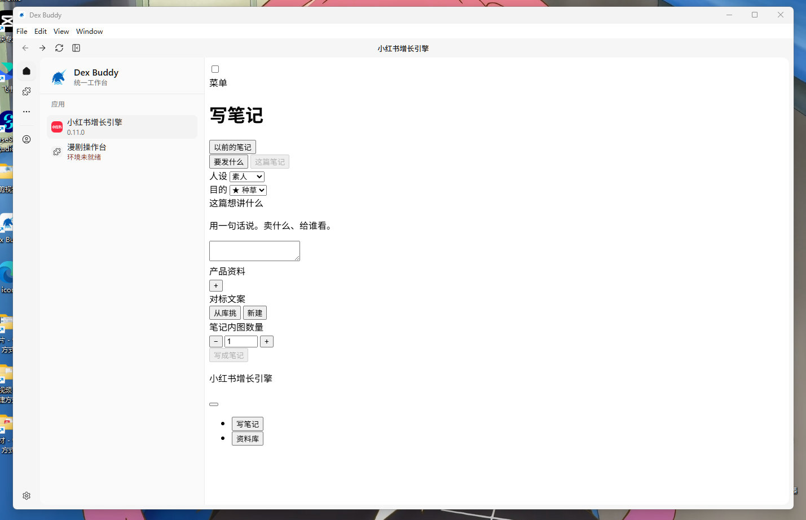
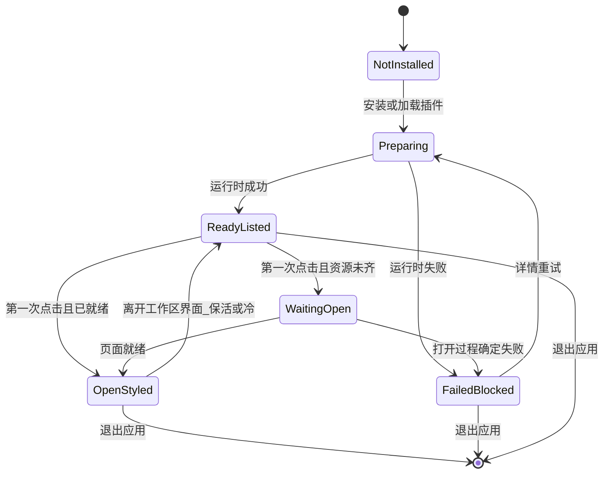

# PRD: 首次打开插件必须可用

| 属性 | 值 |
|---|---|
| 状态 | 工程：accepted，见文末「工程验收状态」 |
| 范围 | 宿主加载已安装界面插件、运行时准备与第一次打开工作区 webview 的门闩；不改插件业务页 |
| 来源需求 | 飞书需求池 `20261106_0006`（表 `1.0.DexBuddy-需求收集管理`，record `reczz28WDkFOlBFK`） |
| 关联文档 | `docs/plugin-development/runtime.md`、`docs/DESIGN.md`、`specs/prds/prd-00009-plugin-view-keepalive.md`、`specs/prds/prd-00011-plugin-external-tools.md` |
| 关联实现（现状） | `src/main/plugin-runtime.ts`、`src/main/protocol.ts`、`src/main/registry.ts`、`src/main/index.ts`（`dex:prepare-plugin`）、`src/renderer/plugins.js`、`src/renderer/plugin-boot.js`、`src/renderer/plugins-page.js` |
| 界面参考 | `specs/prds/images/prd-00018-first-open-plugin-ready/01-first-open-unstyled.png` |

## 1. 背景与问题

来源需求 ID：`20261106_0006`。提出人描述「更新后界面变成这样，卸载重装了也没用」，并附 Windows 截图：宿主侧栏与标题栏正常，工作区里「小红书增长引擎」写笔记页却是浏览器默认表单（无插件样式）。

维护者补充的可复现路径：

1. Windows 装好客户端（或装好/更新好依赖运行时的界面插件）后，**第一次**点开「小红书增长引擎」，工作区出现如上丢样式的裸页。
2. 强制退出再启动，再点一次，页面正常；把该插件卸载后再装，也会变好。
3. 期望：下载/安装完成后，第一次点进去就能正常使用。
4. 产品判断（待工程核实，**不是**已拍板根因）：运行环境准备与打开页面抢跑，缺一次「好了再开」；第二次正常，可能是 Node 环境那时才就绪。

现状与缺口（对照仓库）：

- 宿主在扫描/加载已安装插件目录时就会跑 `preparePluginRuntime`；失败则不 `apply`，侧栏写「环境未就绪」，点击进详情而不是开界面。
- 第一次点开界面时，`dex:prepare-plugin` 只登记 partition 与 preload，随即挂上 webview。
- 冷启动遮罩在 webview `did-finish-load` 就撤；HTML 到了、样式未到也会露出裸页。
- 「正在准备运行环境」主要出现在插件页状态行，挡不住工作区第一次打开。

参考图（失败态）：



## 2. 目标与非目标

### 目标

- 安装或更新完成后，使用者**第一次**点开任一界面插件，工作区出现的是**带样式的插件页**，不必强制退出，也不必卸载重装。
- 运行环境或页面资源还没好：继续显示准备中（沿用冷启动遮罩或「正在准备运行环境」一类明确等待态），**不把裸 HTML 露出来**。
- 准备失败：仍用现有「环境未就绪」；点击进详情并可重试；**不**打开半成品页。
- 验收主场景以 Windows 首次安装后第一次点「小红书增长引擎」为准；门闩规则不按操作系统分叉（所有界面插件同一道门）。

### 非目标

- 不改「小红书增长引擎」或其他插件自己的版式、文案与业务逻辑。
- 不重做漫剧等插件缺本机命令时的安装说明与「环境未就绪」文案（见 `specs/prds/prd-00011-plugin-external-tools.md`）；本 PRD 只要求同一道门闩：未就绪不打开半成品页。
- 不在本篇实现代码；不新增插件市场货架能力；不改登录 / 买断 / 积分。
- 不定义 Release 2 或更高版本；远期排查项进开放项或独立 PRD。

### 成功标准

- Windows 干净安装（或等价：该插件运行时目录尚未就绪）后，第一次点开「小红书增长引擎」，工作区最终呈现与第二次打开视觉一致的带样式页；过程中可出现准备中，不得出现参考图那种浏览器默认表单作为「已打开」态。
- 准备失败时侧栏为「环境未就绪」，工作区不留下半成品 webview 当成功页。
- 已就绪后再次打开：行为与现有保活（`prd-00009`）一致，不因本门闩强制每次冷加载。
- 相关 `pnpm test` 在实现后通过；文档说明第一次打开的等待条件。

## 3. 术语

| 术语 | 含义 |
|---|---|
| 界面插件 | `type` 为 UI 且有 `uiUrl`，在工作区以 webview 打开的插件 |
| 运行时准备 | 宿主按清单 `runtime` 下载/安装钉死版本的 Node 或 Python 及依赖（见 `docs/plugin-development/runtime.md`） |
| 页面就绪 | 插件页对使用者可见时，关键样式与脚本已加载完成，不是浏览器默认未样式表单 |
| 准备中 | 工作区明确的等待态（冷启动遮罩或等价文案），使用者知道还在准备 |
| 环境未就绪 | 现有失败态：侧栏第二行红字，点击进详情/重试，不打开界面 |
| 第一次打开 | 本机该插件安装或更新后，使用者第一次成功进入其工作区界面（相对强退后的第二次） |

## 4. 已拍板规则 / 取舍

| 项 | 决定 |
|---|---|
| 产品结果 | 第一次打开必须可用；禁止以「已打开」形式露出丢样式裸页 |
| 等待 vs 失败 | 未就绪 → 准备中；确定失败 → 环境未就绪 + 详情重试 |
| 适用范围 | 所有界面插件同一道门闩；验收样例用小红书增长引擎 |
| 平台 | 不按 OS 分叉产品规则；主验收场景在 Windows |
| 漫剧侧栏红字 | 保留现有失败态语义；不单独改文案 |
| 根因 | 产品不锁死「仅抢跑」或「仅协议拒联接」；工程核实后在实现 PR / FAQ 记录 |
| Release | 仅 Release 0；不写 Release 1 |

### 取舍说明

- **为何强调第一次**：现场复现是「第一次坏、强退或卸装后好」；成功标准必须钉住这一次，而不是「最终总能打开」。
- **为何允许准备中**：下载解释器与装依赖本来就会花时间；问题是半成品页被当成成功，不是禁止等待。
- **为何不在 PRD 锁死根因**：可能是运行时与打开抢跑，也可能是样式经 `node_modules` 联接被 `app-plugin://` 拒绝。验收只看结果。

## 5. 用户与角色

| 角色 | 目标 |
|---|---|
| 终端使用者（Windows 为主） | 装好后第一次点插件就能用，不要强退或卸装 |
| 运维 / 支持 | 少处理「界面白了 / 没样式」类工单；失败时有明确未就绪与重试 |
| 宿主工程 | 门闩可测；与现有 runtime、webview 保活、插件页状态文案衔接 |
| 插件作者 | 不改插件业务页；依赖宿主保证第一次打开时资源可用 |

## 6. 功能域

### 6.1 打开前门闩

- 点开界面插件前（或遮罩撤下前），宿主确认：运行时已成功准备，且页面不会以无样式半成品呈现给使用者。
- 仍在准备：工作区保持准备中，不把裸 HTML 当作成功页。
- 已失败：走现有「环境未就绪」路径，不挂半成品成功 webview。

### 6.2 等待与反馈

- 准备中沿用冷启动遮罩或「正在准备运行环境」一类明确反馈；不引入新的营销式空态。
- 进度文案可沿用插件页现有 `dex:runtime-progress` 通道；工作区第一次打开也要能感知，不能只写在插件页状态行却让工作区露出裸页。

### 6.3 失败与重试

- 失败后侧栏「环境未就绪」；详情可「重试」。
- 重试成功后，下一次打开必须满足「第一次可用」同等结果。

### 6.4 与保活的关系

- 门闩解决的是**冷路径首次可用**；名额内切走再回来仍按 `prd-00009`，不因本 PRD 强制每次重建。

## 7. 用户故事地图与版本切片

### 7.1 旅程主干

| 步骤 | 节点 | 说明 |
|---|---|---|
| Entry | 安装完成 | 使用者装好 Dex Buddy，并从市场装好（或已带）界面插件 |
| 1 | 启动工作台 | 宿主扫描已安装插件；可能后台准备 runtime |
| 2 | 看见侧栏 | 插件显示版本，或显示「环境未就绪」 |
| 3 | 第一次点击 | 点「小红书增长引擎」（或任意界面插件） |
| 4 | 门闩 | 未就绪则准备中；失败则进详情；就绪则打开 |
| 5 | 页面就绪 | 工作区呈现带样式的插件页 |
| Exit | 正常使用 | 使用者开始写笔记等业务操作；Teardown：离开插件 / 退出应用不留半成品「已打开」假象 |

### 7.2 用户故事地图

| 阶段 | 目标 | 故事 | 验收要点 |
|---|---|---|---|
| 首次安装后打开 | 第一次就能用 | 作为 Windows 使用者，我想装好后第一次点开小红书增长引擎就看到正常界面，以便立刻写笔记 | 干净安装后第一次打开最终为带样式页；过程可准备中；不得停留在参考图裸表单态 |
| 首次安装后打开 | 不必强退 | 作为使用者，我不想强制退出再启动才能看见正常界面，以便少踩坑 | 同一会话内，在准备完成后打开即可；不要求先杀进程 |
| 首次安装后打开 | 不必卸装 | 作为使用者，我不想卸载再安装该插件才能恢复样式，以便少操作 | 不依赖「卸了再装」作为首次可用的必要条件 |
| 等待 | 知道还在准备 | 作为使用者，我想在环境没好时看到准备中，以便不会以为坏了 | 未就绪时工作区为准备中或等价明确等待；不露出裸 HTML 当成功 |
| 失败 | 有退路 | 作为使用者，我想在准备失败时看到「环境未就绪」并能重试，以便修好后再开 | 失败不打开半成品页；详情有重试；重试成功后打开为正常页 |
| 日常 | 再次打开仍顺 | 作为使用者，我想第二次及以后打开仍按现有习惯，以便不被多余加载打断 | 就绪后再次打开遵循保活；不因门闩每次冷加载 |
| 工程 | 可回归 | 作为工程，我想门闩与失败路径可测，以便 Windows 首开场景可复跑 | 实现后有可自动化的就绪判定或协议/路径用例；`pnpm test` 通过 |

### 7.3 Release 切片

#### Release 0（MVP）

可验收结果：

- Windows 首次安装（或等价未就绪）后，第一次点开「小红书增长引擎」得到带样式页，或明确准备中后进入带样式页。
- 未就绪不露出参考图裸页；失败走「环境未就绪」+ 重试。
- 同一道门闩适用于所有界面插件；不按 OS 分叉。
- 不要求强退或卸装才能首次可用。
- 文档写清第一次打开的等待与失败行为。

本期不做：改插件业务 UI；重做 externalTools 安装说明；根因二选一的最终定论（可在实现时记 FAQ）。

## 8. 核心流程与状态机图

```mermaid
flowchart TD
  entry["Entry_安装或更新完成"]
  launch["启动并扫描已安装插件"]
  prep["准备运行时"]
  prepOk{"运行时成功"}
  listed["侧栏显示版本"]
  blocked["侧栏环境未就绪"]
  click["第一次点击界面插件"]
  gate{"页面与环境就绪"}
  waiting["工作区准备中"]
  openOk["打开带样式插件页"]
  detail["进入详情可重试"]
  use["正常使用"]
  exitNode["Exit_离开或退出"]

  entry --> launch
  launch --> prep
  prep --> prepOk
  prepOk -->|是| listed
  prepOk -->|否| blocked
  listed --> click
  blocked --> click
  click --> gate
  gate -->|仍在准备| waiting
  waiting --> gate
  gate -->|失败| detail
  detail -->|重试成功| listed
  gate -->|就绪| openOk
  openOk --> use
  use --> exitNode
```



断头路扫描：禁止从 `WaitingOpen` 直接进入「已展示裸 HTML」的成功态；失败必须到 `FailedBlocked` 或回到可重试，不能卡在无反馈白屏。

## 9. 数据与 API 衔接

- 不新增飞书表字段；本 PRD frontmatter 已挂 `demand_id` / `demand_record_id` / `demand_source`。
- 可能触及：`preparePluginRuntime`、`dex:prepare-plugin`、webview 挂载与 `did-finish-load` 遮罩撤除时机、`app-plugin://` 静态资源解析、`dex:runtime-progress` 在工作区的可见性。
- 不强制本篇规定具体 IPC 形状；工程在实现时保持 `dex:` 前缀与现有 preload 边界。
- 工程待核实：样式是否经 `node_modules` 联接落到用户数据目录，从而被 `resolvePluginAsset` 拒绝（见开放项）。

## 10. 假设与待确认 / 开放项

| 项 | 状态 |
|---|---|
| 根因是运行时与打开抢跑，还是样式路径被协议拒绝，或二者兼有 | 开放：实现时核实；验收只看首次打开结果 |
| 小红书增长引擎是否声明 `runtime.node` 且样式依赖安装后的联接 | 开放：对照该插件清单与打包内容 |
| 主验收机：干净 Windows + 首次装客户端 + 首次开插件 | 已定 |
| 机器类型字段在飞书为空 | 已按截图与口述定为 Windows 场景 |
| 飞书需求状态回写「开工」 | 待本 PRD 落盘后由 `/team:feishu-feature-enginer 回写 … 开工` 执行；本篇撰写不改表 |

## 11. 修订记录

| 日期 | 说明 |
|---|---|
| 2026-11-12 | 初稿。来源飞书 `20261106_0006`；Release 0：首次打开不得露裸页，未就绪则准备中 |
| 2026-11-12 | 工程实现：放行宿主 runtime env 联接资源；工作区样式门闩；FAQ 与 runtime 文档 |

## 12. 工程验收状态

> 由 `/team:prd-accept` 维护；勿手工编造「通过」。最后更新：2026-11-12T10:52:11Z，prd/00018-first-open-plugin-ready@9a49326（实现仍在工作区未提交），范围：R0。

### 总览

- 工程状态：`accepted`
- 验收判定：Release 0 纳入项无「未实现」；维护者确认关闭本 PRD。Mac 弱对照打开界面插件正常；代码与单测齐备。
- 最近验收：2026-11-12T10:52:11Z
- 代码提交：工作区未提交。基线 `prd/00018-first-open-plugin-ready@9a49326`。
- `app-plugin://` 放行宿主自管 `plugin-runtime/<id>/env` 下真实文件；任意其它外链仍拒绝。
- 工作区样式门闩：未齐保持遮罩并自动重载一次，失败不留裸成功页。
- 维护者 Mac 本地点开界面插件确认正常；产品决定关闭本 PRD 并回写飞书已完成。

### Release 交付

| Release | 状态 | 说明 |
|---|---|---|
| R0 | 通过 | 协议、门闩、文档、单测 + Mac 弱对照；维护者确认关闭 |
| R1 | 范围外 | 本 PRD 未定义 Release 1 |

### 功能验收清单（Agent 优先读此表）

| ID | 能力摘要 | Release | 状态 | 证据 |
|---|---|---|---|---|
| S2-1 | `node_modules` 联接到 runtime env 内文件可被解析 | R0 | 通过 | `src/main/protocol.ts` `allowedRealRoots`；`test/registry.test.ts` |
| S2-2 | 任意插件目录外的符号链接仍被拒绝 | R0 | 通过 | 同测例；既有逃逸测 |
| S2-3 | 样式未就绪不撤遮罩；失败不留裸成功页 | R0 | 通过 | `src/renderer/plugin-views.js` `finishLoad` / `styleRetried` |
| S2-4 | 样式就绪判定覆盖无 sheet / 失败 / 全成功 | R0 | 通过 | `src/renderer/page-ready.js`；`test/page-ready.test.ts` |
| US-首开 | 第一次打开界面插件为带样式页 | R0 | 通过 | 代码门闩 + 维护者 Mac 弱对照「点了点是正常的」；关闭本 PRD |
| US-失败 | 准备失败走环境未就绪，不打开半成品 | R0 | 通过 | `plugins.js` `runtimeError` → `onUnavailable`；样式失败 `onFailed` |
| US-保活 | 就绪后再次打开不因门闩强制冷加载 | R0 | 通过 | `openPlugin` 在 `views.isShowing` 时直接返回 |

### 未完成与遗留

- Windows 干净安装「第一次」路径未在本机复跑；若线上再出现裸页，另开缺陷。
- 飞书 `20261106_0006` 随本轮回写为已完成。

### 质量检查

| 检查项 | 状态 |
|---|---|
| pnpm test | 通过（254） |
| pnpm build | 通过（实现时） |
| 文档同步（runtime.md / FAQ / doc_index.md） | 通过 |

---
统计：通过 7 / 部分 0 / 未实现 0 / 范围外 1
