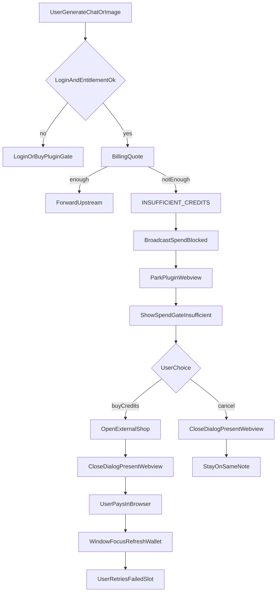
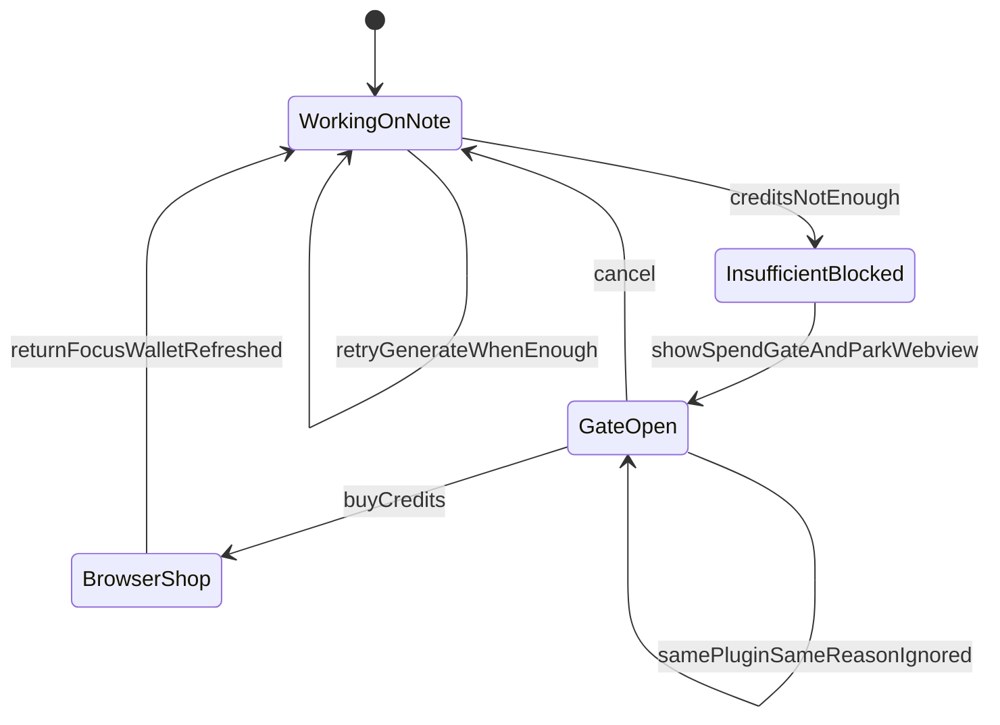

# PRD: 积分不够时购买积分

| 属性 | 值 |
|---|---|
| 状态 | 工程：accepted，见文末「工程验收状态」 |
| 范围 | Electron 工作台：文案 / 生图因积分不够失败时，在当前插件现场弹出「积分不够」层，提供「取消」与「购买积分」（系统浏览器打开 `{gateway}/shop`）；打开层时藏起当前插件 webview；回到前台刷新余额且不冲掉当前笔记现场。必验路径为 `plugins/models-playground`「演示积分不够」（不扣真积分）。不改支付、不改小红书插件仓源码 |
| 来源需求 | 飞书需求池 `20261112_0020`（表 `1.0.DexBuddy-需求收集管理`，record `reczz28YijLgMzk9`） |
| 关联文档 | `docs/DESIGN.md`、`docs/plugin-development/models.md`、`specs/prds/prd-00014-host-chat-egress.md`、`specs/prds/prd-00015-plugin-access-check.md` |
| 关联实现（现状） | `src/renderer/spend-gate.js`、`src/renderer/app.js`、`src/main/host-egress.ts`（试玩 `forceInsufficientCredits`）、`src/main/gateway-session.ts`（`openShop`）、`plugins/models-playground/`、`src/shared/dex-bridge.ts`（`INSUFFICIENT_CREDITS`） |
| 界面参考 | `specs/prds/images/prd-00019-insufficient-credits-prompt/01-note-insufficient-credits.png`、`02-toast-detail.png` |

## 1. 背景与问题

来源需求 ID：`20261112_0020`。提出人描述：「小红书增长引擎：积分不够，不能继续作图了，这种情况该怎么处理呢」。附 Windows 现场截图。

可观察现场（见界面参考图）：

1. 用户已打开「小红书增长引擎」写笔记，进度到「这篇笔记」，「图片 2/2」里第一张成功、第二张标「失败」。
2. 插件 toast 文案为「积分不足（INSUFFICIENT_CREDITS）。请再点一次取回这张图（不会重复扣费）」。
3. 画面上没有「购买积分」或等价入口；用户看不到下一步该怎么补积分。

仓库里宿主侧已有契约与实现雏形（00014 / 00015 / DESIGN）：模型出口报价不够抛 `INSUFFICIENT_CREDITS`，工作台 `spend-gate` 应弹出「积分不够」，确认钮「购买积分」打开 `/shop`，打开前藏起当前 webview。截图说明用户没走到这层可行动提示——根因（没弹出，或弹出了仍被 webview 盖住，或插件 toast 抢走了注意力）标为待工程核实，本文不拍板根因，只钉死现场可验收结果。

## 2. 目标与非目标

### 目标

- 已登录、买断通过（含未上架 / 限免）后，文案 `chat.completions.create` 或生图 `images.generate` 因余额不够失败时，工作台在当前插件现场弹出「积分不够」。
- 弹出层正文不展示错误码；正文沿用「使用前请先购买积分。」；按钮为「取消」和「购买积分」。
- 「购买积分」用系统浏览器打开 `{gatewayBase}/shop`；工作台留在当前插件与当前笔记，不跳到设置积分页。
- 打开弹出层前先藏起当前插件 webview；关掉后再放回，避免原生层盖住宿主 dialog。
- 「取消」关闭层，不打开购买页，不扣积分，仍留在原笔记。
- 用户从浏览器回到 Dex Buddy 前台后刷新余额（与现有获焦 / 积分页同步一致）；不改变当前插件、选中笔记、已成功图、失败槽与滚动位置。
- 积分够了之后，由用户再触发生成失败的那一张；不自动重画。
- 同一插件、同一种拦住，框还开着就不再叠第二个。
- 端到端必验：`pnpm start` 下「模型试玩」→「演示积分不够」，不依赖真实钱包余额为 0。

### 非目标

- 客户端内支付、新建「充值」页，或把按钮 / 标题改成「充值」。
- 改小红书增长引擎（或其它外部插件）源码；插件 toast 若仍画错误码，以宿主弹出层为用户可行动的首层。
- 积分不够时自动再次调用生图或文案。
- 改未登录「需要登录」、未买断「需要购买插件」两态文案与流程（已有，本需求不改）。
- 改报价算法、网关合同、积分商品 SKU。
- 对网关伪造天价报价，或新建独立「验收专用」产品插件；验收挂在现有 `models-playground`。
- 把「真实钱包扣到 0」当作唯一或必验条件。
- Release 1 及更高版本占位；回写飞书需求状态（另走飞书需求管理工程师）。

### 成功标准

- **必验**：已登录后打开「模型试玩」，点「演示积分不够」，工作台弹出「积分不够」，能看见并可点「购买积分」；不打真实报价、不扣积分。
- 点「购买积分」后系统浏览器打开的 origin 为当前网关 base，路径 `/shop`；工作台仍停在模型试玩。
- 点「取消」后层关闭，浏览器不打开，试玩页仍在。
- 弹出层打开期间，用户先看到宿主 dialog，而不是被插件 webview 完全挡住。
- 宿主正文不含 `INSUFFICIENT_CREDITS` 错误码。
- 同一试玩插件、同一种拦住，框还开着再点一次不叠第二个框。
- 不会因该演示路径自动再打一次真实生图 / 文案。
- **可选烟测**（不阻塞验收）：真实钱包为 0 时小红书写笔记生图失败，同样出现上述弹出层。

## 3. 术语

| 术语 | 含义 |
|---|---|
| 积分不够 | 工作台弹出层标题；对应稳定码 `INSUFFICIENT_CREDITS`（报价 `enough === false` 或网关 402） |
| 购买积分 | 弹出层确认钮与积分页按钮文案；打开系统浏览器 `{base}/shop` |
| 工作台弹出层 | 现有 `spend-gate`：登录 / 购买插件 / 购买积分 三态之一 |
| 模型出口 | `ctx.models.chat.completions.create` 与 `ctx.models.images.generate` |
| 当前笔记现场 | 用户正在看的插件界面状态：草稿文案、已成功图、失败槽、滚动与选中 |
| 演示积分不够 | 模型试玩按钮；宿主仅对 `models-playground` 认 `forceInsufficientCredits`，跳过真实报价并通知壳 |

## 4. 已拍板规则

| 项 | 状态 | 决定 |
|---|---|---|
| 叫法 | 已定 | 标题「积分不够」，按钮「购买积分」与「取消」；不另起「充值」 |
| 购买页 | 已定 | 仍打开 `{gatewayBase}/shop`；不在客户端做支付 |
| 提示位置 | 已定 | 工作台弹出层绘制；插件页面不画这三句购买 / 登录文案（与 models.md 一致） |
| 上下文 | 已定 | 跳浏览器买积分时工作台留在原插件与原笔记；回来不冲掉现场 |
| 再生成 | 已定 | 不自动重画；用户积分够后再点生成 |
| 退路 | 已定 | 可取消；取消不打开 `/shop`、不扣积分 |
| 插件仓 | 已定 | 本仓不改小红书等外部插件源码 |
| 验收路径 | 已定 | 必验用模型试玩「演示积分不够」；不要求扣光真钱包；小红书空钱包仅可选烟测 |
| force 选项 | 已定 | 仅 `models-playground` 生效；其它插件传入 `forceInsufficientCredits` 无效 |
| 与 00014/00015 | 已定 | 拦截顺序仍是未登录 → 未买断 → 积分不够；本文只钉死积分不够这一态的现场可行动项 |

## 5. 用户与角色

| 角色 | 目标 |
|---|---|
| 终端用户（运维 / 写笔记） | 作图失败时知道是积分不够，能马上去买，买完还能回到这篇笔记继续 |
| 插件作者 | 继续抛稳定 `INSUFFICIENT_CREDITS`；不必在插件页画购买文案 |
| 宿主工程 | 保证 `onBlocked` → `spend-gate` → `openShop` 在用户可见层可用 |
| 产品 / 需求池 | 飞书 `20261112_0020` 有可验收的客户端结果 |

## 6. 功能域

| 域 | 说明 |
|---|---|
| 模型出口通知 | `INSUFFICIENT_CREDITS` 时主进程广播 `dex:spend-blocked`，payload 含 `pluginId` 与 `reason` |
| 工作台弹出层 | `spend-gate` 展示积分不够文案；确认打开 shop；取消关闭 |
| webview 避让 | 打开层前 park 当前 guest；关闭后 present 回来 |
| 购买跳转 | 主进程 `openShop` → `openExternal(shopUrl)` |
| 余额刷新 | 窗口获焦且已登录时刷新 wallet（沿用现有会话行为），不重置插件 UI 状态 |

## 7. 用户故事地图与版本切片

### 7.1 旅程主干表

#### 旅程 A：模型试玩演示积分不够 → 购买（必验）

| 步骤 | Entry / 动作 | Exit |
|---|---|---|
| A0 | Entry：`pnpm start`、已登录、打开「模型试玩」 | 点「演示积分不够」 |
| A1 | 宿主跳过真实报价，抛 `INSUFFICIENT_CREDITS` 并通知壳；打开前藏起 webview | 弹出「积分不够」 |
| A2 | 点「购买积分」 | 系统浏览器打开 `/shop`；工作台仍停在模型试玩 |
| A3 | Exit：可关掉浏览器回到试玩 | Teardown：未扣积分；无自动再生成 |

#### 旅程 B：演示积分不够 → 取消（必验）

| 步骤 | Entry / 动作 | Exit |
|---|---|---|
| B0 | Entry：同 A0，层已打开 | 用户点「取消」 |
| B1 | Exit：层关闭，浏览器未开，不扣积分 | Teardown：仍在模型试玩页 |

#### 旅程 A′：写笔记生图积分不够 → 购买（可选烟测）

| 步骤 | Entry / 动作 | Exit |
|---|---|---|
| A′0 | Entry：已登录、插件可用、真实余额不够；正在写笔记 | 模型出口报价失败或 402 |
| A′1 | 工作台弹出「积分不够」；打开前藏起当前 webview | 用户看见「购买积分」 |
| A′2 | 点「购买积分」 | 系统浏览器打开 `/shop`；工作台仍停在该插件 |
| A′3 | 在网页完成购买后切回 Dex Buddy | 余额刷新；笔记草稿与图槽仍在 |
| A′4 | 用户再点生成失败槽 | Exit：积分够则出图。Teardown：无自动重画 |

#### 旅程 C：框已开时再次失败

| 步骤 | Entry / 动作 | Exit |
|---|---|---|
| C0 | Entry：同一插件、同一 `INSUFFICIENT_CREDITS`，框仍开着 | 再次收到 blocked |
| C1 | Exit：不叠第二个框 | 仍是同一个「积分不够」层 |

#### 旅程 D：文案补全积分不够

| 步骤 | Entry / 动作 | Exit |
|---|---|---|
| D0 | Entry：已登录买断通过，文案报价不够 | `INSUFFICIENT_CREDITS` |
| D1 | Exit：同 A1 弹出层与购买路径 | 与生图同一套 spend-gate |

#### 旅程 E：未登录或未买断（对照，本 PRD 不改）

| 步骤 | Entry / 动作 | Exit |
|---|---|---|
| E0 | Entry：无会话或未买断 | 先 `UNAUTHORIZED` 或 `NOT_ENTITLED` |
| E1 | Exit：弹登录或购买插件 | 不出现「积分不够」为第一框 |

### 7.2 用户故事地图

| 阶段 | 目标 | 故事 | 验收要点 |
|---|---|---|---|
| 拦住 | 说清楚为什么停 | 作为验收者，我想在模型试玩里一键看到「积分不够」，以便不扣光真钱包也能验 | 点「演示积分不够」出现标题「积分不够」；正文无错误码 |
| 购买 | 能去付钱 | 作为用户，我想从提示一键打开购买积分页，以便补足余额 | 「购买积分」打开 `{base}/shop` |
| 退路 | 可以不买 | 作为用户，我想先关掉提示继续看当前插件，以便稍后再买 | 「取消」关闭层且不打开浏览器 |
| 现场 | 买完还能接着用 | 作为用户，我想买完回来还在原来的插件页上 | 试玩页（或可选烟测下的笔记）仍在；不自动重画 |
| 可见 | 框不被盖住 | 作为用户，我想点得到「购买积分」，以便不被插件层挡住 | 打开层时 park webview；关闭后放回 |
| 去重 | 不要连环弹 | 作为用户，我不想同一失败连弹多个框 | 同插件同 reason 框开着不叠第二个 |

### 7.3 Release 切片

#### Release 0（MVP，必选）

1. 文案 / 生图 `INSUFFICIENT_CREDITS` 时工作台弹出「积分不够」，含「取消」与「购买积分」。
2. 「购买积分」打开系统浏览器 `{gatewayBase}/shop`；打开前藏起当前插件 webview。
3. 取消与买完回来均保留当前插件现场；获焦刷新余额；不自动重画。
4. 同插件同 reason 不叠框；宿主正文不含错误码。
5. 模型试玩提供「演示积分不够」（`forceInsufficientCredits`，仅该插件生效）；端到端验收以该路径为准，不要求真实钱包为 0。

本文不定义 Release 1。溢出项进 §非目标或 §开放项。

## 8. 核心流程与状态机图

### 8.1 积分不够购买主流程

### 8.2 弹出层与现场状态

死胡同预警：若 `onBlocked` 未到达渲染层，或 dialog 打开时未 park webview，用户会停在「只有插件 toast、没有购买」的现场——验收必须以用户能点到「购买积分」为准。余额刷新不得清空笔记状态。不得在不够时自动重试生图造成误扣。

## 9. 数据与 API 衔接

本仓不建业务库表。不新增网关路径。沿用：

| 方法 | 路径 / 通道 | 用途 |
|---|---|---|
| POST | `/v1/billing/quote` | 报价；`enough === false` → 积分不够 |
| 生图 / 文案 | 既有模型出口 | 402 / `INSUFFICIENT_CREDITS` 时同样通知壳 |
| IPC push | `dex:spend-blocked` | `{ pluginId, reason: 'INSUFFICIENT_CREDITS' }` |
| IPC invoke | `dex:gateway-open-shop` | 打开 `{base}/shop` |

## 10. 假设与待确认

### 假设

- 00014 / 00015 已落地的拦截顺序与 `spend-gate` 三态文案仍有效；本文是现场可行动项的验收补钉。
- 网页商城与桌面会话是同一账号时，买完积分回到客户端余额会对上。
- 插件侧 toast 即使仍带错误码，只要宿主层可见且可点，即满足本 PRD；清理插件 toast 属插件仓，不在本仓。
- `pnpm start` 会加载 `plugins/models-playground`；安装包不带该示例，验收在开发挂载下完成即可。

### 开放项

- 飞书截图路径上「宿主层未出现」的根因：未广播、渲染未挂载、webview 盖住、或旧安装包未含 spend-gate——工程用试玩路径复现后修实现，不在本文改产品规则。
- 生图幂等键「再点一次取回」与「真·积分不够」的文案区分：插件仓若要改 toast，另立项；宿主层对真不够统一为购买提示。

### 冲突与决议需求

- DESIGN / models.md 已写「插件页面不画这三句」与「积分不够弹购买积分」。本文与之对齐；若实现与文档不一致，以本文成功标准验收宿主行为，并回写 DESIGN 仅当实现确有行为变更。

## 11. 修订记录

| 日期 | 说明 |
|---|---|
| 2026-11-13 | 初稿。来源飞书 `20261112_0020`；钉死积分不够现场弹出「购买积分」、保留笔记上下文、不自动重画；本仓不改插件源码 |
| 2026-11-13 | 验收改为模型试玩「演示积分不够」必验；不要求扣光真钱包；小红书空钱包仅可选烟测 |

## 12. 工程验收状态

> 由 `/team:prd-accept` 维护；勿手工编造「通过」。最后更新：2026-11-13T06:56:03Z，prd/00019-insufficient-credits-prompt@工作区（基线 59bb882），范围：R0。

### 总览

| 项 | 值 |
|---|---|
| 工程状态 | accepted |
| 验收判定 | R0 主路径通过（feature-dev S2：`pnpm test` + 读文件；北极星 S2-2 / S2-4）；`/team:prd-accept` 复核仍 accepted |
| 最近验收 | 2026-11-13T06:56:03Z |
| 代码提交 | 工作区未提交；分支 `prd/00019-insufficient-credits-prompt`，基线 `59bb882` |
| 摘要 | 试玩「演示积分不够」→ `forceInsufficientCredits`（仅 models-playground）→ spend-gate「积分不够」/「购买积分」；非试玩 force 无效；打开层 park webview |

### Release 交付

| Release | 状态 | 说明 |
|---|---|---|
| R0 | 通过 | 试玩必验路径 + 壳层文案与 shop；不要求扣光真钱包 |
| R1 | 范围外 | 本文未定义 Release 1 |

### 功能验收清单（Agent 优先读此表）

| ID | 能力摘要 | Release | 状态 | 证据 |
|---|---|---|---|---|
| F01 | 试玩 UI「演示积分不够」 | R0 | 通过 | `plugins/models-playground/ui/index.html` |
| F02 | `demoInsufficientCredits` → force → 通知壳、不报价 | R0 | 通过 | `plugins/models-playground/index.js`；`src/main/host-egress.ts`；`test/host-egress.test.ts`「试玩 force…」 |
| F03 | 非试玩 `forceInsufficientCredits` 无效 | R0 | 通过 | 同测「非试玩 force…仍走报价」 |
| F04 | 壳「积分不够」/「购买积分」→ `openGatewayShop` | R0 | 通过 | `src/renderer/spend-gate.js` |
| F05 | 打开弹层 park webview，关闭 present | R0 | 通过 | `src/renderer/app.js` |
| F06 | 小红书空钱包烟测 | R0 | 范围外 | 可选；不阻塞；§非目标/成功标准可选烟测 |

### 未完成与遗留

- 窗口目视「弹窗已出」由人确认；正式 S2 门禁未用浏览器冒充。完整点击购买/取消/叠框等人眼项可交 `/team:test-enginer`。
- 实现尚在工作区，未 `git commit`；`accepted_commit` 未钉死哈希。
- 飞书 `20261112_0020`：本轮由飞书需求管理工程师回写 开工→验收（待评估→进行中→已完成）。
- 终端 invoke reject 打 `GatewayError: 积分不足` 栈为契约「调用仍然失败」，不修。

### 质量检查

| 检查项 | 状态 |
|---|---|
| pnpm test | 通过（257） |
| 文档同步（models.md / DESIGN / doc_index / PRD） | 通过 |

---
统计：通过 5 / 部分 0 / 未实现 0 / 范围外 1
