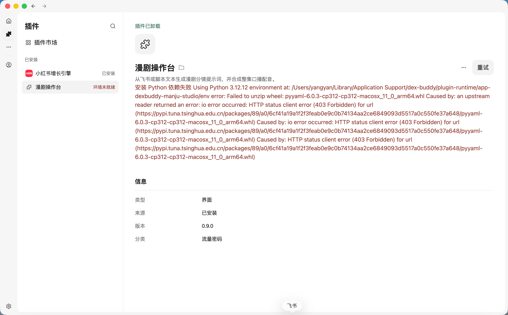
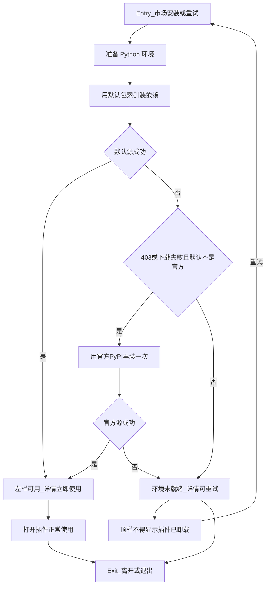
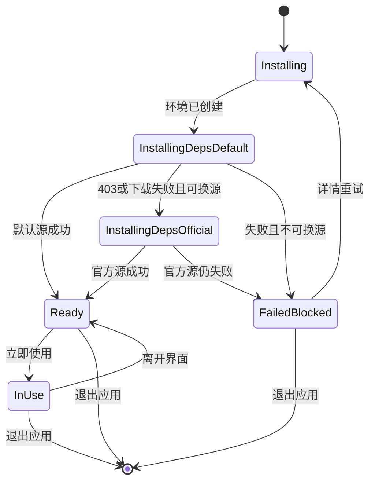

# PRD: 插件 Python 依赖镜像失败时自动换源

| 属性 | 值 |
|---|---|
| 状态 | 工程：accepted，见文末「工程验收状态」 |
| 范围 | 宿主为已安装插件准备 Python 环境时的包索引：默认镜像失败后同一次准备改官方 PyPI；失败态首层文案与顶栏状态；不改插件业务页 |
| 来源需求 | 飞书需求池 `20261110_0011`（表 `1.0.DexBuddy-需求收集管理`，record `reczz28XoYHIuGj3`） |
| 关联文档 | `docs/plugin-development/runtime.md`、`docs/DESIGN.md`、`specs/prds/prd-00003-plugins-page.md`、`specs/prds/prd-00011-plugin-external-tools.md`、`specs/prds/prd-00018-first-open-plugin-ready.md` |
| 关联实现（现状） | `src/main/plugin-runtime.ts`（`pypiIndex`、`toolEnv`、`installPluginEnv`）、`src/main/registry.ts`、`src/renderer/plugins-page.js`、`src/renderer/plugins.js` |
| 界面参考 | `specs/prds/images/prd-00020-plugin-python-index-fallback/01-manju-pypi-403.png` |

## 1. 背景与问题

来源需求 ID：`20261110_0011`。提出人描述：「mac 系统，插件市场，漫剧操作台报错」，并附 Mac 截图。

现场（对照截图）：

1. 从插件市场装上「漫剧操作台」（清单 id `app-dexbuddy-manju-studio`，版本 `0.9.0`，来源「已安装」）。
2. 左栏第二行红字「环境未就绪」；详情按钮是「重试」。
3. 详情正文是 uv 原文：Python 3.12.12 环境已建在用户数据目录的 `plugin-runtime/…`，安装依赖时解压 `pyyaml-6.0.3-…-macosx_11_0_arm64.whl` 失败，清华源 `https://pypi.tuna.tsinghua.edu.cn/…` 返回 `403 Forbidden`。
4. 同一屏顶栏还留着绿字「插件已卸载」，与信息表「已安装」和左栏「环境未就绪」并排出现。

现状与缺口（对照仓库）：

- 宿主默认用 `DEX_BUDDY_PYPI_INDEX`，未设时为清华 simple（`pypiIndex()`），经 `UV_DEFAULT_INDEX` 传给 uv。
- 安装 Python 依赖失败时整段日志进 `runtimeError`，详情原样展示；没有同一次准备里改官方 PyPI 再装的路径。
- 使用者出路是再点「重试」，仍可能打同一镜像；镜像 403 不是使用者能修的地址。

参考图（失败态）：

## 2. 目标与非目标

### 目标

- 从插件市场装上「漫剧操作台」（或任一已安装、声明了 Python 依赖的插件）后，**同一次**运行环境准备里：若默认包索引对 wheel 返回 403 或下载失败，宿主改用官方 PyPI 把依赖装完。
- 装完：左栏不再是「环境未就绪」，详情按钮是「立即使用」，来源仍是「已安装」。使用者不用点重试，也不用自己换镜像。
- 默认源与官方源都失败：左栏与详情首层都写还不能用，并保留「重试」；选中该插件时顶栏不得继续留着上一次的「插件已卸载」。
- 首层说明「这个插件还不能用，因为依赖没装上」；不把解释器路径、插件 id 目录和 PyPI 文件地址当作使用者要读懂的内容。
- 换源发生在准备过程里；全部失败时「重试」再走同一套换源，不先把插件卸掉；已有配置和插件数据不动。

### 非目标

- 不改「漫剧操作台」或其他插件仓库的业务页、清单依赖列表或打包内容。
- 不改 Node 的 npmmirror；不改解释器七牛包（`dex-buddy/runtimes/`）。
- 不重做本机 CLI / externalTools 安装说明（见 `specs/prds/prd-00011-plugin-external-tools.md`）。
- 不改首次打开样式门闩（见 `specs/prds/prd-00018-first-open-plugin-ready.md`）。
- 不代装 Homebrew；不把 Python 依赖打进 Dex Buddy 安装包；不要求使用者手动改镜像或设环境变量。
- 不定义 Release 2 或更高版本；溢出项进开放项或独立 PRD。

### 成功标准

- Mac arm64（与截图等价）从市场装好「漫剧操作台」后，默认镜像对依赖返回 403 或下载失败时，同一次准备改官方源装完；左栏无「环境未就绪」，详情为「立即使用」。
- 环境变量已指向官方 PyPI 时，不重复再试同一官方源。
- 两个源都失败：首层可重试；顶栏不是「插件已卸载」；信息不表「已卸载」。
- 相关 `pnpm test` 在实现后通过；`docs/plugin-development/runtime.md` 写清默认索引与失败换源。

## 3. 术语

| 术语 | 含义 |
|---|---|
| 默认包索引 | `pypiIndex()`：`DEX_BUDDY_PYPI_INDEX` 或清华 simple |
| 官方 PyPI | 官方 simple 索引（实现时钉死 URL；与默认索引相同时不再二次尝试） |
| 同一次准备 | 一次安装或一次「重试」触发的 `preparePluginRuntime` / 安装依赖流程，含默认源与必要时的换源 |
| 环境未就绪 | 现有失败态：侧栏第二行红字，详情可「重试」，不打开界面 |
| 已安装 | 市场装进本机、来源为 `installed` 的插件；失败时仍算已安装，不是已卸载 |

## 4. 已拍板规则 / 取舍

| 项 | 决定 |
|---|---|
| 产品结果 | 默认镜像 403 / 下载失败时，同一次准备改官方源装完；成功后首层可用 |
| 适用范围 | 所有已安装、声明了 Python 依赖的插件；验收样例用「漫剧操作台」Mac arm64 |
| 默认索引 | 仍用现有 `pypiIndex()`；不改为「默认就只用官方」 |
| 换源时机 | 该次 uv 因 403 或下载失败退出后，同一轮改官方 PyPI 再装一次 |
| 已是官方源 | `DEX_BUDDY_PYPI_INDEX`（或解析后的默认）已是官方时，不重复再试 |
| Node / 解释器 | 不改 npmmirror；不改七牛解释器包 |
| 失败文案 | 首层说还不能用、依赖没装上；细节日志可进可复制区或日志，不挡首层 |
| 顶栏状态 | 选中仍已安装的失败插件时，不得显示「插件已卸载」 |
| 数据 | 换源与重试不卸插件；不删配置与 plugin-data |
| Release | 仅 Release 0；不写 Release 1 |

### 取舍说明

- **为何保留默认国内镜像**：多数环境国内镜像更快；问题是 403 时没有退路，不是默认源选错。
- **为何同一次换源**：现场是装完就停在未就绪，出路是人再点重试；成功标准钉住「装完那一次就能用」。
- **为何不改插件仓**：根因在宿主包索引与失败呈现；漫剧业务页与依赖列表不在本仓演进。

## 5. 用户与角色

| 角色 | 目标 |
|---|---|
| 终端使用者（Mac 为主，验收样例） | 市场装上漫剧操作台后就能用，不要自己换镜像或反复重试 |
| 运维 / 支持 | 少处理「环境未就绪 + 清华 403」类工单；失败时首层可读、可重试 |
| 宿主工程 | 换源可测；与现有 runtime、插件页状态文案衔接 |
| 插件作者 | 不改插件仓；继续声明 `runtime.python` 即可 |

## 6. 功能域

### 6.1 安装依赖与换源

- 已安装插件准备 Python 环境时，先按 `pypiIndex()` 装依赖（含 `uv sync` / `uv pip install` 现有路径）。
- 该次因 403 或下载失败退出：同一轮改官方 PyPI 再装一次（重建或不完整 env 的清理规则由工程按现有 stamp / env 语义实现，须保证第二次尝试从干净可装状态开始）。
- 默认已是官方：只装一次，失败直接失败态。
- 换源只换包索引；不改使用者正在看的列表选中项与筛选。

### 6.2 成功与失败呈现

- 成功：清除该插件的 `runtimeError`；左栏显示可用态（版本等，非「环境未就绪」）；详情「立即使用」。
- 失败：左栏「环境未就绪」；详情首层说明还不能用、依赖没装上，并保留「重试」；不把本机路径与镜像 URL 当作首层必读正文。
- 选中该插件时，顶栏状态条不得显示「插件已卸载」。

### 6.3 重试

- 「重试」再次跑完整准备（含默认源 → 必要时官方源）。
- 不卸载插件；不要求先清用户数据。

## 7. 用户故事地图与版本切片

### 7.1 旅程主干

| 步骤 | 节点 | 说明 |
|---|---|---|
| Entry | 打开插件市场 | 使用者在 Mac 上打开 Dex Buddy，进入插件页 / 市场 |
| 1 | 安装漫剧操作台 | 从市场安装「漫剧操作台」（或等价已安装 Python 插件） |
| 2 | 准备运行环境 | 宿主创建 Python 环境并安装依赖；默认索引可能 403 |
| 3 | 换源（若需要） | 同一次准备改官方 PyPI 再装 |
| 4 | 看到结果 | 成功：可立即使用；失败：环境未就绪 + 重试，顶栏不是已卸载 |
| 5 | 使用或重试 | 成功则打开插件；失败可点重试再走 Entry 后半段 |
| Exit | 正常使用或离开 | Teardown：离开详情 / 退出应用；失败也不把插件标成已卸载 |

### 7.2 用户故事地图

| 阶段 | 目标 | 故事 | 验收要点 |
|---|---|---|---|
| 安装后准备 | 一次装完就能用 | 作为 Mac 使用者，我想从市场装上漫剧操作台后不用自己换镜像就能用，以便立刻开操作台 | 默认镜像 403 / 下载失败时同一次准备改官方源装完；左栏无「环境未就绪」；详情「立即使用」 |
| 安装后准备 | 不必反复点重试 | 作为使用者，我不想靠再点「重试」才碰巧装上，以便少踩坑 | 成功路径不依赖人先点重试；重试仅用于两个源都失败之后 |
| 失败 | 首层说真话 | 作为使用者，我想在装不上时一眼看出还不能用、还能重试，以便知道下一步 | 左栏「环境未就绪」；详情有「重试」；首层不靠路径与 URL 才能理解 |
| 失败 | 状态不撒谎 | 作为使用者，我不想在插件仍已安装时看到「插件已卸载」，以便不被误导 | 选中失败且仍已安装的插件时，顶栏不是「插件已卸载」；信息表来源仍是已安装 |
| 失败 | 数据还在 | 作为使用者，我想重试时配置和数据还在，以便不用重装插件 | 重试与换源不卸插件、不删配置与 plugin-data |
| 工程 | 可回归 | 作为工程，我想默认失败换官方源可测，以便 403 场景可复跑 | 有针对换源触发与「已是官方不再二次」的用例；`pnpm test` 通过 |

### 7.3 Release 切片

#### Release 0（MVP）

可验收结果：

- 默认 PyPI 镜像 403 或下载失败时，同一次准备改官方源装完依赖；验收样例「漫剧操作台」Mac arm64。
- 成功后左栏可用、详情「立即使用」、来源已安装。
- 两源皆失败：首层可重试；顶栏不是「插件已卸载」。
- 已配置为官方索引时不重复再试。
- `runtime.md` 写清默认索引与失败换源；相关测试通过。

本期不做：改 Node 镜像策略；改七牛解释器；改插件业务 UI；代装 Homebrew；把依赖打进安装包。

## 8. 核心流程与状态机图

断头路扫描：禁止在默认源 403 后直接结束为「只能人肉重试同一源」且无换源；禁止失败态把仍已安装的插件标成「已卸载」。`FailedBlocked` 必须能经「重试」回到 `Installing`。

## 9. 数据与 API 衔接

- 不新增飞书表字段；本 PRD frontmatter 已挂 `demand_id` / `demand_record_id` / `demand_source`。
- 主要触及：`pypiIndex`、`toolEnv`、`installPluginEnv` / `assertRan`、失败写入 `runtimeError` 的文案裁剪、插件页 `setStatus` 与详情选中时的状态条清理。
- 环境变量 `DEX_BUDDY_PYPI_INDEX` 语义保留：可覆盖默认索引；已是官方时不二次尝试。
- 不强制本篇规定具体 IPC 形状；工程保持现有 `dex:` 与 preload 边界。

## 10. 假设与待确认 / 开放项

| 项 | 状态 |
|---|---|
| 验收样例插件为市场「漫剧操作台」`app-dexbuddy-manju-studio` | 已定 |
| 触发换源的失败类型以 403 与下载失败为主；其它 uv 错误是否也换源 | 开放：实现可先匹配 403 / Forbidden / 下载失败；其余保持直接失败 |
| 官方 PyPI 的精确 URL | 开放：工程钉死稳定 simple URL，并与「已是官方」比较规则写进测试 |
| 第二次安装前是否强制 `rm` env | 开放：须保证可装；与现有 stamp 一致即可 |
| 飞书机器类型字段为空 | 已按截图定为 Mac arm64 场景 |
| 飞书需求状态回写「开工」 | 待本 PRD 落盘后由 `/team:feishu-feature-enginer 回写 … 开工` 执行；本篇撰写不改表 |

## 11. 修订记录

| 日期 | 说明 |
|---|---|
| 2026-11-13 | 初稿。来源飞书 `20261110_0011`；Release 0：默认镜像 403 / 下载失败时同一次改官方源；失败首层说真话且顶栏不标已卸载 |

## 12. 工程验收状态

> 由 `/team:prd-accept` 维护；勿手工编造「通过」。最后更新：2026-11-13T07:50:49Z，prd/00020-plugin-python-index-fallback@工作区（基线 06906d7），范围：R0。

### 总览

| 项 | 值 |
|---|---|
| 工程状态 | accepted |
| 验收判定 | R0 主路径通过（`pnpm test` 261 + 读文件；F01–F05） |
| 最近验收 | 2026-11-13T07:50:49Z（关闭确认） |
| 代码提交 | 工作区未提交；分支 `prd/00020-plugin-python-index-fallback`，基线 `06906d7` |
| 摘要 | 默认清华 PyPI 403/下载失败时同一次改官方源；已是官方不二次；失败首层「依赖没装上」；选中已安装清「插件已卸载」；飞书 `20261110_0011` 已关 |

### Release 交付

| Release | 状态 | 说明 |
|---|---|---|
| R0 | 通过 | 换源、首层文案、顶栏清理、runtime.md、单测 |
| R1 | 范围外 | 本文未定义 Release 1 |

### 功能验收清单（Agent 优先读此表）

| ID | 能力摘要 | Release | 状态 | 证据 |
|---|---|---|---|---|
| F01 | 默认镜像 403/下载失败 → 同一次官方源再装 | R0 | 通过 | `src/main/plugin-runtime.ts`；`test/plugin-runtime.test.ts`「默认镜像 403…」 |
| F02 | 已是官方索引不二次尝试 | R0 | 通过 | 同测「已是官方索引时 403…」 |
| F03 | 两源失败首层「依赖没装上」 | R0 | 通过 | `PYTHON_DEPS_FAILED_MESSAGE`；测「两源皆失败…」 |
| F04 | 选中已安装（含未就绪）清「插件已卸载」 | R0 | 通过 | `src/renderer/plugins-page.js` `sync` |
| F05 | `runtime.md` 写清默认与换源 | R0 | 通过 | `docs/plugin-development/runtime.md` |
| F06 | 真机漫剧 Mac arm64 烟测 | R0 | 范围外 | 窗口 E2E 不阻塞工程关闭 |

### 未完成与遗留

- 真机遇清华 403 的窗口烟测仍可选；不阻塞 `accepted`。
- 实现尚在工作区，未 `git commit`；`accepted_commit` 未钉死哈希。

### 质量检查

| 检查项 | 状态 |
|---|---|
| pnpm test | 通过（261） |
| 文档同步（runtime.md / doc_index） | 通过 |

---
统计：通过 5 / 部分 0 / 未实现 0 / 范围外 1
