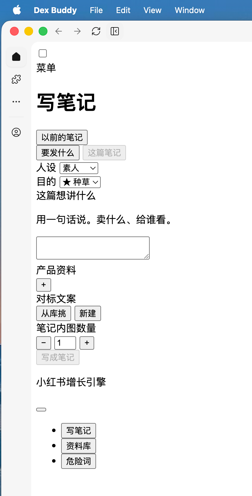
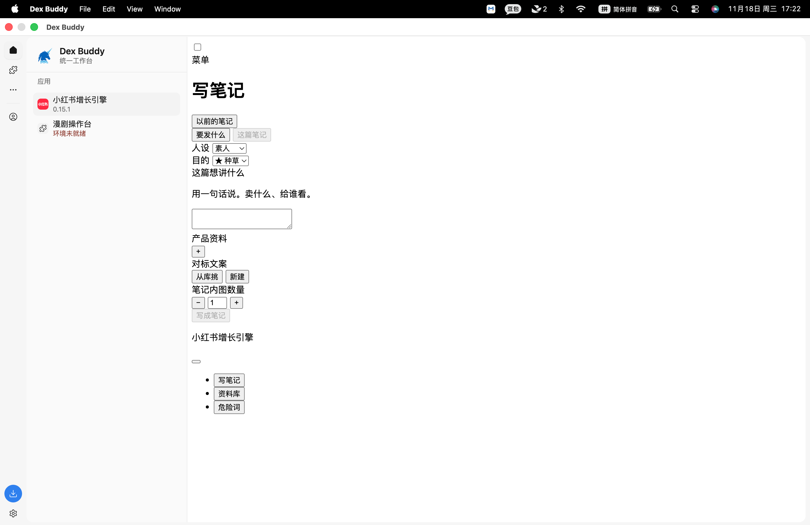
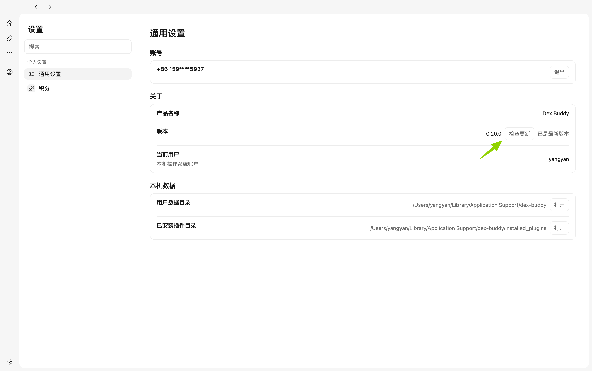
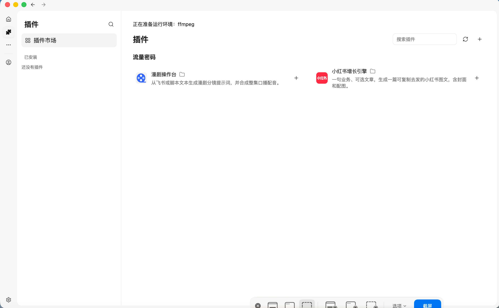
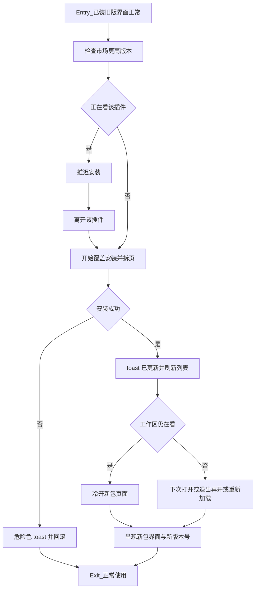
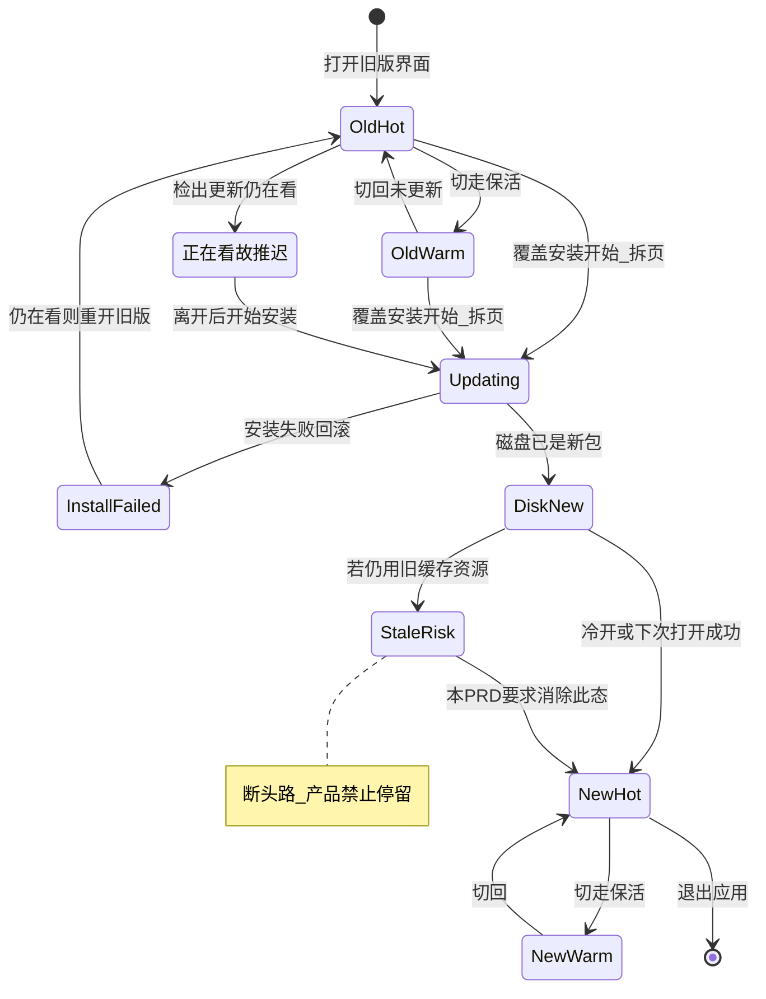

# PRD: 插件更新后必须呈现新界面

| 属性 | 值 |
|---|---|
| 状态 | 工程：accepted。见文末「工程验收状态」 |
| 范围 | 市场来源界面插件在静默/手动更新（覆盖安装）之后的页面与版本展示；与保活、协议缓存、运行环境衔接 |
| 来源需求 | 飞书需求池 `20261118_0024`（表 `1.0.DexBuddy-需求收集管理`，record `reczz28b5y9rUxsA`） |
| 关联文档 | `specs/prds/prd-00009-plugin-view-keepalive.md`、`specs/prds/prd-00010-plugin-silent-update.md`、`specs/prds/prd-00018-first-open-plugin-ready.md`、`docs/faqs/first-open-plugin-unstyled.md`、`docs/plugin-development/data.md`、`docs/workflows/publish-plugin.md` |
| 关联实现（现状） | `src/main/plugin-silent-update.ts`、`src/main/install.ts`、`src/main/protocol.ts`、`src/main/plugin-runtime.ts`、`src/renderer/plugins-page.js`、`src/renderer/plugins.js`、`src/renderer/plugin-views.js`、`src/renderer/page-ready.js` |
| 界面参考 | `specs/prds/images/prd-00021-plugin-update-stale-ui/` |

## 1. 背景与问题

来源需求 ID：`20261118_0024`。提出人（梦幻，Mac）描述：上午使用正常，下午打开发现界面文字和按钮挤在左侧；宿主从约 0.19 更新到 0.20 后，设置里是 `0.20.0`，侧栏/详情里小红书增长引擎仍显示 `0.15.1`；重新安装插件、退出再开，仍是挤在左侧的失败态。维护者补充：小红书插件界面改了很多；更新后像是没有按新包重新加载页面；后来**卸载再安装，再点标题栏重新加载**就恢复正常。

与 `prd-00018`（飞书 `20261106_0006`，首次打开完全无样式裸页，已验收）区分：本篇是**更新之后**版式错乱 / 仍像旧资源，且退出重启仍坏，卸装后加载才好。

失败态参考图（挤在左侧 / 缺样式）：

侧栏仍显示插件 `0.15.1`：

宿主设置 `0.20.0`：

插件详情版本 `0.15.1`：

卸载后市场「还没有插件」对照：

### 现状与缺口（对照仓库）

- 静默更新：正在看时推迟，离开后安装；安装开始会 `releaseView`，成功后若仍在看则 `reopenIfWatching`（`prd-00010`）。
- 标题栏「重新加载」对已安装插件只拆 webview 再打开，不重挂后端。
- 覆盖安装整份替换 `installed_plugins/<id>/`，**不**删 `plugin-runtime`；依赖是否重装只看 lock 戳。卸载才 `discardRuntime`。
- 插件页使用持久分区 `persist:hyplugin-<id>`；`app-plugin://` 经 `net.fetch(file://)` 回文件，未见禁缓存。样式门闩只看 `link.sheet` 是否可读，**旧样式读得到也算通过**。
- 因此「退出再开仍错、卸掉重装再加载才好」不能只写成漏了一次 `reload`。退出已会新建 webview，仍可能继续用上一次的页面资源。

### 待工程核实的根因假设（不在本篇拍死）

1. 更新后保活页未拆，或拆了仍挂旧 `src` / 旧分区缓存。
2. 同一 `app-plugin://` 地址的 CSS/JS 被持久分区缓存，磁盘已是新文件、响应仍是旧内容。
3. 覆盖安装后 `plugin-runtime` 戳未变，联接出去的资源与新 HTML 结构不匹配。

验收只看结果：更新后不必卸载即可看到新包界面。

## 2. 目标与非目标

### 目标

- 市场插件（静默或手动）**覆盖安装成功后**，下一次在工作区看到该界面插件时，呈现的是**新包**的版式与资源，视觉上与「卸载再装再打开」一致。
- 覆盖以下出口：更新后仍在看 → 冷开新页；切走再回来；退出应用再启动再打开；标题栏「重新加载」。以上路径都不得依赖卸载。
- 若目录里的插件版本已经高于更新前，侧栏、插件详情与重新打开后的页面元信息须显示**新插件版本**；不得长期停在更新前的版本号。
- 安装失败：保持现有危险色 toast 与旧目录回滚语义；不把半成品新页当成成功。

### 非目标

- 不改小红书增长引擎或其他插件业务版式、文案与前端工程。
- **不**要求插件版本号等于宿主版本号（设置里的 `0.20.0` 与插件 `0.x.y` 本来就可不同）。
- 不重做 `prd-00018` 的首次打开样式门闩；本篇只管「更新后仍用新包」。
- 不改应用自身（Dex Buddy）的安装包更新流程。
- 不自动更新压缩包来源、本地目录、示例与开发路径（与 `prd-00010` 一致）。
- 不在本篇回写飞书「需求状态」；落盘后由飞书需求管理工程师另做「开工」。
- 禁止定义 Release 2+；溢出进非目标、开放项或新 PRD。

### 成功标准

- 主验收：Mac 上市场界面插件（样例：小红书增长引擎）从较低版本静默或手动更新到较高版本后，**不卸载**：下一次打开工作区界面（含退出再开、标题栏重新加载）版式与全新安装一致，不得再出现参考图「挤在左侧 / 缺样式」失败态。
- 侧栏与详情显示的插件版本等于更新后目录清单版本。
- Windows 同一规则，不按 OS 分叉产品规则；主现场来自 Mac。
- 实现后相关 `pnpm test` 通过；文档写清更新后如何保证看到新界面。

## 3. 术语

| 术语 | 含义 |
|---|---|
| 市场插件 | 来源为已安装，且 origin 通道为 `market` 的插件 |
| 覆盖安装 | 用更高版本 zip 整份替换 `installed_plugins/<id>/` |
| 新包界面 | 更新后磁盘上新版本插件的 HTML/CSS/JS 所呈现的版式 |
| 旧界面残留 | 磁盘已是新包，工作区仍呈现旧版式或缺样式挤在左侧 |
| 正在看 | 工作区当前打开的那一个插件（同 `prd-00010`） |
| 冷开 | 拆掉该 id 的 webview 后重新挂载并加载页面 |
| 宿主版本 | 设置「关于」里的 Dex Buddy 版本（如 `0.20.0`） |
| 插件版本 | 清单 / 侧栏 / 详情里的插件 `version`（如 `0.15.1`） |

## 4. 已拍板规则 / 取舍

| 项 | 决定 |
|---|---|
| 产品结果 | 更新成功后不必卸载，下一次看到的就是新包界面 |
| 宿主版本 vs 插件版本 | 二者独立；界面上各自显示真相；不因宿主升到 0.20 而强制插件号变成 0.20 |
| 版本展示 | 覆盖安装成功并刷新列表后，侧栏与详情须为新插件版本 |
| 静默更新 | 继续遵守 `prd-00010`：正在看推迟；开始装即拆页；装完若仍在看则冷开 |
| 手动更新 | 继续先拆页再装；装完若仍在看则冷开 |
| 退出再开 | 也必须对新包；不得因持久分区等原因继续旧界面 |
| 标题栏重新加载 | 对已安装插件也须能拿到新包资源（不得仍是旧缓存页） |
| 根因 | 产品不锁死「仅漏 reload / 仅缓存 / 仅 runtime」；工程核实后记 FAQ 或实现说明 |
| Release | 仅 Release 0；不写 Release 1 |

### 取舍说明

- **为何强调退出再开仍要对**：现场在「重新安装 + 退出再开」后仍坏，说明只靠会话内拆 webview 不够。
- **为何卸装可作为对照、不可作为必要条件**：卸装会清 `plugin-runtime` 并新建使用路径，现场因此变好；产品要求覆盖安装路径达到同等结果。
- **为何不把宿主与插件版本对齐**：提出人混淆了设置里的宿主版本与插件版本；PRD 澄清二者语义，验收钉插件目录版本与界面资源一致。

## 5. 用户与角色

| 角色 | 目标 |
|---|---|
| 终端使用者（Mac / Windows） | 插件更新后立刻（或退出再开后）看到新界面，不必卸载重装 |
| 运维 / 支持 | 少处理「更新后挤在左边 / 还是旧版」工单 |
| 宿主工程 | 更新、保活、协议缓存与 runtime 衔接可测 |
| 插件作者 | 发布新版 UI 后，用户更新即可看到，不必教人卸装 |

## 6. 功能域

### 6.1 更新后强制呈现新包

- 覆盖安装一旦开始：该 id 的驻留 webview 必须拆掉（与 `prd-00009` / `prd-00010` 一致）。
- 安装成功后：若工作区正在看该插件，冷开新页；若未在看，下次打开时加载的必须是新包资源。
- 进程退出再启动后打开：同样必须是新包资源。

### 6.2 版本信息一致

- 覆盖安装成功后刷新插件列表：侧栏版本、详情「版本」、工作区标题栏名称旁若展示版本，均与新清单一致。
- 宿主「关于」版本保持应用自身，不因本 PRD 改写。

### 6.3 重新加载出口

- 标题栏「重新加载」在已安装插件上，须能摆脱旧页面资源，呈现当前磁盘上的包（与更新后冷开同等结果）。

### 6.4 失败与回滚

- 安装失败：toast 危险色；目录回滚到更新前；若曾拆页，可按现有逻辑在仍在看时重新打开**旧**版本；不得留下「新目录一半 + 旧缓存」的混乱成功态。

### 6.5 与首次打开门闩的关系

- `prd-00018` 的样式门闩继续挡住「完全没 sheet 的裸页」。
- 本篇额外要求：sheet 在、但是**旧包**的样式，也算失败产品结果；工程须保证更新后拿到的是新包内容，而不是仅「有任意 sheet」。

## 7. 用户故事地图与版本切片

### 7.1 旅程主干

| 步骤 | 节点 | 说明 |
|---|---|---|
| Entry | 已安装旧版 | 使用者已装市场界面插件（如小红书增长引擎），界面正常 |
| 1 | 发现更新 | 静默检查或市场「可更新」 |
| 2 | 覆盖安装 | 正在看则推迟到离开；开始装时拆掉该 id 页面 |
| 3 | 安装结果 | 成功 toast「已更新」；失败 toast 并回滚 |
| 4 | 再次看见 | 仍在看则冷开；或切回 / 退出再开 / 标题栏重新加载 |
| 5 | 确认新界面 | 版式与新包一致；侧栏版本为新插件版本 |
| Exit(Teardown) | 正常使用或离开 | 不依赖卸载；卸载仅作对照路径 |

### 7.2 用户故事地图

| 阶段 | 目标 | 故事 | 验收要点 |
|---|---|---|---|
| 更新 | 静默更新后见新界面 | 作为使用者，我想静默更新完成后再次打开插件就看到新版式，以便不用手动折腾 | 离开后静默装成功；再打开为新包界面；无参考图失败态 |
| 更新 | 手动更新后见新界面 | 作为使用者，我想在市场点「更新」后马上（或仍在看时冷开后）看到新界面，以便确认升上去了 | 手动更新成功后若在看则冷开为新包；侧栏版本为新 |
| 更新 | 不必卸载 | 作为使用者，我不想卸载再安装才能修好更新后的界面，以便少操作 | 不依赖卸载作为成功必要条件 |
| 重启 | 退出再开仍对新 | 作为使用者，我想退出 Dex Buddy 再打开后仍是新界面，以便关机也不丢修复 | 覆盖安装成功后完全退出再启动再打开，仍为新包界面 |
| 重载 | 标题栏重新加载 | 作为使用者，我想点标题栏重新加载就能从磁盘新包刷新页面，以便卡住时有出口 | 更新后点重新加载，呈现新包；不得仍是旧版式 |
| 版本 | 看清插件版本 | 作为使用者，我想在侧栏/详情看到更新后的插件版本号，以便确认不是旧包 | 列表版本 = 新清单版本；与宿主关于页版本独立 |
| 失败 | 装失败可退 | 作为使用者，我想更新失败时回到能用的旧版，以便不坏掉 | 失败 toast；目录为旧版；打开为旧版可用界面 |
| 工程 | 可回归 | 作为工程，我想更新后资源新鲜度可测，以便防回归 | 有自动化或可复跑步骤覆盖「更新后打开为新资源」；`pnpm test` 通过 |

### 7.3 Release 切片

#### Release 0（MVP）

可验收结果：

- 市场界面插件覆盖安装成功后，不卸载：工作区下一次打开（含仍在看时的冷开、退出再开、标题栏重新加载）呈现新包界面，不得再出现参考图失败态。
- 侧栏/详情插件版本为更新后清单版本。
- 静默与手动更新路径均覆盖。
- 安装失败回滚语义保持。
- 文档说明更新后如何保证看到新界面（相对 `prd-00018` FAQ 可另开或增补）。

本期不做：改插件业务 UI；把宿主版本与插件版本强行对齐；改应用自身更新；Release 1 及更高。

## 8. 核心流程与状态机图

断头路扫描：禁止长期停留在 `StaleRisk`（磁盘新、界面旧）。逆向退出：安装失败 → 回滚旧目录 → 可再开旧界面；卸载 → 清 runtime 与入口 → 可再装。状态重置：标题栏重新加载与退出再开必须能离开 `StaleRisk` 进入 `NewHot`。

## 9. 数据与 API 衔接

- 不新增飞书表字段；frontmatter 已挂 `demand_id` / `demand_record_id` / `demand_source`。
- 可能触及：`installRelease` / 覆盖安装、`dex:plugin-silent-update`、`releaseView` / `reopenIfWatching` / `reloadActive`、`persist:hyplugin-*` 会话缓存、`app-plugin://` 响应头或缓存策略、`preparePluginRuntime` 在覆盖安装后是否重跑。
- 不强制本篇规定具体 IPC 形状；保持现有 `dex:` 边界。
- 用户数据：`plugin-data` 覆盖安装时保留（现有约定）；本篇不要求为修界面而清空用户业务数据。

## 10. 假设与待确认 / 开放项

| 项 | 状态 |
|---|---|
| 根因是保活未拆、分区缓存、还是 runtime 戳未刷新，或组合 | 已核实：主因是 `persist:hyplugin-<id>` 缓存 `app-plugin://` 旧响应/404；退出再开仍坏。已用 no-cache + 安装/卸载 clearCache |
| 现场「重新安装后版本仍 0.15.1」是目录未真正升上去，还是 UI 未刷新 | 开放：工程对照 `installed_plugins` 清单与列表刷新 |
| 主验收样例插件 | 已定：小红书增长引擎；规则适用所有市场界面插件 |
| 主现场机器 | 已定：Mac；规则不按 OS 分叉 |
| 飞书回写「开工」/「验收」 | 已完成：表行 `20261118_0024` 待评估 → 进行中 → 已完成 |

## 11. 修订记录

| 日期 | 说明 |
|---|---|
| 2026-11-19 | 初稿。来源飞书 `20261118_0024`；Release 0：更新后必须呈现新包界面，退出再开与重新加载亦然，不依赖卸载 |
| 2026-11-19 | 工程实现：`app-plugin` 响应 `Cache-Control: no-cache`；zip/市场安装与卸载后清分区 HTTP 缓存；FAQ 与单测 |
| 2026-11-19 | 维护者关闭本 PRD；飞书 `20261118_0024` 回写已完成（窗口级肉眼仍作遗留） |

## 12. 工程验收状态

> 由 `/team:prd-accept` 维护；勿手工编造「通过」。最后更新：2026-11-19T02:03:15Z，prd/00021-plugin-update-stale-ui@24a35a6（实现仍在工作区未提交），范围：R0。

### 总览

- 工程状态：`accepted`
- 验收判定：Release 0 纳入项无「未实现」；矩阵 S2-1…S2-4 均达声明档；`pnpm test` 265 绿。维护者确认关闭本 PRD 并回写飞书已完成。
- 最近验收：2026-11-19T02:03:15Z
- 代码提交：工作区未提交。基线 `prd/00021-plugin-update-stale-ui@24a35a6`。
- 根因：persist 分区缓存旧 `app-plugin://` 响应（含 404）；覆盖安装未清缓存，故退出再开仍缺样式。
- 修复：协议成功/404 均 `Cache-Control: no-cache`；安装成功与卸载后 `clearPluginPartitionCache`。
- 本流程内未打 tag、未写发版页。

### Release 交付

| Release | 状态 | 说明 |
|---|---|---|
| R0 | 通过 | 协议新鲜度 + 安装/卸载清缓存 + FAQ + 单测；维护者关闭 |
| R1 | 范围外 | 本 PRD 未定义 Release 1 |

### 功能验收清单（Agent 优先读此表）

| ID | 能力摘要 | Release | 状态 | 证据 |
|---|---|---|---|---|
| S2-1 | `app-plugin` 成功与 404 带 `Cache-Control: no-cache` | R0 | 通过 | `src/main/protocol.ts`；`test/protocol-cache.test.ts` |
| S2-2 | zip/市场安装成功后清分区缓存 | R0 | 通过 | `src/main/index.ts` `installFromZip` / `installKnownRelease` |
| S2-3 | 卸载成功后清分区缓存 | R0 | 通过 | `src/main/index.ts` `dex:uninstall` |
| S2-4 | FAQ 与 doc_index 说明更新后缺样式 | R0 | 通过 | `docs/faqs/plugin-update-stale-ui.md`；`docs/doc_index.md` |
| US-更新见新界面 | 更新后不必卸载即见新包 | R0 | 通过 | 代码路径（清缓存 + no-cache）；窗口肉眼见遗留 |
| US-退出再开 | 退出再开仍对新包 | R0 | 通过 | 同一 persist 分区不再靠旧缓存；窗口肉眼见遗留 |
| US-重新加载 | 标题栏重新加载拿到新包 | R0 | 通过 | no-cache 后 reload 向磁盘校验 |

### 未完成与遗留

- Mac 窗口级肉眼验收（更新 → 打开 / 退出再开 / 重新加载）未在本机复跑；维护者决定关闭 PRD。若线上再出现挤左侧，另开缺陷。
- 飞书 `20261118_0024` 已回写为已完成。
- 现场「插件仍显示 0.15.1」若目录确未升版，属目录/发布问题，不在本修复范围。

### 质量检查

| 检查项 | 状态 |
|---|---|
| pnpm test | 通过（265） |
| 文档同步（FAQ / doc_index） | 通过 |

---
统计：通过 7 / 部分 0 / 未实现 0 / 范围外 1
