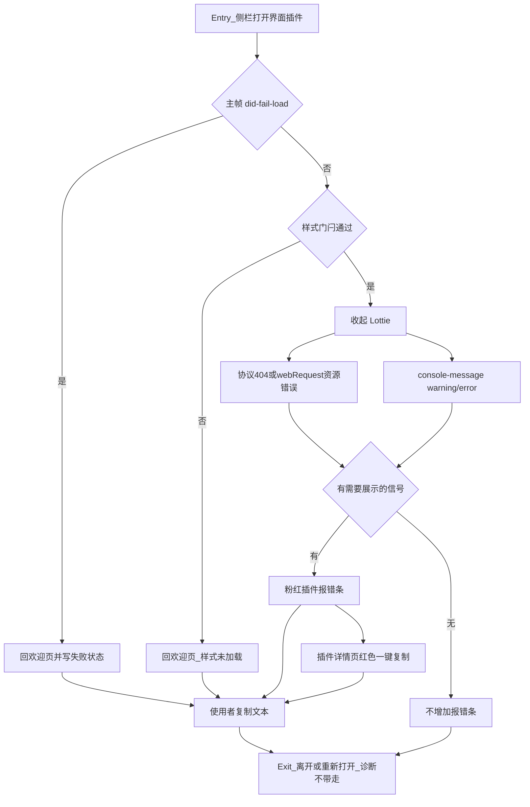
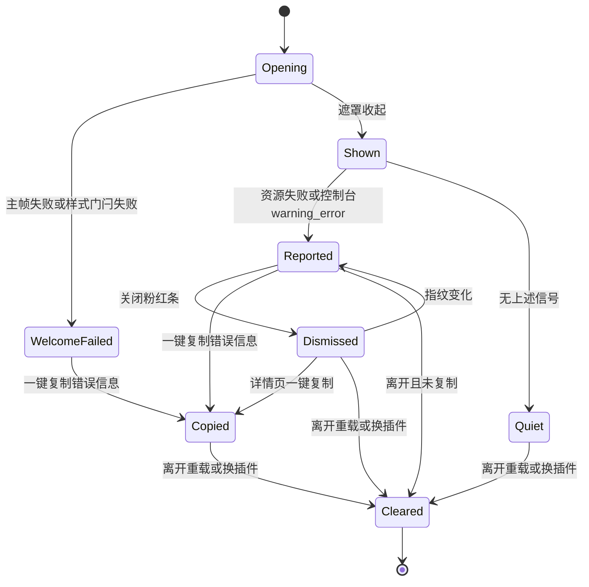

# PRD: 插件页出错要能看出来并复制

| 属性 | 值 |
|---|---|
| 状态 | 工程：accepted（见文末「工程验收状态」） |
| 范围 | 工作区里带界面的插件：把 Electron / 本仓协议已有的失败信号露出来，并提供「复制诊断」。不发明空 DOM 启发式，不把子资源失败误当成 `did-fail-load` |
| 来源需求 | 飞书需求池 `20261120_0027`（表 `1.0.DexBuddy-需求收集管理`，record `reczz28bnEkUFTf7`）。表上产品类型是「DX-小红书增长引擎」；维护者确认仍由本仓处理宿主侧的「换机器才白」和「出错怎么报」 |
| 关联文档 | `specs/prds/prd-00009-plugin-view-keepalive.md`、`specs/prds/prd-00018-first-open-plugin-ready.md`、`specs/prds/prd-00021-plugin-update-stale-ui.md`、`docs/faqs/first-open-plugin-unstyled.md`、`docs/faqs/plugin-update-stale-ui.md`、`docs/DESIGN.md` |
| 关联实现（现状） | `src/renderer/plugin-views.js`、`src/renderer/plugin-boot.js`、`src/renderer/plugins.js`、`src/renderer/page-ready.js`、`src/main/protocol.ts`、`src/main/plugin-runtime.ts` |
| 界面参考 | `specs/prds/images/prd-00022-plugin-page-diagnostics/` |
| 本期交付 | **只落本 PRD**。宿主代码、FAQ、DESIGN 改写另开工程任务，不在本篇撰写阶段改代码 |

## 1. 背景与问题

来源需求 ID：`20261120_0027`。提出人（木子，Windows）描述：把小红书插件打开之后，啥也没有，一片空白。维护者本机无法复现。当事人补充：加载时 Lottie 转了大约一两秒，动画消失后工作区仍是白的。

现场截图（宿主 0.20.1，侧栏插件 0.16.0，工作区全白，没有欢迎页，也没有状态红字）：

设置里宿主已是 0.20.1。设置左栏只有「漫剧操作台」，是因为设置目录只收有配置或设置页的插件，不代表小红书没装上。

### 现状与缺口（对照仓库）

- 冷启动遮罩在 `onLoaded` 时收起。`onLoaded` 只在主帧 `did-finish-load` 且样式门闩通过之后调用。Lottie 能播完再消失，说明这次打开已经被宿主当成成功，访客 webview 已经露出来。
- 宿主只在两类失败时回到欢迎页并写 `#status`：主帧 `did-fail-load`，或样式门闩重试一次仍失败（「插件页面样式未加载」）。现场两条都没走。
- `app-plugin://` 在 `ensurePluginProtocol` 里对缺失文件直接回 HTTP 404，主进程已经知道失败，但渲染层没有任何提示。
- 访客页 `console` 的 warning/error（webview 官方 `console-message`）没有人听。主进程日志打到打包后用户看不见的控制台。没有可复制的诊断文本。
- 0.20.1 的 `clearPluginPartitionCache` 在安装、静默更新、卸载时清的是该插件分区的 HTTP 缓存，而且发生在重新挂上 webview 之前。它不会把「正在看的旧文档」刷成白页。它也不清插件页面自己的 localStorage / IndexedDB。

因此「维护者机器能开、对方机器 Lottie 消失后仍白」对得上：主页面打开成功，差在对方那台后续的文件或脚本。现在这些失败对用户不可见，支持只能再收一张白图。

### 为何不按「听 did-fail-load 子帧」做

Electron 维护者写明：`did-fail-load` 只表示**导航 / 主文档**加载失败；页面里的 script、CSS、图片没拉到，**不会**发这个事件（见 Electron #41766）。官方与维护者对资源失败的既有答案是 `session.webRequest.onErrorOccurred`（#9555）；对本仓自定义协议，缺失文件在协议 handler 回 404 时主进程已有真相。本篇**禁止**把子资源失败押在 `did-fail-load` + `isMainFrame === false` 上。

也不做「遮罩收起后扫 DOM 是否为空」的自造探针：SPA / 晚绘制容易误报，不是 Electron 主流诊断手段。

## 2. 目标与非目标

### 目标

- 带界面的插件在工作区打开时，若出现**协议层资源 404**、**分区上的网络层资源错误**（`script` / `stylesheet`）、或访客 **console warning/error**，工作区顶部下浮粉红「插件报错」条，并有「一键复制错误信息」。
- 复制出来的纯文本足以让维护者区分：哪个 `app-plugin://`（或其它 URL）没加载到、页面脚本说了什么。字段来自 Electron / 协议事件，不编造探测结果。
- 主帧加载失败和样式门闩失败保持现有行为（回欢迎页），粉红条或插件详情页红色「一键复制错误信息」仍可复制这次失败。
- 用户可关掉粉红条；同指纹不反复下浮，工作区不留残余行；需要再抄时可到侧栏悬停卡片分割线下，或插件页详情眉右侧红色「一键复制错误信息」（有诊断即出现，与条关没关无关）。指纹变了或会话重建后再下浮粉红条。
- 页面正常（无上述信号）时不出现报错条；详情页也不出现复制钮。

### 非目标

- 不改小红书增长引擎或其他插件的页面、脚本与业务数据。
- 不改 0.20.1 的清 HTTP 缓存时机与范围。不清插件 localStorage / IndexedDB，不做「重置插件网站数据」。
- 不给终端用户打开 DevTools，不把诊断上传到服务器，不落磁盘日志文件，不新引入 `electron-log` / Sentry 等依赖。
- **不做**空 DOM /「页面有没有内容」启发式；**不做**用 `did-fail-load` 捕子资源。
- 不重做 `prd-00018` 的样式门闩，也不重做 `prd-00021` 的更新后新包界面。
- 不在本篇回写飞书「需求状态」。
- 禁止定义 Release 2+。

### 成功标准

- 主验收：主帧与样式都成功，但协议对某脚本/样式回 404（或分区 `webRequest.onErrorOccurred` 报 script/stylesheet 失败）时，工作区不回到欢迎页，顶上下浮「插件报错」条，点「一键复制错误信息」得到的文本含该 URL（及错误描述）；复制正文里的状态句仍可为「插件页面有文件没加载到」。
- 访客 `console-message` 出现 warning 或 error 时，同样下浮「插件报错」条，复制文本含最近这些消息（级别、来源、行号、正文）；复制正文里的状态句可为「插件页面报错」。
- 关掉粉红条后同指纹不再下浮；侧栏悬停卡片与插件页详情眉仍可出现红色「一键复制错误信息」；新错误指纹或重新加载后粉红条再出现。
- 无资源失败、无 warning/error 时，不出现粉红条与详情复制钮。
- 主帧失败或样式门闩失败仍回欢迎页；粉红条或详情复制钮仍可复制，文本含失败原因。
- 工程实现后相关 `pnpm test` 通过；文本拼装与指纹可用薄纯函数单测，不依赖 Electron 跑主测。

## 3. 术语

| 术语 | 含义 |
|---|---|
| 主帧 | 插件页文档本身的那一次加载；失败走现有 `did-fail-load`（主帧） |
| 资源失败 | 协议 handler 对 `app-plugin://` 回 404，或该插件 persist 分区上 `webRequest.onErrorOccurred`（至少含 `script` / `stylesheet`） |
| 样式门闩 | `prd-00018`：有样式表链接时须都能读到 `sheet`，否则重试一次再失败回欢迎页 |
| 遮罩收起 | Lottie 冷启动遮罩被 `onLoaded` 关掉，表示主帧与样式门闩已通过 |
| console-message | Electron `<webview>` 文档中的访客控制台事件 |
| 诊断文本 | 一次性复制的纯文本，只存在内存里的环形记录，不写文件 |
| 宿主版本 | 设置「关于」里的 Dex Buddy 版本 |
| 插件版本 | 清单 / 侧栏里的插件 `version` |

## 4. 已拍板规则 / 取舍

| 项 | 决定 |
|---|---|
| 这次白屏的宿主结论 | Lottie 播完消失 = 打开成功。不是遮罩卡住，也不是清 HTTP 缓存把当前页刷白 |
| 换机器才白 | 宿主侧露出协议 404 / 资源错误 / 控制台报错。插件自身异常或文件齐全仍白，不在本仓改页面 |
| 技术栈 | 只用 Electron 与本仓协议已有能力；不自造检测体系 |
| 资源失败来源 | ① `ensurePluginProtocol`（或等价处）回 Not found 时记下 url；② 同分区 `session.webRequest.onErrorOccurred`，过滤至少 `script`、`stylesheet` |
| 脚本异常来源 | webview `console-message`，只收 warning / error |
| Electron CSP 噪音 | 忽略开发态 `Electron Security Warning`（来源 `sandbox_bundle`）；不进诊断环，不触发粉红报错条。打包后本就不会出现 |
| 主帧失败 | 继续现有 `did-fail-load`（主帧）与样式门闩；**禁止**用子帧 `did-fail-load` 当资源失败主路径 |
| 状态优先级 | 资源失败 > 控制台 warning/error > 主帧/样式已有失败文案。可见 UI 统一写「插件报错」；长句只进复制文本 |
| 空内容探针 | **不做** |
| 正常页 | 不显示粉红条；详情页无诊断时也不显示复制钮 |
| 可见 UI | 粉红下浮条：黄感叹号 +「插件报错」+「一键复制错误信息」+ 关闭。关掉后工作区不留行；有诊断时：侧栏悬停卡片分割线下第一行（黄感叹号 + 红字），以及插件详情眉右侧红色「一键复制错误信息」（在「…」「立即使用」前）。不进设置页 |
| 关闭后再出现 | 记下信号指纹；同指纹只藏粉红条；指纹变或冷开/重载重建会话后再下浮粉红条 |
| 欢迎页失败 | 「打开插件失败」「插件页面样式未加载」仍回欢迎页，粉红条或详情复制钮可复制 |
| 诊断内容 | 宿主版本、系统、插件 id / 版本 / 来源、加载阶段、资源失败 URL 与错误描述、最近约 30 条 warning/error。另写明：更新只清了 HTTP 缓存，没清插件页面自己的本地数据 |
| 存储 | 只留内存。重新打开或拆掉该页时丢掉上一次的记录与关闭指纹 |
| 依赖 | 不新增 npm 包 |
| Release | 仅 Release 0 |

### 取舍说明

- **为何不在宿主里「修好白屏」：** 现场已经打开成功。维护者机器能画出内容，说明不是人人都白。本仓能对上的是资源/脚本失败对用户不可见。把 Electron 已有事件交出来，才知道下一行该改宿主还是改插件。
- **为何协议 404 要在主进程记：** 自定义协议回 HTTP 404 时，请求在网络层可能算「完成」，不一定进 `onErrorOccurred`；协议 handler 是本仓的真相源。
- **为何仍要「复制诊断」：** 安装包用户没有 DevTools；把最近一段原生失败摘进剪贴板，是打包应用常见支持做法，不是自造遥测平台。
- **为何不做空 DOM 探针：** 晚绘制与空壳根节点会误报；主流做法是听失败事件，不是猜页面长什么样。

## 5. 用户与角色

| 角色 | 目标 |
|---|---|
| 终端使用者 | 打开插件后若是白的或坏的，能看见一句说明，并把诊断复制给支持 |
| 支持 / 维护者 | 不用只靠白图猜；能区分文件没加载到与脚本报错 |
| 宿主工程 | 只接线 Electron / 协议事件，文本拼装可测，不发明启发探测 |
| 插件作者 | 收到的文本能指到自己的脚本或缺失文件；宿主不改插件仓库 |

## 6. 功能域

### 6.1 记下原生信号（不发明第三类）

- **资源失败：** 协议返回 Not found 时记录 `app-plugin://` URL；同分区 `webRequest.onErrorOccurred` 记录 url、`resourceType`、`error`（至少关心 script / stylesheet）。经现有 IPC 推送模式通知宿主窗。
- **控制台：** webview `console-message` 的 warning 与 error：记下级别、来源、行号、正文。环形缓冲约 30 条。info 及更低不写入诊断，也不单独触发状态行。开发态 Electron CSP Security Warning（`sandbox_bundle` / 文案含 `Electron Security Warning`）一律忽略。
- **主帧 / 样式：** 逻辑不变；失败时诊断文本带上原有失败句。
- 可选且易接时：`render-process-gone` 记入诊断（Guest 崩溃）。不是本现场必验项。

### 6.2 可见报错条

工作区正在显示该界面插件（或欢迎页失败仍聚焦该次诊断）时：

| 条件 | 可见 UI | 复制文本内状态句 |
|---|---|---|
| 有资源失败 / warning/error / 主帧或样式失败 | 粉红条「插件报错」；关掉后工作区清空该条；悬停卡片与详情眉仍有红色「一键复制错误信息」 | 资源失败「插件页面有文件没加载到」；控制台「插件页面报错」；主帧/样式沿用失败原文 |
| 无上述信号 | 不出现条；详情无复制钮 | — |

粉红条可叉掉；同指纹不反复下浮。关掉后到悬停卡片或插件页详情复制。不做设置页入口。

### 6.3 复制

- 粉红条、侧栏悬停卡片或详情页上的「一键复制错误信息」把当前诊断纯文本写入剪贴板（现有 `copyText`）。成功用现有 toast「已复制诊断」。
- 文本是给人和模型看的短段落，不含截图、不含账号、不含设置里的密钥。
- 主帧失败或样式失败回到欢迎页时，诊断里仍有失败原因，粉红条、悬停卡片或详情复制钮可以复制。

### 6.4 与现有打开流程的关系

- 不改变 Lottie 出现时机。
- 不把资源失败或控制台报错当成主帧 `did-fail-load`，不因此拆掉 webview 或跳回欢迎页。用户仍可看着白页，但顶上有报错条。
- 标题栏重新加载、更新后冷开、从保活里再次呈现，都重新记一份诊断并清关闭指纹；上一份不残留到另一个插件。

## 7. 用户故事地图与版本切片

### 7.1 旅程主干

| 步骤 | 节点 | 说明 |
|---|---|---|
| Entry | 从侧栏打开界面插件 | 宿主准备分区并挂上 webview，必要时播 Lottie |
| 1 | 主帧结果 | 主帧失败 → 欢迎页 + 可复制状态。成功则进入样式门闩 |
| 2 | 样式门闩 | 重试一次仍失败 → 欢迎页 +「插件页面样式未加载」+ 可复制。通过则收起 Lottie |
| 3 | 原生后续信号 | 协议 404 / `webRequest` 资源错误、`console-message` warning/error |
| 4 | 需要时出状态 | 有信号则下浮「插件报错」条与「一键复制错误信息」；没有则与今天的正常打开相同 |
| 5 | 交给支持 | 使用者复制文本发出；可关掉粉红条后到插件详情页再复制 |
| Exit(Teardown) | 离开或重新打开 | 切走、拆页、重新加载或打开另一个插件时，这份诊断不带到别处 |

### 7.2 用户故事地图

| 阶段 | 目标 | 故事 | 验收要点 |
|---|---|---|---|
| 打开 | 文件没到要说出来 | 作为使用者，我想在插件脚本或样式 404 时看到说明，以便知道不是「什么都没发生」 | 主帧与样式成功、协议或 webRequest 报 script/stylesheet 失败时，不回欢迎页；粉红条「插件报错」；复制文本含该 URL 与「插件页面有文件没加载到」 |
| 打开 | 脚本报错要说出来 | 作为使用者，我想在页面控制台报错时看到「插件报错」条，以便把原文交给支持 | warning 或 error 出现后下浮粉红条；复制文本含级别、来源、行号、正文；最多约 30 条 |
| 打开 | 关掉仍能抄 | 作为使用者，我想关掉粉红条后仍能一键复制，以便还能用插件又不丢报错 | 同指纹工作区不留行；悬停卡片分割线下与详情眉仍有红色「一键复制错误信息」；新错误再下浮粉红条 |
| 打开 | 正常不要吵 | 作为使用者，我想正常插件顶上不要多一行，以便工作区保持现在的样子 | 无资源失败、无 warning/error 时，不出现粉红条；详情无复制钮 |
| 失败 | 原来的失败仍可复制 | 作为使用者，我想打开失败或样式没加载时也能复制原因，以便支持不用看状态栏截图 | 主帧失败与样式门闩失败仍回欢迎页；粉红条或详情复制钮可复制，文本含原有失败句 |
| 交接 | 文本够用 | 作为支持，我想收到宿主版本、系统、插件 id 与版本和上述原生字段，以便判断该改宿主还是插件 | 复制文本含这些字段，并写明更新只清 HTTP 缓存、没清插件页面本地数据；不含账号与密钥 |
| 隔离 | 不串插件 | 作为使用者，我想换一个插件或重新加载后看到的是这一次的诊断，以便不会把上一个插件的报错抄出去 | 重新加载、冷开、拆页或打开另一个 id 后，复制文本不含上一次的 URL 和消息 |
| 工程 | 可回归 | 作为工程，我想状态优先级和文本拼装有单测，以便不靠手点 Electron | `pnpm test` 覆盖：资源失败优先于控制台、正常不出状态、文本含约定字段且不含密钥样例 |

### 7.3 Release 切片

#### Release 0（MVP）

可验收结果：

- 上述故事的粉红条、详情复制钮、复制文本、欢迎页失败可复制、正常页不打扰、诊断不串插件，都在宿主内完成。
- 信号来源限定为：协议 404、分区 `webRequest.onErrorOccurred`（script/stylesheet）、webview `console-message`、现有主帧/样式失败。
- 纯函数单测（若有）与 `pnpm test` 通过。
- `docs/DESIGN.md` 写明粉红条与详情复制钮何时出现；另有一篇 FAQ 说明「Lottie 消失后仍白」时宿主原来为什么没有红字，以及正确信号从哪来。
- 不改清 HTTP 缓存，不改插件仓库，不新增依赖。

本期不做：空 DOM 探针；用 `did-fail-load` 捕子资源；上传诊断；磁盘日志；DevTools；重置插件本地数据；修改插件页面。无 Release 1。

## 8. 核心流程与状态机图

`Shown` 到 `Reported` 必须能再被「重新加载 / 换插件」清掉，避免诊断串页。欢迎页失败不是死胡同：粉红条或详情复制钮仍可复制，使用者可以再从侧栏打开。

## 9. 数据与 API 衔接

- 不新增飞书字段。frontmatter 已挂 `demand_id` / `demand_record_id` / `demand_source`。
- 工程实现时：协议 / `webRequest` 侧经现有 `webContents.send` 模式推到宿主窗（通道名由工程定，登记进 `dex-ipc` / preload）；剪贴板沿用现有 `copyText`。本 PRD 不规定具体通道字符串。
- 不读、不写插件 `plugin-data` 与页面 localStorage。
- URL 原样进入复制文本；不附加账号、令牌或设置密钥。
- 不新增 npm 依赖。

## 10. 假设与待确认 / 开放项

| 项 | 状态 |
|---|---|
| `20261120_0027` 的白屏是资源 404、插件异常，还是旧 localStorage 导致空渲染 | 开放。本篇先把原生失败信号交出来，不在宿主里猜插件源码 |
| HTTP 404 是否一律进 `onErrorOccurred` | 已定：不依赖；协议 handler 回 Not found 必须单独记 |
| `webRequest` 是否还要收 image/font 等 | 开放。Release 0 至少 script + stylesheet；加多类型不改产品文案 |
| 缓冲约 30 条 | 已定数量级。工程可用常量 |
| info 级别控制台是否进入文本 | 已定：不进入，也不单独触发状态行 |
| Electron CSP Security Warning | 已定：忽略，不误报「插件页面报错」 |
| 是否在本篇回写飞书为进行中 | 已定：不回写 |
| 主现场 | 已定：Windows，宿主 0.20.1，插件小红书增长引擎 0.16.0。规则不按 OS 分叉 |

## 11. 修订记录

| 日期 | 说明 |
|---|---|
| 2026-11-20 | 初稿。依据飞书 `20261120_0027` 与维护者补充：Lottie 约一两秒后消失仍白；本机可运行 |
| 2026-11-20 | 修订：对齐 Electron 主流做法。资源失败改协议 404 + `webRequest.onErrorOccurred`；脚本用 `console-message`；删除空内容探针与「用 did-fail-load 捕子资源」；本步只维护 PRD，不改代码 |
| 2026-11-20 | 修订：忽略开发态 Electron CSP Security Warning，避免模型试玩等正常插件误报 |
| 2026-11-20 | 工程验收：Release 0 通过，`status=accepted` |

## 12. 工程验收状态

> 由 `/team:prd-accept` 维护；勿手工编造「通过」。最后更新：2026-11-20T06:25:51Z，prd/00022-plugin-page-diagnostics@ffaec04，范围：R0,R1。

### 总览

- 工程状态：`accepted`
- 验收判定：Release 0 范围内能力均有仓库证据；本期无 Release 1（标范围外）
- 最近验收：2026-11-20T06:25:51Z @ `ffaec04`
- 代码提交：分支 `prd/00022-plugin-page-diagnostics`
- 摘要：
  - 协议 404 + 分区 `webRequest`（script/stylesheet）经 `dex:plugin-asset-error` 推到渲染层
  - webview `console-message` warning/error 入环；忽略 Electron CSP Security Warning
  - 可关闭粉红「插件报错」条 + 指纹再出现；详情页与悬停卡「一键复制错误信息」
  - 纯函数单测与 `pnpm test` 通过；DESIGN / FAQ 已同步

### Release 交付

| Release | 状态 | 说明 |
|---|---|---|
| Release 0 | 通过 | MVP：原生信号、粉红条、复制入口、CSP 过滤、文档与单测 |
| Release 1 | 范围外 | PRD 声明本期不做 / 无 Release 1 |

### 功能验收清单（Agent 优先读此表）

| ID | 能力摘要 | Release | 状态 | 证据 |
|---|---|---|---|---|
| F1 | 协议层资源 404 记入诊断并推送宿主窗 | R0 | 通过 | `src/main/protocol.ts`（`protocol-404`）；`src/main/index.ts` → `dex:plugin-asset-error`；`src/preload/host.cts` / `src/shared/dex-ipc.ts` |
| F2 | 分区 `webRequest.onErrorOccurred`（script/stylesheet）记入诊断 | R0 | 通过 | `src/main/protocol.ts`（`web-request`） |
| F3 | webview `console-message` warning/error 环形缓冲约 30 | R0 | 通过 | `src/renderer/plugin-views.js`；`src/renderer/plugin-diagnostics.js`（`pushConsoleRing` / `CONSOLE_RING`） |
| F4 | 忽略开发态 Electron CSP Security Warning | R0 | 通过 | `isIgnoredConsoleNoise`；`test/plugin-diagnostics.test.ts` |
| F5 | 有信号时下浮粉红「插件报错」条 +「一键复制错误信息」+ 关闭 | R0 | 通过 | `src/renderer/index.html` `#plugin-diag-banner`；`plugins.js` `syncDiagnosticsUi` / `dismissDiagBanner` |
| F6 | 关掉后同指纹不反复下浮；指纹变或重建会话再出现 | R0 | 通过 | `diagnosticFingerprint` + `dismissedFingerprints`；单测指纹稳定/变化 |
| F7 | 有诊断时详情页与悬停卡可复制（与条关没关无关） | R0 | 通过 | `plugins-page.js` `plugin-detail-copy-diagnostics`；`plugins.js` `nav-hover-copy-diagnostics`；`hasDiagnostics` / `copyDiagnostics` |
| F8 | 复制文本含宿主版本、插件 id/版本、资源 URL、console 字段；不含密钥样例 | R0 | 通过 | `formatDiagnosticText`；`test/plugin-diagnostics.test.ts` |
| F9 | 主帧/样式失败仍回欢迎页且可复制 | R0 | 通过 | `handleViewFailed` → `showWelcome` + `syncDiagnosticsUi`；`openFailure` 进指纹与复制文本 |
| F10 | 不做空 DOM 探针；不用 `did-fail-load` 捕子资源 | R0 | 通过 | 无空页探测实现；子资源走协议/`webRequest` |
| F11 | DESIGN / FAQ / doc_index 同步 | R0 | 通过 | `docs/DESIGN.md`、`docs/faqs/plugin-page-blank-no-error.md`、`docs/doc_index.md` |
| F12 | Release 1+ | R1 | 范围外 | PRD「无 Release 1」 |

### 未完成与遗留

- 开放项仍开放：现场白屏根因是 404、脚本异常还是旧 localStorage（本篇只交信号，不猜插件源码）
- `webRequest` 是否扩到 image/font 等：本期至少 script + stylesheet，未扩
- 飞书需求池状态回写：PRD 非目标，本验收不写飞书
- 小红书插件自身 `previewMode` 等业务修复：仓外

### 质量检查

| 检查项 | 状态 |
|---|---|
| pnpm test | 通过（270） |
| 文档同步（DESIGN / FAQ / docs/doc_index.md） | 通过 |

---
统计：通过 11 / 部分 0 / 未实现 0 / 范围外 1
