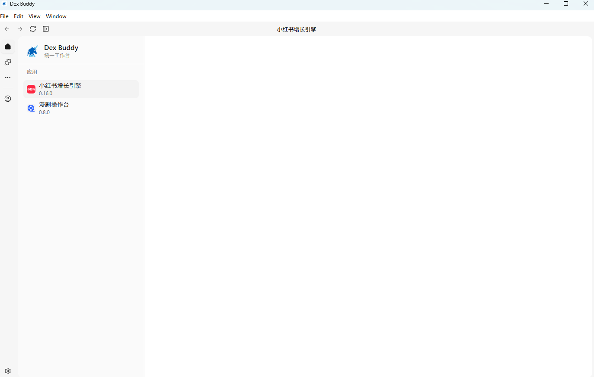
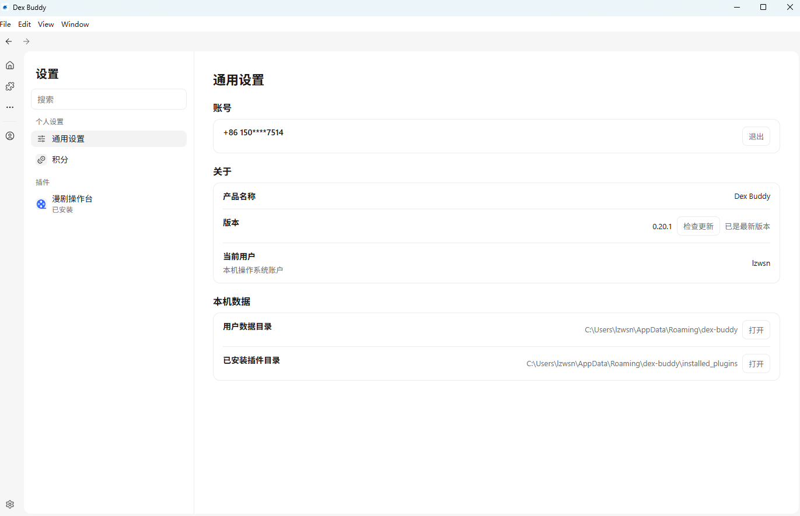
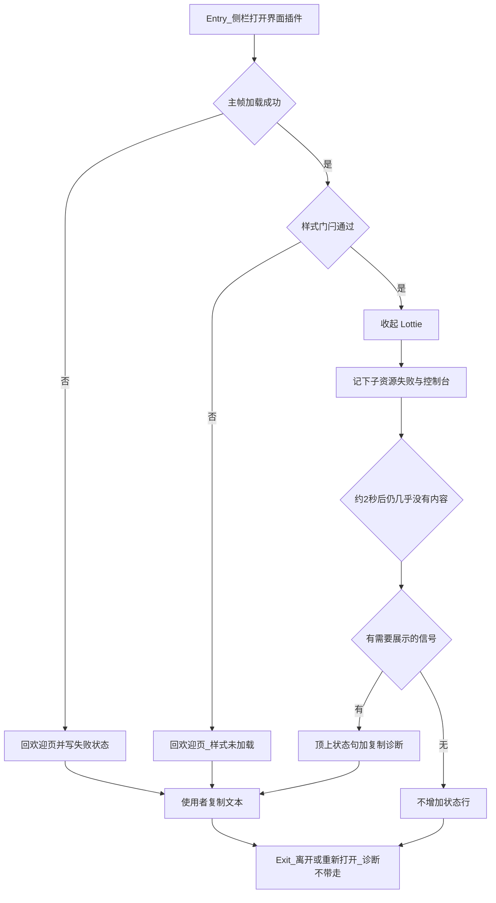
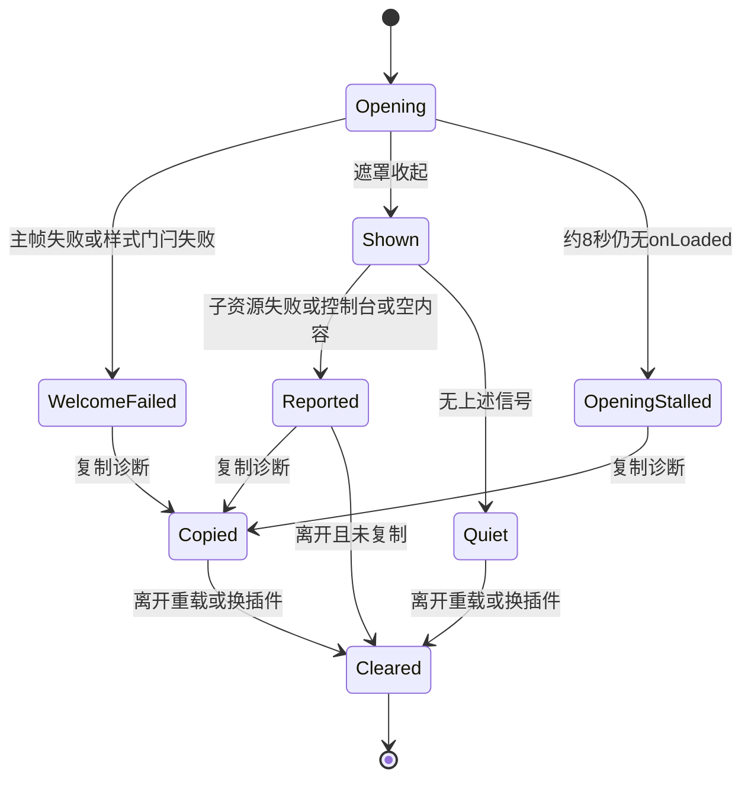

# PRD: 插件页出错要能看出来并复制

| 属性 | 值 |
|---|---|
| 状态 | 工程：backlog |
| 范围 | 工作区里带界面的插件：子资源加载失败、访客页控制台 warning/error、打开成功后仍然几乎没有内容；以及对应的一句状态和「复制诊断」 |
| 来源需求 | 飞书需求池 `20261120_0027`（表 `1.0.DexBuddy-需求收集管理`，record `reczz28bnEkUFTf7`）。表上产品类型是「DX-小红书增长引擎」；维护者确认仍由本仓处理宿主侧的「换机器才白」和「出错怎么报」 |
| 关联文档 | `specs/prds/prd-00009-plugin-view-keepalive.md`、`specs/prds/prd-00018-first-open-plugin-ready.md`、`specs/prds/prd-00021-plugin-update-stale-ui.md`、`docs/faqs/first-open-plugin-unstyled.md`、`docs/faqs/plugin-update-stale-ui.md`、`docs/DESIGN.md` |
| 关联实现（现状） | `src/renderer/plugin-views.js`、`src/renderer/plugin-boot.js`、`src/renderer/plugins.js`、`src/renderer/page-ready.js`、`src/main/protocol.ts`、`src/main/plugin-runtime.ts` |
| 界面参考 | `specs/prds/images/prd-00022-plugin-page-diagnostics/` |

## 1. 背景与问题

来源需求 ID：`20261120_0027`。提出人（木子，Windows）描述：把小红书插件打开之后，啥也没有，一片空白。维护者本机无法复现。当事人补充：加载时 Lottie 转了大约一两秒，动画消失后工作区仍是白的。

现场截图（宿主 0.20.1，侧栏插件 0.16.0，工作区全白，没有欢迎页，也没有状态红字）：

设置里宿主已是 0.20.1。设置左栏只有「漫剧操作台」，是因为设置目录只收有配置或设置页的插件，不代表小红书没装上。

### 现状与缺口（对照仓库）

- 冷启动遮罩在 `onLoaded` 时收起。`onLoaded` 只在主帧 `did-finish-load` 且样式门闩通过之后调用。Lottie 能播完再消失，说明这次打开已经被宿主当成成功，访客 webview 已经露出来。
- 宿主只在两类失败时回到欢迎页并写 `#status`：主帧 `did-fail-load`，或样式门闩重试一次仍失败（「插件页面样式未加载」）。现场两条都没走。
- `did-fail-load` 在 `isMainFrame === false` 时直接返回。脚本或样式子文件没加载到，不会出现任何字。样式门闩只数 `link[rel=stylesheet]` 的 `sheet`，脚本 404 不影响放行。
- 访客页 `console` 的 warning/error 没有人听。主进程日志打到打包后用户看不见的控制台。没有可复制的诊断文本。
- 0.20.1 的 `clearPluginPartitionCache` 在安装、静默更新、卸载时清的是该插件分区的 HTTP 缓存，而且发生在重新挂上 webview 之前。它不会把「正在看的旧文档」刷成白页。它也不清插件页面自己的 localStorage / IndexedDB。

因此「维护者机器能开、对方机器 Lottie 消失后仍白」对得上：主页面打开成功，差在对方那台后续的文件或脚本。现在这些失败被丢掉，支持只能再收一张白图。

## 2. 目标与非目标

### 目标

- 带界面的插件在工作区打开时，子资源加载失败、访客控制台 warning/error、或遮罩收起后页面仍然几乎没有内容，工作区上方出现一句人能看懂的状态，并有「复制诊断」。
- 复制出来的纯文本足以让维护者区分：哪个文件没加载到、页面脚本说了什么、以及打开已经成功但内容是空的。
- 主帧加载失败和样式门闩失败保持现有行为（回欢迎页并写状态），同一颗复制按钮也能复制这次失败。
- 页面正常时不出现这行，避免挡住正常插件。

### 非目标

- 不改小红书增长引擎或其他插件的页面、脚本与业务数据。文件都在、控制台却是插件自己的异常时，修在插件仓，不在本篇。
- 不改 0.20.1 的清 HTTP 缓存时机与范围。不清插件 localStorage / IndexedDB，不做「重置插件网站数据」。
- 不给终端用户打开 DevTools，不把诊断上传到服务器，不落磁盘日志文件。
- 不重做 `prd-00018` 的样式门闩，也不重做 `prd-00021` 的更新后新包界面。
- 不在本篇回写飞书「需求状态」。
- 禁止定义 Release 2+。

### 成功标准

- 主验收：主帧与样式都成功、但有脚本子资源失败，或遮罩收起约 2 秒后正文几乎没有可见内容时，工作区不回到欢迎页，顶上有对应状态句，点「复制诊断」得到的文本含插件 id、版本、失败 URL 或空页探针结果。
- 访客控制台出现 warning 或 error 时，状态为「插件页面报错」，复制文本含最近这些消息（来源、行号、正文）。
- 正常画出内容、且没有子资源失败、也没有 warning/error 时，不出现该状态行。
- 主帧失败或样式门闩失败仍回欢迎页；状态行仍可复制，文本含失败原因。
- 相关 `pnpm test` 通过。判定「出哪句状态、文本里有什么」用纯函数单测，不依赖 Electron。

## 3. 术语

| 术语 | 含义 |
|---|---|
| 主帧 | 插件页文档本身的那一次加载 |
| 子资源 | 主帧之外的脚本、样式等文件加载 |
| 样式门闩 | `prd-00018`：有样式表链接时须都能读到 `sheet`，否则重试一次再失败回欢迎页 |
| 遮罩收起 | Lottie 冷启动遮罩被 `onLoaded` 关掉，表示主帧与样式门闩已通过 |
| 空内容 | 遮罩收起约 2 秒后，正文几乎没有可见文字、图片、canvas、svg |
| 诊断文本 | 一次性复制的纯文本，只存在内存里的环形记录，不写文件 |
| 宿主版本 | 设置「关于」里的 Dex Buddy 版本 |
| 插件版本 | 清单 / 侧栏里的插件 `version` |

## 4. 已拍板规则 / 取舍

| 项 | 决定 |
|---|---|
| 这次白屏的宿主结论 | Lottie 播完消失 = 打开成功。不是遮罩卡住，也不是清 HTTP 缓存把当前页刷白 |
| 换机器才白 | 本仓要露出被丢掉的子资源失败。插件自身异常或文件齐全仍白，不在本仓改页面 |
| 状态优先级 | 子资源失败 > 控制台 warning/error > 空内容 > 超过约 8 秒仍未 `onLoaded`。只显示当前最高的一句 |
| 8 秒未打开 | 保留，给遮罩一直不收的情况。不是 `20261120_0027` 的现场 |
| 空内容探针 | 遮罩收起约 2 秒后做一次。复制文本写明这个时间，避免把慢插件误当成根因 |
| 正常页 | 不显示状态行和复制按钮 |
| 复制按钮 | 放在现有 `#status` 旁，细线文字按钮「复制诊断」。不加标题栏图标 |
| 欢迎页失败 | 「打开插件失败」「插件页面样式未加载」仍回欢迎页，复制按钮留在状态行 |
| 诊断内容 | 宿主版本、系统、插件 id / 版本 / 来源、加载阶段、子资源 URL 与错误码、最近约 30 条 warning/error、空内容探针。另写明：更新只清了 HTTP 缓存，没清插件页面自己的本地数据 |
| 存储 | 只留内存。重新打开或拆掉该页时丢掉上一次的记录 |
| Release | 仅 Release 0 |

### 取舍说明

- **为何不在宿主里「修好白屏」：** 现场已经打开成功。维护者机器能画出内容，说明不是人人都白。本仓能对上的差异是子资源失败被静默丢掉。把文件和报错交出来，才知道下一行该改宿主还是改插件。
- **为何不清本地数据：** 更新后的 localStorage 有可能让新包在旧数据上画出空白，但这会删用户稿件。本篇只在诊断文本里说明缓存清了什么，不提供重置。
- **为何正常时不常驻复制按钮：** 支持要的是出错时能抄走。常驻会在每个插件顶上多一行。

## 5. 用户与角色

| 角色 | 目标 |
|---|---|
| 终端使用者 | 打开插件后若是白的或坏的，能看见一句说明，并把诊断复制给支持 |
| 支持 / 维护者 | 不用只靠白图猜；能区分文件没加载到、脚本报错、页面是空的 |
| 宿主工程 | 子资源失败与控制台进入可测的纯函数，不把正常打开误报成失败 |
| 插件作者 | 收到的文本能指到自己的脚本或缺失文件；宿主不改插件仓库 |

## 6. 功能域

### 6.1 记下三类信号

- 子资源 `did-fail-load`（`isMainFrame === false`，且不是主动中止）：记下 URL 与错误码。不再直接丢弃。主帧失败逻辑不变。
- 访客 `console-message` 的 warning 与 error：记下级别、来源、行号、正文。环形缓冲约 30 条，更早的丢掉。info 及更低不写入诊断，也不单独触发状态行。
- 遮罩收起约 2 秒后做一次空内容探针：可见文字、图片、canvas、svg 几乎都没有，则记为空内容。

### 6.2 状态句

工作区正在显示该界面插件时，按优先级只出一句：

| 条件 | 状态句 |
|---|---|
| 有子资源失败 | 插件页面有文件没加载到 |
| 有 warning 或 error | 插件页面报错 |
| 空内容探针成立 | 插件页面没有内容 |
| 打开超过约 8 秒仍没有 `onLoaded` | 插件页面没有打开 |

状态使用现有错误色。一句旁边是「复制诊断」。没有上述条件时，状态行保持今天的空，复制按钮不出现。

### 6.3 复制

- 点击把当前诊断纯文本写入剪贴板。成功沿用现有「已复制」一类反馈；失败写「无法复制」。
- 文本是给人和模型看的短段落，不含截图、不含账号、不含设置里的密钥。
- 主帧失败或样式失败回到欢迎页时，诊断里仍有失败原因，欢迎页上的状态行可以复制。

### 6.4 与现有打开流程的关系

- 不改变 Lottie 出现时机（打开后约 300ms 仍未就绪才显示）。
- 不把子资源失败或空内容当成 `did-fail-load` 主帧失败，不因此拆掉 webview 或跳回欢迎页。用户仍然看着这块白，但顶上有字。
- 标题栏重新加载、更新后冷开、从保活里再次呈现，都重新记一份诊断；上一份不残留到另一个插件。

## 7. 用户故事地图与版本切片

### 7.1 旅程主干

| 步骤 | 节点 | 说明 |
|---|---|---|
| Entry | 从侧栏打开界面插件 | 宿主准备分区并挂上 webview，必要时播 Lottie |
| 1 | 主帧结果 | 主帧失败 → 欢迎页 + 可复制状态。成功则进入样式门闩 |
| 2 | 样式门闩 | 重试一次仍失败 → 欢迎页 +「插件页面样式未加载」+ 可复制。通过则收起 Lottie |
| 3 | 记下后续信号 | 子资源失败、控制台 warning/error、约 2 秒后的空内容探针 |
| 4 | 需要时出状态 | 有信号则顶上有一句和「复制诊断」；没有则界面与今天的正常打开相同 |
| 5 | 交给支持 | 使用者复制文本发出；或继续使用（白页不再被当成「没有任何错误」） |
| Exit(Teardown) | 离开或重新打开 | 切走、拆页、重新加载或打开另一个插件时，这份诊断不带到别处 |

### 7.2 用户故事地图

| 阶段 | 目标 | 故事 | 验收要点 |
|---|---|---|---|
| 打开 | 文件没到要说出来 | 作为使用者，我想在插件脚本没加载到时看到说明，以便知道不是「什么都没发生」 | 主帧与样式成功、脚本子资源失败时，不回欢迎页；状态为「插件页面有文件没加载到」；复制文本含该 URL 与错误码 |
| 打开 | 脚本报错要说出来 | 作为使用者，我想在页面控制台报错时看到「插件页面报错」，以便把原文交给支持 | warning 或 error 出现后状态为该句；复制文本含级别、来源、行号、正文；最多约 30 条 |
| 打开 | 白屏要说出来 | 作为使用者，我想在 Lottie 消失后页面仍空时看到「插件页面没有内容」，以便不用只发白图 | 遮罩收起约 2 秒后探针为空则出该句；复制文本写明探针时机与结果 |
| 打开 | 正常不要吵 | 作为使用者，我想正常插件顶上不要多一行，以便工作区保持现在的样子 | 无子资源失败、无 warning/error、探针有内容时，不出现状态句和复制按钮 |
| 失败 | 原来的失败仍可复制 | 作为使用者，我想打开失败或样式没加载时也能复制原因，以便支持不用看状态栏截图 | 主帧失败与样式门闩失败仍回欢迎页；状态行可复制，文本含原有失败句 |
| 卡住 | 遮罩不收也有出口 | 作为使用者，我想打开超过一会儿仍没有页面时看到说明，以便和「Lottie 已消失的白屏」区分 | 约 8 秒仍无 `onLoaded` 时状态为「插件页面没有打开」；本次需求现场不依赖这条 |
| 交接 | 文本够用 | 作为支持，我想收到宿主版本、系统、插件 id 与版本、加载阶段和上述信号，以便判断该改宿主还是插件 | 复制文本含这些字段，并写明更新只清 HTTP 缓存、没清插件页面本地数据；不含账号与密钥 |
| 隔离 | 不串插件 | 作为使用者，我想换一个插件或重新加载后看到的是这一次的诊断，以便不会把上一个插件的报错抄出去 | 重新加载、冷开、拆页或打开另一个 id 后，复制文本不含上一次的 URL 和消息 |
| 工程 | 可回归 | 作为工程，我想状态优先级和文本拼装有单测，以便不靠手点 Electron | `pnpm test` 覆盖：子资源优先于控制台、控制台优先于空内容、正常不出状态、文本含约定字段且不含密钥样例 |

### 7.3 Release 切片

#### Release 0（MVP）

可验收结果：

- 上述故事的状态句、复制文本、欢迎页失败可复制、正常页不打扰、诊断不串插件，都在宿主内完成。
- 纯函数单测通过；`pnpm test` 通过。
- `docs/DESIGN.md` 写明这颗文字按钮何时出现；另有一篇 FAQ 说明「Lottie 消失后仍白」时宿主原来为什么没有红字，以及复制文本里能看到什么。
- 不改清 HTTP 缓存，不改插件仓库。

本期不做：上传诊断、磁盘日志、DevTools、重置插件本地数据、修改插件页面。无 Release 1。

## 8. 核心流程与状态机图

`OpeningStalled` 不是本次现场的必经状态。`Shown` 到 `Reported` 必须能再被「重新加载 / 换插件」清掉，避免诊断串页。欢迎页失败不是死胡同：状态行仍可复制，使用者可以再从侧栏打开。

## 9. 数据与 API 衔接

- 不新增飞书字段。frontmatter 已挂 `demand_id` / `demand_record_id` / `demand_source`。
- 不新增 IPC。诊断留在渲染进程内存；剪贴板沿用现有复制能力。
- 不读、不写插件 `plugin-data` 与页面 localStorage。
- 子资源 URL 原样进入复制文本，便于对 `app-plugin://` 路径；不附加账号、令牌或设置密钥。

## 10. 假设与待确认 / 开放项

| 项 | 状态 |
|---|---|
| `20261120_0027` 的白屏是子资源 404、插件异常，还是旧 localStorage 导致空渲染 | 开放。本篇先把三类信号交出来，不在宿主里猜插件源码 |
| 空内容探针约 2 秒、未打开约 8 秒、缓冲约 30 条 | 已定数量级。工程可用常量，单测锁优先级与文本，不锁毫秒 |
| info 级别控制台是否进入文本 | 已定：不进入，也不单独触发状态行 |
| 是否在本篇回写飞书为进行中 | 已定：不回写 |
| 主现场 | 已定：Windows，宿主 0.20.1，插件小红书增长引擎 0.16.0。规则不按 OS 分叉 |

## 11. 修订记录

| 日期 | 说明 |
|---|---|
| 2026-11-20 | 初稿。依据飞书 `20261120_0027` 与维护者补充：Lottie 约一两秒后消失仍白；本机可运行。Release 0 只做宿主可见诊断与复制 |
