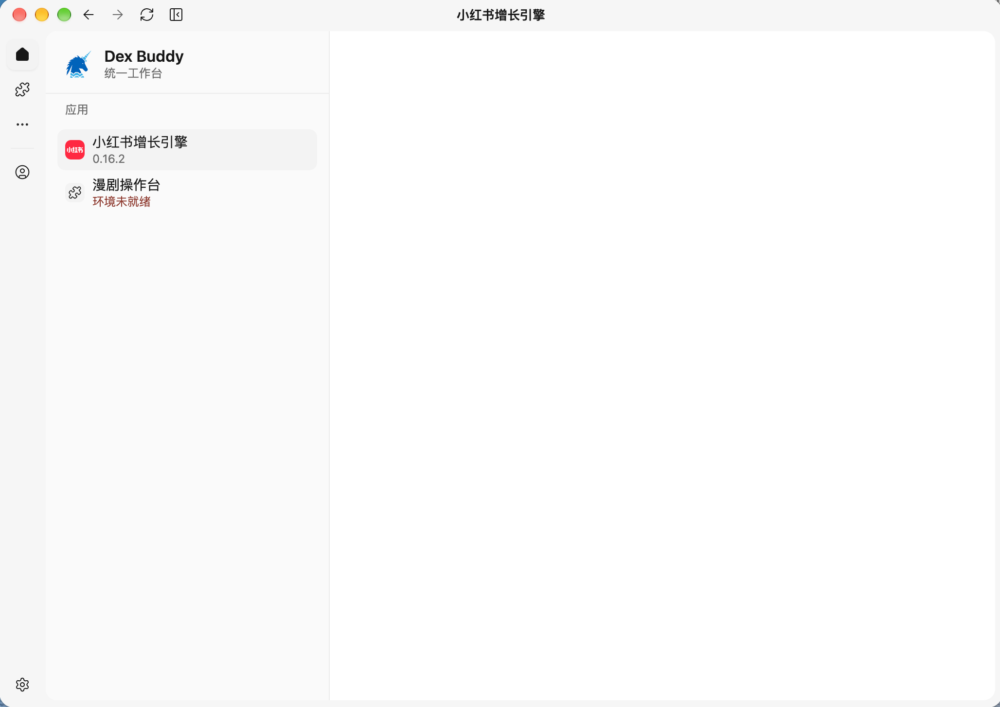
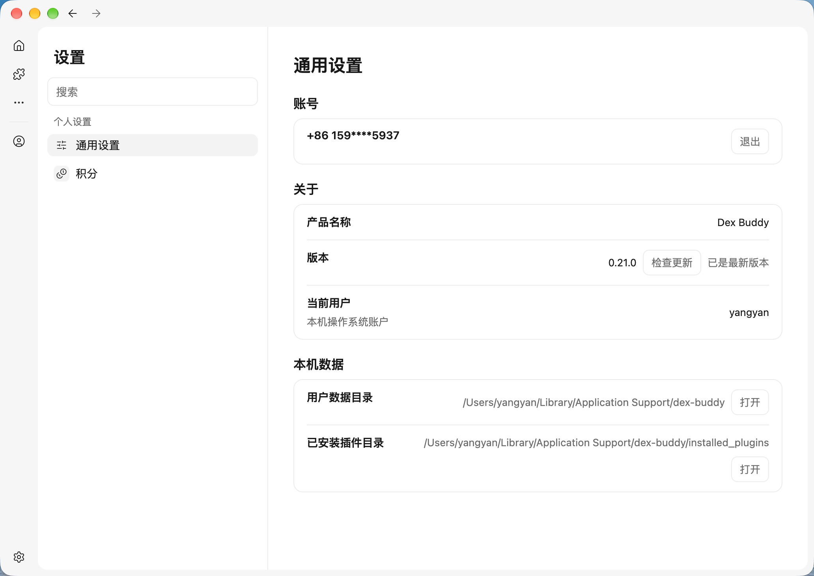
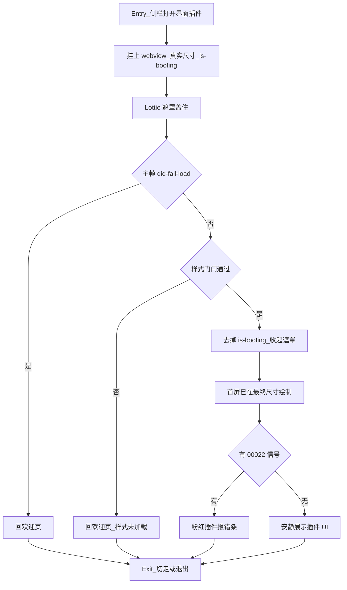
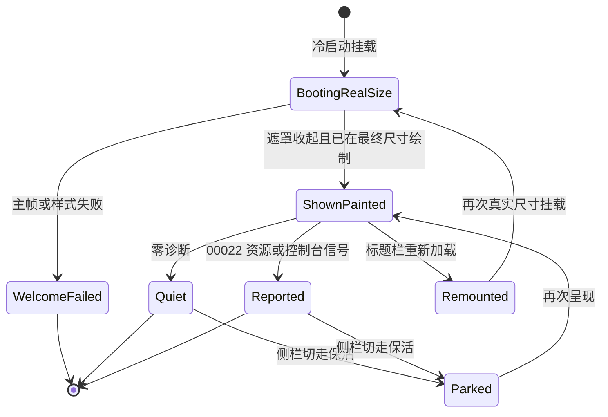

# PRD: 冷启动插件页不要收成 0×0

| 属性 | 值 |
|---|---|
| 状态 | 工程：accepted（见文末「工程验收状态」） |
| 范围 | 两件事：① 零诊断白屏仍可「复制启动信息」（宿主侧启动布局）；② 冷启动 webview 保持真实尺寸 + Lottie 遮罩，尝试避免 0×0 放大不补画。不做空 DOM 探测，不自动登出 |
| 来源需求 | 飞书需求池 `20261125_0029`（表 `1.0.DexBuddy-需求收集管理`，record `reczz28djQXgiYOS`）。产品类型「Dexbuddy客户端」 |
| 关联文档 | `specs/prds/prd-00009-plugin-view-keepalive.md`、`specs/prds/prd-00018-first-open-plugin-ready.md`、`specs/prds/prd-00022-plugin-page-diagnostics.md`、`docs/faqs/plugin-page-blank-no-error.md`、`docs/DESIGN.md` |
| 关联实现（现状） | `src/renderer/style.css`（`#viewport-host webview.is-booting`）、`src/renderer/plugin-views.js`（`finishLoad` / `present`）、`src/renderer/plugins.js`（`reloadActive`）、`src/renderer/plugin-boot.js` |
| 界面参考 | `specs/prds/images/prd-00023-plugin-boot-blank-repaint/` |
| 本期交付 | **只落本 PRD**。宿主 CSS / 挂载逻辑、DESIGN、FAQ 改写另开工程任务，不在本篇撰写阶段改代码 |

## 1. 背景与问题

来源需求 ID：`20261125_0029`。提出人（梦幻，MAC）描述：早上开机后提示 Dex Buddy 需要更新，更新到最新版本后，小红书插件右边操作界面变成一片空白；把 APP 退出后重新打开还是这样。

现场截图（侧栏选中小红书增长引擎 0.16.2，标题栏已是插件名，工作区全白；同侧栏漫剧行曾显示「环境未就绪」）：

通用设置确认宿主已是 0.21.0，且「已是最新版本」；本机用户 `yangyan`，用户数据在 `~/Library/Application Support/dex-buddy`：

维护者在对方机器上补充：

- 宿主 **0.21.0**。粉红「插件报错」条、侧栏悬停卡、插件详情三处都没有「一键复制错误信息」（**零诊断**）。
- 小红书与漫剧都是 Lottie 转圈消失后一片白。
- 漫剧点标题栏「重新加载」后界面出现；小红书再刷新仍白。
- 早上只退出应用再开仍白。之后退出应用、退出账号、再登录，界面恢复。
- 以前偶发白屏「过一阵又好了」；这次一直没好，直到重登。

### 现状与缺口（对照仓库）

- `0.21.0` 已落地 `prd-00022`：协议 404、分区 `webRequest`（script/stylesheet）、webview `console-message` warning/error 会下浮粉红条并可复制。本次三处入口都空，说明这些信号没有发生。
- Lottie 在主帧 `did-finish-load` 且样式门闩通过后由 `onLoaded` 收起（`plugin-views.js` → `finishLoad`）。转圈能消失 = 宿主已把这次打开当成成功，并去掉 `is-booting`。
- 冷启动挂上的 webview 带 `is-booting`。`style.css` 把它收成 **宽高 0** 且 `visibility: hidden`，目的是避免原生 webview 盖住 Lottie（与烧模型弹层藏 webview 同一类原因，见 `docs/DESIGN.md`）。
- 遮罩收起时去掉 `is-booting`，访客从 0×0 放大到工作区尺寸。macOS 上 Electron guest 在这种尺寸跳变后**经常不补画**，表现就是转圈没了、全白、没有任何报错。
- 标题栏「重新加载」对已安装插件会 `views.drop` 再 `openPlugin`（`plugins.js` `reloadActive`）：窗口布局已稳定后再挂一次。漫剧第二次挂载能画出界面，与「第一次 0×0 → 放大不补画」对得上。
- 卸载 / 重装只清插件目录、`plugin-runtime`、设置与 HTTP 缓存（`clearPluginPartitionCache`），**不清** `persist:hyplugin-*` 的 localStorage / IndexedDB，也不清 `plugin-data`。本次两个插件一起白、且零诊断，**主因不指向**单插件残留数据；重装不是本期主路径。

因此：00022 解决的是「打开成功但有原生失败信号却看不见」；本篇解决的是「打开成功、零信号、画面却没画出来」——宿主把「加载完成」和「已经在最终尺寸上画过」当成了同一件事。

### 为何不把「退出再登录」并进 Release 0

小红书在第二次挂载后仍白，退出账号再登录才恢复。宿主在 `createWindow` 之前已 `await gatewaySession.start()`（`src/main/index.ts`），窗口不会比会话启动更早出现。重登会换一轮令牌；若插件页在第一次 `dex.call` 失败时把整页留白且不打 console，00022 的粉红条也不会出现。这一截**证据不足、不能用 0×0 解释完**，记入开放项；本期**不**做成自动登出或空 DOM 探针。

## 2. 目标与非目标

### 目标

- **可汇报**：遮罩收起后记录宿主侧 webview 盒模型（收起前 / 后）；零诊断时插件详情「⋯」菜单提供「复制启动信息」（带 info 图标），正文含启动布局；有 00022 信号时粉红条复制正文同样带上启动布局。不因此下浮粉红条；不放在详情眉或侧栏悬停卡。
- **尝试修复**：带界面的插件在冷启动 / 首次挂上 webview 时，**保持工作区真实宽高**，由已有白底 Lottie 遮罩盖住访客，**不再**用 `width:0; height:0; visibility:hidden` 把 webview 收成零尺寸。
- 转圈在主帧与样式通过后收起时，访客页面已经在最终尺寸上布局并绘制过；使用者**不必**先点「重新加载」才看见界面（假设成立时）。
- 不引入新的粉红条误报（启动布局单独不触发粉红条）。
- `is-parked`（保活隐藏页）的现有行为可继续用「不占布局」策略；booting 与 parked **样式拆开**。

### 非目标

- 不削弱 `prd-00022` 的失败信号集合与粉红条触发条件；仅在复制文本与零诊断入口上增加启动布局。
- **不做**空 DOM /「页面有没有内容」启发式；**不**自动退出登录或强制刷新会话来「治」白屏。
- 不清插件 localStorage / IndexedDB，不做「重置插件网站数据」产品入口（可另立 PRD）。
- 不改小红书增长引擎或其他插件仓库里的页面与脚本。
- 不重做 `prd-00018` 样式门闩，不重做 `prd-00021` 更新后新包界面。
- 不在本篇回写飞书「需求状态」。
- 禁止定义 Release 2+。

### 成功标准

- 主验收：冷启动或宿主更新后首次打开界面插件，Lottie 收起后工作区出现插件界面（至少漫剧与小红书主路径），**无需**先点标题栏重新加载。
- 零诊断场景下不再出现「转圈消失 → 全白」作为冷启动常态；若仍有协议 / console 失败，仍走 00022 粉红条。
- 遮罩仍能盖住正在 booting 的 webview（原生层不得从遮罩「透出来」抢点击）；`docs/DESIGN.md` 写明 booting 用真实尺寸 + 遮罩，不用 0×0。
- 工程实现后相关 `pnpm test` 通过；若有纯 CSS/挂载契约可测点，用现有 `node:test` 覆盖，不依赖手点 Electron 才算过。

## 3. 术语

| 术语 | 含义 |
|---|---|
| 冷启动挂载 | 该插件 id 第一次在本会话创建 `<webview>` 并开始加载 `uiUrl` |
| `is-booting` | 访客尚未通过主帧 + 样式门闩时 webview 上的 class；收起 Lottie 前应保持 |
| 零尺寸藏页 | 现状：`is-booting` / `is-parked` 共用 `width:0; height:0; visibility:hidden` |
| 真实尺寸挂载 | webview 在 `#viewport-host` 内保持与工作区一致的宽高，由上层遮罩挡住视线与点击 |
| 重新挂载 | 标题栏「重新加载」对已安装插件：`drop` 后再 `openPlugin` |
| 零诊断 | 粉红条、悬停卡、详情眉均无「一键复制错误信息」 |
| 遮罩收起 | Lottie 被 `onLoaded` 关掉，表示主帧与样式门闩已通过 |

## 4. 已拍板规则 / 取舍

| 项 | 决定 |
|---|---|
| 现场主因（本期） | 冷启动 `is-booting` 零尺寸 → 放大后 macOS guest 不补画；两插件全白 + 零诊断 + 漫剧重挂即好，支持此结论 |
| 小红书须重登才好 | **开放项**。不并进 Release 0 自动登出；不据此否定 0×0 修复 |
| Booting 藏页方式 | **真实尺寸 + 现有 `#plugin-boot` Lottie 遮罩**（z-index / pointer-events 盖住）；禁止再用 0×0 作为 booting 手段 |
| `is-parked` | 保活隐藏页可继续不占布局；与 booting **拆开**样式规则，避免改 parked 误伤内存配额行为 |
| 诊断 | 不改 00022；本修复不新增粉红条文案 |
| 空内容探针 | **不做** |
| 卸载清网站数据 | **不做**（本期） |
| 依赖 | 不新增 npm 包 |
| Release | 仅 Release 0 |

### 取舍说明

- **为何改挂载尺寸而不是「多监听一个失败事件」：** 现场已经零诊断；再扩 00022 也听不到「没画出来」。问题在布局契约，不在缺一条错误通道。
- **为何保留 Lottie 遮罩：** DESIGN 已规定冷启动用遮罩挡住原生 webview；只把「缩小到 0」换成「尺寸正常、遮罩在上」，与弹层藏 webview 的动机一致，实现面更小。
- **为何不把重登写进 MVP：** 证据链断在插件侧或会话交互；乱自动登出会误伤正常会话。记开放项，有可复现步骤再单独立项。

## 5. 用户与角色

| 角色 | 目标 |
|---|---|
| 终端使用者 | 更新或冷开后点开插件就能看见界面，不必先猜要不要刷新或重登 |
| 支持 / 维护者 | 少收「全白又没报错」的工单；若仍白且有 00022 信号，仍能复制诊断 |
| 宿主工程 | 只改 booting 布局与遮罩叠放；parked 与诊断边界清晰 |
| 插件作者 | 页面在最终尺寸上首次布局；宿主不改插件仓库 |

## 6. 功能域

### 6.1 Booting 布局

- `is-booting` 的 webview：**占满** `#viewport-host` 的可用宽高（与热态一致的 flex 布局）。
- 视觉与点击：由 `#plugin-boot`（或等价遮罩）盖住；webview 不得透出抢点击。
- `finishLoad` 成功后去掉 `is-booting`、收起遮罩；此时 guest 已在真实尺寸上加载过，无需依赖「从 0 放大」触发补画。

### 6.2 与 parked / 重新加载

- `is-parked`：继续现有「不占布局」策略即可；样式选择器与 `is-booting` 分离。
- 标题栏重新加载、内存逐出后再开：仍可走现有 drop + mount；主路径应不再**依赖**重新加载才能看见第一屏。

### 6.3 与 00022 / 门闩

- 主帧失败、样式门闩失败：行为不变（回欢迎页等）。
- 有资源 / console 信号：仍走粉红条。本修复不替代诊断。

## 7. 用户故事地图与版本切片

### 7.1 旅程主干

| 步骤 | 节点 | 说明 |
|---|---|---|
| Entry | 冷开或更新后从侧栏打开界面插件 | 宿主准备分区并挂上 webview |
| 1 | Booting 真实尺寸 | webview 占满工作区；Lottie 遮罩在上 |
| 2 | 主帧 + 样式门闩 | 失败 → 现有欢迎页路径；成功 → 去掉 `is-booting`、收起遮罩 |
| 3 | 首屏可见 | 使用者看见插件 UI，无需先点重新加载 |
| 4 | 可选诊断 | 若有 00022 信号则粉红条；零信号则安静 |
| Exit(Teardown) | 切走 / 卸载 / 退出应用 | parked 或拆页按现有保活与配额；不把 booting 零尺寸带回 |

### 7.2 用户故事地图

| 阶段 | 目标 | 故事 | 验收要点 |
|---|---|---|---|
| 冷开 | 第一次就有界面 | 作为使用者，我想更新或冷开后第一次点开界面插件就能看见内容，以便不用猜要不要刷新 | Lottie 收起后工作区有插件 UI；至少覆盖漫剧与小红书主路径 |
| 冷开 | 不必先重挂 | 作为使用者，我想不必先点「重新加载」才出界面，以便少一步折腾 | 主路径上不依赖 `reloadActive` 才首次可见 |
| 冷开 | 遮罩仍挡住 | 作为使用者，我想转圈时点不到底下半成品页，以便手感与现在一致 | booting 期间遮罩盖住；webview 真实尺寸但不抢点击 |
| 保活 | 隐藏页照旧 | 作为使用者，我想侧栏互切仍保持已开插件，以便不重做保活 | `is-parked` 行为与 `prd-00009` 一致；样式与 booting 拆开 |
| 诊断 | 真报错仍可见 | 作为使用者，我想文件 404 或脚本报错时仍有粉红条，以便还能复制给支持 | 不削弱 00022；本修复不新增误报 |
| 工程 | 可回归 | 作为工程，我想 DESIGN 写明 booting 不用 0×0，以便以后别又改回去 | DESIGN 更新；相关测试或契约断言通过 |

### 7.3 Release 切片

#### Release 0（MVP）

可验收结果：

- `is-booting` 改为真实尺寸 + Lottie 遮罩；与 `is-parked` 样式拆分。
- 冷开 / 更新后首次打开界面插件，转圈消失后有 UI，无需先重新加载（主路径：漫剧、小红书）。
- 00022 诊断行为不变；无新粉红条误报。
- `docs/DESIGN.md`（及必要时 FAQ）写明 booting 契约。
- 不新增依赖；不改插件仓库；不自动登出。

本期不做：空 DOM 探针；自动退出登录；卸载时清网站数据；改 00022 信号集合。无 Release 1。

## 8. 核心流程与状态机图

`BootingRealSize` 禁止回到「零尺寸 booting」。`Remounted` 是增强路径，不是冷开主路径的必经步骤。小红书「须重登」不进入本状态机产品边；见开放项。

## 9. 数据与 API 衔接

- 不新增飞书字段。frontmatter 已挂 `demand_id` / `demand_record_id` / `demand_source`。
- 不新增 IPC 通道；纯渲染层 CSS / class 与现有 `plugin-boot` 遮罩。
- 不读、不写插件 `plugin-data` 与页面 localStorage。
- 不新增 npm 依赖。

## 10. 假设与待确认 / 开放项

| 项 | 状态 |
|---|---|
| 漫剧重挂即好、两插件零诊断全白 | 已定：支持冷启动 0×0 不补画为本期主因 |
| 小红书重挂仍白、退出再登录才好 | **开放**。可能与插件首屏 `dex.call` / 会话有关；本期不自动登出 |
| 晨间截图漫剧「环境未就绪」 | 记录现场；与「后来两插件都白」可并存（环境未就绪是另一条 UI）。本期仍以全白 + 零诊断主路径为准 |
| Windows 是否同症 | 开放。规则按挂载契约改，不按 OS 分叉；有证据再补验收机 |
| 是否在本篇回写飞书为进行中 | 已定：不回写；落盘后另用飞书需求管理工程师「回写 开工」 |
| `is-parked` 是否一并改真实尺寸 | 已定：本期不改 parked 零尺寸策略，只拆选择器 |

## 11. 修订记录

| 日期 | 说明 |
|---|---|
| 2026-11-25 | 初稿。依据飞书 `20261125_0029` 与维护者现场：0.21.0 零诊断、两插件转圈后全白、漫剧重挂即好、小红书须重登；本期只修 booting 0×0 |
| 2026-11-25 | 修订：根因未闭环。R0 改为两件事——零诊断可复制启动布局 + 尝试 booting 不用 0×0 |
| 2026-11-25 | 工程验收：Release 0 通过，`status=accepted` |
| 2026-11-25 | 复验：入口改为详情「⋯」菜单；`status=accepted` 维持 |

## 12. 工程验收状态

> 由 `/team:prd-accept` 维护；勿手工编造「通过」。最后更新：2026-11-25T09:56:42Z，prd/00023-plugin-boot-blank-repaint@工作区（相对 `f16666b`），范围：R0。

### 总览

- 工程状态：`accepted`
- 验收判定：Release 0 范围内能力均有仓库证据；本期无 Release 1（标范围外）
- 最近验收：2026-11-25T09:56:42Z
- 代码提交：分支 `prd/00023-plugin-boot-blank-repaint`（验收时尚未单独 commit）
- 摘要：
  - 零诊断时详情「⋯」→「复制启动信息」（info 图标）；复制文本含启动布局
  - `is-booting` 与 `is-parked` 样式拆开；booting 保持真实尺寸 + Lottie 遮罩
  - `formatBootLayoutSize` / `hasBootLayoutReport` 单测；`pnpm test` 272 通过
  - DESIGN / FAQ / doc_index 已同步；重登路径仍为开放项

### Release 交付

| Release | 状态 | 说明 |
|---|---|---|
| Release 0 | 通过 | 可汇报 + 尝试修 0×0 |
| Release 1 | 范围外 | 本期无 R1 |

### 功能验收清单（Agent 优先读此表）

| ID | 能力摘要 | Release | 状态 | 证据 |
|---|---|---|---|---|
| S2-1 | booting 不用 0×0，与 parked 拆开 | R0 | 通过 | `src/renderer/style.css` `#viewport-host webview.is-booting` / `.is-parked` |
| S2-2 | 复制文本含启动布局 during/after | R0 | 通过 | `plugin-diagnostics.js` `formatDiagnosticText`；`test/plugin-diagnostics.test.ts` |
| S2-3 | 零诊断时详情「⋯」菜单「复制启动信息」 | R0 | 通过 | `plugins.js` `hasBootReport`；`plugins-page.js` `moreMenu` 插入 info 项 |
| S2-4 | pnpm test 绿 | R0 | 通过 | 本轮 272 pass |

### 未完成与遗留

- 窗口内「冷开必出界面」人眼验收留给 `/team:test-enginer`
- 开放项：小红书须退出再登录才好（不在本期自动登出）
- 本验收时分支上改动尚未 git commit

### 质量检查

| 检查项 | 状态 |
|---|---|
| pnpm test | 通过（272） |
| 文档同步（DESIGN / FAQ / doc_index） | 通过 |

---
统计：通过 4 / 部分 0 / 未实现 0 / 范围外 1
