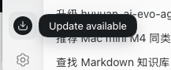
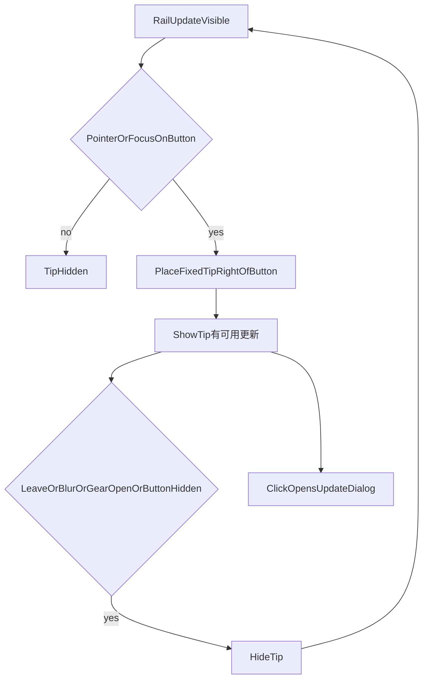
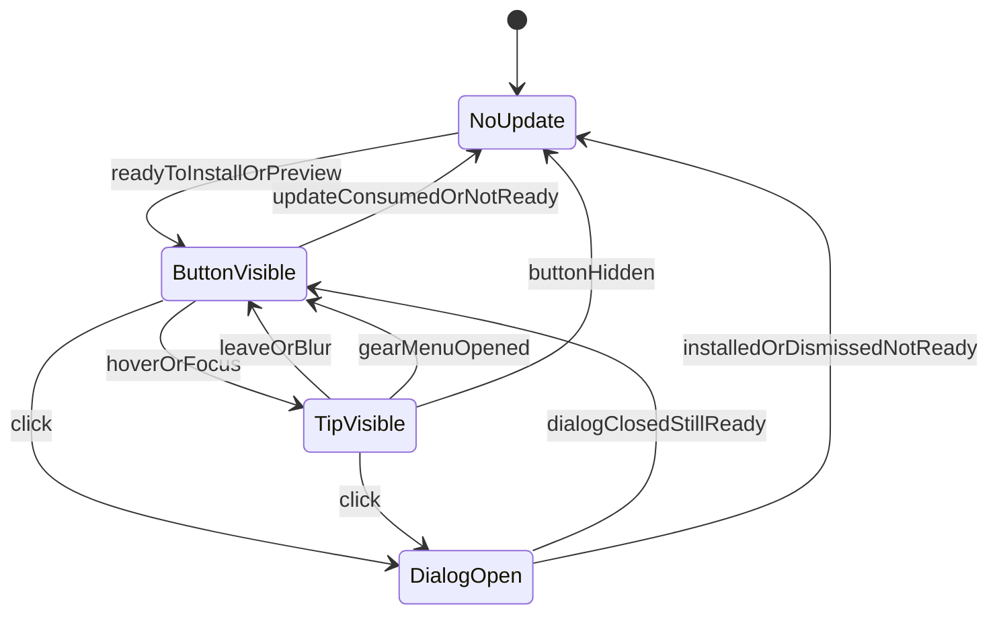

# PRD: 图标轨下载钮悬停「有可用更新」

| 属性 | 值 |
|---|---|
| 状态 | 工程：accepted（见文末「工程验收状态」） |
| 范围 | 有可安装更新时，图标轨 `#rail-update` 悬停 / 聚焦出现深色短句提示「有可用更新」；抽出与插件目录提示共用的悬停提示控件。不改检查更新与下载安装流程 |
| 关联文档 | `docs/DESIGN.md`、`docs/faqs/how-to-prevent-popup-clipping.md`、`docs/build-and-release.md`、`specs/prds/prd-00002-workbench-chrome.md`、`specs/prds/prd-00005-system-settings.md` |
| 关联实现（现状） | `src/renderer/ui/hover-tip.js`、`src/renderer/updater.js`、`src/renderer/plugins-page.js`、`src/renderer/chrome.js`、`src/renderer/style.css`（`.hover-tip`）、`src/renderer/index.html`（`#rail-update`） |
| 界面参考 | `specs/prds/images/prd-00024-rail-update-tooltip/01-rail-update-tooltip-ref.png` |
| 本期交付 | **只落本 PRD**。壳样式 / 共用控件 / DESIGN 回写另开工程任务，不在本篇撰写阶段改代码 |

## 1. 背景与问题

打包后的 Windows / macOS 在有可安装更新时，图标轨齿轮上方会出现一颗 32px 正圆、底色 `--status`、白色下载箭头的按钮（`#rail-update`）。点击打开既有更新对话框；齿轮菜单里也有「下载 vX / 安装 vX」。

现状缺口：鼠标移到这颗蓝钮上时，**没有任何可见提示**。使用者只能靠图标形状猜含义，或依赖 `aria-label`（读屏可见，普通人看不见）。参考交互是悬停后在按钮右侧弹出一句黑底白字短句（参考图）：

### 现状与缺口（对照仓库）

- `showUpdateDot` 仅在 `readyToInstall` 时为真；`syncUpdateChrome` 据此显示 `#rail-update`（开发预览 `forceUpdateIcon` 也可显示）。
- 按钮已有 `aria-label`（「下载新版本」或「重启并安装更新」），但没有 `role="tooltip"` 的可见气泡。
- 本仓壳是原生 HTML / CSS / JS + Lucide，**不是** shadcn / React / Tailwind。截图里的黑底短句，已有对应物：插件详情文件夹旁的 `.plugin-folder-tip`（底 `--ink`、字 `--paper`、圆角 8、`position: fixed`、`pointer-events: none`）。
- 齿轮弹出层与账号弹出层是白底可点菜单，不适合承载这句只读提示。
- DESIGN 约定：控件第二次出现再抽到 `src/renderer/ui/`。目录提示是第一次，本需求是第二次，实现时必须抽出共用控件。

### 为何现在做

蓝钮已经是「有更新」的主视觉入口；缺少一句可见标签，发现成本高、与参考产品不一致。改动面小，不碰更新管道。

## 2. 目标与非目标

### 目标

- 当 `#rail-update` 可见时，指针悬停或键盘聚焦该钮，右侧出现深色提示，文案固定为 **「有可用更新」**。
- 移开指针或失焦后提示立刻消失；钮隐藏时提示不得残留。
- 视觉与行为对齐现有 `.plugin-folder-tip`（深底短句），定位用 `position: fixed` 挂到 `document.body`，避免被轨或主区裁切。
- 实现时抽出共用悬停提示（建议 `src/renderer/ui/`），目录提示与下载钮提示都走它。
- 点击蓝钮仍打开既有更新对话框；Mac / Windows 平台差异仍由对话框与齿轮菜单表达。

### 非目标

- 不改自动检查更新、下载、安装、进度条、对话框文案与出现条件。
- 不在提示里显示版本号（版本继续在对话框与齿轮菜单）。
- 不给标题栏「重新加载」或其它轨按钮加提示气泡（DESIGN 已写重新加载没有提示气泡）。
- 不引入 shadcn、React、Tailwind 或新的 npm 依赖。
- 不把提示做成可点的 Popover / 菜单；不在齿轮上恢复蓝点方案。
- 禁止定义 Release 2+；本文不写 Release 1。

### 成功标准

- `readyToInstall`（或开发预览强制显示蓝钮）时，悬停 / 聚焦蓝钮可见「有可用更新」；移开 / 失焦后消失。
- 提示在钮右侧约 8px、垂直大致居中；不被 `#rail` 或主区裁切。
- 打开齿轮菜单时提示收起，不与白底菜单叠在一起。
- 目录提示与下载钮提示共用抽出后的控件 API；`docs/DESIGN.md` 补上蓝钮悬停提示一句。
- 相关 `pnpm test` 通过；若有纯逻辑可测点（显示条件、文案常量），用现有 `node:test` 覆盖。

## 3. 术语

| 术语 | 含义 |
|---|---|
| 蓝钮 / `#rail-update` | 图标轨齿轮上方、有可安装更新时出现的正圆下载按钮 |
| 悬停提示 | 只读、不可点的短句气泡；`role="tooltip"`；对齐 `.plugin-folder-tip` |
| 可安装更新 | 更新状态为 `readyToInstall`；`showUpdateDot` 为真 |
| 共用悬停提示控件 | 第二次出现后抽到 `src/renderer/ui/` 的 show/hide/place API |
| 更新对话框 | 既有 `#update-dialog`：确认下载 / 安装与进度 |

## 4. 已拍板规则 / 取舍

| 项 | 决定 |
|---|---|
| 控件体系 | 原生壳 + DESIGN；**不是** shadcn。用深色悬停提示，对齐 `.plugin-folder-tip` |
| 文案 | 固定中文「有可用更新」；不写英文 Update available；提示内不带版本号 |
| 平台 | Mac（dmg）与 Windows（自动安装）同一句提示 |
| 触发 | 指针进入与键盘聚焦显示；离开与失焦隐藏；无延迟要求（与目录提示一致，立刻显示） |
| 位置 | 钮右侧约 8px、垂直居中；`fixed`；视口边缘需钳制时优先保证完整可见 |
| 与齿轮菜单 | 齿轮菜单打开时收起提示 |
| 出现条件 | 仅蓝钮可见时；钮 `hidden` 时不创建或立刻隐藏提示 |
| 抽取 | 本需求落地时必须抽出共用控件；目录提示一并迁入 |
| 依赖 | 不新增 npm 包 |
| Release | 仅 Release 0 |

### 取舍说明

- **为何不用 `title` 原生气泡：** 系统气泡样式不可控，与 DESIGN 深色短句不一致，也无法保证右侧定位。
- **为何不用白底齿轮 / 账号弹出层：** 那些是可点菜单；本句只读、无动作。
- **为何文案不含版本：** 版本已在对话框与齿轮行；悬停只回答「这颗蓝钮是什么」。
- **为何现在抽到 `ui/`：** DESIGN 门槛是第二次出现；本需求正好跨过门槛，避免第三处再复制一份。

## 5. 用户与角色

| 角色 | 目标 |
|---|---|
| 桌面用户（主） | 看见蓝钮时立刻明白「有可用更新」，并仍可一点打开安装 / 下载流程 |
| 键盘用户 | 焦点落到蓝钮时同样看见提示（不只依赖读屏 `aria-label`） |
| 验收 / 工程 | 按 DESIGN 与既有 tip 模式落地，不引入新组件栈 |

## 6. 功能域

| 域 | 说明 |
|---|---|
| 显示条件 | 跟随 `syncUpdateChrome`：蓝钮显示则提示可触发；隐藏则提示不可见 |
| 交互 | `pointerenter` / `pointerleave`、`focus` / `blur`；可选与目录提示同一套 place 函数 |
| 视觉 | 底 `--ink`、字 `--paper`、约 12px（`--text-meta`）、圆角 8、阴影 `--shadow`、`pointer-events: none` |
| 共用控件 | 新建 `src/renderer/ui/`（或等价路径）导出挂载 / 显示 / 隐藏 / 摆放；`plugins-page` 目录 tip 与 `updater` 蓝钮共用 |
| 文档 | 实现后回写 `docs/DESIGN.md` 图标轨段落：蓝钮悬停显示「有可用更新」 |

## 7. 用户故事地图与版本切片

### 7.1 旅程主干表

#### 旅程 A：悬停发现更新（主路径）

| 步骤 | Entry / 动作 | Exit |
|---|---|---|
| A0 | Entry：打包机上更新状态变为 `readyToInstall`，蓝钮出现 | 用户看见齿轮上方蓝钮 |
| A1 | 鼠标移到蓝钮 | 右侧出现「有可用更新」 |
| A2 | 鼠标移开 | 提示消失，蓝钮仍在 |
| A3 | Exit：点击蓝钮 | 打开既有更新对话框。Teardown：提示在点击前或失焦时已收起 |

#### 旅程 B：键盘聚焦

| 步骤 | Entry / 动作 | Exit |
|---|---|---|
| B0 | Entry：蓝钮可见 | Tab 焦点落到蓝钮 |
| B1 | 提示出现「有可用更新」 | 用户读到可见标签 |
| B2 | Exit：焦点离开 | 提示消失 |

#### 旅程 C：打开齿轮菜单

| 步骤 | Entry / 动作 | Exit |
|---|---|---|
| C0 | Entry：蓝钮可见，提示可能正显示 | 用户打开齿轮菜单 |
| C1 | Exit：提示收起；菜单内仍可点「下载 vX / 安装 vX」 | Teardown：关菜单后悬停蓝钮可再出提示 |

#### 旅程 D：无更新 / 钮隐藏

| 步骤 | Entry / 动作 | Exit |
|---|---|---|
| D0 | Entry：状态不是可安装更新，蓝钮 `hidden` | 轨上无蓝钮 |
| D1 | Exit：不出现「有可用更新」气泡 | Teardown：无残留节点挡点击 |

#### 旅程 E：下载进行中（对照）

| 步骤 | Entry / 动作 | Exit |
|---|---|---|
| E0 | Entry：用户已从对话框开始下载；蓝钮是否仍显示由现有 `showUpdateDot` 决定 | 本篇不改显示条件 |
| E1 | Exit：若蓝钮仍在，悬停仍是「有可用更新」；进度仍只在对话框 | 不另起下载态文案 |

### 7.2 用户故事地图

| 阶段 | 目标 | 故事 | 验收要点 |
|---|---|---|---|
| 发现 | 认出蓝钮含义 | 作为用户，我想悬停下载钮时看到「有可用更新」，以便确认这是应用更新入口 | 蓝钮可见时悬停右侧出现该中文短句；样式为深底白字 |
| 可达 | 键盘同等 | 作为键盘用户，我想聚焦该钮时也看到同一句，以便不依赖鼠标 | focus 显示、blur 隐藏 |
| 行动 | 仍能安装 | 作为用户，我想点蓝钮继续走原来的下载 / 安装对话框 | 点击行为与改前一致 |
| 清理 | 不挡界面 | 作为用户，我不想提示挡住齿轮菜单或残留在屏幕上 | 开齿轮时提示收起；钮隐藏时无残留 |
| 一致 | 控件复用 | 作为工程，我想目录 tip 与蓝钮 tip 共用一套控件，以便符合 DESIGN 抽取门槛 | 存在共用模块；两处调用同一 API |

### 7.3 Release 切片

#### Release 0（MVP，必选）

1. `#rail-update` 可见时，悬停与聚焦显示「有可用更新」；离开与失焦隐藏。
2. 提示视觉对齐 `.plugin-folder-tip`；定位在钮右侧约 8px、垂直居中，`position: fixed`，视口内钳制。
3. 齿轮菜单打开时收起提示；蓝钮隐藏时提示不可见。
4. 抽出共用悬停提示控件；插件目录 tip 迁入同一实现。
5. 回写 `docs/DESIGN.md` 一句：有更新时蓝钮悬停显示「有可用更新」。
6. 点击蓝钮、更新对话框、检查更新逻辑保持现状。

本文不定义 Release 1。溢出项进 §非目标或 §开放项。

## 8. 核心流程与状态机图

### 8.1 悬停提示主流程

### 8.2 蓝钮与提示状态

死胡同预警：若 tip 用 `position: absolute` 挂在 `#rail` 内且祖先有 `overflow: hidden`，提示会被裁成一条或看不见——必须 `fixed` + 按 `getBoundingClientRect` 摆放（见 `docs/faqs/how-to-prevent-popup-clipping.md`）。若抽出控件时漏迁目录 tip，会出现两套样式漂移。

## 9. 数据与 API 衔接

本仓不建业务库表。不新增更新 IPC。沿用既有 updater 状态推送与 `showUpdateDot` / `syncUpdateChrome`。

| 通道 / 符号 | 用途 |
|---|---|
| 现有 updater status | 决定蓝钮显示；本篇只读 |
| `#rail-update` | 锚点按钮 |
| 共用 tip 模块（新建） | show / hide / place；文案由调用方传入 |

渲染层可增加常量如「有可用更新」；无需网关。

## 10. 假设与待确认

### 假设

- 参考图语义为「Update available」；产品文案采用中文「有可用更新」。
- `readyToInstall` 时蓝钮显示条件保持不变；开发预览 `forceUpdateIcon` 同样可验收提示。
- `#rail` 当前无会裁切 `fixed` 子树的 `transform` / `filter`；若日后加上，须改挂载策略（FAQ 已警告）。

### 开放项

- 是否在 `aria-describedby` 关联 tip 节点：工程可按无障碍最佳实践补上，不改变可见文案。
- tip 圆角是否从 8 改为更「胶囊」：默认保持与 `.plugin-folder-tip` 一致的 8；若 DESIGN 评审要更圆，只改共用样式一处。

### 冲突与决议需求

- `prd-00002` 曾写齿轮蓝点；现行 DESIGN 已改为齿轮上方蓝钮。本篇以 DESIGN 与现实现为准，不恢复蓝点。
- 标题栏重新加载「没有提示气泡」保持不变；本篇只覆盖蓝钮。

## 11. 修订记录

| 日期 | 说明 |
|---|---|
| 2026-11-26 | 初稿。蓝钮悬停 / 聚焦「有可用更新」；对齐 plugin-folder-tip；第二次出现抽出共用控件；仅 Release 0 |
| 2026-11-26 | 工程落地 R0：共用 `hover-tip`、蓝钮右侧提示、齿轮打开收起；验收 accepted |
| 2026-11-26 | 修 clear 误删常驻 tip；`/team:prd-accept` 关闭 PRD（R0 accepted） |

## 12. 工程验收状态

> 由 `/team:prd-accept` 维护；勿手工编造「通过」。最后更新：2026-11-26T02:43:18Z，prd/00024-rail-update-tooltip@工作区（相对 `d05f998`），范围：R0。

### 总览

- 工程状态：`accepted`
- 验收判定：Release 0 范围内能力均有仓库证据；本期无 Release 1（标范围外）
- 最近验收：2026-11-26T02:43:18Z
- 代码提交：分支 `prd/00024-rail-update-tooltip`（验收时尚未单独 commit）
- 摘要：
  - 共用 `src/renderer/ui/hover-tip.js`；目录 tip 与蓝钮 tip 同 API
  - 蓝钮悬停 / 聚焦「有可用更新」，右侧放置；`aria-describedby` + Escape 关闭
  - 齿轮打开与钮 `hidden` 收起 tip；点击仍开更新对话框
  - `clearHoverTips` 只清 `.plugin-folder-tip`，不误删 `#rail-update-tip`
  - DESIGN / doc_index 已同步；`pnpm test` 277 通过

### Release 交付

| Release | 状态 | 说明 |
|---|---|---|
| Release 0 | 通过 | 悬停提示 + 抽出共用控件 + 切页不误删 |
| Release 1 | 范围外 | 本期无 R1 |

### 功能验收清单（Agent 优先读此表）

| ID | 能力摘要 | Release | 状态 | 证据 |
|---|---|---|---|---|
| S2-1 | 共用 tip 模块，目录与蓝钮共用 | R0 | 通过 | `src/renderer/ui/hover-tip.js`；`plugins-page.js` / `updater.js` `createHoverTip`/`bindHoverTip` |
| S2-2 | 文案「有可用更新」，right 放置 | R0 | 通过 | `RAIL_UPDATE_TIP_TEXT`；`placement: 'right'`；`test/hover-tip.test.ts` |
| S2-3 | 齿轮打开 / 钮 hidden 收起 tip | R0 | 通过 | `chrome.js` `hideAllHoverTips`；`updater.js` `syncUpdateChrome` / `openUpdateDialog` |
| S2-4 | DESIGN 已写蓝钮悬停句 | R0 | 通过 | `docs/DESIGN.md`；`docs/doc_index.md` |
| S2-5 | 插件页清理不摘轨上常驻 tip | R0 | 通过 | `FOLDER_HOVER_TIP_CLEAR_SELECTOR === '.plugin-folder-tip'`；`test/hover-tip.test.ts` |

### 未完成与遗留

- 窗口内悬停人眼抽检可留给 `/team:test-enginer`（`forceUpdateIcon: true`）；工程侧代码证据已齐
- tip 圆角仍 8（与目录 tip 一致），未改胶囊形
- 本验收时分支上改动尚未 git commit

### 质量检查

| 检查项 | 状态 |
|---|---|
| pnpm test | 通过（277） |
| 文档同步（DESIGN / doc_index） | 通过 |

---
统计：通过 5 / 部分 0 / 未实现 0 / 范围外 1
